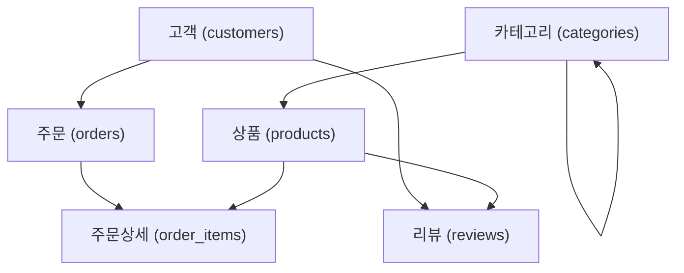

# [실습 미션] MENTORMALL 쇼핑몰 스키마 구축 및 DDL 마스터

본 실습 미션은 [02_ddl_guide.md](file:///c:/Users/up/Documents/GitHub/kor-dbms-class/02_ddl_guide.md)에서 학습한 DDL(CREATE, ALTER, RENAME, TRUNCATE, DROP) 및 제약조건을 온라인 쇼핑몰 **MENTORMALL** 데이터베이스 구축 시나리오를 통해 종합적으로 연습하는 과정입니다.

---

## 📌 실습 개요 및 환경 설정

- **실습 접속 계정**: `MANTORMALL` (관리자 `SYSTEM` 계정이 아닌 실습용 일반 사용자 세션에서 진행)
- **주요 목표**:
  1. 테이블 간 참조 관계(외래키)를 고려한 올바른 생성 순서 이해
  2. 제약조건(PK, FK, UNIQUE, CHECK, NOT NULL, DEFAULT)의 올바른 적용
  3. 비즈니스 요구사항 변경에 따른 `ALTER TABLE` 명령 활용
  4. 테이블 복제(CTAS), 테이블명 변경, 데이터 초기화 및 영구 삭제 실습
  5. 데이터 사전(Data Dictionary)을 통한 객체 생성 결과 검증

---

## 🗺️ 테이블 관계도 및 생성 순서 가이드

외래키(FOREIGN KEY)가 설정된 테이블은 **참조 대상이 되는 부모 테이블이 먼저 생성**되어 있어야 오류(`ORA-00942: 테이블 또는 뷰가 존재하지 않습니다`)가 발생하지 않습니다.



> [!IMPORTANT]
> **권장 생성 순서**:
> 1. **1단계 (독립 부모 테이블)**: `customers`, `categories`
> 2. **2단계 (1차 참조 테이블)**: `products`, `orders`
> 3. **3단계 (2차 복합 참조 테이블)**: `order_items`, `reviews`

---

## 🚀 Mission 1: 쇼핑몰 핵심 테이블 생성 (CREATE TABLE)

아래 명세서를 참고하여 각 테이블을 순서에 맞게 생성하세요.

### 1-1. 고객 테이블 (`customers`)
- **컬럼 명세**:
  - `customer_id`: 숫자형, 기본키(PRIMARY KEY)
  - `name`: 가변문자(100), 필수 입력(NOT NULL)
  - `email`: 가변문자(100), 중복 불가(UNIQUE)
  - `phone`: 가변문자(20), 중복 불가(UNIQUE)
  - `registered_date`: 날짜형, 기본값 현재 날짜(`SYSDATE`)
  - `is_active`: 고정문자(1), 기본값 `'Y'`, `'Y'` 또는 `'N'`만 허용하는 CHECK 제약조건

<details>
<summary>🔍 정답 확인 (1-1 customers)</summary>

```sql
CREATE TABLE customers (
    customer_id      NUMBER PRIMARY KEY,
    name             VARCHAR2(100) NOT NULL,
    email            VARCHAR2(100) UNIQUE,
    phone            VARCHAR2(20) UNIQUE,
    registered_date  DATE DEFAULT SYSDATE,
    is_active        CHAR(1) DEFAULT 'Y' CHECK (is_active IN ('Y', 'N'))
);
```
</details>

---

### 1-2. 카테고리 테이블 (`categories`)
- **컬럼 명세**:
  - `category_id`: 숫자형, 기본키(PRIMARY KEY)
  - `parent_id`: 숫자형, 상위 카테고리의 `category_id`를 참조하는 외래키 (제약조건명: `fk_categories_parent`)
  - `category_name`: 가변문자(100), 필수 입력(NOT NULL)
  - `category_level`: 숫자(1자리), `1`, `2`, `3`만 입력 가능하도록 CHECK 제약조건 설정

<details>
<summary>🔍 정답 확인 (1-2 categories)</summary>

```sql
CREATE TABLE categories (
    category_id     NUMBER PRIMARY KEY,
    parent_id       NUMBER,
    category_name   VARCHAR2(100) NOT NULL,
    category_level  NUMBER(1) CHECK (category_level IN (1, 2, 3)),
    CONSTRAINT fk_categories_parent FOREIGN KEY (parent_id)
        REFERENCES categories(category_id)
);
```
</details>

---

### 1-3. 상품 테이블 (`products`)
- **컬럼 명세**:
  - `product_id`: 숫자형, 기본키(PRIMARY KEY)
  - `name`: 가변문자(200), 필수 입력(NOT NULL)
  - `category_id`: 숫자형, `categories` 테이블의 `category_id`를 참조하는 외래키 (제약조건명: `fk_products_category`)
  - `price`: 숫자(전체 10자리, 소수점 2자리)
  - `stock_quantity`: 숫자형 (재고수량)
  - `created_at`: 날짜형, 기본값 현재 날짜(`SYSDATE`)

<details>
<summary>🔍 정답 확인 (1-3 products)</summary>

```sql
CREATE TABLE products (
    product_id      NUMBER PRIMARY KEY,
    name            VARCHAR2(200) NOT NULL,
    category_id     NUMBER,
    price           NUMBER(10, 2),
    stock_quantity  NUMBER,
    created_at      DATE DEFAULT SYSDATE,
    CONSTRAINT fk_products_category FOREIGN KEY (category_id)
        REFERENCES categories(category_id)
);
```
</details>

---

### 1-4. 주문 테이블 (`orders`)
- **컬럼 명세**:
  - `order_id`: 숫자형, 기본키(PRIMARY KEY)
  - `customer_id`: 숫자형, 필수 입력(NOT NULL), `customers` 테이블의 `customer_id`를 참조하는 외래키 (제약조건명: `fk_orders_customer`)
  - `order_date`: 날짜형, 기본값 현재 날짜(`SYSDATE`)
  - `status`: 가변문자(20), 기본값 `'결제대기'`, (`'결제대기'`, `'결제완료'`, `'배송중'`, `'배송완료'`, `'취소'`) 값만 허용하는 CHECK 제약조건 설정

<details>
<summary>🔍 정답 확인 (1-4 orders)</summary>

```sql
CREATE TABLE orders (
    order_id     NUMBER PRIMARY KEY,
    customer_id  NUMBER NOT NULL,
    order_date   DATE DEFAULT SYSDATE,
    status       VARCHAR2(20) DEFAULT '결제대기'
                     CHECK (status IN ('결제대기', '결제완료', '배송중', '배송완료', '취소')),
    CONSTRAINT fk_orders_customer FOREIGN KEY (customer_id)
        REFERENCES customers(customer_id)
);
```
</details>

---

### 1-5. 주문 상세 테이블 (`order_items`)
- **컬럼 명세**:
  - `order_item_id`: 숫자형, 기본키(PRIMARY KEY)
  - `order_id`: 숫자형, 필수 입력(NOT NULL), `orders` 테이블 참조 외래키 (제약조건명: `fk_order_items_order`)
  - `product_id`: 숫자형, 필수 입력(NOT NULL), `products` 테이블 참조 외래키 (제약조건명: `fk_order_items_product`)
  - `quantity`: 숫자형, 필수 입력(NOT NULL)
  - `price_each`: 숫자(10, 2) (개별 상품 단가)

<details>
<summary>🔍 정답 확인 (1-5 order_items)</summary>

```sql
CREATE TABLE order_items (
    order_item_id  NUMBER PRIMARY KEY,
    order_id       NUMBER NOT NULL,
    product_id     NUMBER NOT NULL,
    quantity       NUMBER NOT NULL,
    price_each     NUMBER(10, 2),
    CONSTRAINT fk_order_items_order FOREIGN KEY (order_id)
        REFERENCES orders(order_id),
    CONSTRAINT fk_order_items_product FOREIGN KEY (product_id)
        REFERENCES products(product_id)
);
```
</details>

---

### 1-6. 상품 리뷰 테이블 (`reviews`)
- **컬럼 명세**:
  - `review_id`: 숫자형, 기본키(PRIMARY KEY)
  - `customer_id`: 숫자형, 필수 입력(NOT NULL), `customers` 테이블 참조 외래키 (제약조건명: `fk_reviews_customer`)
  - `product_id`: 숫자형, 필수 입력(NOT NULL), `products` 테이블 참조 외래키 (제약조건명: `fk_reviews_product`)
  - `rating`: 숫자(1자리), 1부터 5 사이의 값만 허용 (`CHECK (rating BETWEEN 1 AND 5)`)
  - `content`: 가변문자(1000)
  - `created_at`: 날짜형, 기본값 현재 날짜(`SYSDATE`)

<details>
<summary>🔍 정답 확인 (1-6 reviews)</summary>

```sql
CREATE TABLE reviews (
    review_id     NUMBER PRIMARY KEY,
    customer_id   NUMBER NOT NULL,
    product_id    NUMBER NOT NULL,
    rating        NUMBER(1) CHECK (rating BETWEEN 1 AND 5),
    content       VARCHAR2(1000),
    created_at    DATE DEFAULT SYSDATE,
    CONSTRAINT fk_reviews_customer FOREIGN KEY (customer_id)
        REFERENCES customers(customer_id),
    CONSTRAINT fk_reviews_product FOREIGN KEY (product_id)
        REFERENCES products(product_id)
);
```
</details>

---

## 🔢 Mission 2: 시퀀스(Sequence) 생성

각 테이블의 기본키(ID)에 1부터 순차적으로 증가하는 번호를 부여하기 위해 6개의 시퀀스를 생성하세요.  
(옵션: 시작값 1, 증가값 1, 캐시 미사용 `NOCACHE`)

- **생성할 시퀀스 목록**:
  - `seq_customers`
  - `seq_categories`
  - `seq_products`
  - `seq_orders`
  - `seq_order_items`
  - `seq_reviews`

<details>
<summary>🔍 정답 확인 (Mission 2 시퀀스 생성)</summary>

```sql
CREATE SEQUENCE seq_customers START WITH 1 INCREMENT BY 1 NOCACHE;
CREATE SEQUENCE seq_categories START WITH 1 INCREMENT BY 1 NOCACHE;
CREATE SEQUENCE seq_products START WITH 1 INCREMENT BY 1 NOCACHE;
CREATE SEQUENCE seq_orders START WITH 1 INCREMENT BY 1 NOCACHE;
CREATE SEQUENCE seq_order_items START WITH 1 INCREMENT BY 1 NOCACHE;
CREATE SEQUENCE seq_reviews START WITH 1 INCREMENT BY 1 NOCACHE;
```
</details>

---

## 🛠️ Mission 3: 비즈니스 요구사항 변경에 따른 구조 변경 (ALTER TABLE)

쇼핑몰 운영 도중 아래와 같은 기획 수정 사항이 접수되었습니다. `ALTER` 문을 사용하여 테이블 구조를 수정하세요.

### 3-1. 신규 컬럼 추가 (ADD)
- **시나리오**: 상품 배송을 위해 고객의 거주지 주소를 저장해야 합니다.
- **요구사항**: `customers` 테이블에 `address` 컬럼(가변문자 255바이트)을 추가하세요.

<details>
<summary>🔍 정답 확인 (3-1 컬럼 추가)</summary>

```sql
ALTER TABLE customers
ADD address VARCHAR2(255);

-- 확인
DESC customers;
-- 또는
SELECT column_name, data_type, data_length
FROM user_tab_cols
WHERE table_name = 'CUSTOMERS';
```
</details>

### 3-2. 컬럼명 변경 (RENAME COLUMN)
- **시나리오**: 상품명의 의미를 더욱 명확히 하기 위해 컬럼 명칭을 변경합니다.
- **요구사항**: `products` 테이블의 `name` 컬럼을 `product_name`으로 변경하세요.

<details>
<summary>🔍 정답 확인 (3-2 컬럼명 변경)</summary>

```sql
ALTER TABLE products
RENAME COLUMN name TO product_name;
```
</details>

### 3-3. 컬럼 크기 확장 (MODIFY)
- **시나리오**: 고객들의 리뷰 작성이 길어져 기존 1000자 용량이 부족합니다.
- **요구사항**: `reviews` 테이블의 `content` 컬럼 용량을 `VARCHAR2(2000)`으로 확장하세요.

<details>
<summary>🔍 정답 확인 (3-3 컬럼 크기 확장)</summary>

```sql
ALTER TABLE reviews
MODIFY content VARCHAR2(2000);
```
</details>

### 3-4. 컬럼 삭제 (DROP COLUMN)
- **시나리오**: 개인정보 보호 정책 변경에 따라 주소 컬럼을 별도의 배송지 테이블로 분리하기로 결정하여 기존 컬럼을 제거합니다.
- **요구사항**: `customers` 테이블에 추가했던 `address` 컬럼을 삭제하세요.

<details>
<summary>🔍 정답 확인 (3-4 컬럼 삭제)</summary>

```sql
ALTER TABLE customers
DROP COLUMN address;
```
</details>

---

## 📋 Mission 4: 테이블 복제 (CTAS: CREATE TABLE AS SELECT)

### 4-1. 빈 테이블 구조만 복제 (스켈레톤 복제)
- **시나리오**: 특별 프로모션 대상 VIP 고객 목록만 따로 임시 보관할 테이블이 필요합니다.
- **요구사항**: `customers` 테이블의 데이터는 가져오지 않고, **구조만 동일하게 복제**하여 `vip_customers_temp` 테이블을 생성하세요. (`WHERE 1=0` 활용)

<details>
<summary>🔍 정답 확인 (4-1 구조 복제)</summary>

```sql
CREATE TABLE vip_customers_temp
AS
SELECT *
FROM customers
WHERE 1=0;

-- 확인 (결과 건수 0건 확인)
SELECT * FROM vip_customers_temp;
```
</details>

> [!NOTE]
> CTAS로 생성된 테이블에는 `NOT NULL` 제약조건만 복사되며, 원본의 `PRIMARY KEY`, `FOREIGN KEY`, `UNIQUE`, `CHECK` 제약조건 및 시퀀스는 자동으로 복사되지 않습니다.

---

## 🔄 Mission 5: 테이블 이름 변경, 초기화 및 삭제 (RENAME, TRUNCATE, DROP)

### 5-1. 테이블 이름 변경 (RENAME)
- **요구사항**: Mission 4에서 생성한 `vip_customers_temp` 테이블의 이름을 `event_target_customers`로 변경하세요.

<details>
<summary>🔍 정답 확인 (5-1 테이블 이름 변경)</summary>

```sql
RENAME vip_customers_temp TO event_target_customers;

-- 확인
SELECT * FROM event_target_customers;
```
</details>

### 5-2. 테이블 데이터 비우기 (TRUNCATE)
- **요구사항**: 테스트용으로 사용한 `event_target_customers` 테이블의 구조는 유지한 채 모든 데이터를 초기화(고속 비우기)하세요.

<details>
<summary>🔍 정답 확인 (5-2 TRUNCATE)</summary>

```sql
TRUNCATE TABLE event_target_customers;
```
</details>

### 5-3. 테이블 영구 삭제 (DROP TABLE ... PURGE)
- **요구사항**: 실습이 끝난 `event_target_customers` 테이블을 오라클 휴지통(`RECYCLEBIN`)을 거치지 않고 완전히 영구 삭제하세요.

<details>
<summary>🔍 정답 확인 (5-3 DROP TABLE PURGE)</summary>

```sql
DROP TABLE event_target_customers PURGE;
```
</details>

---

## 🔍 Mission 6: 데이터 사전(Data Dictionary) 조회 및 최종 검증

모든 미션을 완료한 후, 오라클 데이터 사전을 통해 객체들이 정상적으로 생성되었는지 검증 쿼리를 실행해 보세요.

```sql
-- 1. 내가 소유한 모든 실습 테이블 목록 확인 (총 6개 테이블)
SELECT table_name
FROM user_tables
ORDER BY table_name;

-- 2. 내가 생성한 모든 시퀀스 목록 확인 (총 6개 시퀀스)
SELECT sequence_name, min_value, max_value, increment_by, last_number
FROM user_sequences
ORDER BY sequence_name;

-- 3. 특정 테이블(CUSTOMERS)의 컬럼 및 데이터 타입 확인
SELECT column_id, column_name, data_type, data_length, nullable, data_default
FROM user_tab_columns
WHERE table_name = 'CUSTOMERS'
ORDER BY column_id;

-- 4. 특정 테이블(ORDERS)의 제약조건 목록 확인
SELECT constraint_name, constraint_type, search_condition
FROM user_constraints
WHERE table_name = 'ORDERS';
```

---

## 💡 수고하셨습니다!
이제 MENTORMALL 쇼핑몰의 핵심 데이터베이스 뼈대가 완성되었습니다. 다음 3일차 수업에서는 이 테이블들에 데이터를 직접 입력(`INSERT`), 수정(`UPDATE`), 삭제(`DELETE`)하는 **DML(데이터 조작어)**을 학습합니다.
