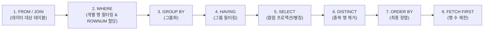

# Oracle SQL 데이터 정렬(ORDER BY), 중복 제거(DISTINCT), 행 수 제한(ROW LIMITING) 실습 가이드

관계형 데이터베이스(RDBMS)의 테이블은 데이터를 물리적으로 저장할 때 특정 순서를 보장하지 않으며 동일한 데이터가 반복되어 조회될 수 있습니다. 이번 실습에서는 데이터를 원하는 순서대로 정렬하는 `ORDER BY` 절(오름차순, 내림차순, NULL 제어), 중복된 데이터를 걸러내고 고유한 목록을 추출하는 `DISTINCT` 키워드, 그리고 상위 N개 데이터를 추출하는 행 수 제한(`FETCH FIRST`, `ROWNUM`)의 동작 원리와 실무 활용 팁을 학습합니다.

---

## 0. 사전 준비: 실습 사용자 및 세션 확인

모든 SQL 실습은 관리자(`SYSTEM`) 계정이 아닌 **실습용 일반 사용자(`KOREA_MALL`)** 세션의 SQL 편집기에서 진행합니다.

```sql
-- 현재 접속 계정 확인 (결과가 KOREA_MALL 이어야 함)
SELECT USER FROM DUAL;
```

> 🎯 **핵심 배움 포인트 (실습 환경 확인)**:
> - 데이터베이스 카탈로그 오염을 방지하고 보안 원칙을 준수하기 위해 DDL/DML 및 SELECT 실습은 반드시 일반 계정(`KOREA_MALL`)에서 실행합니다.

---

## 1. 정렬(ORDER BY)의 기본 원리와 정렬 기준

`ORDER BY` 절은 `SELECT` 쿼리의 맨 마지막에 작성하며, 컬럼 값을 기준으로 데이터를 오름차순 또는 내림차순으로 재배열합니다.

* **`ASC` (Ascending, 오름차순)**: 작은 값에서 큰 값으로 나열합니다. **(기본값, 생략 가능)**
  - 🔢 **숫자**: 작은 수 → 큰 수 (예: `1 → 10`)
  - 📅 **날짜**: 과거 날짜 → 미래 날짜 (예: `2025-01-01 → 2025-12-31`)
  - 🔤 **문자**: 사전 순서 (예: `가 → 하`, `A → Z`)
* **`DESC` (Descending, 내림차순)**: 큰 값에서 작은 값으로 나열합니다.
  - 🔢 **숫자**: 큰 수 → 작은 수 (예: `10 → 1`)
  - 📅 **날짜**: 최신 날짜(미래) → 과거 날짜 (예: `2025-12-31 → 2025-01-01`)
  - 🔤 **문자**: 사전 역순 (예: `하 → 가`, `Z → A`)

| 구분 | 키워드 | 정렬 방향 | 기본값 여부 | 적용 예시 (숫자 / 날짜 / 문자) |
| :---: | :---: | :---: | :---: | :--- |
| **오름차순** | `ASC` | 작은 값 → 큰 값 | **기본값** (생략 가능) | `1 → 10` / `과거 → 미래` / `가 → 하`, `A → Z` |
| **내림차순** | `DESC` | 큰 값 → 작은 값 | 명시 필요 | `10 → 1` / `미래 → 과거` / `하 → 가`, `Z → A` |

---

## # 실습 예제 1 : 상품을 가격순으로 정렬하기

`products` 테이블에서 상품명(`name`)과 단가(`price`)를 조회하고, 가격이 저렴한 순서(오름차순, `ASC`)로 정렬합니다.

### 1.1 가격 오름차순 정렬 쿼리

```sql
-- 상품을 가격 오름차순으로 정렬
SELECT name, price
FROM products
ORDER BY price ASC;
```

> 🎯 **핵심 배움 포인트 (ORDER BY와 ASC 생략 원칙)**:
> - **기본 정렬 방식 (Default)**: SQL 표준 및 Oracle Database에서 `ORDER BY`의 정렬 방식 기본값은 `ASC`(오름차순)입니다. 따라서 `ORDER BY price`와 같이 `ASC`를 생략해도 완전히 동일하게 동작합니다.
> - **숫자 정렬 기준**: 숫자는 작은 수에서 큰 수(`0 → 1,000 → 10,000`) 방향으로 정렬됩니다. 쇼핑몰의 "낮은 가격순" 필터를 구현할 때 가장 기본적으로 사용하는 형태입니다.

---

## # 실습 예제 2 : 최신 상품 먼저 보기

`products` 테이블에서 상품명(`name`), 단가(`price`), 등록일시(`created_at`)를 조회하고, 최근에 등록된 상품이 가장 먼저 노출되도록 등록일 기준 내림차순(`DESC`)으로 정렬합니다.

### 2.1 최신순(내림차순) 정렬 쿼리

```sql
-- 상품을 등록일 기준으로 최신순 정렬
SELECT name, price, created_at
FROM products
ORDER BY created_at DESC;
```

> 🎯 **핵심 배움 포인트 (DESC와 날짜 역순 정렬)**:
> - **내림차순 키워드 (`DESC`)**: 큰 값부터 먼저 나열되므로 `DESC` 키워드는 절대로 생략할 수 없습니다.
> - **날짜 컬럼의 내림차순 특징**: 날짜와 시간은 더 큰 값(더 최근 시점, 미래에 가까운 시점)이 먼저 정렬되므로, `ORDER BY created_at DESC`는 실무에서 **"최신순", "최근 등록순", "타임라인 피드"** 목록을 만들 때 필수적으로 사용하는 구문입니다.

---

## # 실습 예제 3 : 동일한 가격일 경우 상품명으로 정렬하기

`products` 테이블에서 상품명(`name`)과 단가(`price`)를 조회할 때, 1차적으로 높은 가격순(내림차순, `DESC`)으로 정렬하고, 가격이 같은 상품끼리는 상품명 알파벳/사전순(오름차순, `ASC`)으로 2차 정렬합니다.

### 3.1 다중 컬럼 정렬 쿼리

```sql
-- 가격이 동일하면 상품명 알파벳순 정렬
SELECT name, price
FROM products
ORDER BY price DESC, name ASC;
```

> 🎯 **핵심 배움 포인트 (다중 컬럼 정렬, Multi-Column Sort)**:
> - **다중 정렬 기준 지정 (콤마 `,` 구분)**:
>   - `ORDER BY 컬럼1 [ASC|DESC], 컬럼2 [ASC|DESC], ...` 형태로 여러 컬럼을 쉼표로 연결하여 정렬 우선순위를 지정할 수 있습니다.
> - **우선순위 원칙 (왼쪽 → 오른쪽)**:
>   - 가장 왼쪽에 명시한 `price DESC`가 **1차 정렬 기준**이 됩니다.
>   - 1차 기준 컬럼의 값이 동일한 행(동점 데이터)에 대해서만 다음 기준인 `name ASC`가 **2차 정렬 기준**으로 적용됩니다. (1차 기준값이 다르면 2차 기준은 평가되지 않습니다.)
> - **독립적인 정렬 방향**:
>   - 각 컬럼마다 `ASC` 또는 `DESC`를 개별적으로 지정할 수 있습니다. (예: `price`는 `DESC`, `name`은 `ASC`)
>   - 2차 기준의 `ASC` 역시 기본값이므로 `ORDER BY price DESC, name`과 같이 작성해도 동일하게 동작하지만, 쿼리의 명확한 의도 전달을 위해 실무에서는 명시하는 것을 권장합니다.

---

## # 실습 예제 4 : 컬럼 위치 번호로 정렬하기

`ORDER BY` 절에 컬럼명 대신 `SELECT` 절에 나열된 **컬럼의 위치 번호(순번, 1-based Index)**를 지정하여 정렬할 수 있습니다. `SELECT name, price`에서 2번째 컬럼인 `price`를 기준으로 높은 가격순(내림차순, `DESC`)으로 정렬합니다.

### 4.1 컬럼 위치 번호 정렬 쿼리

```sql
-- SELECT절의 2번째 컬럼인 price 기준으로 정렬
SELECT name, price
FROM products
ORDER BY 2 DESC;
```

> 🎯 **핵심 배움 포인트 (컬럼 위치 번호와 실무 사용 시 주의점)**:
> - **1부터 시작하는 순번 (1-based Index)**:
>   - SQL에서 컬럼 위치 번호는 `0`이 아닌 `1`부터 시작합니다.
>   - 위 쿼리에서 `1`은 첫 번째 컬럼인 `name`, `2`는 두 번째 컬럼인 `price`를 의미합니다.
> - **위치 번호 정렬의 장점**:
>   - 긴 수식(예: `price * stock_quantity`)이나 복잡한 함수가 포함된 컬럼을 정렬할 때 쿼리를 짧고 간결하게 작성할 수 있어 임시 분석 시 유용합니다.
> - ⚠️ **실무에서 사용을 지양해야 하는 이유 (유지보수 취약성)**:
>   1. **컬럼 추가/순서 변경 시 정렬 기준 왜곡**: 나중에 기획 변경으로 `SELECT product_id, name, price FROM products`처럼 앞단에 컬럼이 추가되면, `2`번 컬럼이 `price`가 아니라 `name`으로 바뀌어 조용히 잘못된 정렬이 수행됩니다.
>   2. **가독성 저하**: 쿼리문만 보아서는 `2`가 어떤 데이터를 기준으로 정렬하는지 직관적으로 파악하기 어렵습니다.
>   3. 따라서 프로덕션 애플리케이션 쿼리에서는 **컬럼명을 직접 명시하거나 명시적 별칭(ALIAS)을 사용하는 것이 권장 표준**입니다.

---

## 4.1 NULL의 기본 정렬 방식 (Oracle 기준)

Oracle에서는 `ORDER BY` 절에 별도의 옵션을 주지 않을 경우, 다음과 같은 규칙으로 `NULL`을 정렬합니다.

| 정렬 방향 | NULL 위치 |
| :---: | :---: |
| **ASC (오름차순)** | 맨 마지막 |
| **DESC (내림차순)** | 맨 처음 |

> 📌 **정리**: Oracle에서는 **오름차순 정렬 시 NULL이 뒤로 가고, 내림차순 정렬 시 NULL이 앞으로 옵니다.**  
> (Oracle은 내부적으로 `NULL`을 가장 큰 값으로 취급하기 때문입니다.)

---

## # 실습 예제 5 : NULL 값을 위에 먼저 보여주기

`customers` 테이블에서 고객 이름(`name`)과 이메일(`email`)을 조회할 때, 이메일 내림차순(`DESC`)으로 정렬하되 `NULLS FIRST`를 명시하여 이메일이 없는(`NULL`) 고객을 결과 목록 맨 위에 먼저 노출합니다.

### 5.1 NULL 우선 정렬 쿼리

```sql
SELECT name, email
FROM customers
ORDER BY email DESC NULLS FIRST;
```

> 🎯 **핵심 배움 포인트 (NULLS FIRST 옵션)**:
> - **`NULLS FIRST`**: 정렬 방향(`ASC` 또는 `DESC`)과 무관하게 `NULL` 값을 무조건 결과 집합의 **맨 앞(위)**으로 끌어올립니다.
> - **실무 활용**: 이메일이나 연락처 등 필수 정보가 누락된 고객 데이터를 먼저 선별하여 확인하고 조치해야 하는 관리자 화면 등에서 유용하게 활용됩니다.

---

## # 실습 예제 6 : NULL 값을 맨 아래로 보내기

`customers` 테이블에서 이메일 내림차순(`DESC`)으로 정렬할 때, 기본적으로 맨 위에 올라오는 `NULL` 값을 `NULLS LAST` 옵션을 통해 맨 아래(마지막)로 보냅니다.

### 6.1 NULL 후순위 정렬 쿼리

```sql
SELECT name, email
FROM customers
ORDER BY email DESC NULLS LAST;
```

> 🎯 **핵심 배움 포인트 (NULLS LAST 옵션)**:
> - **`NULLS LAST`**: 정렬 방향과 무관하게 `NULL` 값을 항상 결과 집합의 **맨 뒤(아래)**에 배치합니다.
> - **실무 활용**: 내림차순 정렬을 유지하면서도 데이터가 입력된 실제 유효 값들을 먼저 확인하고, 미입력(`NULL`) 데이터는 맨 뒤로 밀어내고 싶을 때 가장 널리 쓰이는 표준 기법입니다.

---

### 📌 [핵심 포인트] NULL 정렬 위치 제어 요약

| 정렬 방식 | NULL 위치 제어 | 설명 |
| :--- | :--- | :--- |
| **ORDER BY 컬럼명 ASC** | 기본 : `NULLS LAST` | 오름차순 + NULL은 맨 아래 |
| **ORDER BY 컬럼명 DESC** | 기본 : `NULLS FIRST` | 내림차순 + NULL은 맨 위 |
| **NULLS FIRST** | 직접 NULL을 위로 지정 | NULL을 항상 먼저 표시 |
| **NULLS LAST** | 직접 NULL을 아래로 지정 | NULL을 항상 마지막에 표시 |

---

## 5. 중복 데이터 제거 (DISTINCT)

데이터를 조회할 때 동일한 데이터가 여러 행에 걸쳐 반복 출력될 수 있습니다. `DISTINCT` 키워드를 사용하면 중복된 행을 제거하고 **고유한(Unique) 결과만 한 번씩 추출**할 수 있습니다.

---

## # 실습 예제 7 : 상품 테이블에서 카테고리 번호 목록을 중복 없이 조회하기

`products` 테이블에는 여러 상품이 동일한 카테고리에 속해 있을 수 있습니다. `DISTINCT` 키워드를 사용하여 등록된 상품들이 속한 **고유한 카테고리 번호(`category_id`) 목록만 중복 없이 조회**합니다.

### 7.1 DISTINCT 중복 제거 쿼리

```sql
-- products 테이블에서 중복 없이 category_id 목록 조회
SELECT DISTINCT category_id
FROM products;
```

> 🎯 **핵심 배움 포인트 (단일 컬럼 DISTINCT)**:
> - **중복 행 제거**: 테이블에 수십 개의 상품이 동일한 `category_id`를 갖더라도, 결과에는 중복이 제거되어 고유한 카테고리 번호만 각 1행씩 반환됩니다.
> - **NULL 값의 중복 처리**: 컬럼 값에 `NULL`이 여러 개 존재하더라도 `DISTINCT`를 적용하면 `NULL` 역시 단 1개의 고유한 값으로 취급되어 1행만 출력됩니다.

---

## # 실습 예제 8-1 : 주문된 상품명 조회하기 (중복 발생)

먼저 고객이 주문한 상품명을 조회해 보겠습니다. `order_items`와 `products` 테이블을 조인하여 주문된 모든 내역의 상품명을 조회합니다.

### 8-1.1 중복이 발생하는 주문 상품명 조회 쿼리

```sql
-- 고객이 주문한 상품명 조회
SELECT p.name
FROM order_items oi
JOIN products p ON oi.product_id = p.product_id;
```

> 🎯 **핵심 배움 포인트 (1:N 조인과 데이터 중복 발생 원인)**:
> - 여러 고객이 동일한 인기 상품을 반복해서 주문했기 때문에 `order_items` 테이블에 해당 `product_id`를 가진 행이 여러 번 등장합니다.
> - 따라서 `products`와 조인 시 동일한 상품명(`p.name`)이 중복되어 출력됩니다.

---

## # 실습 예제 8-2 : 주문된 상품명 중복 제거하기

`DISTINCT` 키워드를 사용하여 지금까지 한 번이라도 주문된 적이 있는 **고유한 주문 상품명 목록만 중복 없이 깔끔하게 추출**합니다.

### 8-2.1 주문 상품명 중복 제거 쿼리

```sql
-- 고객이 주문한 상품명을 중복 없이 조회
SELECT DISTINCT p.name
FROM order_items oi
JOIN products p ON oi.product_id = p.product_id;
```

> 🎯 **핵심 배움 포인트 (조인 결과의 DISTINCT 적용)**:
> - **비즈니스 고유 목록 추출**: "지금까지 판매된 적이 있는 상품들의 목록", "한 번이라도 주문한 고객 목록" 등과 같은 비즈니스 목록을 조회할 때 조인 결과에 `DISTINCT`를 적용합니다.
> - **중복 제거 연산**: 데이터베이스 엔진은 조인된 결과 집합을 메모리에서 해시(Hash) 또는 정렬(Sort) 알고리즘을 거쳐 중복을 제거하고 최종 유일값만 반환합니다.

---

### 📌 [핵심 포인트] DISTINCT 정리

| 구분 | 설명 |
| :--- | :--- |
| **기본 역할** | 중복된 행 제거, 고유한 결과만 추출 |
| **사용 위치** | `SELECT` 절에만 사용 가능 (`SELECT DISTINCT ...`) |
| **중복 판단 기준** | 선택한 **모든 컬럼의 값 조합**이 완벽히 동일할 때 중복으로 처리됨 |
| **주의사항** | 특정 컬럼 하나만 부분적으로 중복 제거하려면 `GROUP BY`를 사용하는 것이 더 적절할 수 있음 |

---

## 6. 조회 결과 행 수 제한 (Row Limiting & Top-N 쿼리)

방대한 데이터베이스에서 필요한 **상위 N개의 행(Top-N)만 추출**하거나 웹 애플리케이션의 **페이징(Pagination) 처리**를 구현할 때 행 수를 제한하는 문법을 사용합니다.  
Oracle에서는 전통적으로 `ROWNUM` 가상 컬럼을 사용해 왔으며, Oracle 12c 버전부터는 SQL 표준인 `FETCH FIRST n ROWS ONLY` 절을 지원합니다.

---

## # 실습 예제 9 : 최근 리뷰 상위 3개 조회하기

`reviews` 테이블에서 등록일시(`created_at`) 기준 내림차순(`DESC`)으로 정렬한 뒤, 가장 최근에 작성된 리뷰 **상위 3개만 조회**합니다.

### 9.1 FETCH FIRST 행 수 제한 쿼리

```sql
-- 최근 작성된 리뷰 중 상위 3개만 조회
SELECT review_id, customer_id, rating, created_at
FROM reviews
ORDER BY created_at DESC
FETCH FIRST 3 ROWS ONLY;
```

> 🎯 **핵심 배움 포인트 (FETCH FIRST n ROWS ONLY)**:
> - **SQL 표준 문법 (Oracle 12c 이상 지원)**: `ORDER BY` 정렬이 완료된 최종 결과에서 지정한 개수(`3`)만큼의 행만 깔끔하게 잘라옵니다.
> - **가독성과 직관성**: 복잡한 인라인 뷰(서브쿼리)를 작성하지 않고도 `ORDER BY` 맨 끝에 한 줄만 덧붙여 Top-N 결과를 간결하게 추출할 수 있습니다.

---

## # 실습 예제 10 : 상품 목록 중 상위 5개 행 제한하기 (정렬 미적용)

`products` 테이블에서 특정 정렬 기준 없이 데이터베이스가 조회한 순서대로 **상위 5개 행만 조회**합니다.

### 10.1 ROWNUM 행 번호 제한 쿼리

```sql
-- 상품 목록 중 상위 5개 출력 (주의 : 정렬되지 않음)
SELECT rownum, name, price
FROM products
WHERE ROWNUM <= 5;
```

> 🎯 **핵심 배움 포인트 (ROWNUM 가상 컬럼, Pseudocolumn)**:
> - **행 번호 자동 부여**: `ROWNUM`은 테이블에 실제로 저장된 컬럼이 아니라, 쿼리가 실행되어 행을 읽어오는 순서대로 `1`부터 부여되는 임시 가상 번호입니다.
> - **정렬 미보장**: `ORDER BY`가 없으므로 데이터베이스 내부 저장 구조나 인덱스 스캔 순서에 따라 임의의 5개 데이터가 출력됩니다.

---

## # 실습 예제 11 : ROWNUM 사용 시 주의할 점

가장 비싼 상품 5개를 구하기 위해 `WHERE ROWNUM <= 5`와 `ORDER BY price DESC`를 동시에 작성하면 어떻게 될까요? 의도와 달리 **정렬된 결과의 상위 5개가 출력되지 않습니다.**

### 11.1 잘못된 ROWNUM 정렬 쿼리 (주의 예제)

```sql
-- 이렇게 하면 정렬된 결과에서 상위 5개가 출력되지 않음
SELECT name, price
FROM products
WHERE ROWNUM <= 5
ORDER BY price DESC;
```

> 🎯 **핵심 배움 포인트 (SQL 실행 순서와 ROWNUM의 함정)**:
> - **원인 (실행 순서의 차이)**:
>   - SQL 실행 순서에서 `WHERE` 절은 `ORDER BY` 절보다 **훨씬 먼저 실행**됩니다.
>   - 따라서 전체 테이블에서 **무작위로 먼저 5개의 행을 추출(WHERE ROWNUM <= 5)**한 다음, **그 5개 데이터만을 가지고 가격 내림차순 정렬(ORDER BY)**을 수행하게 됩니다.
>   - 그 결과, 전체 상품 중에서 가장 비싼 5개가 아니라 무작위 5개 상품끼리만 정렬된 잘못된 결과가 반환됩니다.
> - **올바른 해결책**:
>   1. 최신 방식: `ORDER BY price DESC FETCH FIRST 5 ROWS ONLY;` 사용
>   2. 전통적 방식: 서브쿼리(인라인 뷰)로 먼저 전체 정렬을 수행한 뒤 바깥에서 ROWNUM 적용 (개발자 note ❼ 참고)

---

### 📌 ROWNUM을 정리하면 다음과 같습니다.

| 항목 | 설명 |
| :--- | :--- |
| **역할** | `SELECT`된 결과에 행 번호를 자동 부여 |
| **시작 번호** | 항상 `1`부터 시작 |
| **주의사항** | 정렬(`ORDER BY`)보다 먼저 적용됨 (`WHERE` 절 단계에서 번호 할당) |
| **정확한 사용법** | 정렬된 결과에서 상위 N개를 제한하려면 **서브쿼리(인라인 뷰)** 필요 |

---

### 📌 FETCH FIRST와 ROWNUM을 비교하면 다음과 같습니다.

| 구분 | FETCH FIRST | ROWNUM |
| :--- | :--- | :--- |
| **도입 버전** | Oracle 12c 이상 | 모든 Oracle 버전에서 사용 가능 |
| **문법 구조** | SQL 표준 문법, 가독성 우수 | Oracle 고유의 가상 컬럼 방식 |
| **정렬과의 관계** | `ORDER BY` 이후 최종 적용 가능 | `ORDER BY`보다 먼저 적용됨 |
| **페이징 처리 지원** | `OFFSET`과 함께 직관적 사용 가능 | 페이징 처리 시 2중 서브쿼리 필요 |
| **추천 여부** | **최신 SQL에서 적극 권장** | 하위 호환 또는 단순 건수 제한에 사용 |

---

### 📌 [핵심 포인트] 정렬·중복제거·행 제한 기능 총정리

| 기능 | 설명 | 예시 문법 |
| :---: | :--- | :--- |
| **ORDER BY** | 조회 결과 정렬 | `ORDER BY price DESC` |
| **DISTINCT** | 중복 제거 | `SELECT DISTINCT category_id ...` |
| **FETCH** | 결과 개수 제한 (Oracle 12c 이상) | `FETCH FIRST 5 ROWS ONLY` |
| **OFFSET** | 지정한 행 수만큼 건너뛰고 출력 | `OFFSET 5 ROWS FETCH NEXT 5 ROWS ONLY` |
| **ROWNUM** | 결과 개수 제한 (예전 방식) | `WHERE ROWNUM <= 3`<br>*(주의 : 정렬 시 서브쿼리 필요)* |

> 💡 **참고 (OFFSET 활용 페이징 처리)**:
> - `OFFSET 5 ROWS FETCH NEXT 5 ROWS ONLY`: 앞의 5개 행을 건너뛰고(Skip) 그다음 5개 행을 가져옵니다. 페이지당 5개씩 보여주는 화면에서 **2페이지(`6~10위`)** 데이터를 조회할 때 사용하는 최신 표준 페이징 문법입니다.

---

## 💡 개발자 note!

### ❶ SQL 쿼리의 실제 실행 순서 (완전판)

SQL 문장은 작성 순서와 데이터베이스 엔진 내부의 **실제 실행 순서**가 다릅니다.



- **`WHERE` 단계(2번)**에서 `ROWNUM`이 할당되므로, `ORDER BY (7번)`보다 먼저 적용됩니다. (실습 예제 11의 원인!)
- **`FETCH FIRST`는 정렬까지 끝난 맨 마지막(8번)**에 실행되므로 의도한 대로 정확한 Top-N 추출이 가능합니다.

---

### ❷ DISTINCT의 성능 주의사항 (무분별한 사용 금지)

- `DISTINCT`는 내부적으로 대량의 데이터를 메모리(PGA)에서 정렬(Sort Unique)하거나 해시 테이블(Hash Unique)을 생성하여 중복을 검사합니다.
- 데이터 건수가 수백만 건 이상일 때 `DISTINCT`를 남용하면 심각한 CPU 및 메모리 부하가 발생할 수 있습니다.
- 실무에서는 불필요한 조인으로 인해 데이터 중복(1:N 조인 시 불필요한 행 증폭)이 발생하지 않도록 **조인 조건과 서브쿼리(EXISTS / IN 등)를 먼저 정밀하게 설계**하는 것이 훨씬 효율적입니다.

---

### ❸ DBMS 제품별 NULL 정렬 기본 동작 차이점

`NULL` 정렬의 기본 정책은 데이터베이스 제품(RDBMS)마다 다릅니다. 이기종 DB 마이그레이션이나 멀티 DB 환경 개발 시 주의가 필요합니다.

* **Oracle / PostgreSQL**:
  - `NULL`을 **가장 큰 값(최대값)**으로 간주합니다.
  - `ASC` 정렬 시 `NULLS LAST` (맨 뒤)
  - `DESC` 정렬 시 `NULLS FIRST` (맨 앞)
* **MySQL / MariaDB / SQL Server**:
  - `NULL`을 **가장 작은 값(최소값)**으로 간주합니다.
  - `ASC` 정렬 시 `NULL`이 맨 앞, `DESC` 정렬 시 `NULL`이 맨 뒤로 배치됩니다. (Oracle과 정반대 동작)
  - 따라서 Oracle 환경에서 `DESC` 시 `NULL`을 뒤로 보내려면 반드시 본문에서 실습한 **`NULLS LAST`** 옵션을 명시해야 합니다.

---

### ❹ 정렬 성능과 인덱스 (실무 팁)

`ORDER BY`는 결과 집합 전체를 메모리(PGA) 영역으로 가져와 정렬(Sort Operation)을 수행합니다.

1. **대용량 데이터 정렬 시 부하**:
   - 데이터 건수가 수백만 건 이상일 때 인덱스 없이 `ORDER BY`를 실행하면 메모리 부족으로 인해 임시 디스크 영역(TEMP 테이블스페이스)을 사용하여 쿼리 응답 속도가 급격히 느려질 수 있습니다.
2. **인덱스(Index)를 활용한 Sort 생략**:
   - 정렬 대상 컬럼(예: `created_at`)에 인덱스가 이미 생성되어 있다면, Oracle은 인덱스에 정렬된 순서대로 읽기만 하므로 별도의 정렬 연산 없이 즉각적인 응답(Index Scan)이 가능합니다.

---

### ❺ 다중 정렬에서 컬럼 기술 순서의 중요성

다중 정렬에서는 **컬럼을 나열한 순서(좌측 → 우측)**에 따라 결과가 완전히 달라집니다.

- `ORDER BY price DESC, name ASC`:
  - 가격이 가장 비싼 상품부터 정렬되며, 가격이 같은 상품들 사이에서만 상품명 알파벳순으로 정렬됩니다.
- `ORDER BY name ASC, price DESC`:
  - 상품명 사전순으로 먼저 정렬되며, 상품명이 완전히 동일할 때만 가격 내림차순으로 정렬됩니다. (만약 상품명이 고유하다면 두 번째 기준인 `price`는 결과에 아무런 영향을 주지 못합니다.)
- 따라서 다중 정렬을 작성할 때는 **가장 핵심적인 주 분류 기준 컬럼을 맨 왼쪽에 배치**해야 합니다.

---

### ❻ 대소문자 무관 정렬과 함수 기반 인덱스(FBI)

대소문자를 구분하지 않고 정렬하기 위해 `ORDER BY LOWER(name)`처럼 컬럼에 함수를 적용하는 경우가 많습니다. 하지만 이때 성능 문제가 발생할 수 있습니다.

#### 1. 문제: 왜 기존 인덱스를 못 쓰고 느려질까?
* **문자 코드 차이**: 기본 정렬(`ORDER BY name`)은 문자 코드(ASCII) 순서로 처리되므로 대문자가 소문자보다 먼저 정렬됩니다 (`Apple`, `Banana`, `apple`, `banana`). 이를 사람이 보기에 자연스러운 순서(`Apple`, `apple`, `Banana`, `banana`)로 모으기 위해 `LOWER(name)`을 사용합니다.
* **인덱스 무력화 (책의 색인 비유)**:
  * 책 맨 뒤 '찾아보기(색인, Index)'에는 원본 단어(`Apple`, `Banana`, `apple`, `banana`) 기준으로 페이지가 정리되어 있습니다.
  * 독자가 "단어를 전부 **소문자로 바꾼 순서**대로 다시 줄 세워줘!"라고 요청하면, DB는 원본 기준 색인을 활용할 수 없게 됩니다.
  * 결국 DB는 기존 색인을 포기하고 **테이블 전체를 처음부터 끝까지 다 읽은 뒤(Full Table Scan)**, 값들을 하나하나 소문자로 변환해 메모리에서 새로 줄을 세우는 무거운 작업(**Sort**)을 수행하게 됩니다.

#### 2. 해결책: 함수 기반 인덱스 (FBI, Function-Based Index)
"그렇다면 책 뒤에 **소문자로 미리 변환해서 정렬해 둔 전용 색인**을 하나 파두자!"는 원리입니다.

```sql
-- 소문자 변환 값에 대한 함수 기반 인덱스 생성
CREATE INDEX idx_customers_lower_name ON customers(LOWER(name));
```

* **동작 원리**: 데이터가 삽입·수정될 때마다 Oracle이 `LOWER(name)` 결과를 미리 계산하여 정렬된 상태로 인덱스에 보관합니다.
* **효과**: 이후 `ORDER BY LOWER(name)`을 실행하면, CPU를 소모하는 별도 정렬 연산 없이 **미리 정렬되어 있는 인덱스만 훑고 즉시 초고속으로 결과를 반환**합니다.

---

### ❼ 전통적인 ROWNUM 기반 올바른 Top-N 쿼리 (인라인 뷰)

Oracle 11g 이하 레거시 시스템이나 실무 프로젝트에서 `ROWNUM`으로 정확한 정렬 상위 N건을 구하려면 **서브쿼리(인라인 뷰)를 사용하여 먼저 정렬한 후 바깥에서 ROWNUM을 적용**해야 합니다.

```sql
-- [올바른 방법] 먼저 정렬을 수행한 후 상위 5개를 추출
SELECT name, price
FROM (
    SELECT name, price
    FROM products
    ORDER BY price DESC
)
WHERE ROWNUM <= 5;
```

- 안쪽 서브쿼리에서 전체 상품을 가격 내림차순으로 정렬하고,
- 바깥쪽 메인 쿼리에서 이미 정렬된 결과 집합에 1번부터 번호를 매겨 상위 5개를 추출하므로 정확한 Top-5 결과가 보장됩니다.
- 현대 Oracle 12c+ 환경에서는 이 복잡한 서브쿼리 대신 **`FETCH FIRST 5 ROWS ONLY`** 구문을 사용하는 것이 표준입니다.
