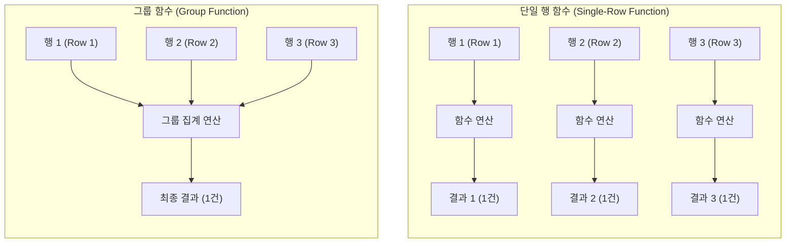
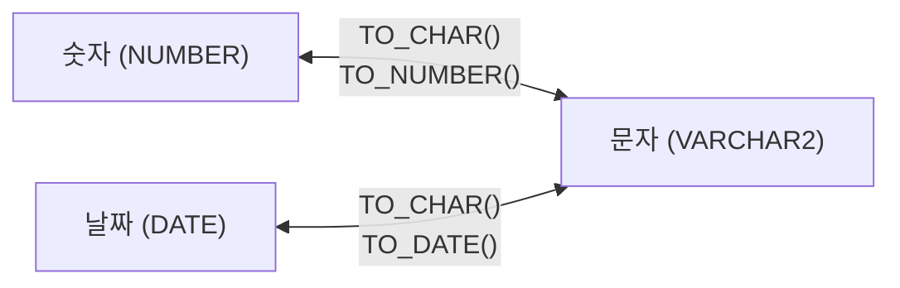

# Oracle SQL 단일행 함수(Single-Row Functions) 및 제어문 실습 가이드

오라클 SQL에서 함수(Function)는 데이터 조작 및 계산, 포맷 변환, 조건 제어 등을 수행하는 핵심 도구입니다. 단일행 함수(Single-Row Function)는 테이블의 **각 행(Row)마다 개별적으로 적용되어 행당 하나의 결과를 반환**하는 특징을 가집니다.

이번 실습에서는 교재 내용을 바탕으로 **문자 함수, 숫자 함수, 날짜 함수, 형 변환 함수, NULL 처리 함수, 조건 제어문(DECODE, CASE WHEN)**을 단계별 실습 예제와 함께 학습합니다.

> [!NOTE]
> **📖 SQL 문법 표기 규칙 안내**
> 본 가이드의 함수 및 SQL 문법 설명에 사용되는 기호는 다음과 같습니다:
> - **`[ ]` (대괄호)**: 생략 가능한 **선택 사항(Optional)**을 나타냅니다. *(실제 SQL 작성 시 대괄호 기호는 입력하지 않습니다)*
> - **`|` (파이프)**: 나열된 옵션 중 **하나를 선택(OR)**함을 나타냅니다.

---

## 0. 사전 준비: 실습 사용자 및 세션 확인

모든 SQL 실습은 관리자(`SYSTEM`) 계정이 아닌 **실습용 일반 사용자(`KOREA_MALL`)** 세션의 SQL 편집기에서 진행합니다.

```sql
-- 현재 접속 계정 확인 (결과가 KOREA_MALL 이어야 함)
SELECT USER FROM DUAL;
```

> 🎯 **핵심 배움 포인트 (실습 환경 확인)**:
> - 데이터베이스 카탈로그 오염을 방지하고 보안 원칙을 준수하기 위해 DDL/DML 및 함수 실습은 반드시 일반 계정(`KOREA_MALL`) 세션에서 실행합니다.

---

## 1. SQL 함수의 분류 체계 (처리 행 수 기준)

SQL 함수는 처리하는 행(Row)의 개수에 따라 크게 **두 가지**로 분류합니다.

| 구분 | 설명 | 대표 예시 | 다루는 차수 |
| :---: | :--- | :--- | :---: |
| **단일 행 함수**<br>(Single-Row Function) | 한 행을 입력받아 각 행마다 하나의 결과를 반환 | `LENGTH`, `ROUND`, `SYSDATE`, `TO_CHAR` 등 | **6일차 (현재 섹션)** |
| **그룹 함수 (집계 함수)**<br>(Group / Aggregate Function) | 여러 행을 입력받아 하나의 집계 결과를 반환 | `SUM`, `AVG`, `COUNT`, `MAX`, `MIN` 등 | 7일차 (다음 섹션) |



### 1.1 단일행 함수의 핵심 특징
1. **행별 독립 연산**: `SELECT` 절에 적용 시 조회된 각 행마다 개별적으로 연산되어 입력된 행의 개수와 동일한 수의 결과 행이 출력됩니다.
2. **자유로운 위치 활용**: `SELECT`, `WHERE`, `ORDER BY` 절 등 쿼리의 거의 모든 절에서 자유롭게 사용할 수 있습니다.
3. **함수의 중첩(Nested Function)**: 함수 안에 또 다른 함수를 인자(Argument)로 중첩하여 사용할 수 있으며, 가장 안쪽(Inner) 함수부터 바깥쪽(Outer) 순서로 실행됩니다.
4. **가상 테이블 `DUAL` 활용**: 특정 테이블의 데이터를 조회하지 않고 상수나 함수의 단일 계산 결과를 테스트할 때 Oracle이 기본 제공하는 1행 1열의 시스템 가상 테이블 `DUAL`을 사용합니다.

### 1.2 단일행 함수의 기능별 세부 분류

단일 행 함수는 처리하는 데이터의 성격과 기능에 따라 다음과 같이 분류할 수 있습니다.

| 함수 유형 | 주요 함수 | 핵심 역할 및 설명 |
| :--- | :--- | :--- |
| **문자열 함수** | `LENGTH`, `SUBSTR`, `INSTR`, `CONCAT`, `TRIM` 등 | 문자열의 길이 측정, 부분 문자열 추출, 문자 위치 검색, 공백 제거 등 |
| **숫자 함수** | `ROUND`, `TRUNC`, `MOD`, `CEIL`, `FLOOR` 등 | 반올림, 절삭(버림), 나머지 계산, 올림 및 내림 연산 등 |
| **날짜 함수** | `SYSDATE`, `ADD_MONTHS`, `MONTHS_BETWEEN`, `NEXT_DAY` 등 | 현재 시스템 일시 반환, 개월 수 가감 및 두 날짜 간격 계산 등 |
| **변환 함수** | `TO_CHAR`, `TO_NUMBER`, `TO_DATE`, `CAST` 등 | 문자 ↔ 숫자 ↔ 날짜 간 명시적 데이터 타입 변환 및 날짜/숫자 포맷팅 |
| **NULL 처리 함수** | `NVL`, `NVL2`, `COALESCE`, `NULLIF` | `NULL` 데이터를 기본값으로 치환하거나 동등 비교 분기 처리 |
| **조건 처리 표현식/함수** | `CASE`, `DECODE` 등 | SQL 내에서 `IF-THEN-ELSE` 형태의 다중 조건 분기 로직 구현 |

---

## # 실습 예제 1 : LENGTH() 함수로 문자열 길이 반환하기

`LENGTH()` 함수는 인자로 전달받은 문자열이나 컬럼 값의 **글자 수(문자 개수)**를 정수 형태로 반환하는 가장 기본적인 문자 함수입니다.

### 1.1 기본 문자열 길이 반환 쿼리 (DUAL 활용)

```sql
SELECT LENGTH('SQL') FROM DUAL;  -- 'SQL'문자열의 길이 반환하기, 결과 : 3
```

> 🎯 **핵심 배움 포인트 (LENGTH 함수의 동작 원리)**:
> - **문자 수 기준 계산**: 한글, 영문, 숫자, 특수문자, 공백(스페이스) 모두 구분 없이 **단일 1글자**로 카운트합니다.
>   - 예: `LENGTH('SQL')` ➔ `3`
>   - 예: `LENGTH('데이터베이스')` ➔ `6`
>   - 예: `LENGTH('Oracle SQL')` ➔ `10` (공백 1칸 포함)
> - **`LENGTH` vs `LENGTHB` 차이점**:
>   - `LENGTH(str)`: 순수 **문자 수(Character Count)**를 반환합니다.
>   - `LENGTHB(str)`: 문자열이 메모리/디스크에서 차지하는 **바이트(Byte) 수**를 반환합니다. AL32UTF8 문자셋 기준 한글 한 글자는 3바이트, 영문/숫자는 1바이트를 차지합니다.
> - **`DUAL` 테이블의 역할**: 특정 테이블의 컬럼 없이 함수 결과나 연산식을 단독으로 테스트할 때 사용하는 Oracle 기본 가상 테이블(1행 1열)입니다.

---

## # 실습 예제 3-1 : 단일 행 함수 - 고객 이름의 글자 수 구하기

실제 테이블 컬럼을 `LENGTH()` 함수의 인자로 전달하여 각 행마다 개별적으로 연산된 문자열 길이를 조회합니다.

### 3-1.1 고객 이름 글자 수 조회 쿼리

```sql
-- 고객 이름이 몇 글자인지 확인합니다.
SELECT name,
       LENGTH(name) AS name_length
FROM customers;
```

### 3-1.2 쿼리 실행 결과 예시 (`KOREA_MALL.customers`)

| NAME | NAME_LENGTH |
| :--- | :---: |
| 김하늘 | 3 |
| 박서준 | 3 |
| 이보영 | 3 |
| 정해인 | 3 |
| 신민아 | 3 |

> 🎯 **핵심 배움 포인트 (테이블 컬럼에 적용되는 단일행 함수의 원리)**:
> - **행별 1:1 매핑 연산**: `FROM customers`를 통해 인출된 10명의 고객 각각에 대해 `LENGTH(name)`이 10번 개별 실행되어 10개의 결과 행이 생성됩니다.
> - **별칭(ALIAS) 부여 (`AS name_length`)**: 함수를 적용한 컬럼은 기본 헤더명이 `LENGTH(NAME)`으로 다소 길고 복잡해지므로, `AS name_length`처럼 의미 있는 컬럼 별칭을 지정하는 것이 실무 표준입니다.
> - **WHERE 절 필터링 응용**:
>   ```sql
>   -- 이름이 3글자를 초과하는 고객만 조회 (WHERE절 조건식 활용)
>   SELECT name, LENGTH(name) AS name_length
>   FROM customers
>   WHERE LENGTH(name) > 3;
>   ```

---

## # 실습 예제 3-2 : 그룹 함수 - KOREA_MALL의 전체 재고량 합계 구하기

그룹 함수(집계 함수)는 테이블의 여러 행을 입력받아 데이터를 합산하거나 통계를 내어 **단 하나의 결과 행**을 반환합니다. 단일행 함수(예제 3-1)와 비교하며 그 차이를 체감해 봅니다.

### 3-2.1 전체 재고량 합계 쿼리

```sql
-- 전체 상품의 재고량(보유량)을 합산하여 출력합니다.
SELECT SUM(stock_quantity) AS total_stock
FROM products;
```

### 3-2.2 쿼리 실행 결과 예시 (`KOREA_MALL.products`)

| TOTAL_STOCK |
| :---: |
| 6230 |

> 🎯 **핵심 배움 포인트 (단일행 함수 vs 그룹 함수의 결정적 차이)**:
> - **출력 행 개수의 차이**:
>   - **단일행 함수(예제 3-1)**: `customers` 테이블의 10개 행 각각에 대해 계산되어 **10개의 행**이 반환됩니다.
>   - **그룹 함수(예제 3-2)**: `products` 테이블의 25개 행 전체를 묶어 단 하나의 총합으로 집계하므로 **오직 1개의 행**만 반환됩니다.
> - ⚠️ **초보자가 가장 많이 범하는 오류 (ORA-00937)**:
>   ```sql
>   -- [오류 발생] 단일행 컬럼(25개 행)과 그룹 함수(1개 행)를 동시에 조회하는 경우
>   SELECT name, SUM(stock_quantity)
>   FROM products;
>   -- ORA-00937: not a single-group group function (단일 그룹의 그룹 함수가 아닙니다)
>   ```
>   - 출력되는 행의 개수가 일치하지 않기 때문에 일반 컬럼과 그룹 함수를 함께 쓰려면 반드시 다음 차수(7일차)에서 다룰 **`GROUP BY` 절**을 사용해야 합니다.

---

## 2. 문자열 함수 (Character Functions)

문자열 함수는 문자 데이터를 다루는 함수로, 텍스트 가공, 정제, 검색 등에 필수적입니다. 실무에서는 다음과 같은 상황에서 특히 유용하게 활용됩니다.

* **대소문자 변환**: 검색·정렬 시 대소문자 차이로 인한 불일치를 해결하고 기준을 통일할 때 (`LOWER`, `UPPER`, `INITCAP`)
* **특정 문자의 위치 파악**: 구분자나 특정 기호의 인덱스를 찾을 때 (예: `'@'`가 포함된 이메일 주소 위치 파악 - `INSTR`)
* **공백 제거 또는 패딩(padding, 여백) 처리**: 불필요한 앞뒤 공백 제거 및 자릿수 맞춤 채우기 (`TRIM`, `LPAD`, `RPAD`)
* **문자열 결합 및 자르기**: 여러 컬럼 문자열을 합치거나 특정 구간의 글자만 잘라낼 때 (`CONCAT`, `||`, `SUBSTR`)
* **문자열의 길이 확인**: 유효성 검사 및 글자 수 제한 확인 (`LENGTH`, `LENGTHB`)

---

## # 실습 예제 4-1 : 고객 이메일을 소문자로 변환하기

고객이 회원가입 시 대문자나 혼용된 형태로 입력했을 수 있는 이메일 주소를 일관된 소문자(`LOWER`)로 변환하여 조회합니다.

### 4-1.1 이메일 소문자 변환 조회 쿼리

```sql
-- 고객의 이메일을 모두 소문자로 변환하여 조회
SELECT name, email, LOWER(email) AS email_lower
FROM customers
WHERE email IS NOT NULL;
```

### 4-1.2 쿼리 실행 결과 예시 (`KOREA_MALL.customers`)

| NAME | EMAIL | EMAIL_LOWER |
| :--- | :--- | :--- |
| 김하늘 | kh@mm.com | kh@mm.com |
| 박서준 | psj@mm.com | psj@mm.com |
| 이보영 | lby@mm.com | lby@mm.com |
| 정해인 | jhi@mm.com | jhi@mm.com |
| 신민아 | sma@mm.com | sma@mm.com |

> 🎯 **핵심 배움 포인트 (대소문자 변환 함수의 원리와 실무 활용)**:
> 
> 1. **대소문자 변환 3총사 함수**:
>    - `LOWER(str)`: 모든 알파벳 문자를 **소문자**로 변환 (예: `LOWER('ORACLE')` ➔ `'oracle'`)
>    - `UPPER(str)`: 모든 알파벳 문자를 **대문자**로 변환 (예: `UPPER('oracle')` ➔ `'ORACLE'`)
>    - `INITCAP(str)`: 단어의 **첫 글자만 대문자**, 나머지는 소문자로 변환 (예: `INITCAP('hello world')` ➔ `'Hello World'`)
> 
> 2. **한글 및 숫자 대상 적용**:
>    - 알파벳이 아닌 한글, 숫자, 특수문자는 `LOWER()` 또는 `UPPER()`를 통과해도 값이 변하지 않고 그대로 유지됩니다.

---

## # 실습 예제 4-2 : 대소문자 구분 없이 이메일 검색하기

Oracle Database는 문자열의 대소문자를 엄격히 구분합니다. 고객이 대소문자를 혼용해서 가입했거나 사용자가 검색창에 대문자로 입력했더라도 정확히 찾아낼 수 있도록 `WHERE` 절 조건식에 `LOWER()` 함수를 적용합니다.

### 4-2.1 대소문자 구분 없는 이메일 검색 쿼리

```sql
-- 'kh@mm.com'이라는 이메일을 가진 고객 찾기 (대소문자 구분 없음)
SELECT name, email
FROM customers
WHERE LOWER(email) = 'kh@mm.com';
```

### 4-2.2 쿼리 실행 결과 예시 (`KOREA_MALL.customers`)

| NAME | EMAIL |
| :--- | :--- |
| 김하늘 | kh@mm.com |

> 🎯 **핵심 배움 포인트 (대소문자 무관 검색과 인덱스 주의점)**:
> 
> 1. **대소문자 통일의 원리**:
>    - `email` 컬럼의 값을 `LOWER(email)`을 통해 모두 소문자로 변환한 뒤, 소문자 리터럴인 `'kh@mm.com'`과 비교하므로 DB에 `'KH@MM.COM'`이나 `'Kh@mm.com'`으로 저장되어 있어도 완벽하게 매칭됩니다.
>    - 대문자 기준인 `WHERE UPPER(email) = 'KH@MM.COM'`으로 작성해도 완전히 동일한 효과를 얻을 수 있습니다.
> 
> 2. **변수/파라미터 입력 시 실무 패턴**:
>    - 애플리케이션 사용자 입력값 역시 대소문자가 섞여 들어올 수 있으므로, 실무에서는 양쪽 모두를 소문자로 통일하는 패턴을 흔히 사용합니다.
>    ```sql
>    WHERE LOWER(email) = LOWER(:input_email);
>    ```
> 
> 3. ⚠️ **성능 고려사항 (함수 기반 인덱스, Function-Based Index)**:
>    - `WHERE LOWER(email) = 'kh@mm.com'`처럼 컬럼을 함수로 감싸 가공하면, `email` 컬럼에 일반 B-Tree 인덱스가 있더라도 인덱스를 사용하지 못하고 전체 테이블 스캔(Full Table Scan)이 발생합니다.
>    - 수백만 건 이상의 대용량 서비스에서 이러한 대소문자 무관 검색이 빈번하다면, Oracle의 **함수 기반 인덱스(FBI)** 생성을 고려해야 합니다.
>    ```sql
>    -- 소문자 변환 값에 대한 함수 기반 인덱스 생성
>    CREATE INDEX idx_customers_lower_email ON customers(LOWER(email));
>    ```

---

## # 실습 예제 5 : 영문 고객명을 INITCAP으로 변환하기

KOREA_MALL 실습 테이블의 고객명은 한글로 저장되어 있으므로 아래 예제는 영문 데이터를 가정한 예시입니다. 단어의 첫 글자만 대문자로 변환하고 나머지는 소문자로 정리하는 `INITCAP()` 함수의 동작 방식을 확인합니다.

### 5.1 INITCAP 함수를 활용한 이름 표기 변환 쿼리

```sql
-- 영문 고객명을 INITCAP으로 변환
SELECT 'steven king' AS name,
       INITCAP('steven king') AS "initcap name"
FROM DUAL;
```

### 5.2 쿼리 실행 결과 예시

| NAME | initcap name |
| :--- | :--- |
| steven king | Steven King |

> 🎯 **핵심 배움 포인트 (INITCAP 함수의 동작 원리와 특징)**:
> 
> 1. **단어 단위 첫 글자 대문자화 (Title Case)**:
>    - `INITCAP`은 문자열 전체의 맨 앞 글자 하나만 바꾸는 것이 아니라, **공백(스페이스) 또는 알파벳이 아닌 특수문자(밑줄, 하이픈 등)로 구분된 각 단어마다 첫 글자를 대문자로 변환**합니다.
>    - 이미 대문자로 되어 있는 나머지 글자들은 자동으로 소문자로 변환됩니다.
>      - `INITCAP('steven king')` ➔ `'Steven King'`
>      - `INITCAP('ORACLE DATABASE')` ➔ `'Oracle Database'`
>      - `INITCAP('korea_mall-shop')` ➔ `'Korea_Mall-Shop'`
> 
> 2. **쌍따옴표(`" "`) 컬럼 별칭의 역할**:
>    - `AS "initcap name"`처럼 별칭을 쌍따옴표로 감싸면, Oracle의 기본 식별자 대문자 변환 규칙을 무시하고 **소문자 유지 및 공백(스페이스)이 포함된 별칭**을 그대로 출력 헤더에 반영할 수 있습니다.
> 
> 3. **한글 데이터 적용 시 동작**:
>    - 한글에는 대소문자가 존재하지 않으므로 `INITCAP('김하늘')`을 실행해도 아무런 오류 없이 원래 한글 문자열 `'김하늘'`이 그대로 반환됩니다.

---

## # 실습 예제 6-1 : 상품명과 해당 글자 수 조회하기

`products` 테이블에서 상품명(`name`)과 글자 수를 조회하되, 상품명이 10글자를 초과하는 상품만 필터링하여 확인합니다. `WHERE` 절 조건식에 `LENGTH()` 단일행 함수를 적용하는 실전 패턴을 학습합니다.

### 6-1.1 상품명 및 글자 수 조건 조회 쿼리

```sql
-- 상품명과 해당 글자수 조회
SELECT name AS "상품명",
       LENGTH(name) AS "글자수"
FROM products
WHERE LENGTH(name) > 10;
```

### 6-1.2 쿼리 실행 결과 예시 (`KOREA_MALL.products`)

| 상품명 | 글자수 |
| :--- | :---: |
| 성공하는 사람들의 7가지 습관 | 17 |
| 아주 작은 습관의 힘 | 11 |
| 나는 내가 죽었다고 생각했습니다 | 17 |
| 하버드 새벽 4시 반 | 11 |

> 🎯 **핵심 배움 포인트 (WHERE 절 함수 필터링과 실행 순서)**:
> 
> 1. **WHERE 절에서 단일행 함수 직접 사용**:
>    - 단일행 함수는 `SELECT` 절뿐만 아니라 `WHERE` 절의 조건식에서도 자유롭게 사용할 수 있습니다. 각 행의 `name` 값을 읽을 때마다 `LENGTH(name)`을 즉석에서 계산하여 10보다 큰지 비교합니다.
> 
> 2. **공백(스페이스)의 글자 수 포함**:
>    - `LENGTH()` 함수는 띄어쓰기 공백도 정확히 1글자로 카운트합니다.
>    - 예: `'아주 작은 습관의 힘'` ➔ 한글 9자 + 공백 2칸 = 총 **11자**
> 
> 3. ⚠️ **초보자 주의: WHERE 절에서 컬럼 별칭 사용 불가 (ORA-00904)**:
>    ```sql
>    -- [오류 발생] SELECT절의 별칭인 "글자수"를 WHERE절에서 사용한 경우
>    SELECT name AS "상품명", LENGTH(name) AS "글자수"
>    FROM products
>    WHERE "글자수" > 10;
>    -- ORA-00904: "글자수": 부적합한 식별자
>    ```
>    - **이유 (SQL 실행 순서)**:
>      1. `FROM products` (테이블 접근)
>      2. `WHERE LENGTH(name) > 10` (행 필터링) ➔ **아직 SELECT 절이 실행되기 전이므로 별칭 "글자수"를 인식하지 못함!**
>      3. `SELECT name, LENGTH(name)` (컬럼 프로젝션 및 별칭 부여)
>    - 따라서 `WHERE` 절에서는 별칭 대신 `LENGTH(name) > 10`처럼 **원래의 함수 표현식을 그대로 작성**해야 합니다.

---

## # 실습 예제 6-2 : 한글 문자열의 LENGTH vs LENGTHB 비교하기

문자열의 순수 글자 수를 세는 `LENGTH()`와 컴퓨터 메모리/디스크 상에서 물리적으로 차지하는 바이트(Byte) 크기를 측정하는 `LENGTHB()` 함수의 차이점을 한글 데이터를 통해 비교해 봅니다.

### 6-2.1 한글 문자열의 LENGTH vs LENGTHB 비교 쿼리

```sql
-- 한글 문자열의 LENGTH vs LENGTHB 비교
SELECT '김하늘' AS "이름",
       LENGTH('김하늘') AS "글자수",
       LENGTHB('김하늘') AS "바이트수"
FROM DUAL;
```

### 6-2.2 쿼리 실행 결과 예시 (AL32UTF8 캐릭터셋 기준)

| 이름 | 글자수 | 바이트수 |
| :--- | :---: | :---: |
| 김하늘 | 3 | 9 |

> 🎯 **핵심 배움 포인트 (LENGTH vs LENGTHB와 캐릭터셋의 이해)**:
> 
> 1. **`LENGTH()`**: 순수 **문자 개수(Character Count)**를 반환합니다.
>    - 한글이든 영문이든 공백이든 1글자는 무조건 `1`로 계산됩니다.
>    - `'김하늘'` ➔ `3`
> 
> 2. **`LENGTHB()`**: 문자열이 물리적으로 차지하는 **바이트 크기(Byte Count)**를 반환합니다.
>    - 오라클 데이터베이스의 캐릭터셋(NLS_CHARACTERSET) 설정에 따라 결과가 다릅니다:
>      - **`AL32UTF8` (현대 오라클 표준 UTF-8)**: 한글 1글자당 **3바이트(Byte)** ➔ `'김하늘'` = 3 × 3 = **9바이트**
>      - **`KO16MSWIN949` / `KO16KSC5601` (완성형 한글)**: 한글 1글자당 **2바이트(Byte)** ➔ `'김하늘'` = 3 × 2 = **6바이트**
>      - **영문 / 숫자 / 기본 특수문자(ASCII)**: 캐릭터셋과 상관없이 1글자당 항상 **1바이트(Byte)**
> 
>    - 한글 데이터를 안전하게 다루려면 바이트 계산 원리를 이해하고 컬럼 크기를 넉넉하게 잡거나 `VARCHAR2(10 CHAR)`처럼 문자 단위(`CHAR`)로 명시해야 합니다.

---

## # 실습 예제 6-3 : 영문 문자열의 LENGTH vs LENGTHB 비교하기

한글과 달리 영문 알파벳, 숫자, 기본 공백 문자는 어떤 캐릭터셋에서도 **1글자당 1바이트**를 차지합니다. 영문 문자열을 통해 `LENGTH()`와 `LENGTHB()`의 결과가 동일하게 나타나는 원리를 확인합니다.

### 6-3.1 영문 문자열의 LENGTH vs LENGTHB 비교 쿼리

```sql
-- 영문 문자열의 LENGTH vs LENGTHB 비교
SELECT 'Steven King' AS "이름",
       LENGTH('Steven King') AS "글자수",
       LENGTHB('Steven King') AS "바이트수"
FROM DUAL;
```

### 6-3.2 쿼리 실행 결과 예시

| 이름 | 글자수 | 바이트수 |
| :--- | :---: | :---: |
| Steven King | 11 | 11 |

> 🎯 **핵심 배움 포인트 (영문 데이터의 1글자 = 1바이트 원리와 비교 요약)**:
> 
> 1. **영문 및 공백의 바이트 원리**:
>    - 영문 알파벳(대소문자), 숫자, 기본 키보드 특수문자, 띄어쓰기 공백은 표준 ASCII 코드 범위에 속하므로 **무조건 1글자당 1바이트**입니다.
>    - `'Steven'`(6자) + `' '`(공백 1자) + `'King'`(4자) = 총 **11글자 / 11바이트**
>    - 따라서 순수 영문/숫자 데이터에서는 항상 **`LENGTH() == LENGTHB()`** 관계가 성립합니다.
> 
> 2. **한글 vs 영문 LENGTH/LENGTHB 비교 요약표 (AL32UTF8 기준)**:
> 
> | 데이터 예시 | 데이터 유형 | LENGTH (글자수) | LENGTHB (바이트수) | 바이트 계산 공식 |
> | :--- | :---: | :---: | :---: | :--- |
> | `'Steven King'` | 영문 + 공백 | **11** | **11** | 11글자 × 1Byte = 11Byte |
> | `'김하늘'` | 순수 한글 | **3** | **9** | 3글자 × 3Byte = 9Byte |
> | `'SQL 튜닝'` | 영문+공백+한글 | **6** | **10** | (영문 3자 + 공백 1자 = 4Byte) + (한글 2자 × 3Byte = 6Byte) = 10Byte |

---

## # 실습 예제 7-1 : 이메일 주소에서 '@' 위치 찾기

`INSTR()` 함수는 문자열 내에서 특정 문자나 단어가 처음으로 등장하는 **위치(인덱스 순번)**를 찾아 정수로 반환합니다. 고객 이메일 주소에서 구분 기호인 골뱅이(`'@'`) 기호가 몇 번째 글자에 위치하는지 확인합니다.

### 7-1.1 이메일 주소에서 '@' 위치 추출 쿼리

```sql
-- 이메일 주소에서 @ 위치 추출
SELECT name AS "고객명",
       email,
       INSTR(email, '@') AS "at_위치"
FROM customers
WHERE email IS NOT NULL;
```

### 7-1.2 쿼리 실행 결과 예시 (`KOREA_MALL.customers`)

| 고객명 | EMAIL | at_위치 |
| :--- | :--- | :---: |
| 김하늘 | kh@mm.com | 3 |
| 박서준 | psj@mm.com | 4 |
| 이보영 | lby@mm.com | 4 |
| 정해인 | jhi@mm.com | 4 |
| 신민아 | sma@mm.com | 4 |

> 🎯 **핵심 배움 포인트 (INSTR 함수의 기본 문법과 동작 원리)**:
> 
> 1. **1부터 시작하는 인덱스 (1-based Index)**:
>    - SQL에서는 일반 프로그래밍 언어(C, Java, Python 등 0-based)와 달리 **첫 번째 글자의 순번이 `1`**입니다.
>    - `'kh@mm.com'`의 경우: `k`(1), `h`(2), `@`(3) 이므로 반환값은 **`3`**입니다.
> 
> 2. **찾는 문자가 없을 때의 반환값 (`0`)**:
>    - 대상 문자열에 검색하려는 문자가 전혀 존재하지 않으면 **`0`**을 반환합니다.
>    - 예: `SELECT INSTR('Hello', 'z') FROM DUAL;` ➔ `0`
>    - **WHERE 절 활용 팁**: `WHERE INSTR(email, '@') > 0` 구문은 `WHERE email LIKE '%@%'`와 동일하게 특정 문자의 포함 여부를 검증할 때 사용할 수 있습니다.
> 
> 3. **INSTR 함수의 전체 구문 형식**:
>    ```sql
>    INSTR(대상문자열, 찾을문자열 [, 시작위치 [, 발견횟수]])
>    ```
>    - `시작위치(position)`: 검색을 시작할 인덱스 (생략 시 `1`). 음수를 주면 문자열 오른쪽 끝에서부터 왼쪽으로 역방향 검색합니다.
>    - `발견횟수(occurrence)`: 몇 번째로 나타나는 문자를 찾을지 지정 (생략 시 `1`번째).
>    - 예: `INSTR('user@gmail.com@backup', '@', 1, 2)` ➔ 2번째 `@`의 위치를 반환

---

## # 실습 예제 7-2 : 두 번째 등장 위치 찾기

동일한 구분자(예: 슬래시 `'/'`, 하이픈 `'-'`)가 문자열 내에 여러 번 반복될 때, 특정 순서(예: 2번째 등장)의 위치를 정확히 짚어내기 위해 `INSTR()`의 **3번째(시작 위치)**와 **4번째(발견 횟수)** 파라미터를 활용합니다.

### 7-2.1 날짜 형식 문자열에서 두 번째 '/' 위치 검색 쿼리

```sql
-- '2025/07/12'에서 두 번째 '/' 위치
SELECT INSTR('2025/07/12', '/', 1, 2) AS "두번째_위치"
FROM DUAL;
```

### 7-2.2 쿼리 실행 결과 예시

| 두번째_위치 |
| :---: |
| 8 |

> 🎯 **핵심 배움 포인트 (INSTR 다중 파라미터 제어와 역방향 검색)**:
> 
> 1. **문자열 인덱스 및 위치 카운팅 상세 분석**:
> 
> | 문자열 | 2 | 0 | 2 | 5 | **/** | 0 | 7 | **/** | 1 | 2 |
> | :---: | :---: | :---: | :---: | :---: | :---: | :---: | :---: | :---: | :---: | :---: |
> | **순번(인덱스)** | 1 | 2 | 3 | 4 | **5** (1차 등장) | 6 | 7 | **8** (2차 등장) | 9 | 10 |
> 
> - `INSTR('2025/07/12', '/', 1, 2)`의 의미:
>   - `1`번 위치(`'2'`)부터 검사를 시작하여,
>   - `'/'` 기호가 **`2`번째**로 나타나는 위치인 **`8`**을 정확히 반환합니다.
> 
> 2. **실무 응용: 역방향 검색 (음수 인덱스 활용)**:
>    - 시작 위치에 **음수(`-1`)**를 전달하면 문자열의 **맨 오른쪽(끝)에서부터 역방향**으로 문자를 탐색합니다. (단, 결과로 반환되는 위치 번호는 여전히 맨 앞 기준의 인덱스입니다.)
>    ```sql
>    -- 뒤에서부터 첫 번째로 나타나는 '/'의 위치 찾기 (결과: 8)
>    SELECT INSTR('2025/07/12', '/', -1, 1) FROM DUAL;
>    ```
>    - 이 패턴은 파일 경로에서 파일명을 추출하거나 URL에서 마지막 서브 경로를 분리할 때 실무에서 자주 사용됩니다.

---

## # 실습 예제 8-1 : 고객 전화번호 앞자리 추출하기

`SUBSTR()` 함수는 문자열의 특정 시작 위치부터 원하는 글자 수만큼 **부분 문자열을 잘라내어 추출(Sub-string)**하는 함수입니다. 고객의 전체 전화번호에서 통신사 식별 국번(앞 3자리)을 추출합니다.

### 8-1.1 전화번호 앞 3자리 추출 쿼리

```sql
-- 전화번호에서 앞 3자리 추출
SELECT name AS "고객명",
       phone AS "전체전화번호",
       SUBSTR(phone, 1, 3) AS "국번"
FROM customers;
```

### 8-1.2 쿼리 실행 결과 예시 (`KOREA_MALL.customers`)

| 고객명 | 전체전화번호 | 국번 |
| :--- | :--- | :---: |
| 김하늘 | 010-1000-0001 | 010 |
| 박서준 | 010-1000-0002 | 010 |
| 이보영 | 010-1000-0003 | 010 |
| 정해인 | 010-1000-0004 | 010 |
| 신민아 | 010-1000-0005 | 010 |

> 🎯 **핵심 배움 포인트 (SUBSTR 함수의 기본 문법)**:
> 
> ```sql
> SUBSTR(문자열, 시작위치 [, 추출길이])
> ```
> - **시작위치**: 1부터 시작하는 첫 글자 위치 (1-based 인덱스)
> - **추출길이**: 가져올 글자 수 *(선택: 생략 시 시작 위치부터 문자열 끝까지 추출)*
> - `SUBSTR(phone, 1, 3)`의 의미: `phone` 컬럼의 **1번째 글자부터 3글자**를 잘라옵니다. ➔ `'010'`

---

## # 실습 예제 8-2 : 고객 전화번호 끝자리 추출하기

고객 인증이나 본인 확인 시 전화번호 뒷자리(마지막 4글자)를 확인할 때가 많습니다. `SUBSTR()`에 **음수(`-`) 시작 위치**를 지정하여 문자열 끝에서부터 역으로 위치를 잡아 마지막 4자리를 추출합니다.

### 8-2.1 전화번호 마지막 4자리 추출 쿼리

```sql
-- 전화번호에서 마지막 4자리 추출
SELECT name AS "고객명",
       phone AS "전체전화번호",
       SUBSTR(phone, -4) AS "뒷번호"
FROM customers;
```

### 8-2.2 쿼리 실행 결과 예시 (`KOREA_MALL.customers`)

| 고객명 | 전체전화번호 | 뒷번호 |
| :--- | :--- | :---: |
| 김하늘 | 010-1000-0001 | 0001 |
| 박서준 | 010-1000-0002 | 0002 |
| 이보영 | 010-1000-0003 | 0003 |
| 정해인 | 010-1000-0004 | 0004 |
| 신민아 | 010-1000-0005 | 0005 |

> 🎯 **핵심 배움 포인트 (음수 시작 위치와 길이 생략 시 동작)**:
> 
> 1. **음수(`-`) 시작 인덱스의 원리**:
>    - 양수 인덱스는 왼쪽(앞)에서부터 `1, 2, 3...` 순으로 세지만, **음수 인덱스는 오른쪽(끝)에서부터 `-1, -2, -3...`** 순으로 셉니다.
>    - 전화번호 `'010-1000-0001'`에서 뒤에서 4번째 글자는 첫 번째 `'0'`(`-4`)입니다.
> 
> 2. **추출 길이(3번째 인자) 생략 시의 규칙**:
>    - `SUBSTR(str, pos)`처럼 3번째 인자인 길이를 생략하면, **지정한 시작 위치부터 해당 문자열의 맨 끝까지 전부 추출**합니다.
>    - 따라서 `SUBSTR(phone, -4)`는 **"뒤에서 4번째 글자부터 맨 끝까지"** 추출하므로 마지막 4자리가 반환됩니다.

---

## # 실습 예제 8-3 : 상품명에서 처음 5글자 추출하기

웹 페이지나 모바일 UI에서 상품명이 너무 길 경우 레이아웃을 해치지 않도록 앞단 5글자만 요약해서 보여주고자 할 때 `SUBSTR()`을 활용합니다.

### 8-3.1 상품명 앞 5글자 추출 쿼리

```sql
-- 상품명에서 처음 5글자 추출
SELECT name AS "상품명",
       SUBSTR(name, 1, 5) AS "요약명"
FROM products;
```

### 8-3.2 쿼리 실행 결과 예시 (`KOREA_MALL.products`)

| 상품명 | 요약명 |
| :--- | :--- |
| 82년생 김지영 | 82년생&nbsp; |
| 소년이 온다 | 소년이 온 |
| 채식주의자 | 채식주의자 |
| 성공하는 사람들의 7가지 습관 | 성공하는&nbsp; |
| 아주 작은 습관의 힘 | 아주 작은 |

> 🎯 **핵심 배움 포인트 (한글 문자열 추출과 SUBSTR vs SUBSTRB)**:
> 
> 1. **문자 단위 자르기 (`SUBSTR`)**:
>    - `SUBSTR()`은 글자 수 기준(Character-based)으로 동작하므로 한글이든 영문/공백이든 깨짐 없이 정확하게 5글자를 잘라냅니다.
>    - 만약 상품명 전체 글자 수가 5글자 미만(예: 3~4자)이라면 에러 없이 존재하는 전체 글자만 그대로 반환합니다 (예: 5글자인 `'채식주의자'`는 그대로 5글자 출력).
> 
> 2. **`SUBSTR` vs `SUBSTRB`의 차이 (바이트 단위)**:
>    - `SUBSTR(str, 1, 5)`: 1번째 글자부터 **5글자** 추출
>    - `SUBSTRB(str, 1, 5)`: 1번째 바이트부터 **5바이트** 추출 (한글 1글자가 3바이트인 UTF-8 환경에서 `SUBSTRB`로 5바이트를 자르면 한글 1글자 + 깨진 2바이트가 되어 한글이 깨질 수 있으므로 일반 텍스트 조작에는 반드시 **`SUBSTR()`**을 사용해야 합니다.)

---

## # 실습 예제 8-4 : 이메일 도메인 추출하기

고객의 이메일 주소에서 구분 기호인 골뱅이(`'@'`) 뒤에 나오는 도메인 이름(예: `'mm.com'`)만 분리하여 추출합니다. 문자의 위치를 찾는 `INSTR()`과 부분 문자열을 잘라내는 `SUBSTR()`을 함께 결합하는 **함수 중첩(Nested Function)**의 대표적인 실무 패턴입니다.

### 8-4.1 이메일 주소에서 도메인 추출 쿼리

```sql
-- 이메일 주소에서 도메인 추출
SELECT email,
       SUBSTR(email, INSTR(email, '@') + 1) AS "도메인"
FROM customers
WHERE email IS NOT NULL;
```

### 8-4.2 쿼리 실행 결과 예시 (`KOREA_MALL.customers`)

| EMAIL | 도메인 |
| :--- | :--- |
| kh@mm.com | mm.com |
| psj@mm.com | mm.com |
| lby@mm.com | mm.com |
| jhi@mm.com | mm.com |
| sma@mm.com | mm.com |

> 🎯 **핵심 배움 포인트 (함수 중첩의 실행 원리와 아이디/도메인 추출 공식)**:
> 
> 1. **함수의 중첩(Nested Function) 실행 순서**:
>    - SQL에서 함수가 중첩되어 있을 때는 가장 **안쪽(Inner) 함수부터 먼저 실행**된 후 그 결과값이 바깥쪽(Outer) 함수의 인자로 전달됩니다.
>    - `'kh@mm.com'` 기준 실행 단계:
>      1. `INSTR(email, '@')`: `'@'`의 위치인 **`3`**을 찾습니다.
>      2. `+ 1`: 골뱅이 기호 자체는 제외해야 하므로 그 다음 글자 위치인 **`4`**(`'m'`)를 계산합니다.
>      3. `SUBSTR(email, 4)`: 추출 길이를 생략했으므로 **4번째 글자부터 문자열 맨 끝까지** 전부 잘라내어 최종적으로 **`'mm.com'`**을 반환합니다.
> 
> 2. **실무 필수 공식: 이메일 아이디 vs 도메인 분리**:
> 
> | 구분 | 추출 공식 (SQL 표현식) | 동작 설명 |
> | :--- | :--- | :--- |
> | **아이디 추출** | `SUBSTR(email, 1, INSTR(email, '@') - 1)` | 1번째 글자부터 골뱅이 앞(`@위치 - 1`)까지의 길이만큼 추출 |
> | **도메인 추출** | `SUBSTR(email, INSTR(email, '@') + 1)` | 골뱅이 다음(`@위치 + 1`)부터 문자열 끝까지 전부 추출 |
> 
> 3. **비즈니스 활용 (GROUP BY 연계)**:
>    - `SELECT SUBSTR(email, INSTR(email, '@') + 1) AS domain, COUNT(*) FROM customers GROUP BY SUBSTR(...)` 쿼리를 실행하면 네이버, 지메일, 카카오 등 **고객들이 가장 많이 이용하는 포털 도메인 통계 리포트**를 손쉽게 산출할 수 있습니다.

---

## # 실습 예제 9-1 : 이메일 주소의 양쪽 공백 제거하기

사용자가 웹 브라우저나 앱 입력 폼에 이메일을 입력할 때 실수로 앞뒤에 입력한 불필요한 공백 문자(White Space)를 정제하기 위해 `TRIM()` 함수를 사용합니다.

### 9-1.1 양쪽 공백 제거 쿼리

```sql
-- 이메일 앞/뒤 공백제거
SELECT '  kh@mm.com  ' AS "원본이메일",
       TRIM('  kh@mm.com  ') AS "공백제거된이메일"
FROM DUAL;
```

### 9-1.2 쿼리 실행 결과 예시

| 원본이메일 | 공백제거된이메일 |
| :--- | :--- |
| &nbsp;&nbsp;kh@mm.com&nbsp;&nbsp; | kh@mm.com |

> 🎯 **핵심 배움 포인트 (TRIM 함수의 기본 동작)**:
> - `TRIM(문자열)`은 기본적으로 문자열의 **왼쪽(앞)과 오른쪽(뒤)에 있는 공백을 모두 제거**합니다.
> - 단, 문자열 **중간에 위치한 공백(단어 사이 공백)은 제거되지 않고 그대로 보존**됩니다. (예: `TRIM('  hello world  ')` ➔ `'hello world'`)

---

## # 실습 예제 9-2 : 특정 문자 제거하기 (-하이픈)

`TRIM()` 함수는 단순 공백 제거뿐만 아니라 `TRIM('제거문자' FROM 문자열)` 형태로 문법을 확장하여 문자열 양 끝에 붙은 특정 기호나 문자를 깔끔하게 떼어낼 수 있습니다.

### 9-2.1 양쪽 하이픈 제거 쿼리

```sql
-- 양쪽 하이픈 제거
SELECT TRIM('-' FROM '-010-1000-0001-') AS "정리된번호"
FROM DUAL;
```

### 9-2.2 쿼리 실행 결과 예시

| 정리된번호 |
| :--- |
| 010-1000-0001 |

> 🎯 **핵심 배움 포인트 (특정 문자 TRIM의 특징과 주의점)**:
> - **양 끝만 제거**: 문자열 맨 앞과 맨 끝에 붙어 있던 하이픈(`'-'`)만 제거되고, 전화번호 **중간의 구분 하이픈(`010-1000-0001`)은 절대 삭제되지 않습니다.**
> - **단일 문자만 지정 가능**: `TRIM()`의 `FROM` 앞에는 오직 **1글자의 단일 문자**만 지정할 수 있습니다. (여러 글자를 제거하려면 뒤에서 배울 `REPLACE()` 함수를 사용해야 합니다.)

---

## TRIM의 방향 지정 옵션 (LEADING / TRAILING / BOTH)

`TRIM()` 함수는 문자열의 어느 쪽에서 문자를 제거할지 방향을 명시적으로 제어할 수 있는 키워드 옵션을 제공합니다.

| 구문 형식 | 제거 방향 | 동작 설명 |
| :--- | :---: | :--- |
| `TRIM(LEADING '문자' FROM 문자열)` | **왼쪽만** 제거 | 문자열 앞단에 위치한 지정 문자만 제거 |
| `TRIM(TRAILING '문자' FROM 문자열)` | **오른쪽만** 제거 | 문자열 끝단에 위치한 지정 문자만 제거 |
| `TRIM(BOTH '문자' FROM 문자열)` | **양쪽 모두** 제거 | 앞뒤 양쪽의 지정 문자 제거 (**기본값이므로 BOTH 생략 가능**) |

```sql
-- 방향 지정 옵션 실습
SELECT TRIM(LEADING '0' FROM '000123400')  AS "왼쪽_0_제거",   -- 결과: '123400'
       TRIM(TRAILING '0' FROM '000123400') AS "오른쪽_0_제거", -- 결과: '0001234'
       TRIM(BOTH '0' FROM '000123400')     AS "양쪽_0_제거"     -- 결과: '1234'
FROM DUAL;
```

---

## # 실습 예제 9-3 : 왼쪽 공백 제거하기

`LTRIM()` 함수는 Left Trim의 약자로, 문자열의 **왼쪽(시작 부분)에 존재하는 공백만 제거**하고 오른쪽 공백은 손대지 않고 그대로 둡니다.

### 9-3.1 왼쪽 공백 제거 쿼리

```sql
-- 왼쪽 공백 제거
SELECT LTRIM('  MENTOR') AS "왼쪽정리"
FROM DUAL;
```

### 9-3.2 쿼리 실행 결과 예시

| 왼쪽정리 |
| :--- |
| MENTOR |

> 🎯 **핵심 배움 포인트 (LTRIM의 활용)**:
> - `LTRIM('  MENTOR')`는 `TRIM(LEADING ' ' FROM '  MENTOR')`와 완전히 동일하게 동작합니다.
> - 구문이 훨씬 짧고 직관적이어서 왼쪽 공백만 정제할 때 실무에서 매우 자주 쓰입니다.

---

## # 실습 예제 9-4 : 오른쪽 공백 제거하기

`RTRIM()` 함수는 Right Trim의 약자로, 문자열의 **오른쪽(끝 부분)에 존재하는 공백만 제거**하고 왼쪽 공백은 그대로 유지합니다.

### 9-4.1 오른쪽 공백 제거 쿼리

```sql
-- 오른쪽 공백 제거
SELECT RTRIM('MENTOR  ') AS "오른쪽정리"
FROM DUAL;
```

### 9-4.2 쿼리 실행 결과 예시

| 오른쪽정리 |
| :--- |
| MENTOR |

> 🎯 **핵심 배움 포인트 (RTRIM의 실무 중요성)**:
> - **고정 길이 `CHAR` 타입 공백 제거**:
>   - DB 설계 시 `CHAR(10)`과 같은 고정 길이 컬럼에 `'ABC'`(3자)를 저장하면 나머지 7자리는 빈 공백(스페이스)으로 채워집니다.
>   - 이를 조회하여 프로그래밍 언어나 API로 넘겨줄 때 뒤에 채워진 빈 공백들을 깔끔히 털어내기 위해 **`RTRIM(컬럼)`**을 필수적으로 사용합니다.

---

## # 실습 예제 10 : 전화번호에서 하이픈(-) 제거하기

고객 테이블에서 전화번호 데이터를 숫자만 남기고 구분 기호인 하이픈(`'-'`)을 모두 제거합니다. 문자열 내의 특정 문자를 다른 문자로 바꾸거나 완전히 삭제할 때 `REPLACE()` 함수를 사용합니다.

### 10.1 하이픈 제거 후 숫자만 남긴 전화번호 조회 쿼리

```sql
-- 하이픈 제거 후 숫자만 남긴 전화번호 조회
SELECT name AS "고객명",
       phone AS "원본전화번호",
       REPLACE(phone, '-', '') AS "숫자전화번호"
FROM customers;
```

### 10.2 쿼리 실행 결과 예시 (`KOREA_MALL.customers`)

| 고객명 | 원본전화번호 | 숫자전화번호 |
| :--- | :--- | :--- |
| 김하늘 | 010-1000-0001 | 01010000001 |
| 박서준 | 010-1000-0002 | 01010000002 |
| 이보영 | 010-1000-0003 | 01010000003 |
| 정해인 | 010-1000-0004 | 01010000004 |
| 신민아 | 010-1000-0005 | 01010000005 |

> 🎯 **핵심 배움 포인트 (REPLACE 함수의 문법과 TRIM과의 차이점)**:
> 
> ```sql
> REPLACE(대상문자열, 찾을문자열 [, 바꿀문자열])
> ```
> 1. **문자 완전 삭제 (빈 문자열 치환)**:
>    - 바꿀 문자열 자리에 빈 따옴표(`''`)를 지정하면, 일치하는 모든 문자를 지워버리는 효과를 냅니다.
> 2. **`TRIM` vs `REPLACE`의 결정적 차이**:
>    - `TRIM('-' FROM phone)`: 문자열의 **맨 앞과 맨 뒤의 하이픈만 제거** (중간 하이픈 보존)
>    - `REPLACE(phone, '-', '')`: 문자열의 앞, 중간, 뒤 위치를 가리지 않고 **등장하는 모든 하이픈을 일괄 삭제**
> 3. **문자열 치환 응용**:
>    - `REPLACE('010-1000-0001', '-', '/')` ➔ `'010/1000/0001'` (다른 기호나 단어로 교체 가능)

---

## # 실습 예제 11-1 : 카테고리 이름 연결 - '상위 > 하위' 형태로 출력하기

`CONCAT()` 함수를 이용하여 상위 카테고리 명칭인 `'도서 > '`와 하위 카테고리명을 결합해 `'도서 > 소설'` 형태의 계층형 전체 카테고리명을 만들어 봅니다.

### 11-1.1 CONCAT 함수로 계층형 카테고리명 생성 쿼리

```sql
-- CONCAT 함수로 '도서 > 하위카테고리명' 형식 만들기
SELECT category_id,
       category_name AS "하위카테고리",
       CONCAT('도서 > ', category_name) AS "전체카테고리명"
FROM categories
WHERE parent_id = 1;
```

### 11-1.2 쿼리 실행 결과 예시 (`KOREA_MALL.categories`)

| CATEGORY_ID | 하위카테고리 | 전체카테고리명 |
| :---: | :--- | :--- |
| 4 | 소설 | 도서 > 소설 |
| 5 | 자기계발 | 도서 > 자기계발 |
| 6 | 인문/사회 | 도서 > 인문/사회 |

> 🎯 **핵심 배움 포인트 (CONCAT 함수의 기본 원리)**:
> - `CONCAT(문자열1, 문자열2)`는 두 개의 문자열 인자를 결합(Concatenation)하여 하나의 문자열로 반환합니다.
> - 쇼핑몰의 브레드크럼(Breadcrumb, 사이트 이동 경로: `홈 > 도서 > 소설`)을 표시할 때 유용합니다.

---

## # 실습 예제 11-2 : 세 개의 문자열을 중첩 CONCAT으로 연결하기

`CONCAT()` 함수는 오라클 문법상 **인자를 최대 2개까지만** 받을 수 있습니다. 따라서 3개 이상의 문자열을 연결하려면 함수를 중첩(Nested)하여 사용해야 합니다.

### 11-2.1 세 개의 문자열 중첩 CONCAT 쿼리

```sql
-- 세 개의 문자열을 중첩 CONCAT()으로 연결
SELECT category_id,
       category_name AS "하위카테고리",
       CONCAT(CONCAT('도서', ' > '), category_name) AS "전체카테고리명"
FROM categories
WHERE parent_id = 1;
```

### 11-2.2 쿼리 실행 결과 예시

| CATEGORY_ID | 하위카테고리 | 전체카테고리명 |
| :---: | :--- | :--- |
| 4 | 소설 | 도서 > 소설 |
| 5 | 자기계발 | 도서 > 자기계발 |
| 6 | 인문/사회 | 도서 > 인문/사회 |

> 🎯 **핵심 배움 포인트 (중첩 CONCAT과 연결 연산자 `||` 비교)**:
> 
> 1. **인자 2개 제한**:
>    - `CONCAT('A', 'B', 'C')`처럼 3개 이상의 인자를 넘기면 **`ORA-00909: invalid number of arguments`** 오류가 발생합니다.
>    - 따라서 `CONCAT(CONCAT('도서', ' > '), category_name)` 형태로 안쪽에서 먼저 2개를 합치고, 그 결과에 3번째를 합치는 중첩 방식을 사용해야 합니다.

---

## # 실습 예제 11-3 : || 연산자로 연결하기

Oracle SQL의 문자열 연결 연산자인 파이프 기호 2개(`||`)를 사용하면 함수 중첩 없이 여러 개의 문자열이나 컬럼을 훨씬 직관적이고 깔끔하게 이어붙일 수 있습니다.

### 11-3.1 연결 연산자(||)를 이용한 다중 문자열 결합 쿼리

```sql
-- 세 개 이상의 문자열을 || 연산자로 연결
SELECT '도서' || ' > ' || category_name AS "전체카테고리명"
FROM categories
WHERE parent_id = 1;
```

### 11-3.2 쿼리 실행 결과 예시 (`KOREA_MALL.categories`)

| 전체카테고리명 |
| :--- |
| 도서 > 소설 |
| 도서 > 자기계발 |
| 도서 > 인문/사회 |

> 🎯 **핵심 배움 포인트 (CONCAT() 함수 vs || 연결 연산자 비교)**:
> 
> 1. **인자 개수 제한 없는 자유로운 결합**:
>    - `CONCAT()` 함수는 2개씩만 묶을 수 있어 3개 이상 연결 시 복잡한 괄호 중첩이 발생하지만,
>    - `||` 연산자는 `A || B || C || D`처럼 원하는 만큼 계속 연결할 수 있습니다.
> 
> 2. **CONCAT vs || 연산자 비교 요약표**:
> 
> | 비교 항목 | `CONCAT()` 함수 | `||` 연결 연산자 (파이프) |
> | :--- | :---: | :---: |
> | **연결 가능 개수** | 한 번에 **2개**로 엄격히 제한 | 개수 제한 없이 **무제한 결합 가능** |
> | **3개 이상 연결 구문** | `CONCAT(CONCAT('A', 'B'), 'C')` | `'A' || 'B' || 'C'` |
> | **가독성 및 유지보수** | 중첩 시 괄호가 복잡해짐 | 수식처럼 매우 직관적이고 깔끔함 |
> | **실무 선호도** | 함수형 인터페이스 필요 시 제한적 사용 | **실무 SQL 쿼리 작성 시 압도적 표준** |
> 
> 3. **NULL 처리의 안전성**:
>    - Oracle에서는 문자열에 `NULL`을 연결 연산자로 결합(`'결과: ' || NULL`)해도 에러가 나거나 전체가 NULL이 되지 않고, `NULL`을 빈 문자열(`''`)처럼 취급하여 `'결과: '`가 정상 출력됩니다. (숫자 산술 연산 `10 + NULL = NULL`과는 완전히 다릅니다.)

---

## # 실습 예제 12 : 주문번호 패딩 처리하기

숫자형 ID나 일련번호 앞쪽에 특정 문자(예: `'0'`)를 덧붙여 고정된 자릿수(예: 5자리 고정 코드)로 출력할 때 `LPAD()` 함수를 사용합니다.

### 12.1 주문번호를 '00001' 형식으로 변환하는 패딩 쿼리

```sql
-- 주문번호를 '00001' 형식으로 변환
SELECT order_id,
       LPAD(TO_CHAR(order_id), 5, '0') AS "포맷주문번호"
FROM orders;
```

### 12.2 쿼리 실행 결과 예시 (`KOREA_MALL.orders`)

| ORDER_ID | 포맷주문번호 |
| :---: | :--- |
| 1 | 00001 |
| 2 | 00002 |
| 3 | 00003 |
| 4 | 00004 |
| 5 | 00005 |

> 🎯 **핵심 배움 포인트 (LPAD / RPAD 함수의 동작 원리와 실무 활용)**:
> 
> 1. **패딩 함수의 기본 문법**:
>    ```sql
>    LPAD(문자열, 전체자릿수 [, 채울문자])
>    RPAD(문자열, 전체자릿수 [, 채울문자])
>    ```
>    - **`LPAD` (Left Padding)**: 문자열의 **왼쪽(앞)**에 지정한 문자를 채워 지정한 전체 자릿수를 만듭니다.
>    - **`RPAD` (Right Padding)**: 문자열의 **오른쪽(뒤)**에 지정한 문자를 채워 지정한 전체 자릿수를 만듭니다.
>    - `채울문자`를 생략하면 기본값으로 **공백(스페이스 `' '`)**이 채워집니다.
> 
> 2. **`TO_CHAR()` 함수를 통한 명시적 형변환**:
>    - `order_id`는 숫자형(`NUMBER`) 컬럼입니다.
>    - `LPAD()`는 문자 함수이므로, 실무에서는 `TO_CHAR(order_id)`처럼 숫자를 명시적으로 문자로 변환한 뒤 전달하는 것이 가장 안전한 표준 패턴입니다.
> 
> 3. **실무 꿀팁: 개인정보 마스킹(Masking) 처리 (RPAD 활용)**:
>    - 고객 이름이나 전화번호 뒷자리를 별표(`*`)로 마스킹할 때 `RPAD`와 `SUBSTR`을 결합하여 처리합니다.
>    ```sql
>    -- 전화번호 뒷자리 4개를 별표(****)로 마스킹 처리
>    SELECT phone,
>           RPAD(SUBSTR(phone, 1, 9), 13, '*') AS "마스킹전화번호"
>    FROM customers;
>    -- 결과: '010-1000-****'
>    ```
> 
> 4. ⚠️ **주의: 원본 길이가 지정한 전체 길이보다 클 때의 잘림(Truncation) 현상**:
>    - `LPAD`와 `RPAD`의 2번째 파라미터는 "덧붙일 문자의 개수"가 아니라 **"최종 반환될 결과 문자열의 전체 자릿수"**입니다.
>    - 만약 **원본 문자열의 길이가 지정한 전체 자릿수보다 길다면, 에러가 발생하는 대신 지정된 길이만큼만 남고 문자열이 잘려버립니다.**
>      ```sql
>      -- 5자리로 지정했으나 원본이 6자리인 경우
>      SELECT LPAD('100000', 5, '0') FROM DUAL; -- 결과: '10000' (뒤의 '0'이 잘림!)
>      ```
>    - **실무 설계 가이드**: 주문번호가 `100000`처럼 6자리 이상으로 커질 가능성이 있다면, 처음부터 `LPAD(TO_CHAR(order_id), 8, '0')`처럼 넉넉한 자릿수를 지정하거나 비즈니스 정책을 수립해야 심각한 데이터 왜곡 버그를 방지할 수 있습니다.

---

## 3. 숫자 함수 (Numeric Functions)

숫자 함수는 수치 데이터의 연산, 소수점 처리(반올림, 올림, 버림), 나머지 계산 등을 수행하는 함수입니다. 금액 계산, 할인율 적용, 평균 평점 산출 등 비즈니스 로직의 수치 처리에 필수적입니다.

---

## # 실습 예제 13-1 : 소수점 자릿수별 반올림하기

`ROUND()` 함수는 지정한 소수점 자릿수에서 사사오입(4 이하 버림, 5 이상 올림) 원칙에 따라 숫자를 반올림하여 반환합니다.

### 13-1.1 소수점 자릿수별 반올림 쿼리

```sql
-- 소수점 자릿수별 반올림
SELECT ROUND(123.456, 1) AS "소수점_첫째자리_반올림",
       ROUND(123.456, 2) AS "소수점_둘째자리_반올림",
       ROUND(123.456)    AS "정수_반올림"
FROM DUAL;
```

### 13-1.2 쿼리 실행 결과 예시

| 소수점_첫째자리_반올림 | 소수점_둘째자리_반올림 | 정수_반올림 |
| :---: | :---: | :---: |
| 123.5 | 123.46 | 123 |

> 🎯 **핵심 배움 포인트 (ROUND 함수의 자릿수 규칙과 동작 원리)**:
> 
> ```sql
> ROUND(숫자 [, 반올림자릿수])
> ```
> 1. **양수(`n > 0`) 자릿수의 의미**:
>    - 소수점 이하 `n`번째 자리까지 **남기고**, 그 바로 다음 자리인 `n+1`번째 자리에서 반올림을 판별합니다.
>    - `ROUND(123.456, 1)`: 소수 첫째 자리까지 남김 ➔ 소수 둘째 자리(`5`)에서 올림되어 **`123.5`**
>    - `ROUND(123.456, 2)`: 소수 둘째 자리까지 남김 ➔ 소수 셋째 자리(`6`)에서 올림되어 **`123.46`**
> 
> 2. **자릿수 생략 또는 `0` 지정 시의 의미**:
>    - 자릿수를 생략하거나 `0`을 넘기면 **소수점 이하를 완전히 없애고 정수(Integer)** 형태로 반올림합니다.
>    - `ROUND(123.456)`: 소수 첫째 자리(`4`)가 5 미만이므로 버려져 **`123`** 반환
> 
> 3. **자릿수 기준 한눈에 보기 표**:
> 
> | 자릿수 인자 | 최종 표시 형태 | 반올림 판별 위치 | 123.456 적용 결과 |
> | :---: | :--- | :--- | :---: |
> | **`2`** | 소수 둘째 자리까지 | 소수 셋째 자리 (`6` ➔ 올림) | **`123.46`** |
> | **`1`** | 소수 첫째 자리까지 | 소수 둘째 자리 (`5` ➔ 올림) | **`123.5`** |
> | **`0` (생략)** | 정수 형태 | 소수 첫째 자리 (`4` ➔ 버림) | **`123`** |

---

## # 실습 예제 13-2 : 음수 자릿수로 정수 반올림하기

`ROUND()` 함수의 두 번째 인자에 **음수(`-n`)**를 지정하면 소수점이 아닌 **정수 부분(일의 자리, 십의 자리, 백의 자리 등)**에서 반올림을 수행하여 10, 100, 1,000 단위의 정돈된 금액이나 통계치를 만들 수 있습니다.

### 13-2.1 음수 자릿수를 이용한 정수 반올림 쿼리

```sql
-- 음수 자릿수로 정수 반올림
SELECT ROUND(1785, -1) AS "일의자리_반올림",
       ROUND(1785, -3) AS "백의자리_반올림"
FROM DUAL;
```

### 13-2.2 쿼리 실행 결과 예시

| 일의자리_반올림 | 백의자리_반올림 |
| :---: | :---: |
| 1790 | 2000 |

> 🎯 **핵심 배움 포인트 (음수 자릿수 반올림의 원리와 자릿수 전체 매핑)**:
> 
> 1. **음수 자릿수(`-n`)의 동작 원리**:
>    - **`-1`**: **일의 자리**에서 반올림하여 **10 단위**로 맞춥니다.
>      - `1785`의 일의 자리는 `5` ➔ 올림되어 **`1790`**
>    - **`-2`**: **십의 자리**에서 반올림하여 **100 단위**로 맞춥니다.
>      - `1785`의 십의 자리는 `8` ➔ 올림되어 **`1800`**
>    - **`-3`**: **백의 자리**에서 반올림하여 **1,000 단위**로 맞춥니다.
>      - `1785`의 백의 자리는 `7` ➔ 올림되어 **`2000`**
> 
> 2. **ROUND 함수의 자릿수 매핑 총정리 구조도**:
> 
> ```text
> 숫자 위치:    1    7    8    5   .   4    5    6
>               천   백   십   일  소수점  첫째 둘째 셋째
> 자릿수 파라미터: -3  -2   -1   0   .   1    2    3
> ```
> 
> 3. **비즈니스 실무 활용**:
>    - 쇼핑몰에서 1원 또는 10원 단위의 자투리 금액을 절사하거나, 대시보드 매출 현황판에서 `ROUND(총매출, -4)`(만원 단위)나 `ROUND(총매출, -6)`(백만원 단위)로 깔끔하게 요약 통계를 표시할 때 필수적으로 쓰입니다.

---

## # 실습 예제 14-1 : 소수점 이하 버리기

`TRUNC()` 함수는 Truncate(자르다, 절삭하다)의 약자로, 지정한 소수점 자릿수 이하의 숫자를 반올림하지 않고 **무조건 버림(절삭)** 처리합니다.

### 14-1.1 소수점 이하 절삭 쿼리

```sql
-- 소수점 이하 절삭
SELECT TRUNC(123.456, 2) AS "둘째자리_절삭",
       TRUNC(123.456, 1) AS "첫째자리_절삭",
       TRUNC(123.456)    AS "정수_절삭"
FROM DUAL;
```

### 14-1.2 쿼리 실행 결과 예시

| 둘째자리_절삭 | 첫째자리_절삭 | 정수_절삭 |
| :---: | :---: | :---: |
| 123.45 | 123.4 | 123 |

> 🎯 **핵심 배움 포인트 (TRUNC 함수의 동작 원리와 ROUND와의 차이점)**:
> 
> ```sql
> TRUNC(숫자 [, 절삭자릿수])
> ```
> 1. **무조건 버림(절삭) 원리**:
>    - `ROUND()`는 다음 자리 숫자가 5 이상이면 올림하지만, `TRUNC()`는 다음 자리 숫자가 `9`든 `8`이든 관계없이 **모두 잘라내어 버립니다**.
>    - `TRUNC(123.456, 2)`: 소수 둘째 자리(`5`)까지만 남기고 셋째 자리(`6`)를 버림 ➔ **`123.45`**
>    - `TRUNC(123.456, 1)`: 소수 첫째 자리(`4`)까지만 남기고 이하를 모두 버림 ➔ **`123.4`**
>    - `TRUNC(123.456)`: 자릿수 생략 시 `0`으로 처리되어 소수점 이하를 전부 버리고 정수만 남김 ➔ **`123`**
> 
> 2. **ROUND vs TRUNC 직접 비교 (123.456 기준)**:
> 
> | 지정 자릿수 | `ROUND()` (반올림) | `TRUNC()` (절삭/버림) | 비교 핵심 포인트 |
> | :---: | :---: | :---: | :--- |
> | **`2`** | **123.46** | **123.45** | 셋째 자리 `6`을 올림 vs 무조건 버림 |
> | **`1`** | **123.5** | **123.4** | 둘째 자리 `5`를 올림 vs 무조건 버림 |
> | **`0` (생략)** | **123** | **123** | 첫째 자리 `4`는 5 미만이므로 우연히 결과 일치 |
> 
> 3. **실무 비즈니스 응용**:
>    - 포인트 적립 계산 시 소수점 이하 버림
>    - 이자 계산, 환율 계산에서 낙전(원 단위 미만 자투리) 절사 처리

---

## # 실습 예제 14-2 : 음수 자릿수로 정수 버리기

`TRUNC()` 함수의 자릿수에 **음수(`-n`)**를 지정하면 정수부의 일의 자리, 십의 자리, 백의 자리 이하를 반올림하지 않고 무조건 `0`으로 버려서 깔끔한 단위 절사 금액을 만듭니다.

### 14-2.1 음수 자릿수를 이용한 정수 절삭 쿼리

```sql
-- 정수 자리에서 버림
SELECT TRUNC(1785, -1) AS "일의자리_버림",
       TRUNC(1785, -2) AS "십의자리_버림",
       TRUNC(1785, -3) AS "백의자리_버림"
FROM DUAL;
```

### 14-2.2 쿼리 실행 결과 예시

| 일의자리_버림 | 십의자리_버림 | 백의자리_버림 |
| :---: | :---: | :---: |
| 1780 | 1700 | 1000 |

> 🎯 **핵심 배움 포인트 (음수 자릿수 절삭의 원리와 ROUND와의 결과 비교)**:
> 
> 1. **정수부 단위 절삭의 원리**:
>    - **`-1`**: 일의 자리를 버려 **10 단위**로 맞춥니다. ➔ `1785`의 일의 자리 `5`를 버려 **`1780`**
>    - **`-2`**: 십의 자리 이하를 버려 **100 단위**로 맞춥니다. ➔ `1785`의 십의 자리 이하 `85`를 버려 **`1700`**
>    - **`-3`**: 백의 자리 이하를 버려 **1,000 단위**로 맞춥니다. ➔ `1785`의 백의 자리 이하 `785`를 버려 **`1000`**
> 
> 2. **정수부 음수 자릿수 ROUND vs TRUNC 결정적 비교 (1785 기준)**:
> 
> | 자릿수 인자 | 판별/절삭 대상 위치 | `ROUND()` (반올림) | `TRUNC()` (버림/절삭) | 차이점 요약 |
> | :---: | :---: | :---: | :---: | :--- |
> | **`-1`** | 일의 자리 (`5`) | **1790** | **1780** | 5에서 올림 vs 무조건 0으로 버림 |
> | **`-2`** | 십의 자리 (`8`) | **1800** | **1700** | 8에서 올림 vs 무조건 00으로 버림 |
> | **`-3`** | 백의 자리 (`7`) | **2000** | **1000** | 7에서 올림 vs 무조건 000으로 버림 |
> 
> 3. **실무 활용 (커머스 할인 및 결제 금액 정책)**:
>    - 쿠폰 할인 적용 후 10원 단위 절사: `TRUNC(discount_price, -1)`
>    - 세금 계산서 발행 시 원 단위 절사: `TRUNC(total_amount, -1)`

---

## # 실습 예제 15 : 상품 재고를 3개 단위로 포장할 경우 남는 수량 확인하기

`MOD()` 함수를 사용하여 상품의 재고수량(`stock_quantity`)을 3개 단위 번들로 묶었을 때 남는 자투리 수량(나머지)을 산출합니다.

### 15.1 실습 쿼리

```sql
-- 상품 재고를 3개 단위로 포장할 경우 남는 수량 확인
SELECT name AS "상품명",
       STOCK_QUANTITY AS "재고수량",
       MOD(STOCK_QUANTITY, 3) AS "남는수량"
FROM products
WHERE STOCK_QUANTITY IS NOT NULL;
```

### 15.2 쿼리 실행 결과 예시 (상위 10개 행)

| 상품명 | 재고수량 | 남는수량 |
| :--- | :---: | :---: |
| 82년생 김지영 | 455 | 2 |
| 소년이 온다 | 397 | 1 |
| 채식주의자 | 221 | 2 |
| 노르웨이의 숲 | 46 | 1 |
| 위대한 개츠비 | 107 | 2 |
| 1984 | 418 | 1 |
| 몰입 | 423 | 0 |
| 성공하는 사람들의 7가지 습관 | 290 | 2 |
| 아주 작은 습관의 힘 | 402 | 0 |
| 소크라테스의 변명 | 233 | 2 |

> 🎯 **핵심 배움 포인트 (MOD() 함수의 원리와 실무 활용 패턴)**:
> 
> 1. **`MOD(n1, n2)` 함수의 문법과 연산 원리**:
>    - `n1`을 `n2`로 나눈 **나머지(Remainder)**를 반환합니다.
>    - 수학적 계산 원리: `MOD(n1, n2) = n1 - n2 * TRUNC(n1 / n2)`
>    - 예: `MOD(455, 3)` ➔ $455 \div 3 = 151$ (몫), 나머지 **$2$**
>    - 예: `MOD(423, 3)` ➔ $423 \div 3 = 141$ (나누어 떨어짐), 나머지 **$0$**
> 
> 2. **SQL에서 나머지 연산자 주의점 (`%` vs `MOD()`)**:
>    - C, Java, Python 등 일반 프로그래밍 언어에서는 `%` 기호가 나머지 연산자이지만, **SQL에서 `%`는 `LIKE` 연산의 와일드카드 문자**입니다.
>    - 따라서 오라클을 비롯한 표준 SQL에서는 나머지 계산 시 연산자 기호 대신 **반드시 내장 함수인 `MOD()`**를 사용해야 합니다.
> 
> 3. **실무 활용 3대 대표 패턴**:
>    - **① 짝수 / 홀수 구분 (배치 분산 및 홀짝 이벤트)**:
>      - `MOD(customer_id, 2) = 0` ➔ 짝수 (Even)
>      - `MOD(customer_id, 2) = 1` ➔ 홀수 (Odd)
>      - 예: 대용량 데이터 배치 분산 처리, A/B 테스트 대상 그룹 분기 시 활용
>    - **② N의 배수 필터링 (주기적 정기 작업)**:
>      - `WHERE MOD(order_count, 10) = 0` ➔ 10회 구매 단위마다 감사 쿠폰 발급 대상 선정
>    - **③ 포장/번들 단위 및 자투리 재고 계산**:
>      - 박스/번들 단위 포장 시 남는 단품 재고 확인 (`MOD(stock_quantity, 번들수량)`)
> 
> 4. **음수 및 0 처리 특성**:
>    - 피제수(`n1`)가 음수이면 결과도 음수 부호를 유지합니다 (예: `MOD(-10, 3)` ➔ `-1`).
>    - 제수(`n2`)가 0이면 에러(`ORA-01476: 제수가 0 입니다`)가 발생하지 않고 피제수 `n1` 원본을 그대로 반환합니다 (`MOD(10, 0)` ➔ `10`).

---

## # 실습 예제 16 : 소수점 포함한 수치를 정수로 올리기

`CEIL()` 함수를 사용하여 양수와 음수의 소수점을 올림(천장값, Ceiling) 처리하여 정수로 반환합니다.

### 16.1 실습 쿼리

```sql
-- 소수점 포함한 수치를 정수로 올림
SELECT CEIL(5.115), CEIL(3.9), CEIL(-3.1), CEIL(-3.8)
FROM dual;
```

### 16.2 쿼리 실행 결과 예시

| CEIL(5.115) | CEIL(3.9) | CEIL(-3.1) | CEIL(-3.8) |
| :---: | :---: | :---: | :---: |
| 6 | 4 | -3 | -3 |

> 🎯 **핵심 배움 포인트 (CEIL() 함수의 올림 원리와 수직선 개념)**:
> 
> 1. **`CEIL(n)` 함수의 정의**:
>    - 인자 `n`보다 **크거나 같은 가장 작은 정수**를 반환합니다.
>    - 자릿수 인자를 별도로 받지 않으며, **무조건 정수 단위**로만 올림을 수행합니다.
> 
> 2. **양수와 음수의 올림 방향 (수직선 상 오른쪽 이동)**:
>    - **수직선(Number Line)**에서 항상 **오른쪽(더 큰 수 방향)**에 있는 첫 번째 정수를 찾습니다.
>    - **양수**: 소수부가 0보다 크면 무조건 다음 큰 정수로 올라갑니다.
>      - `5.115` ➔ **`6`**
>      - `3.9` ➔ **`4`**
>    - **음수 (주의! 절댓값이 아닌 수의 크기 기준)**:
>      - `-3.1`보다 큰 첫 번째 정수는 `-4`가 아니라 **`-3`**입니다. (수직선 상에서 `-3`이 `-3.1`보다 오른쪽에 위치함)
>      - `-3.8`보다 큰 첫 번째 정수 역시 **`-3`**입니다.
> 
> 3. **실무 핵심 활용: 웹 애플리케이션의 총 페이지 수(Total Pages) 계산**:
>    - 게시판, 상품 목록 등 페이징(Pagination) UI 구현 시 총 페이지 수를 계산할 때 가장 표준적으로 사용됩니다.
>    ```sql
>    -- 총 상품 수 91개, 한 페이지당 10개씩 노출할 때 필요한 총 페이지 수 (10페이지)
>    SELECT CEIL(91 / 10) AS total_pages FROM DUAL; -- 결과: 10
>    ```
>    - 단 1건이라도 자투리 데이터가 존재하면 다음 페이지가 생성되어야 하므로 `ROUND`나 `TRUNC`가 아닌 **반드시 `CEIL`**을 사용해야 데이터 누락이 방지됩니다.

---

## # 실습 예제 17 : 소수점 포함한 수치를 정수로 내리기

`FLOOR()` 함수를 사용하여 양수와 음수의 소수점을 내림(바닥값, Floor) 처리하여 정수로 반환합니다.

### 17.1 실습 쿼리

```sql
-- 소수점 포함한 수치를 정수로 내림
SELECT
   FLOOR(3.9), FLOOR(3.1), FLOOR(-3.5)
FROM dual;
```

### 17.2 쿼리 실행 결과 예시

| FLOOR(3.9) | FLOOR(3.1) | FLOOR(-3.5) |
| :---: | :---: | :---: |
| 3 | 3 | -4 |

> 🎯 **핵심 배움 포인트 (FLOOR() 함수의 내림 원리와 CEIL/TRUNC 비교)**:
> 
> 1. **`FLOOR(n)` 함수의 정의**:
>    - 인자 `n`보다 **작거나 같은 가장 큰 정수**를 반환합니다.
>    - 자릿수 인자를 별도로 지정하지 않으며, **무조건 정수 단위**로만 내림을 수행합니다.
> 
> 2. **양수와 음수의 내림 방향 (수직선 상 왼쪽 이동)**:
>    - **수직선(Number Line)**에서 항상 **왼쪽(더 작은 수 방향)**에 있는 첫 번째 정수를 찾습니다.
>    - **양수**: 소수부를 무조건 버려 바로 앞의 정수로 내려갑니다.
>      - `FLOOR(3.9)` ➔ **`3`**
>      - `FLOOR(3.1)` ➔ **`3`**
>    - **음수 (핵심 주의!)**:
>      - `-3.5`보다 작은 첫 번째 정수는 `-3`이 아니라 **`-4`**입니다. (수직선 상에서 `-4 < -3.5 < -3`)
> 
> 3. **결정적 비교: `CEIL` vs `FLOOR` vs `TRUNC` 음수 처리 비교**:
> 
> | 대상 값 ($n$) | `CEIL(n)` (올림 / 수직선 오른쪽) | `FLOOR(n)` (내림 / 수직선 왼쪽) | `TRUNC(n)` (절삭 / 0을 향함) |
> | :---: | :---: | :---: | :---: |
> | **`3.5`** | **`4`** | **`3`** | **`3`** |
> | **`-3.5`** | **`-3`** | **`-4`** | **`-3`** |
> 
> > 💡 **기억 비법**: 
> > - 양수일 때 `FLOOR`와 `TRUNC`의 결과는 완전히 일치합니다 (`3`).
> > - 하지만 **음수일 때** `TRUNC`는 부호 뒤의 소수점만 잘라내므로 **`-3`**(0 쪽으로 이동)이 되지만, `FLOOR`는 수학적으로 더 작은 정수인 **`-4`**(왼쪽으로 이동)가 됩니다!

---

## 4. 날짜 함수 (Date Functions)

오라클의 날짜(`DATE`) 데이터 타입은 단순한 연/월/일뿐만 아니라 **세기, 년, 월, 일, 시, 분, 초**에 이르는 정밀한 시점 정보를 기본적으로 포함하고 있습니다. 날짜 함수는 시스템의 현재 시각 확인, 날짜 간의 기간 계산, 특정 일자(월말, 다음 특정 요일 등) 산출, 날짜 데이터 가감 연산 등에 광범위하게 활용됩니다.

---

## # 실습 예제 18 : 현재 날짜와 시간 조회하기

`SYSDATE`는 오라클 데이터베이스 서버 운영체제(OS)의 현재 날짜와 시각을 반환하는 대표적인 날짜 함수(의사 컬럼)입니다.

### 18.1 실습 쿼리

```sql
-- 현재 서버의 날짜 및 시간 조회
SELECT SYSDATE AS "현재일시"
FROM dual;
```

### 18.2 쿼리 실행 결과 예시

| 현재일시 |
| :---: |
| 2026-10-27 21:25:00 |

*(※ DBeaver 환경 설정 및 세션의 `NLS_DATE_FORMAT` 설정에 따라 `26/10/27` 또는 `2026-10-27` 등 표시 포맷은 달라질 수 있습니다.)*

> 🎯 **핵심 배움 포인트 (SYSDATE의 내부 구조와 시간 데이터 관리)**:
> 
> 1. **`SYSDATE`의 특징 (괄호가 없는 함수)**:
>    - `SYSDATE`는 인자를 받지 않는 특수 함수(의사 컬럼, Pseudocolumn)이므로 **`SYSDATE()`처럼 괄호를 붙이지 않고 단독으로 호출**합니다.
>    - 데이터베이스 인스턴스가 설치되어 구동 중인 **서버의 운영체제(OS) 시스템 시계**를 기준으로 값을 가져옵니다.
> 
> 2. **SYSDATE 시간 정보와 실무 날짜 비교 (`TRUNC(SYSDATE)`)**:
>    - `SYSDATE`는 단순히 날짜(`YYYY-MM-DD`)만 가지고 있는 것이 아니라 **시, 분, 초 정보까지 모두 포함**하고 있습니다.
>    - 화면에 날짜만 표시되더라도 내부 시분초가 일치하지 않으면 동등 비교(`=`) 시 원하는 데이터를 찾지 못하는 치명적인 버그가 발생합니다:
>      ```sql
>      -- [주의] 오늘 가입한 고객을 찾으려 하지만, 시분초까지 100% 일치해야 하므로 결과가 안 나올 수 있음!
>      SELECT * FROM customers WHERE registered_date = SYSDATE;
>      ```
>    - 따라서 **실무에서는 날짜 비교 시 `TRUNC(SYSDATE)`를 사용하여 시간 정보(00:00:00)를 날리고 날짜만 비교하는 것이 표준 관례**처럼 사용됩니다:
>      ```sql
>      -- 시분초를 날리고 오늘(00시 00분 00초) 기준 날짜만 안전하게 비교
>      SELECT * FROM customers WHERE TRUNC(registered_date) = TRUNC(SYSDATE);
>      ```
>    - 온전한 시분초를 화면에 출력하여 확인하려면 `TO_CHAR(SYSDATE, 'YYYY-MM-DD HH24:MI:SS')`를 사용합니다.
> 
> 3. **날짜 연산의 기본 (`+/-`)**:
>    - 별도의 날짜 함수를 쓰지 않고도 `+`와 `-` 연산자를 사용하여 숫자를 더하거나 빼서 날짜를 자유롭게 계산할 수 있습니다 (오라클의 기본 단위는 **'일(Day)'**):
>      - `SYSDATE + 1` : **내일** (정확히 하루 뒤 같은 시각)
>      - `SYSDATE - 1` : **어제** (하루 전 같은 시각)
>      - `SYSDATE - 7` : **7일 전** (일주일 전)
>      - `SYSDATE + 7` : **7일 후** (일주일 뒤)
>      - `SYSDATE + 1/24` : **1시간 뒤** ($1 \div 24$일)
>      - `SYSDATE + 1/(24*60)` : **1분 뒤** ($1 \div 1440$일)
>      - `날짜1 - 날짜2` : 두 날짜 간의 **경과 일수(차이)**를 실수 형태로 반환
> 
> 4. **`SYSDATE` vs `CURRENT_DATE`의 차이 (글로벌 서비스 설계)**:
>    - **`SYSDATE`**: 데이터베이스 **서버 OS 기준**의 현재 시각을 반환합니다.
>    - **`CURRENT_DATE`**: 데이터베이스에 접속한 **클라이언트 세션의 타임존(Timezone)**에 맞춘 현재 시각을 반환합니다.
>    - 해외 지사나 다국적 사용자를 대상으로 하는 글로벌 서비스 구축 시 세션 타임존과 서버 타임존의 차이를 고려하는 것이 매우 중요합니다.


---

## # 실습 예제 19 : 고객 가입일로부터 6개월 뒤 날짜 계산하기

`ADD_MONTHS()` 함수를 사용하여 고객의 회원가입일(`registered_date`)에 6개월을 더한 만료 예정일을 산출합니다.

### 19.1 실습 쿼리

```sql
-- 고객의 가입일 기준 6개월 뒤 만료 예정일 계산
SELECT name, registered_date,
       ADD_MONTHS(registered_date, 6) AS "6개월후_만료일"
FROM customers;
```

### 19.2 쿼리 실행 결과 예시 (`KOREA_MALL.customers` 전체 10명)

| NAME | REGISTERED_DATE | 6개월후_만료일 |
| :--- | :---: | :---: |
| 김하늘 | 2024-12-01 | 2025-06-01 |
| 박서준 | 2024-12-03 | 2025-06-03 |
| 이보영 | 2024-12-05 | 2025-06-05 |
| 정해인 | 2025-01-01 | 2025-07-01 |
| 신민아 | 2025-01-05 | 2025-07-05 |
| 이종석 | 2025-01-10 | 2025-07-10 |
| 김소현 | 2025-02-01 | 2025-08-01 |
| 남주혁 | 2025-02-12 | 2025-08-12 |
| 김태리 | 2025-02-25 | 2025-08-25 |
| 유연석 | 2025-03-03 | 2025-09-03 |

> 🎯 **핵심 배움 포인트 (ADD_MONTHS()의 동작 원리와 월말일 처리 규칙)**:
> 
> 1. **`ADD_MONTHS(date, n)` 함수의 문법**:
>    - 지정한 날짜(`date`)에 정수 `n`개월을 더하거나 뺍니다.
>    - `n`이 양수이면 `n`개월 후의 미래 날짜, `n`이 음수이면 `n`개월 전의 과거 날짜를 반환합니다.
> 
> 2. **왜 `+ 180` 대신 `ADD_MONTHS()`를 써야 하는가?**:
>    - 달력의 각 월은 28일, 29일(윤년), 30일, 31일로 일수가 제각각입니다.
>    - 단순 일수 덧셈(`registered_date + 180` 또는 `+ 30`)을 사용하면 월별 일수 차이로 인해 정확한 '6개월 뒤' 또는 '1개월 뒤' 동일 날짜를 보장할 수 없습니다.
>    - `ADD_MONTHS`는 달력 체계(캘린더)를 인식하여 정확한 개월 단위 연산을 수행합니다.
> 
> 3. **월말일(Last Day of Month) 처리의 특별 규칙 (시험 및 실무 빈출)**:
>    - **규칙 1 (월말일 유지)**: 입력 일자가 해당 월의 **마지막 날(말일)**인 경우, 반환되는 결과 역시 계산된 대상 월의 **마지막 날**이 됩니다.
>      - 예: `ADD_MONTHS(TO_DATE('2024-02-29', 'YYYY-MM-DD'), 1)` ➔ **`2024-03-31`** (2월 말일이므로 3월 29일이 아닌 3월 말일 31일 반환)
>    - **규칙 2 (존재하지 않는 날짜 자동 보정)**: 더한 월의 일수가 원래 일수보다 적으면, 그 달의 마지막 날짜로 자동 조정됩니다.
>      - 예: `ADD_MONTHS(TO_DATE('2024-01-31', 'YYYY-MM-DD'), 1)` ➔ **`2024-02-29`** (2월 31일은 존재하지 않으므로 2월의 말일로 보정)
> 
> 4. **실무 활용 패턴 (구독 만료일 및 기간 필터링)**:
>    - 정기 구독/멤버십 서비스의 만료일 계산: `ADD_MONTHS(start_date, 1)`
>    - 최근 3개월 이내 가입 회원 조회:
>      ```sql
>      SELECT name, registered_date
>      FROM customers
>      WHERE registered_date >= ADD_MONTHS(SYSDATE, -3);
>      ```

---

## # 실습 예제 20 : 고객 가입 후 경과 개월 수 계산하기

`MONTHS_BETWEEN()` 함수를 사용하여 현재 일시(`SYSDATE`)와 고객의 가입일(`registered_date`) 사이의 경과 개월 수를 산출하고, `ROUND()` 함수를 중첩하여 소수점 첫째 자리까지 깔끔하게 반올림합니다.

### 20.1 실습 쿼리

```sql
-- 고객이 가입한 지 몇 개월이 지났는지 계산
SELECT name, registered_date,
       ROUND(MONTHS_BETWEEN(SYSDATE, registered_date), 1) AS "가입후_개월수"
FROM customers;
```

### 20.2 쿼리 실행 결과 예시 (`KOREA_MALL.customers`)

| NAME | REGISTERED_DATE | 가입후_개월수 |
| :--- | :---: | :---: |
| 김하늘 | 2024-12-01 | 7.4 |
| 박서준 | 2024-12-03 | 7.3 |
| 이보영 | 2024-12-05 | 7.2 |
| 정해인 | 2025-01-01 | 6.4 |
| 신민아 | 2025-01-05 | 6.2 |
| 이종석 | 2025-01-10 | 6.1 |
| 김소현 | 2025-02-01 | 5.4 |
| 남주혁 | 2025-02-12 | 5.0 |
| 김태리 | 2025-02-25 | 4.6 |
| 유연석 | 2025-03-03 | 4.3 |

*(※ 위 결과 표는 2025년 7월 중순 실행 기준의 예시이며, `SYSDATE`는 실시간 시스템 시계이므로 쿼리를 실행하는 현재 시점에 따라 결과값은 유동적으로 계산됩니다.)*

> 🎯 **핵심 배움 포인트 (MONTHS_BETWEEN()의 파라미터 순서와 연산 특성)**:
> 
> 1. **인자의 순서 (`date1` vs `date2`)**:
>    - `MONTHS_BETWEEN(date1, date2)`는 수학적으로 **`date1 - date2`**를 개월 단위로 계산합니다.
>    - 따라서 경과 개월 수처럼 **양수(+)** 결과를 얻으려면 **더 최근(미래)의 날짜인 `SYSDATE`를 첫 번째 인자**로 두고, **과거 날짜인 `registered_date`를 두 번째 인자**로 지정해야 합니다.
>    - 만약 인자 순서를 바꾸면 음수(-) 값이 반환됩니다:
>      ```sql
>      -- 결과: -7.4 (순서 역전으로 인한 음수 반환)
>      MONTHS_BETWEEN(registered_date, SYSDATE)
>      ```
> 
> 2. **소수점이 발생하는 원리와 정수 반환 조건**:
>    - 두 날짜의 **일(Day)이 완전히 같거나**, 두 날짜가 모두 각 월의 **마지막 날(말일)**인 경우에만 **정수(Integer)**가 반환됩니다.
>      - 예: `MONTHS_BETWEEN('2025-05-15', '2025-02-15')` ➔ **`3`**
>      - 예: `MONTHS_BETWEEN('2025-03-31', '2025-02-28')` ➔ **`1`** (말일끼리 비교)
>    - 일자가 다른 경우에는 31일을 기준으로 일할 계산된 소수점(부동소수점)이 발생하므로, 비즈니스 요건에 맞춰 **`ROUND()`(반올림)** 또는 **`TRUNC()`(버림)**를 함께 중첩하여 사용하는 것이 실무 표준입니다.
> 
> 3. **함수의 중첩(Nested Function) 활용**:
>    - `ROUND(MONTHS_BETWEEN(...), 1)` 구문처럼 안쪽의 `MONTHS_BETWEEN` 연산 결과가 바깥쪽 `ROUND` 함수의 첫 번째 인자로 전달되어 소수점 첫째 자리까지 가공됩니다.
> 
> 4. **실무 활용 분야**:
>    - **근속 연수 및 개월 수 산출**: 퇴직금 산정, 정기 승진 대상자 필터링
>    - **고객 유지 기간(Customer Lifetime)**: 가입 N개월 이상 장기 우수 고객(VIP) 선정
>    - **약정/할부 잔여 개월 계산**: 렌탈, 통신 요금 약정 만료 여부 확인

---

## # 실습 예제 21 : 오늘 기준 다음 월요일 날짜 조회하기

`NEXT_DAY()` 함수를 사용하여 현재 일시(`SYSDATE`)를 기준으로 바로 다음 번에 찾아오는 특정 요일('월요일')의 일자를 산출합니다.

### 21.1 실습 쿼리

```sql
-- SYSDATE 기준으로 다음 월요일의 날짜 계산
SELECT SYSDATE AS "오늘",
       NEXT_DAY(SYSDATE, '월요일') AS "다음_월요일"
FROM dual;
```

### 21.2 쿼리 실행 결과 예시

| 오늘 | 다음_월요일 |
| :---: | :---: |
| 2026-10-27 21:38:00 | 2026-11-02 21:38:00 |

*(※ 위 결과는 화요일인 2026-10-27 기준 예시이며, 그 다음 주 월요일인 2026-11-02가 반환됩니다.)*

> 🎯 **핵심 배움 포인트 (NEXT_DAY()의 요일 표기법과 언어 독립적 숫자 매핑)**:
> 
> 1. **`NEXT_DAY(date, char|num)` 함수의 동작 원리**:
>    - 지정한 날짜(`date`)보다 **엄격히 미래(이후)** 시점에서 가장 먼저 돌아오는 지정 요일의 날짜를 반환합니다.
>    - ⚠️ **오늘이 해당 요일인 경우 주의**: 만약 오늘이 월요일인데 `NEXT_DAY(SYSDATE, '월요일')`을 실행하면 오늘 날짜가 나오는 것이 아니라, **정확히 일주일 뒤(+7일)의 다음 월요일**이 반환됩니다.
> 
> 2. **요일 명칭 표기법과 NLS 언어 환경 주의사항**:
>    - 요일 문자열은 현재 세션의 `NLS_DATE_LANGUAGE` 설정에 종속적입니다:
>      - **한국어 환경 (`KOREAN`)**: `'월요일'` 또는 축약형 `'월'`
>      - **영어 환경 (`AMERICAN`)**: `'MONDAY'` 또는 축약형 `'MON'`
>    - 만약 한국어 환경에서 `'MONDAY'`를 입력하거나, 영어 환경에서 `'월요일'`을 입력하면 **`ORA-01846: 지정한 요일이 부적합합니다`** 에러가 발생합니다.
> 
> 3. **실무 꿀팁: 언어 설정과 무관한 숫자 요일(1~7) 매핑 활용**:
>    - 다국어 서비스나 글로벌 배포 환경에서는 서버 언어 설정 변경에 영향받지 않도록 **숫자(1~7)**를 사용하는 것이 가장 안전한 표준 패턴입니다:
> 
> | 숫자 | 1 | 2 | 3 | 4 | 5 | 6 | 7 |
> | :---: | :---: | :---: | :---: | :---: | :---: | :---: | :---: |
> | **요일** | **일요일** | **월요일** | **화요일** | **수요일** | **목요일** | **금요일** | **토요일** |
> 
>    ```sql
>    -- 언어 환경과 무관하게 항상 동작하는 다음 월요일 조회 (2 = 월요일)
>    SELECT NEXT_DAY(SYSDATE, 2) AS "다음_월요일" FROM DUAL;
>    ```
> 
> 4. **실무 활용 사례**:
>    - **정기 배송 출고일 스케줄링**: 주 1회(매주 월요일) 정기 출고 시스템에서 주문 시점 기준 다음 출고일 자동 지정
>    - **정기 백업/점검 스케줄**: 주말 정기 점검 일자(예: 다음 토요일 `NEXT_DAY(SYSDATE, 7)`) 자동 산출

---

## # 실습 예제 22 : 오늘이 속한 월의 마지막 날짜 확인하기

`LAST_DAY()` 함수를 사용하여 현재 일시(`SYSDATE`)가 속한 달의 마지막 날짜(말일)를 산출합니다.

### 22.1 실습 쿼리

```sql
-- 오늘이 속한 월의 마지막 날짜 확인
SELECT SYSDATE AS "오늘",
       LAST_DAY(SYSDATE) AS "이번달_말일"
FROM dual;
```

### 22.2 쿼리 실행 결과 예시

| 오늘 | 이번달_말일 |
| :---: | :---: |
| 2026-10-27 21:38:00 | 2026-10-31 21:38:00 |

*(※ 10월은 31일까지 있으므로 2026-10-31이 반환되며, 원본 `SYSDATE`의 시간 정보도 유지됩니다.)*

> 🎯 **핵심 배움 포인트 (LAST_DAY() 함수의 특징과 실무 콤보 활용법)**:
> 
> 1. **`LAST_DAY(date)` 함수의 동작 원리**:
>    - 인자로 전달된 날짜(`date`)가 포함된 월의 **마지막 날(28, 29, 30, 31일 중 하나)**을 정확히 찾아 반환합니다.
>    - 2월의 윤년(29일)과 평년(28일) 및 각 달의 일수 차이를 오라클이 내부 달력 알고리즘으로 자동 계산하므로 복잡한 분기 처리 없이 안전하게 월말일을 얻을 수 있습니다.
>    - 반환값에는 입력 날짜의 **시분초 시간 정보가 그대로 보존**됩니다.
> 
> 2. **실무 꿀팁: 이번 달의 첫날(1일)을 구하는 콤보 테크닉**:
>    - `LAST_DAY`와 `ADD_MONTHS`를 조합하면 이번 달의 시작일(1일)을 손쉽게 구할 수 있습니다:
>      ```sql
>      -- 지난달 말일 + 1일 = 이번 달 1일
>      SELECT LAST_DAY(ADD_MONTHS(SYSDATE, -1)) + 1 AS "이번달_첫날" FROM DUAL;
>      -- 결과: 2026-10-01
>      ```
>    - *(참고: 날짜 절삭 함수인 `TRUNC(SYSDATE, 'MM')`을 사용해도 동일하게 해당 월의 1일을 구할 수 있습니다.)*
> 
> 3. **이번 달의 잔여 일수(남은 날) 계산**:
>    - `LAST_DAY`에서 `TRUNC(SYSDATE)`를 빼면 이번 달 말일까지 남은 일수가 산출됩니다:
>      ```sql
>      SELECT LAST_DAY(TRUNC(SYSDATE)) - TRUNC(SYSDATE) AS "남은일수" FROM DUAL;
>      ```
> 
> 4. **실무 활용 사례**:
>    - **월말 정산 및 청구 마감**: 매월 말일 23:59:59 기준 데이터 집계
>    - **월간 실적 리포트 조회 기간 설정**: 매월 1일 ~ 매월 말일까지의 주문 데이터 필터링

---

## # 실습 예제 23 : 고객 가입일을 월 기준 반올림하기

`ROUND()` 함수는 숫자뿐만 아니라 **날짜(`DATE`) 데이터**에도 적용할 수 있습니다. 포맷 모델 `'MM'`을 지정하여 가입일(`registered_date`)의 일자가 15일 이하이면 해당 월 1일로 내리고, 16일 이상이면 다음 달 1일로 반올림하여 산출합니다.

### 23.1 실습 쿼리

```sql
-- 가입일이 15일 이전이면 해당 월 1일, 이후면 다음달 1일
SELECT name, registered_date,
       ROUND(registered_date, 'MM') AS "월반올림_날짜"
FROM customers;
```

### 23.2 쿼리 실행 결과 예시 (`KOREA_MALL.customers` 전체 10명)

| NAME | REGISTERED_DATE | 월반올림_날짜 | 반올림 판별 사유 |
| :--- | :---: | :---: | :--- |
| 김하늘 | 2024-12-01 | 2024-12-01 | 1일 $\le$ 15일 ➔ 당월 1일 |
| 박서준 | 2024-12-03 | 2024-12-01 | 3일 $\le$ 15일 ➔ 당월 1일 |
| 이보영 | 2024-12-05 | 2024-12-01 | 5일 $\le$ 15일 ➔ 당월 1일 |
| 정해인 | 2025-01-01 | 2025-01-01 | 1일 $\le$ 15일 ➔ 당월 1일 |
| 신민아 | 2025-01-05 | 2025-01-01 | 5일 $\le$ 15일 ➔ 당월 1일 |
| 이종석 | 2025-01-10 | 2025-01-01 | 10일 $\le$ 15일 ➔ 당월 1일 |
| 김소현 | 2025-02-01 | 2025-02-01 | 1일 $\le$ 15일 ➔ 당월 1일 |
| 남주혁 | 2025-02-12 | 2025-02-01 | 12일 $\le$ 15일 ➔ 당월 1일 |
| **김태리** | **2025-02-25** | **2025-03-01** | **25일 $\ge$ 16일 ➔ 익월 1일로 올림!** |
| 유연석 | 2025-03-03 | 2025-03-01 | 3일 $\le$ 15일 ➔ 당월 1일 |

> 🎯 **핵심 배움 포인트 (날짜 반올림 포맷 코드와 기준 임계점)**:
> 
> 1. **`ROUND(date, format)` 함수의 동작 원리**:
>    - 지정한 날짜 형식(`format`) 단위의 절반(Midpoint)을 기준으로 날짜를 사사오입(반올림)합니다.
>    - 반올림된 결과 날짜의 시간 정보는 해당 단위의 시작 시각인 **`00:00:00`**으로 초기화됩니다.
> 
> 2. **날짜 반올림에 사용되는 주요 포맷 코드와 동작 정리**:
> 
> | 포맷 코드 | 반올림 기준 임계점 (절반 위치) | 동작 설명 |
> | :---: | :--- | :--- |
> | **`DD`** | **정오 12:00:00** | 정오 12시 이전이면 당일 `00:00:00`, 12시 이후(정오 포함)이면 익일 `00:00:00`로 반올림 |
> | **`MM`** | **15일 / 16일** | 1~15일은 해당 월 1일, 16일 이후는 다음 달 1일로 반올림 |
> | **`YYYY`** | **6월 30일 / 7월 1일** | 1월 1일~6월 30일은 해당 연도 1월 1일, 7월 1일부터는 다음 연도 1월 1일로 반올림 |
> | **`HH24`** | **30분** | 24시간 단위 반올림으로, 30분 미만은 해당 시간, 30분 이상은 다음 시간으로 반올림 |
> 
> 3. **실무 활용 사례**:
>    - **월초/익월 과금 기준일 자동 분기**:
>      - 통신사나 정기 구독 서비스에서 15일 이전 가입자는 당월분 청구(`당월 1일`), 16일 이후 가입자는 익월부터 과금(`익월 1일`)하는 비즈니스 정책을 구현할 때 `ROUND(join_date, 'MM')`을 직접 활용할 수 있습니다.
>    - **상/하반기 통계 집계 기준일 표준화**: `ROUND(order_date, 'YYYY')`를 통해 연간 실적 집계 기준점을 정규화

---

## # 실습 예제 24-1 : 고객 가입일을 월 단위로 절삭하기

`TRUNC()` 함수를 날짜 데이터에 적용하여 특정 단위 이하의 시간 및 일자 정보를 버리고(절삭), 해당 주기의 시작 시점(해당 월의 1일)으로 정규화합니다.

### 24-1.1 날짜 TRUNC() 주요 포맷 코드

| 포맷 코드 | 설명 |
| :---: | :--- |
| **`DD`** | 시, 분, 초를 제거하고 해당 날짜의 **0시 0분 0초**로 반환 (기본값) |
| **`MM`** | 일, 시, 분, 초를 제거하고 **해당 월의 1일 00:00:00**으로 반환 |
| **`YYYY`** | 월, 일, 시, 분, 초를 제거하고 **해당 연도의 1월 1일 00:00:00**으로 반환 |

### 24-1.2 실습 쿼리

```sql
-- 가입일을 '해당 월의 1일'로 절삭 (분석용 기준월 통일)
SELECT name, registered_date,
       TRUNC(registered_date, 'MM') AS "월기준_절삭일"
FROM customers;
```

### 24-1.3 쿼리 실행 결과 예시 (`KOREA_MALL.customers` 전체 10명)

| NAME | REGISTERED_DATE | 월기준_절삭일 | ROUND와의 결과 비교 (`김태리` 주목) |
| :--- | :---: | :---: | :--- |
| 김하늘 | 2024-12-01 | 2024-12-01 | ROUND 결과 동일 (`2024-12-01`) |
| 박서준 | 2024-12-03 | 2024-12-01 | ROUND 결과 동일 (`2024-12-01`) |
| 이보영 | 2024-12-05 | 2024-12-01 | ROUND 결과 동일 (`2024-12-01`) |
| 정해인 | 2025-01-01 | 2025-01-01 | ROUND 결과 동일 (`2025-01-01`) |
| 신민아 | 2025-01-05 | 2025-01-01 | ROUND 결과 동일 (`2025-01-01`) |
| 이종석 | 2025-01-10 | 2025-01-01 | ROUND 결과 동일 (`2025-01-01`) |
| 김소현 | 2025-02-01 | 2025-02-01 | ROUND 결과 동일 (`2025-02-01`) |
| 남주혁 | 2025-02-12 | 2025-02-01 | ROUND 결과 동일 (`2025-02-01`) |
| **김태리** | **2025-02-25** | **2025-02-01** | **ROUND는 `2025-03-01` 올림 vs TRUNC는 무조건 `2025-02-01` 당월 1일!** |
| 유연석 | 2025-03-03 | 2025-03-01 | ROUND 결과 동일 (`2025-03-01`) |

> 🎯 **핵심 배움 포인트 (날짜 TRUNC()의 원리와 실무 분석 쿼리 패턴)**:
> 
> 1. **`TRUNC(date, [format])` 함수의 동작 원리**:
>    - 지정한 단위(`format`) 미만의 시간·날짜 정보를 무조건 버리고 해당 단위의 **초기 시작점(1일, 1월 1일, 00:00:00)**으로 되돌립니다.
>    - 포맷을 생략(`TRUNC(SYSDATE)`)하면 기본 포맷인 `'DD'`가 적용되어 날짜는 그대로 두고 **시간 정보만 `00:00:00`으로 초기화**됩니다.
> 
> 2. **`ROUND(date, 'MM')` vs `TRUNC(date, 'MM')` 결정적 차이 (`김태리` 2월 25일 기준)**:
>    - `ROUND`는 16일 이상이면 익월 1일로 올려버리므로 월별 집계 시 2월 가입자가 3월 데이터로 왜곡될 수 있습니다.
>    - 반면 `TRUNC`는 일자가 몇 일이든 관계없이 **무조건 해당 월의 1일**로 통일하므로, **월별 통계 및 코호트 분석에는 반드시 `TRUNC()`를 사용**해야 합니다.
> 
> 3. **실무 활용 2대 표준 패턴**:
>    - **① 월별/연도별 매출 집계 (`GROUP BY` 결합)**:
>      ```sql
>      -- 월별 매출 통계 산출 시 그룹 기준 컬럼으로 표준 활용
>      SELECT TRUNC(order_date, 'MM') AS order_month,
>             SUM(total_amount) AS monthly_sales
>      FROM orders
>      GROUP BY TRUNC(order_date, 'MM')
>      ORDER BY order_month;
>      ```
>    - **② 당일 00시 00분 00초 기준 데이터 범위 조회 (인덱스 보존 패턴)**:
>      ```sql
>      -- 오늘 하루 동안의 주문 건 조회 (함수 변환으로 인한 인덱스 누락 방지 패턴)
>      SELECT * FROM orders
>      WHERE order_date >= TRUNC(SYSDATE)
>        AND order_date <  TRUNC(SYSDATE) + 1;
>      ```

---

## # 실습 예제 24-2 : 주문일 기준 연도별 분석용 절삭 처리하기

`TRUNC()` 함수에 포맷 모델 `'YYYY'`를 지정하여 주문일시(`order_date`)의 월, 일, 시, 분, 초 정보를 모두 버리고 해당 주문이 발생한 **연도의 1월 1일**로 절삭하여 연도별 분석 기준일을 생성합니다.

### 24-2.1 실습 쿼리

```sql
-- 주문일을 연 단위로 절삭하여 연도별 그룹핑 준비
SELECT order_id, order_date,
       TRUNC(order_date, 'YYYY') AS "연도기준_절삭일"
FROM orders;
```

### 24-2.2 쿼리 실행 결과 예시 (`KOREA_MALL.orders` 상위 10개 행)

| ORDER_ID | ORDER_DATE | 연도기준_절삭일 |
| :---: | :---: | :---: |
| 1 | 2025-06-01 | 2025-01-01 |
| 2 | 2025-05-25 | 2025-01-01 |
| 3 | 2025-06-11 | 2025-01-01 |
| 4 | 2025-06-13 | 2025-01-01 |
| 5 | 2025-04-13 | 2025-01-01 |
| 6 | 2025-06-11 | 2025-01-01 |
| 7 | 2025-04-07 | 2025-01-01 |
| 8 | 2025-05-14 | 2025-01-01 |
| 9 | 2025-05-02 | 2025-01-01 |
| 10 | 2025-06-16 | 2025-01-01 |

> 🎯 **핵심 배움 포인트 (연 단위 절삭 'YYYY'와 비즈니스 분석 인텔리전스)**:
> 
> 1. **`'YYYY'` 포맷 모델의 동작 원리**:
>    - 해당 날짜의 연도 정보만 보존하고, **월·일은 무조건 `01-01`**, **시간은 `00:00:00`**으로 초기화합니다.
>    - `2025-06-01`이든 `2025-12-31`이든 관계없이 모두 **`2025-01-01`**이라는 동일한 연도 기준일로 매핑됩니다.
> 
> 2. **`ROUND(date, 'YYYY')`와의 비교**:
>    - `ROUND(order_date, 'YYYY')`를 쓰면 7월 1일 이후 주문 건이 다음 해(`2026-01-01`)로 넘어가므로 연간 실적 집계에 심각한 오류가 발생합니다.
>    - 연도별 통계 그룹핑 시에는 **반드시 `TRUNC(order_date, 'YYYY')`**를 사용해야 합니다.
> 
> 3. **실무 활용: 다년간(Multi-Year) 연간 성장률(YoY) 분석 쿼리**:
>    - 연도별 총 매출, 주문 건수 추이를 산출할 때 `GROUP BY`의 핵심 기준 키로 사용됩니다:
>      ```sql
>      SELECT TRUNC(order_date, 'YYYY') AS order_year,
>             COUNT(order_id) AS total_orders
>      FROM orders
>      GROUP BY TRUNC(order_date, 'YYYY')
>      ORDER BY order_year;
>      ```

---

## 5. 형 변환 함수 (Conversion Functions)

데이터베이스에서는 숫자, 문자, 날짜 등 서로 다른 데이터 타입 간의 변환이 빈번하게 발생합니다. 오라클이 내부적으로 타입을 맞춰주는 **암시적(묵시적) 형변환**이 지원되지만, 예기치 못한 에러나 성능 저하(인덱스 미사용)를 방지하기 위해 실무에서는 개발자가 의도한 포맷과 타입으로 직접 지정하는 **명시적 형변환 함수(`TO_CHAR`, `TO_NUMBER`, `TO_DATE`)**를 사용하는 것이 표준 원칙입니다.



* **`TO_CHAR`**: 숫자나 날짜를 원하는 형식의 포맷 문자열로 변환
* **`TO_NUMBER`**: 숫자 형태의 문자열을 계산 가능한 순수 숫자 데이터로 변환
* **`TO_DATE`**: 날짜 형태의 문자열을 연산 가능한 오라클 날짜(`DATE`) 객체로 변환

---

## # 실습 예제 25 : 상품 가격에 숫자 포맷 적용하기

`TO_CHAR()` 함수를 사용하여 상품의 가격(`price`) 숫자를 세 자릿수마다 콤마(`,`)를 찍거나, 정해진 6자리를 맞추기 위해 빈 공간을 `0`으로 채우는(Zero-padding) 문자열 포맷으로 변환합니다.

### 25.1 실습 쿼리

```sql
-- 상품 가격에 숫자 포맷 적용 : 천 단위 콤마와 0 채우기
SELECT
   name AS "상품명",
   price AS "원래가격",
   TO_CHAR(price, '999,999') AS "콤마포맷",
   TO_CHAR(price, '000000') AS "6자리고정"
FROM products;
```

### 25.2 쿼리 실행 결과 예시 (`KOREA_MALL.products` 상위 10개 행)

| 상품명 | 원래가격 | 콤마포맷 | 6자리고정 |
| :--- | :---: | :---: | :---: |
| 82년생 김지영 | 14000 | 14,000 | 014000 |
| 소년이 온다 | 12000 | 12,000 | 012000 |
| 채식주의자 | 12900 | 12,900 | 012900 |
| 노르웨이의 숲 | 15700 | 15,700 | 015700 |
| 위대한 개츠비 | 10800 | 10,800 | 010800 |
| 1984 | 7700 | 7,700 | 007700 |
| 몰입 | 16500 | 16,500 | 016500 |
| 성공하는 사람들의 7가지 습관 | 4100 | 4,100 | 004100 |
| 아주 작은 습관의 힘 | 9200 | 9,200 | 009200 |
| 소크라테스의 변명 | 12400 | 12,400 | 012400 |

> 🎯 **핵심 배움 포인트 (숫자 TO_CHAR 포맷 모델의 규칙과 실무 주의사항)**:
> 
> 1. **핵심 숫자 포맷 기호**:
>    - **`9`**: 자릿수를 나타내며, 유효 숫자가 존재하면 출력하고 빈 자리는 **공백(스페이스)**으로 비워둡니다.
>    - **`0`**: 자릿수를 나타내며, 유효 숫자가 없더라도 빈 자리를 **`0`**으로 강제 채웁니다 (Zero-padding).
>    - **`,`**: 세 자리마다 천 단위 구분 기호(콤마)를 출력합니다.
>    - **`.`**: 소수점 위치를 명시합니다 (예: `'999,999.00'`).
>    - **`L` / `$`**: 통화 기호 출력 (`L`: 로컬 통화 기호 `₩`, `$`: 달러 기호).
> 
> 2. ⚠️ **가장 흔한 에러: 자릿수 부족 시 샵(`###`) 표기 현상**:
>    - 포맷으로 지정한 자릿수보다 원본 숫자의 정수 자릿수가 더 크면 에러 메시지 대신 **`#######`** 형태로 데이터가 깨져서 출력됩니다.
>    - 예: `TO_CHAR(1234567, '999,999')` ➔ **`########`** (자릿수 초과 오류)
>    - **실무 설계 원칙**: 데이터의 최대 예상 길이보다 포맷의 `9` 자릿수를 넉넉하게(예: `'999,999,999'`) 잡아야 합니다.
> 
> 3. **앞자리 공백(Leading Space)과 `FM` 옵션**:
>    - `'999,999'`로 변환하면 맨 앞에 보이지 않는 공백 1칸이 기본으로 들어갑니다. 이는 오라클이 양수/음수 부호(`+`/`-`)를 표시하기 위해 미리 확보한 자리입니다.
>    - 이 불필요한 앞 공백을 완전히 제거하려면 **`FM` (Fill Mode)** 접두사를 포맷 앞에 붙여줍니다:
>      ```sql
>      -- 맨 앞 공백 없이 깔끔하게 '14,000' 출력
>      SELECT TO_CHAR(14000, 'FM999,999') FROM DUAL;
>      ```

---

## # 실습 예제 26 : 날짜를 "YYYY-MM-DD" 형식의 문자열로 변환하기

`TO_CHAR()` 함수를 날짜(`DATE`) 데이터에 적용하여, 클라이언트 환경 설정에 구애받지 않고 일관된 `"YYYY-MM-DD"` 형태의 문자열로 변환합니다.

### 26.1 실습 쿼리

```sql
-- 고객의 가입일을 날짜 포맷 문자열로 변환
SELECT
   name AS "고객명",
   registered_date AS "가입일(날짜형)",
   TO_CHAR(registered_date, 'YYYY-MM-DD') AS "가입일(문자형)"
FROM customers;
```

### 26.2 쿼리 실행 결과 예시 (`KOREA_MALL.customers` 전체 10명)

| 고객명 | 가입일(날짜형) | 가입일(문자형) |
| :--- | :---: | :---: |
| 김하늘 | 2024-12-01 | 2024-12-01 |
| 박서준 | 2024-12-03 | 2024-12-03 |
| 이보영 | 2024-12-05 | 2024-12-05 |
| 정해인 | 2025-01-01 | 2025-01-01 |
| 신민아 | 2025-01-05 | 2025-01-05 |
| 이종석 | 2025-01-10 | 2025-01-10 |
| 김소현 | 2025-02-01 | 2025-02-01 |
| 남주혁 | 2025-02-12 | 2025-02-12 |
| 김태리 | 2025-02-25 | 2025-02-25 |
| 유연석 | 2025-03-03 | 2025-03-03 |

> 🎯 **핵심 배움 포인트 (날짜 TO_CHAR 포맷 모델과 실무 표준 활용)**:
> 
> 1. **날짜 ➔ 문자 변환이 실무에서 필수적인 이유**:
>    - `registered_date`(날짜형)는 데이터베이스 클라이언트 툴(DBeaver, SQL Developer)의 언어 및 `NLS_DATE_FORMAT` 설정에 따라 화면에 `24/12/01`, `01-DEC-24`, `2024-12-01 00:00:00` 등 제각각으로 표시될 수 있습니다.
>    - 반면 `TO_CHAR(..., 'YYYY-MM-DD')`를 사용하면 어떤 환경에서 접속하더라도 **항상 고정된 10자리의 표준 포맷(`YYYY-MM-DD`) 문자열**로 반환되므로, 웹 화면 노출이나 REST API JSON 응답 생성 시 데이터 일관성을 완벽히 보장합니다.
> 
> 2. **날짜 포맷 모델 주요 기호 총정리**:
> 
> | 포맷 기호 | 의미 및 출력 형태 | 예시 (`2025-06-15 14:30:45` 기준) |
> | :---: | :--- | :---: |
> | **`YYYY`** | 4자리 연도 | `2025` |
> | **`YY` / `RR`** | 2자리 연도 | `25` |
> | **`MM`** | 2자리 월 (01~12) | `06` |
> | **`DD`** | 2자리 일 (01~31) | `15` |
> | **`DAY`** | 요일 전체 명칭 | `일요일` (영문: `SUNDAY`) |
> | **`DY`** | 요일 약어 명칭 | `일` (영문: `SUN`) |
> | **`HH24`** | 24시간 형식 시간 (00~23) | `14` |
> | **`HH` / `HH12`** | 12시간 형식 시간 (01~12) | `02` |
> | **`MI`** | **분 (00~59)** ⚠️ *월(`MM`)과 철자 혼동 주의!* | `30` |
> | **`SS`** | 초 (00~59) | `45` |
> 
> 3. ⚠️ **초보자 최대 함정: 월(`MM`)과 분(`MI`)의 혼동**:
>    - SQL 포맷에서 **월은 `MM` (Month)**이고, **분은 `MI` (Minute)**입니다.
>    - 만약 시간을 나타낼 때 `HH24:MM:SS`로 잘못 쓰면 **분이 나와야 할 자리에 '월' 숫자가 반복 출력**되는 치명적인 버그가 발생합니다. (반드시 `HH24:MI:SS` 사용!)
> 
> 4. **한글 포함 포맷팅 (`"년"`, `"월"`, `"일"` 따옴표 처리)**:
>    - 포맷 문자열 내에 특수문자나 한글을 포함할 때는 **큰따옴표(`" "`)**로 감싸주어야 문법 에러를 방지할 수 있습니다:
>      ```sql
>      SELECT TO_CHAR(SYSDATE, 'YYYY"년" MM"월" DD"일"') AS "한글일자" FROM DUAL;
>      -- 결과: 2026년 10월 27일
>      ```

---

## # 실습 예제 27 : 날짜를 한글 형식으로 표현하기

`TO_CHAR()` 함수 내에서 포맷 기호(`YYYY`, `MM`, `DD`) 사이에 한글 문자열(`"년"`, `"월"`, `"일"`)을 큰따옴표(`" "`)로 감싸 결합하여, `"2025년 06월 01일"`과 같은 직관적인 한국어 날짜 형식으로 변환합니다.

### 27.1 실습 쿼리

```sql
-- 주문일을 "2025년 07월 15일"과 같은 형식으로 변환
SELECT
   order_id,
   TO_CHAR(order_date, 'YYYY"년" MM"월" DD"일"') AS "주문일자(한글표현)"
FROM orders;
```

### 27.2 쿼리 실행 결과 예시 (`KOREA_MALL.orders` 상위 10개 행)

| ORDER_ID | 주문일자(한글표현) |
| :---: | :---: |
| 1 | 2025년 06월 01일 |
| 2 | 2025년 05월 25일 |
| 3 | 2025년 06월 11일 |
| 4 | 2025년 06월 13일 |
| 5 | 2025년 04월 13일 |
| 6 | 2025년 06월 11일 |
| 7 | 2025년 04월 07일 |
| 8 | 2025년 05월 14일 |
| 9 | 2025년 05월 02일 |
| 10 | 2025년 06월 16일 |

> 🎯 **핵심 배움 포인트 (포맷 문자열 내 한글 리터럴 포함 규칙과 FM 응용)**:
> 
> 1. **큰따옴표(`" "`)를 사용하는 필수 이유**:
>    - 포맷 모델은 작은따옴표(`' '`)로 둘러싸여 있습니다.
>    - 이 내부에서 오라클이 날짜 포맷 기호(예: `Y`, `M`, `D`, `H`, `S` 등)로 해석하지 않고 **있는 그대로(Literal) 출력해야 하는 문자(한글, 특수문자, 영문 텍스트 등)**는 반드시 **큰따옴표(`" "`)**로 감싸주어야 합니다.
>    - ⚠️ **흔한 에러**: 만약 큰따옴표 없이 `'YYYY년 MM월 DD일'`로 작성하면 오라클은 `년`, `월`, `일`을 해석하지 못해 **`ORA-01821: 날짜 형식이 부적합합니다 (date format not recognized)`** 에러를 발생시킵니다.
> 
> 2. **실무 꿀팁: `FM` 접두사로 앞의 `0` 제거하기 (Fill Mode)**:
>    - 기본 변환 시에는 월과 일이 2자리로 고정되어 `06월 01일`처럼 앞자리에 `0`이 붙습니다.
>    - 영수증, 계약서 등에서 보다 자연스러운 한글 날짜(예: `2025년 6월 1일`)로 출력하려면 포맷 맨 앞에 **`FM`** 접두사를 붙여 앞의 `0`과 불필요한 공백을 제거할 수 있습니다:
>      ```sql
>      SELECT TO_CHAR(order_date, 'FMYYYY"년" MM"월" DD"일"') AS "자연스러운한글일자"
>      FROM orders;
>      -- 결과: 2025년 6월 1일
>      ```
> 
> 3. **실무 활용 사례**:
>    - 고객용 결제 영수증, 배송 안내 알림톡/SMS 메시지 생성
>    - 공문서, 세금계산서, 거래명세서 등 한글 표준 서식 출력

---

## # 실습 예제 28 : 시간까지 포함한 주문 일시 표시하기

`TO_CHAR()` 함수에 시간 포맷(`HH24:MI:SS`)을 결합하여, 단순 일자뿐 아니라 시, 분, 초까지 포함된 정밀한 일시 형식(`"YYYY-MM-DD HH24:MI:SS"`)으로 변환합니다.

### 28.1 실습 쿼리

```sql
-- 주문일 + 시간까지 표시
SELECT
   order_id,
   TO_CHAR(order_date, 'YYYY-MM-DD HH24:MI:SS') AS "주문일시"
FROM orders;
```

### 28.2 쿼리 실행 결과 예시 (`KOREA_MALL.orders` 상위 10개 행)

| ORDER_ID | 주문일시 |
| :---: | :---: |
| 1 | 2025-06-01 00:00:00 |
| 2 | 2025-05-25 00:00:00 |
| 3 | 2025-06-11 00:00:00 |
| 4 | 2025-06-13 00:00:00 |
| 5 | 2025-04-13 00:00:00 |
| 6 | 2025-06-11 00:00:00 |
| 7 | 2025-04-07 00:00:00 |
| 8 | 2025-05-14 00:00:00 |
| 9 | 2025-05-02 00:00:00 |
| 10 | 2025-06-16 00:00:00 |

*(※ 샘플 데이터의 `order_date`는 날짜 위주로 입력되어 시간이 `00:00:00`으로 출력되지만, 실제 결제 시점 데이터나 `SYSDATE`의 경우 `2026-10-27 21:52:15`처럼 정확한 실시간 시분초가 출력됩니다.)*

> 🎯 **핵심 배움 포인트 (정밀 시간 포맷 모델과 24시간제/12시간제 표기법)**:
> 
> 1. **`HH24` vs `HH` / `HH12`의 차이점**:
>    - **`HH24` (24시간제, 실무 권장)**:
>      - 하루를 `00`부터 `23`까지로 표현합니다 (예: 오후 3시는 `15`).
>      - 오전/오후 혼선이 없어 로그 분석, 트랜잭션 추적, 정렬 시 가장 널리 사용됩니다.
>    - **`HH` 또는 `HH12` (12시간제)**:
>      - 시간을 `01`부터 `12`까지로 표현합니다 (예: 오후 3시는 `03`).
>      - 12시간제를 쓸 때는 반드시 **`AM`** 또는 **`PM`** 표시자를 함께 붙여주어야 오전/오후 구분이 가능합니다:
>        ```sql
>        SELECT TO_CHAR(SYSDATE, 'YYYY-MM-DD AM HH:MI:SS') FROM DUAL;
>        -- 결과: 2026-10-27 오후 09:52:15
>        ```
> 
> 2. **월(`MM`) vs 분(`MI`)의 구분 재강조**:
>    - 포맷 모델 작성 시 가장 자주 범하는 실수가 분 자리에 `MM`을 적는 것입니다 (`HH24:MM:SS` ➔ 오류).
>    - 분은 항상 **`MI` (Minute)**로 작성해야 올바른 분 데이터가 출력됩니다.
> 
> 3. **실무 활용: 트랜잭션 감사(Audit) 및 장애 로그 분석**:
>    - 전자상거래 주문, 금융 이체, 배치 잡(Batch Job) 실행 로그 등 정밀한 시간 순서 파악이 요구되는 모든 실무 테이블 조회 시 `'YYYY-MM-DD HH24:MI:SS'`는 가장 필수적인 기본 표준 포맷입니다.

---

## # 실습 예제 29 : 현재 날짜(SYSDATE)의 요일과 월을 영어로 출력하기

오라클에서 날짜를 문자열로 변환할 때 출력되는 요일명(`DAY`, `DY`)과 월 이름(`MONTH`, `MON`)은 접속 세션의 NLS(National Language Support) 설정에 종속됩니다. 먼저 현재 세션의 언어 및 지역 설정을 확인합니다.

### 29.1 현재 세션의 NLS 설정 확인 쿼리

```sql
-- 현재 설정 확인
SELECT
   SYS_CONTEXT('USERENV', 'NLS_DATE_LANGUAGE') AS date_language,
   SYS_CONTEXT('USERENV', 'NLS_TERRITORY') AS territory
FROM dual;
```

### 29.2 쿼리 실행 결과 예시

| DATE_LANGUAGE | TERRITORY |
| :---: | :---: |
| KOREAN | KOREA |

> 🎯 **핵심 배움 포인트 (SYS_CONTEXT 함수와 NLS 환경 변수의 이해)**:
> 
> 1. **`SYS_CONTEXT('USERENV', '속성명')` 함수의 역할**:
>    - 데이터베이스에 접속한 현재 세션(사용자 환경, User Environment)의 다양한 컨텍스트 정보를 반환하는 시스템 내장 함수입니다.
>    - **`NLS_DATE_LANGUAGE`**: 날짜 포맷팅 시 요일과 월을 표기하는 기준 언어 (기본값: `KOREAN`)
>    - **`NLS_TERRITORY`**: 날짜의 기본 표기 순서, 통화 기호, 주(Week)의 시작 요일 등을 결정하는 국가/지역 설정 (기본값: `KOREA`)
> 
> 2. **세션 언어 환경에 따른 날짜 출력 차이**:
>    - 현재 세션이 `KOREAN`인 경우:
>      - `DAY` ➔ `화요일`, `DY` ➔ `화`
>      - `MONTH` ➔ `10월`, `MON` ➔ `10월`
>    - 영어(`AMERICAN`)로 요일과 월을 출력하려면 세션을 변경하거나, `TO_CHAR` 함수의 세 번째 인자로 NLS 파라미터를 지정해야 합니다.

---

## # 실습 예제 30 : 영어로 현재 날짜(SYSDATE)의 요일과 월 출력하기

`TO_CHAR()` 함수의 세 번째 인자로 `'NLS_DATE_LANGUAGE = ENGLISH'` 파라미터를 지정하여, 세션 언어 설정을 바꾸지 않고도 현재 날짜(`SYSDATE`)의 요일명(`DY`, `DAY`)과 월 이름(`MON`, `MONTH`)을 영문으로 출력합니다.

### 30.1 실습 쿼리

```sql
-- TO_CHAR 함수와 NLS_DATE_LANGUAGE 파라미터를 사용하여
-- 현재 날짜(SYSDATE)의 요일과 월을 영어로 출력
SELECT TO_CHAR(SYSDATE, 'YYYY-MM-DD DY',
               'NLS_DATE_LANGUAGE = ENGLISH') AS "영문요일_약어",
       TO_CHAR(SYSDATE, 'YYYY-MM-DD DAY',
               'NLS_DATE_LANGUAGE = ENGLISH') AS "영문요일_전체",
       TO_CHAR(SYSDATE, 'YYYY-MM-DD MON',
               'NLS_DATE_LANGUAGE = ENGLISH') AS "영문월_약어",
       TO_CHAR(SYSDATE, 'YYYY-MM-DD MONTH',
               'NLS_DATE_LANGUAGE = ENGLISH') AS "영문월_전체"
FROM dual;
```

### 30.2 쿼리 실행 결과 예시 (화요일인 10월 27일 기준)

| 영문요일_약어 | 영문요일_전체 | 영문월_약어 | 영문월_전체 |
| :---: | :---: | :---: | :---: |
| 2026-10-27 TUE | 2026-10-27 TUESDAY | 2026-10-27 OCT | 2026-10-27 OCTOBER |

> 🎯 **핵심 배움 포인트 (TO_CHAR 함수의 3번째 파라미터와 영문 날짜 포맷팅)**:
> 
> 1. **3번째 인자(`NLS_DATE_LANGUAGE`)의 실무 가치**:
>    - `ALTER SESSION SET NLS_DATE_LANGUAGE = ...` 명령으로 세션 전체의 언어를 바꾸면 다른 쿼리 결과까지 영향을 받습니다.
>    - 하지만 `TO_CHAR(date, format, 'NLS_DATE_LANGUAGE = ENGLISH')`처럼 3번째 인자를 사용하면 **해당 쿼리의 해당 컬럼 변환에만 국소적으로 영문 포맷을 적용**할 수 있어 실무에서 가장 안전하고 권장되는 방법입니다.
>    - 언어명으로는 `ENGLISH` 또는 `AMERICAN`을 모두 사용할 수 있습니다.
> 
> 2. **영문 요일/월 포맷 모델 4대 구분**:
> 
> | 구분 | 약어 (Abbreviation, 3글자) | 전체 명칭 (Full Name) |
> | :---: | :--- | :--- |
> | **요일** | **`DY`**: `MON`, `TUE`, `WED`, `THU`, `FRI`, `SAT`, `SUN` | **`DAY`**: `MONDAY`, `TUESDAY`, `WEDNESDAY`, ... |
> | **월** | **`MON`**: `JAN`, `FEB`, `MAR`, `APR`, `MAY`, `JUN`, ... | **`MONTH`**: `JANUARY`, `FEBRUARY`, `MARCH`, ... |
> 
> 3. ⚠️ **공백 패딩(Blank Padding) 현상과 `FM` 옵션**:
>    - 오라클은 `DAY`와 `MONTH`를 출력할 때 가장 긴 단어 길이(예: `WEDNESDAY` 9자리, `SEPTEMBER` 9자리)에 맞춰 뒤쪽에 **공백(스페이스)을 자동으로 채워 넣는 특성**이 있습니다.
>    - 따라서 문자열을 이어 붙이거나 비교할 때 뒤 공백을 제거하려면 **`FM` (Fill Mode)**을 붙여줍니다:
>      ```sql
>      -- 뒤 공백 없이 깔끔하게 'TUESDAY' 반환
>      SELECT TO_CHAR(SYSDATE, 'FMDAY', 'NLS_DATE_LANGUAGE = ENGLISH') FROM DUAL;
>      ```
> 
> 4. **실무 활용 사례**:
>    - 글로벌 영문 인보이스(Invoice), 해외 고객용 결제 내역서 및 영문 이메일 템플릿 생성

---

## # 실습 예제 31 : 일본어로 현재 날짜(SYSDATE)의 요일과 월 출력하기

`TO_CHAR()` 함수의 세 번째 인자에 `'NLS_DATE_LANGUAGE = JAPANESE'` 파라미터를 전달하여, 현재 날짜(`SYSDATE`)의 요일명(`DY`, `DAY`)과 월 이름(`MON`, `MONTH`)을 일본어 한자 표기로 변환합니다.

### 31.1 실습 쿼리

```sql
-- 현재 날짜(SYSDATE)의 요일과 월을 일본어로 출력
SELECT TO_CHAR(SYSDATE, 'YYYY-MM-DD DY',
               'NLS_DATE_LANGUAGE = JAPANESE') AS "일본어요일_약어",
       TO_CHAR(SYSDATE, 'YYYY-MM-DD DAY',
               'NLS_DATE_LANGUAGE = JAPANESE') AS "일본어요일_전체",
       TO_CHAR(SYSDATE, 'YYYY-MM-DD MON',
               'NLS_DATE_LANGUAGE = JAPANESE') AS "일본어월_약어",
       TO_CHAR(SYSDATE, 'YYYY-MM-DD MONTH',
               'NLS_DATE_LANGUAGE = JAPANESE') AS "일본어월_전체"
FROM dual;
```

### 31.2 쿼리 실행 결과 예시 (화요일인 10월 27일 기준)

| 일본어요일_약어 | 일본어요일_전체 | 일본어월_약어 | 일본어월_전체 |
| :---: | :---: | :---: | :---: |
| 2026-10-27 火 | 2026-10-27 火曜日 | 2026-10-27 10月 | 2026-10-27 10月 |

> 🎯 **핵심 배움 포인트 (글로벌 다국어 NLS 확장성과 크로스보더 커머스 활용)**:
> 
> 1. **다국어 NLS 지원의 유연성**:
>    - 오라클은 `KOREAN`, `ENGLISH`, `JAPANESE` 외에도 `CHINESE`, `FRENCH`, `GERMAN`, `SPANISH` 등 세계 각국의 NLS 언어 셋을 폭넓게 내장하고 있습니다.
>    - SQL 레벨에서 `NLS_DATE_LANGUAGE`를 인자로 제어함으로써, 애플리케이션(Java, Python 등)에서 별도의 다국어 변환 라이브러리를 거치지 않고도 DB에서 직접 국가별 현지화된 날짜 문자열을 생성할 수 있습니다.
> 
> 2. **일본어 요일/월 포맷의 특징**:
>    - **`DY` (약어 요일)**: `月`, `火`, `水`, `木`, `金`, `土`, `日` (한 글자 한자 약어)
>    - **`DAY` (전체 요일)**: `月曜日`, `火曜日`, `水曜日`, ...
>    - **`MON` / `MONTH`**: `1月`, `2月`, ..., `10月`, `11月`, `12月`
> 
> 3. **실무 활용 사례 (크로스보더 역직구 커머스)**:
>    - 일본 현지 고객 대상 주문 내역서, 배송 추적 문자/이메일 템플릿, 결제 영수증 PDF 출력 등 글로벌 이커머스 서비스 구축 시 핵심 기능으로 활용됩니다.

---

## # 실습 예제 32 : 한국어로 현재 날짜(SYSDATE)의 요일과 월 출력하기

`TO_CHAR()` 함수의 세 번째 인자로 `'NLS_DATE_LANGUAGE = KOREAN'` 파라미터를 명시하여, 서버나 세션의 기본 언어 설정에 관계없이 항상 표준 한국어 요일(`DY`, `DAY`)과 월(`MON`, `MONTH`)을 출력합니다.

### 32.1 실습 쿼리

```sql
-- 현재 날짜(SYSDATE)의 요일과 월을 한국어로 출력
SELECT TO_CHAR(SYSDATE, 'YYYY-MM-DD DY',
               'NLS_DATE_LANGUAGE = KOREAN') AS "한글요일_약어",
       TO_CHAR(SYSDATE, 'YYYY-MM-DD DAY',
               'NLS_DATE_LANGUAGE = KOREAN') AS "한글요일_전체",
       TO_CHAR(SYSDATE, 'YYYY-MM-DD MON',
               'NLS_DATE_LANGUAGE = KOREAN') AS "한글월_약어",
       TO_CHAR(SYSDATE, 'YYYY-MM-DD MONTH',
               'NLS_DATE_LANGUAGE = KOREAN') AS "한글월_전체"
FROM dual;
```

### 32.2 쿼리 실행 결과 예시 (화요일인 10월 27일 기준)

| 한글요일_약어 | 한글요일_전체 | 한글월_약어 | 한글월_전체 |
| :---: | :---: | :---: | :---: |
| 2026-10-27 화 | 2026-10-27 화요일 | 2026-10-27 10월 | 2026-10-27 10월 |

> 🎯 **핵심 배움 포인트 (명시적 KOREAN 지정의 중요성과 3개국 언어 비교 총정리)**:
> 
> 1. **클라우드 DB 환경에서 명시적 `KOREAN` 지정이 필수적인 이유**:
>    - AWS RDS, Oracle Cloud(OCI) Autonomous DB 등 글로벌 클라우드 환경에서는 데이터베이스 인스턴스가 기본 영문(`AMERICAN`) 환경으로 프로비저닝되는 경우가 많습니다.
>    - 세션 설정에 의존하면 로컬 개발 PC에서는 한글로 나오던 쿼리가 클라우드 배포 후 영문(`TUE`, `OCTOBER`)으로 바뀌어 화면 UI가 깨지는 사고가 발생합니다.
>    - 따라서 **한국어 표기가 필수적인 화면/보고서 쿼리에서는 세 번째 인자로 `'NLS_DATE_LANGUAGE = KOREAN'`을 명시적으로 선언**하는 것이 안전한 아키텍처 표준입니다.
> 
> 2. **주요 3개국 언어(한국어, 영어, 일본어) 포맷 결과 총정리 비교 (10월 27일 화요일 기준)**:
> 
> | NLS_DATE_LANGUAGE | 요일 약어 (`DY`) | 요일 전체 (`DAY`) | 월 약어 (`MON`) | 월 전체 (`MONTH`) |
> | :---: | :---: | :---: | :---: | :---: |
> | **`KOREAN`** | **`화`** | **`화요일`** | **`10월`** | **`10월`** |
> | **`ENGLISH`** | **`TUE`** | **`TUESDAY`** | **`OCT`** | **`OCTOBER`** |
> | **`JAPANESE`** | **`火`** | **`火曜日`** | **`10月`** | **`10月`** |
> 
> > 💡 **참고**: 한국어와 일본어에서는 `MON`(약어)과 `MONTH`(전체)의 표기 결과가 동일하게 `10월` 및 `10月`로 출력됩니다.

---

## # 실습 예제 33 : 단순 숫자 문자열의 변환하기

`TO_NUMBER()` 함수를 사용하여 문자형 숫자(`'15000'`)를 연산 가능한 순수 숫자 데이터 타입(`NUMBER`)으로 명시적 변환한 후 산술 덧셈 연산을 수행합니다.

### 33.1 실습 쿼리

```sql
SELECT TO_NUMBER('15000') + 5000 AS "합계"
FROM dual;
```

### 33.2 쿼리 실행 결과 예시

| 합계 |
| :---: |
| 20000 |

> 🎯 **핵심 배움 포인트 (TO_NUMBER 함수의 역할과 명시적 형변환의 중요성)**:
> 
> 1. **`TO_NUMBER(char, [format])` 함수의 문법과 동작**:
>    - 문자열 형태의 숫자 데이터를 오라클의 기본 수치 타입인 `NUMBER`로 변환합니다.
>    - 콤마나 통화 기호가 없는 단순 정수 형태의 문자열(`'15000'`)은 별도의 포맷 인자 없이 `TO_NUMBER('15000')` 단독으로 변환할 수 있습니다.
> 
> 2. **암시적(묵시적) 형변환 대비 명시적 형변환이 필수적인 이유**:
>    - 오라클은 `'15000' + 5000`처럼 문자와 숫자를 덧셈 연산자로 결합하면 내부적으로 문자를 숫자로 자동 변환(암시적 형변환)해 줍니다.
>    - 하지만 실무에서 암시적 형변환에 의존하면 심각한 문제가 발생합니다:
>      - ⚠️ **성능 저하 (인덱스 미사용)**: `WHERE` 절에서 문자 타입 컬럼과 숫자를 비교할 때, 컬럼 쪽에 암시적 형변환(`TO_NUMBER(column)`)이 일어나 **기존 인덱스를 전혀 타지 못하고 전체 테이블 스캔(Full Table Scan)**이 발생하여 시스템 장애로 이어질 수 있습니다.
>      - ⚠️ **런타임 에러 취약성**: 만약 데이터 중에 공백이나 특수문자, 콤마가 하나라도 섞여 있다면 즉시 **`ORA-01722: 수치가 부적합합니다 (invalid number)`** 에러가 터지며 쿼리 실행이 중단됩니다.
>    - 따라서 개발자가 `TO_NUMBER()`를 사용하여 **명시적으로 타입을 변환하는 것이 성능과 안정성 측면에서 실무 표준 원칙**입니다.

---

## # 실습 예제 34 : 포맷 없는 변환 오류 확인하기

천 단위 구분 기호(콤마 `,`)가 포함된 문자열(`'15,000'`)을 포맷 모델 없이 `TO_NUMBER()`로 변환하려 할 때 발생하는 오류 현상과 원인을 분석합니다.

### 34.1 오류 발생 쿼리

```sql
SELECT TO_NUMBER('15,000') + 5000 AS "합계"
FROM dual;
```

### 34.2 쿼리 실행 결과 (오류 발생)

```text
SQL 오류: ORA-01722: 수치가 부적합합니다
01722. 00000 -  "invalid number"
*Cause:    The specified number was invalid.
*Action:   Specify a valid number.
```

> 🎯 **핵심 배움 포인트 (ORA-01722 발생 원인과 해결 방법)**:
> 
> 1. **오류 발생 원인**:
>    - `TO_NUMBER()` 함수에 포맷 인자를 넘기지 않으면 오라클은 문자열 전체가 `0~9` 순수 숫자와 부호(`+`/`-`)로만 구성되어 있을 것으로 기대합니다.
>    - 문자열 내에 포함된 쉼표(`,`)를 숫자로 변환할 수 없기 때문에 **`ORA-01722 (수치가 부적합합니다)`** 에러가 발생합니다.
> 
> 2. **해결 방법 2가지 (실무 테크닉)**:
>    - **방법 ① : 포맷 모델 명시 (권장)**:
>      - 두 번째 인자에 콤마 포맷(`'999,999'`)을 명시하여 쉼표가 구분자임을 오라클에 알려줍니다:
>        ```sql
>        SELECT TO_NUMBER('15,000', '999,999') + 5000 AS "합계" FROM DUAL;
>        -- 정상 실행 결과: 20000
>        ```
>    - **방법 ② : 문자 치환 함수(REPLACE) 결합**:
>      - 변환 전에 `REPLACE`로 콤마를 제거한 후 순수 숫자로 변환합니다:
>        ```sql
>        SELECT TO_NUMBER(REPLACE('15,000', ',', '')) + 5000 AS "합계" FROM DUAL;
>        -- 정상 실행 결과: 20000
>        ```
> 
> 3. **실무 활용**:
>    - 외부 엑셀, CSV 파일이나 웹 폼에서 콤마가 포함되어 넘어온 가격/금액 데이터를 DB의 숫자형 컬럼에 `INSERT`/`UPDATE`할 때 필수적으로 적용되는 데이터 정제 패턴입니다.

---

## # 실습 예제 35 : 명시적 형 변환 + 포맷 지정하기

`TO_NUMBER()` 함수의 두 번째 인자로 숫자 포맷 모델(`'999,999'`)을 명시하여, 쉼표(`,`)가 포함된 금액 문자열(`'15,000'`)을 에러 없이 안전하게 숫자로 변환한 뒤 덧셈 연산을 수행합니다.

### 35.1 실습 쿼리

```sql
SELECT TO_NUMBER('15,000', '999,999') + 5000 AS "합계"
FROM dual;
```

### 35.2 쿼리 실행 결과 예시

| 합계 |
| :---: |
| 20000 |

> 🎯 **핵심 배움 포인트 (TO_NUMBER 포맷 모델 매핑 원리와 통화 기호 처리)**:
> 
> 1. **포맷 모델 일치 원칙**:
>    - 입력 문자열에 콤마(`,`)나 소수점(`.`) 등 특수 기호가 포함되어 있다면, **포맷 모델 문자열에도 동일한 위치에 해당 기호를 정확히 배치**해주어야 합니다.
>    - `'999,999'`는 최대 6자리의 숫자이며 세 자리마다 콤마가 배치될 수 있는 구조임을 오라클에 정의해 주는 역할을 합니다.
> 
> 2. **통화 기호(`$`, `L`)가 포함된 문자열의 변환**:
>    - 문자열에 달러 기호(`$`)나 원화 기호(`₩`)가 붙어 있는 경우에도 대응하는 포맷 기호를 지정하여 변환할 수 있습니다:
>      ```sql
>      -- 달러 기호 포함 문자열 변환
>      SELECT TO_NUMBER('$15,000', '$999,999') AS num_dollar FROM DUAL; -- 결과: 15000
>      
>      -- 원화 로컬 기호 포함 문자열 변환
>      SELECT TO_NUMBER('￦15,000', 'L999,999') AS num_won FROM DUAL;    -- 결과: 15000
>      ```
> 
> 3. **실무 팁: `DEFAULT ... ON CONVERSION ERROR` (Oracle 12c R2 이상)**:
>    - 데이터 정제 시 잘못된 형식의 문자열이 섞여 있을 때 에러로 중단되지 않고 기본값(예: `0`)으로 안전하게 대체하는 최신 오라클 문법:
>      ```sql
>      -- 변환 실패 시 ORA-01722 대신 0을 반환하여 배치가 중단되지 않도록 방어
>      SELECT TO_NUMBER('잘못된값' DEFAULT 0 ON CONVERSION ERROR) FROM DUAL;
>      ```

---

## # 실습 예제 36 : 부호가 있는 문자열 변환하기

마이너스 부호(`-`)와 콤마(`,`)가 함께 포함된 음수 문자열(`'-12,500'`)을 변환하기 위해 포맷 모델 앞에 부호 지정자 **`S` (Sign)**를 붙여 올바른 음수 값(`-12500`)으로 변환합니다.

### 36.1 실습 쿼리

```sql
SELECT
   TO_NUMBER('-12,500', 'S999,999') AS "음수변환"
FROM dual;
```

### 36.2 쿼리 실행 결과 예시

| 음수변환 |
| :---: |
| -12500 |

> 🎯 **핵심 배움 포인트 (부호 포맷 지정자 S, MI, PR의 원리와 회계 데이터 처리)**:
> 
> 1. **부호 포맷 지정자 `S` (Sign)**:
>    - 포맷 모델 맨 앞에 `S`를 붙이면(`'S999,999'`), 문자열의 선두에 있는 부호(`+` 또는 `-`)를 인식하여 양수 또는 음수로 정확하게 파싱합니다.
> 
> 2. **실무 회계/금융권 음수 표기 포맷 3총사**:
>    - 데이터 소스에 따라 음수가 다양한 형태로 표현될 수 있으므로, 알맞은 포맷 기호를 매핑할 수 있어야 합니다:
> 
> | 포맷 기호 | 원본 문자열 예시 | 포맷 모델 예시 | 변환 결과 | 설명 |
> | :---: | :---: | :---: | :---: | :--- |
> | **`S`** | `'-12,500'` | `'S999,999'` | **`-12500`** | 앞자리 부호 인식 (선두 부호) |
> | **`MI`** | `'12,500-'` | `'999,999MI'` | **`-12500`** | 뒷자리 마이너스 기호 인식 (후미 부호) |
> | **`PR`** | `'<12,500>'` | `'999,999PR'` | **`-12500`** | 회계학적 꺾쇠 괄호(`< >`) 표기를 음수로 변환 |
> 
> 3. **실무 활용 사례**:
>    - 환불 및 반품 정산 데이터(음수 매출) 집계
>    - 회계 및 재무제표 엑셀 데이터의 DB 일괄 업로드 파싱

---

## # 실습 예제 37 : 기본 날짜 문자열 변환하기

`TO_DATE()` 함수를 사용하여 텍스트 형태의 날짜 문자열(`'2025-07-21'`)을 포맷 모델(`'YYYY-MM-DD'`)에 맞춰 오라클 내부 `DATE` 객체로 명시적 변환합니다.

### 37.1 실습 쿼리

```sql
-- 문자열을 날짜로 변환
SELECT TO_DATE('2025-07-21', 'YYYY-MM-DD') AS "변환된날짜"
FROM dual;
```

### 37.2 쿼리 실행 결과 예시

| 변환된날짜 |
| :---: |
| 2025-07-21 00:00:00 |

*(※ 포맷에 시간 정보를 생략한 경우 시·분·초는 `00:00:00`으로 자동 초기화됩니다.)*

> 🎯 **핵심 배움 포인트 (TO_DATE 함수의 필요성과 ORA-01861 예방 원칙)**:
> 
> 1. **`TO_DATE(char, format)` 함수의 문법**:
>    - 첫 번째 인자의 문자열(`char`) 패턴과 두 번째 인자의 포맷 모델(`format`)이 정확히 1:1로 일치해야 합니다.
>    - 구분 기호(`-`, `/`, 공백 등)까지 완벽하게 매핑되어야 정상 파싱됩니다 (예: `'2025/07/21'`이면 포맷도 `'YYYY/MM/DD'`).
> 
> 2. ⚠️ **암시적 날짜 변환의 치명적 위험과 `ORA-01861`**:
>    - `WHERE registered_date >= '2025-07-21'`처럼 포맷 없이 따옴표 문자열로만 비교하면, 오라클은 현재 세션의 `NLS_DATE_FORMAT` 설정에 맞춰 암시적 형변환을 시도합니다.
>    - 만약 클라이언트 도구나 서버의 세션 설정이 `DD-MON-RR` 등으로 바뀌는 순간, **`ORA-01861: 리터럴이 형식 문자열과 일치하지 않음 (literal does not match format string)`** 에러가 발생하며 프로그램이 다운됩니다.
>    - 따라서 **SQL 쿼리 내에서 날짜 문자열을 다룰 때는 반드시 `TO_DATE('...', 'YYYY-MM-DD')`를 명시적으로 사용하는 것이 필수 불변의 원칙**입니다.
> 
> 3. **실무 활용 사례**:
>    - 웹 프론트엔드의 날짜 검색 조건(시작일/종료일) 파라미터를 받아 기간 필터링 쿼리를 작성할 때 표준으로 사용:
>      ```sql
>      SELECT order_id, order_date
>      FROM orders
>      WHERE order_date >= TO_DATE('2025-06-01', 'YYYY-MM-DD')
>        AND order_date <  TO_DATE('2025-07-01', 'YYYY-MM-DD');
>      ```

---

## # 실습 예제 38 : 날짜와 시간까지 변환하기

`TO_DATE()` 함수에 시간 포맷 모델(`'YYYY-MM-DD HH24:MI:SS'`)을 결합하여, 시, 분, 초가 포함된 상세 일시 문자열을 오라클의 정밀 `DATE` 객체로 변환합니다.

### 38.1 실습 쿼리

```sql
-- 날짜 + 시간까지 변환
SELECT TO_DATE('2025-07-21 14:30:00', 'YYYY-MM-DD HH24:MI:SS') AS "전체일시"
FROM dual;
```

### 38.2 쿼리 실행 결과 예시

| 전체일시 |
| :---: |
| 2025-07-21 14:30:00 |

> 🎯 **핵심 배움 포인트 (정밀 시간 변환 규칙과 ORA-01830 에러 주의사항)**:
> 
> 1. **시간 정보가 포함된 문자열 변환 원리**:
>    - 입력 문자열에 시간(`14:30:00`)이 포함되어 있다면, 포맷 모델에도 반드시 **`HH24:MI:SS`**를 누락 없이 작성해야 합니다.
>    - 24시간 표기법인 `HH24`를 사용함으로써 오후 시간대(14시)가 정확하게 24시간 체계로 파싱됩니다.
> 
> 2. ⚠️ **흔한 에러: `ORA-01830 (불필요한 데이터 포함)`**:
>    - 만약 입력 문자열은 `'2025-07-21 14:30:00'`인데 포맷 모델을 `'YYYY-MM-DD'`로만 지정하면:
>      ```sql
>      -- [오류 발생] 포맷 모델에 시간이 누락됨
>      SELECT TO_DATE('2025-07-21 14:30:00', 'YYYY-MM-DD') FROM DUAL;
>      -- ORA-01830: 날짜 형식의 지정에 불필요한 데이터가 포함되어 있습니다
>      ```
>    - 입력 문자열의 모든 구성 요소(연, 월, 일, 시, 분, 초, 공백)가 포맷 모델과 완벽하게 일치해야 함을 명심해야 합니다.
> 
> 3. **실무 활용 사례**:
>    - 이벤트 마감 시점(`'2025-07-21 23:59:59'`), 타임아웃 만료 시각, 특정 시간대(예: 14시~16시)의 트랜잭션 데이터 범위 검색 조건 생성

---

## # 실습 예제 39 : 문자열을 숫자로 변환하여 할인 계산하기

ANSI SQL 표준 형 변환 함수인 `CAST()`를 사용하여 문자열 `'2000'`을 숫자형(`NUMBER`)으로 변환한 뒤, `products` 테이블의 상품 정가(`price`)에서 할인 금액을 차감하여 최종 할인가를 계산합니다.

### 39.1 실습 쿼리

```sql
-- 문자열 '2000'을 숫자로 변환하여 상품 정가에서 할인 금액을 계산
SELECT
    name AS "상품명",
    price AS "정가",
    CAST('2000' AS NUMBER) AS "할인금액",
    price - CAST('2000' AS NUMBER) AS "할인가"
FROM products
WHERE product_id = 1;
```

### 39.2 쿼리 실행 결과 예시

| 상품명 | 정가 | 할인금액 | 할인가 |
| :--- | :---: | :---: | :---: |
| 점프 투 파이썬 | 18800 | 2000 | 16800 |

> 🎯 **핵심 배움 포인트 (CAST 함수의 문법 및 TO_NUMBER와의 비교)**:
> 
> 1. **ANSI SQL 표준 함수 `CAST()`의 문법**:
>    - `CAST(expression AS target_type)` 형태로 작성하며, 임의의 표현식을 목표 데이터 타입으로 명시적 변환합니다.
>    - 예: `CAST('2000' AS NUMBER)` ➔ 문자열 `'2000'`을 숫자형 `2000`으로 변환.
>    - Oracle 고유 함수인 `TO_NUMBER`, `TO_CHAR`, `TO_DATE`와 달리, `CAST`는 ANSI SQL 표준 문법이므로 타 DBMS(MySQL, PostgreSQL, MS-SQL 등)와의 쿼리 호환성(이식성)이 뛰어납니다.
> 
> 2. **`CAST` vs `TO_NUMBER`의 차이점**:
>    - **`CAST(expr AS NUMBER)`**: 단순한 기본 타입 변환에 적합하며 표준 문법을 따릅니다. 단, 쉼표(`,`)나 통화 기호(`$`, `￦`) 같은 세부 포맷 모델(Format Mask)을 지정할 수 없습니다.
>    - **`TO_NUMBER(expr, format)`**: 포맷 모델(`'999,999'`, `'L999,999'`)을 함께 지정할 수 있어 콤마나 화폐 단위가 포함된 복잡한 문자열을 변환할 때 필수적으로 사용됩니다.
> 
> 3. **실무 활용 사례**:
>    - DBMS 이식성이 중요한 클라우드 MSA 환경이나 ORM 기반 프레임워크와의 연동 쿼리 작성 시 활용
>    - 외부 파라미터나 환경설정 테이블에서 문자열(VARCHAR2) 형태로 전달된 고정 할인액을 수치 연산에 즉시 적용할 때 사용

---

## # 실습 예제 40 : 상위 카테고리가 없는 경우 '최상위'로 표시하기

`NVL()` 함수와 문자 변환 함수 `TO_CHAR()`를 결합하여 `categories` 테이블에서 상위 카테고리 번호(`parent_id`)가 `NULL`인 대분류 카테고리를 직관적인 문자열인 `'최상위'`로 치환하여 조회합니다.

### 40.1 실습 쿼리

```sql
-- 상위 카테고리(parent_id)가 NULL인 경우 '최상위'로 표시
SELECT
    category_id AS "카테고리ID",
    category_name AS "카테고리명",
    NVL(TO_CHAR(parent_id), '최상위') AS "상위카테고리"
FROM categories;
```

### 40.2 쿼리 실행 결과 예시

| 카테고리ID | 카테고리명 | 상위카테고리 |
| :---: | :--- | :---: |
| 1 | 도서 | 최상위 |
| 2 | 문구 | 최상위 |
| 3 | 굿즈 | 최상위 |
| 4 | 소설 | 1 |
| 5 | 자기계발 | 1 |
| 6 | 인문/사회 | 1 |
| 7 | 한국소설 | 4 |
| 8 | 외국소설 | 4 |
| 9 | 시간관리 | 5 |
| 10 | 철학 | 6 |
| 11 | 심리학 | 6 |

> 🎯 **핵심 배움 포인트 (NVL 함수의 동작 원리와 데이터 타입 일치 규칙)**:
> 
> 1. **`NVL(expr1, expr2)` 함수의 기본 문법**:
>    - 첫 번째 인자(`expr1`)의 값이 `NULL`이 아니면 `expr1`을 그대로 반환하고, `NULL`이면 두 번째 인자(`expr2`)의 대체 값을 반환합니다.
> 
> 2. ⚠️ **가장 중요한 규칙: 두 인자의 데이터 타입 일치 (ORA-01722 방지)**:
>    - `NVL` 함수의 두 인자는 **반드시 서로 호환 가능한 동일한 데이터 타입**이어야 합니다.
>    - `parent_id`는 숫자형(`NUMBER`) 컬럼이고, 대체하려는 `'최상위'`는 문자열(`VARCHAR2`)입니다.
>    - 만약 `TO_CHAR` 없이 다음과 같이 작성하면:
>      ```sql
>      -- [오류 발생] 숫자 컬럼과 문자열 리터럴 직접 매핑 시도
>      SELECT NVL(parent_id, '최상위') FROM categories;
>      -- ORA-01722: 수치가 부적합합니다 (invalid number)
>      ```
>    - 오라클은 첫 번째 인자의 타입(NUMBER)에 맞춰 두 번째 인자(`'최상위'`)를 숫자로 자동 변환(암시적 형변환)하려 시도하다가 실패하여 **`ORA-01722` 에러가 발생**합니다.
>    - 따라서 숫자형 컬럼의 `NULL`을 문자열(예: `'없음'`, `'미등록'`, `'최상위'`)로 표시할 때는 **반드시 `NVL(TO_CHAR(컬럼), '대체문자열')` 형태로 타입을 맞추어 주는 것이 실무 표준 원칙**입니다.
> 
> 3. **실무 활용 사례**:
>    - 계층형 메뉴/카테고리 트리 UI에서 최상위 루트 노드 표시
>    - 담당자 사번/추천인 코드 누락 시 `'지정안됨'` 또는 `'본사직속'`으로 화면 표기

---

## # 실습 예제 41 : 리뷰 내용(content)이 없는 경우 분기 처리하기

`NVL2()` 함수를 사용하여 대상 컬럼이 `NULL`이 아닐 때와 `NULL`일 때의 출력 값을 각각 다르게 지정하는 삼항 조건 분기를 구현합니다. 기존 샘플 데이터의 리뷰에는 내용이 모두 작성되어 있으므로, 내용이 비어 있는(`NULL`) 테스트 리뷰를 직접 추가한 후 `NVL2()`로 상태를 구분하여 조회합니다.

### 41.1 실습 준비: 내용 없는(NULL) 테스트 리뷰 데이터 등록

```sql
-- 리뷰 내용(content)이 없는 리뷰 데이터를 추가
INSERT INTO reviews (
    review_id, customer_id, product_id, rating, content, created_at
) VALUES (
    9001,           -- 리뷰 ID (고유값)
    1,              -- 기존에 존재하는 고객 ID
    1,              -- 기존에 존재하는 상품 ID
    5,              -- 평점
    NULL,           -- 리뷰 내용 없음
    SYSDATE         -- 작성일
);

COMMIT;
```

### 41.2 실습 쿼리: NVL2를 활용한 내용 상태 분기 조회

```sql
-- 리뷰 내용이 있는지 여부를 분기하여 출력
SELECT
    review_id AS "리뷰번호",
    rating AS "평점",
    NVL2(content, '내용있음', '내용없음') AS "내용상태"
FROM reviews;
```

### 41.3 쿼리 실행 결과 예시

| 리뷰번호 | 평점 | 내용상태 |
| :---: | :---: | :---: |
| 1 | 3 | 내용있음 |
| 2 | 5 | 내용있음 |
| 3 | 3 | 내용있음 |
| ... | ... | ... |
| 23 | 3 | 내용있음 |
| **9001** | **5** | **내용없음** |

*(※ 새로 삽입된 9001번 리뷰는 `content`가 `NULL`이므로 세 번째 인자인 `'내용없음'`이 출력됩니다.)*

> 🎯 **핵심 배움 포인트 (NVL2 함수의 3개 인자 구조 및 동작 원리)**:
> 
> 1. **`NVL2(expr, expr1, expr2)` 함수의 문법 구조**:
>    - **`expr` (검사 대상)**: `NULL` 여부를 판별할 대상 컬럼 또는 표현식입니다.
>    - **`expr1` (NOT NULL 결과)**: `expr`이 `NULL`이 아닐 때 반환할 값입니다.
>    - **`expr2` (NULL 결과)**: `expr`이 `NULL`일 때 반환할 값입니다.
>    - 자바나 C 계열 프로그래밍 언어의 **삼항 연산자 `(expr != null ? expr1 : expr2)`** 와 완전히 동일한 메커니즘으로 동작합니다.
> 
> 2. **`NVL` vs `NVL2`의 핵심 차이점**:
>    - **`NVL(A, B)`**: A가 `NULL`이면 대체값 B를 반환하고, 아니면 **A의 원본 값 자체**를 반환합니다 (인자 2개).
>    - **`NVL2(A, B, C)`**: A가 `NULL`인지 여부에 따라 **원본 A와 무관하게 전혀 새로운 값(B 또는 C)**으로 라벨링할 수 있습니다 (인자 3개).
> 
> 3. ⚠️ **데이터 타입 일치 규칙 주의사항**:
>    - `NVL2`에서는 **두 번째 인자(`expr1`)와 세 번째 인자(`expr2`)의 데이터 타입이 반드시 일치**하거나 자동 변환 가능해야 합니다.
>    - 첫 번째 인자(`expr`)의 데이터 타입은 두 번째/세 번째 인자와 전혀 달라도 상관없습니다 (위 예제에서도 `content`는 VARCHAR2이고, 반환값 역시 둘 다 VARCHAR2 리터럴임).
> 
> 4. **실무 활용 사례**:
>    - 회원 탈퇴일(`withdrawn_at`) 컬럼의 유무에 따른 `탈퇴회원` / `정상활동` 계정 상태 분류
>    - 쿠폰 할인율/할인금액 등록 여부에 따른 `할인적용` / `정가판매` 프로모션 뱃지 표시

---

## # 실습 예제 42 : 리뷰 평점이 3점이면 NULL 처리하기

`NULLIF()` 함수를 사용하여 두 인자의 값이 서로 같을 때 의도적으로 `NULL`을 반환하는 조건을 구현합니다. `reviews` 테이블에서 평점(`rating`)이 중간 점수인 3점인 경우 `NULL`로 치환하고, 그 외의 점수(1, 2, 4, 5점)는 본래 점수 그대로 유지하여 조회합니다.

### 42.1 실습 쿼리

```sql
-- 평점이 3점이면 NULL, 나머지는 그대로 출력
SELECT
    review_id,
    rating,
    NULLIF(rating, 3) AS "가중평가점수"
FROM reviews;
```

### 42.2 쿼리 실행 결과 예시

| REVIEW_ID | RATING | 가중평가점수 |
| :---: | :---: | :---: |
| 1 | 3 | *(null)* |
| 2 | 5 | 5 |
| 3 | 3 | *(null)* |
| 4 | 5 | 5 |
| 5 | 4 | 4 |
| ... | ... | ... |
| 9 | 3 | *(null)* |
| 10 | 4 | 4 |

*(※ 평점이 3점인 리뷰 행은 두 인자가 일치(`rating == 3`)하므로 결과가 `NULL`로 출력됩니다.)*

> 🎯 **핵심 배움 포인트 (NULLIF 함수의 동작 원리와 실무 0 나누기 방어)**:
> 
> 1. **`NULLIF(expr1, expr2)`의 동작 원리**:
>    - 두 인자(`expr1`, `expr2`)의 값이 같으면 **`NULL`**을 반환하고, 값이 서로 다르면 **첫 번째 인자(`expr1`)**를 그대로 반환합니다.
>    - 내부적으로 다음과 같은 `CASE WHEN` 조건문과 완전히 동일하게 동작합니다:
>      ```sql
>      CASE 
>          WHEN expr1 = expr2 THEN NULL 
>          ELSE expr1 
>      END
>      ```
> 
> 2. ⚠️ **사용 시 주의사항**:
>    - 첫 번째 인자(`expr1`) 자리에는 리터럴 `NULL`을 직접 작성할 수 없습니다 (`NULLIF(NULL, 3)` ➔ 문법 에러 발생).
>    - 두 인자의 데이터 타입이 서로 비교 가능한 호환 타입이어야 합니다.
> 
> 3. 🔥 **실무 최빈출 활용 팁: '0으로 나누기 오류(ORA-01476)' 완벽 방어**:
>    - SQL 통계나 보고서 쿼리에서 나눗셈 연산 시, 분모가 `0`이 되면 **`ORA-01476: 제수가 0입니다 (divisor is equal to zero)`** 치명적 에러가 발생합니다.
>    - 이때 `NULLIF(분모, 0)`을 적용하면 분모가 0일 때 `NULL`로 바뀌고, **오라클에서 `어떤값 / NULL`의 결과는 에러 없이 `NULL`이 되므로** 쿼리가 중단되지 않고 안전하게 처리됩니다:
>      ```sql
>      -- [실무 표준 패턴] 0 나누기 오류 완벽 방어
>      SELECT total_sales / NULLIF(order_count, 0) AS "건당평균매출"
>      FROM sales_summary;
>      ```
> 
> 4. **통계/분석 활용 사례**:
>    - 집계 함수(`AVG`, `SUM` 등)는 `NULL`을 자동 제외하므로, '보통(3점)' 같은 중립적 의견을 `NULLIF(rating, 3)`으로 제외한 후 순수 호불호 평점의 평균을 산출할 때 유용합니다.

---

## # 실습 예제 43 : 고객 연락 가능 정보 결정하기 (전화번호 ➔ 이메일 ➔ '미입력')

ANSI SQL 표준 함수인 `COALESCE()`를 사용하여 여러 컬럼 중 **처음으로 `NULL`이 아닌 유효한 값을 우선순위에 따라 선택**하는 다중 대체(Fallback) 로직을 구현합니다. 실습을 위해 연락처 보유 상태가 각기 다른 테스트 고객 3명을 등록한 후, 1순위 전화번호(`phone`), 2순위 이메일(`email`), 모두 없을 경우 `'미입력'` 순으로 대표 연락처를 결정하여 조회합니다.

### 43.1 실습 준비: 연락처 보유 유형별 테스트 고객 등록

```sql
-- 고객 1: 전화번호만 있는 경우
INSERT INTO customers (customer_id, name, email, phone, registered_date, is_active)
VALUES (9001, '김영민', NULL, '010-1234-5678', SYSDATE, 'Y');

-- 고객 2: 전화번호는 없고 이메일만 있는 경우
INSERT INTO customers (customer_id, name, email, phone, registered_date, is_active)
VALUES (9002, '이상이', 'mailonly@example.com', NULL, SYSDATE, 'Y');

-- 고객 3: 전화번호와 이메일 모두 없는 경우
INSERT INTO customers (customer_id, name, email, phone, registered_date, is_active)
VALUES (9003, '지진희', NULL, NULL, SYSDATE, 'Y');

COMMIT;
```

### 43.2 실습 쿼리: COALESCE를 활용한 연락처 우선순위 결정 조회

```sql
-- 연락처 우선순위가 적용된 결과를 확인합니다.
SELECT
    name AS "고객명",
    COALESCE(phone, email, '미입력') AS "연락처"
FROM customers
WHERE customer_id IN (9001, 9002, 9003);
```

### 43.3 쿼리 실행 결과 예시

| 고객명 | 연락처 |
| :--- | :--- |
| 김영민 | 010-1234-5678 |
| 이상이 | mailonly@example.com |
| 지진희 | 미입력 |

*(※ 김영민은 1순위인 `phone`이 반환되고, 이상이는 `phone`이 NULL이므로 2순위 `email`이 반환되며, 지진희는 둘 다 NULL이므로 최종 기본값 `'미입력'`이 반환됩니다.)*

> 🎯 **핵심 배움 포인트 (COALESCE 함수의 다중 우선순위 평가 원리와 NVL 비교)**:
> 
> 1. **`COALESCE(expr1, expr2, ... , exprN)`의 동작 원리**:
>    - 나열된 인자들을 **왼쪽부터 오른쪽 순서대로 검사**하다가, **최초로 `NULL`이 아닌 유효한 값을 만나는 즉시 그 값을 반환**하고 평가를 종료합니다 (단락 평가, Short-circuit).
>    - 모든 인자가 `NULL`일 경우에만 최종적으로 `NULL`을 반환합니다.
> 
> 2. **`COALESCE` vs `NVL` 비교 (중첩 탈출과 가독성)**:
>    - `NVL`은 인자를 2개만 취할 수 있으므로 3단계 이상의 우선순위를 처리하려면 중첩해야 합니다:
>      ```sql
>      -- [NVL 중첩 방식] 가독성이 떨어지고 복잡함
>      NVL(phone, NVL(email, '미입력'))
>      
>      -- [COALESCE 표준 방식] 가변 인자로 깔끔하게 직관적 표현 가능 (권장)
>      COALESCE(phone, email, '미입력')
>      ```
>    - 또한 `COALESCE`는 **ANSI SQL 표준**이므로 모든 상용/오픈소스 DBMS에서 동일하게 동작하여 이식성이 보장됩니다.
> 
> 3. ⚠️ **데이터 타입 일치 규칙**:
>    - `COALESCE`에 나열되는 모든 인자 표현식은 **동일한 데이터 타입이거나 상호 호환 가능한 타입**이어야 합니다. (위 예제에서는 `phone`, `email`, `'미입력'` 모두 문자열 타입임)
> 
> 4. **실무 활용 사례**:
>    - **알림/메시지 발송 채널 결정**: 휴대폰(SMS) ➔ 이메일(Email) ➔ 앱 푸시(Push) ➔ 우편발송
>    - **배송지 주소 폴백(Fallback)**: 최근 배송지 ➔ 회원 기본 배송지 ➔ 회사 주소
>    - **다중 가격 정책 적용**: 프로모션 특가 ➔ 회원 등급별 할인가 ➔ 상품 기본 정가

---

## # 실습 예제 44 : 단순 CASE - 주문 상태 코드 변환하기

ANSI SQL 표준 조건 표현식인 **단순 CASE(Simple CASE Expression)**를 사용하여 `orders` 테이블의 한글 주문 상태(`status`) 값을 대외 연동이나 시스템 표준에 부합하는 영문 상태 코드로 일대일 매핑 변환합니다.

### 44.1 실습 쿼리

```sql
-- 주문 상태에 따라 한글 상태명을 영문 코드로 변환하여 출력
SELECT
    order_id AS "주문번호",
    status AS "주문상태(한글)",
    CASE status
        WHEN '결제완료' THEN 'PAID'
        WHEN '배송중'   THEN 'SHIPPED'
        WHEN '배송완료' THEN 'DELIVERED'
        ELSE 'CANCEL'
    END AS "주문상태(영문)"
FROM orders;
```

### 44.2 쿼리 실행 결과 예시

| 주문번호 | 주문상태(한글) | 주문상태(영문) |
| :---: | :--- | :--- |
| 1 | 결제완료 | PAID |
| 2 | 결제완료 | PAID |
| 3 | 배송완료 | DELIVERED |
| 4 | 결제완료 | PAID |
| 5 | 배송중 | SHIPPED |
| ... | ... | ... |
| 11 | 주문취소 | CANCEL |

*(※ `status`가 '결제완료', '배송중', '배송완료'가 아닌 나머지 상태(예: '주문취소')는 `ELSE` 조건에 의해 `'CANCEL'`로 변환됩니다.)*

> 🎯 **핵심 배움 포인트 (단순 CASE의 구조와 switch-case 매핑 원리)**:
> 
> 1. **단순 CASE 표현식(Simple CASE Expression)의 문법 구조**:
>    - 문법 형태:
>      ```sql
>      CASE 대상컬럼_또는_표현식
>          WHEN 비교값1 THEN 반환값1
>          WHEN 비교값2 THEN 반환값2
>          ...
>          ELSE 기본반환값
>      END
>      ```
>    - `CASE` 키워드 바로 뒤에 **비교 기준이 되는 컬럼(`status`)**을 한 번만 명시하고, `WHEN` 절에는 **동등 비교(`=`)할 값**만 나열합니다.
>    - 일반 프로그래밍 언어의 **`switch-case` 문**과 구조적으로 완벽히 동일합니다.
> 
> 2. ⚠️ **`ELSE` 절과 `END` 키워드의 중요 규칙**:
>    - **`ELSE` 절 생략 시의 동작**: `ELSE`를 작성하지 않았는데 `WHEN` 조건 중 일치하는 값이 하나도 없으면 **`NULL`이 반환**됩니다. 의도치 않은 `NULL` 누수를 막기 위해 가급적 `ELSE` 기본값을 명시하는 습관이 좋습니다.
>    - **반드시 `END`로 마감**: CASE 절은 하나의 표현식 블록이므로 끝에 반드시 **`END`**를 써주어야 합니다 (누락 시 `ORA-00905: 누락된 키워드` 구문 오류 발생).
> 
> 3. **반환 데이터 타입의 일관성**:
>    - 모든 `THEN` 뒤의 결과값과 `ELSE` 뒤의 기본값은 **동일한 데이터 타입(또는 상호 호환 가능한 타입)**이어야 합니다.
> 
> 4. **실무 활용 사례**:
>    - DB에 저장된 한글 상태값/코드값을 프론트엔드 UI용 영문 Enum 코드로 변환
>    - 결제 대행사(PG사), 배송 물류사(CJ대한통운, 한진 등)와의 외부 API 연동 시 상태 규격 매핑

---

## # 실습 예제 45 : 검색 CASE - 재고 수량에 따른 재고 상태 표시하기

부등호(`=`, `<=`, `>=`) 및 범위 비교가 가능한 **검색 CASE(Searched CASE Expression)** 문법을 사용하여 `products` 테이블의 상품 재고 수량(`stock_quantity`)에 따라 `'품절'`, `'재고부족'`, `'재고충분'` 상태를 동적으로 분류하여 조회합니다.

### 45.1 실습 쿼리

```sql
-- 재고 수량(stock_quantity)에 따라 재고 상태 분류
SELECT
    name AS "상품명",
    stock_quantity AS "재고수량",
    CASE
        WHEN stock_quantity = 0 THEN '품절'
        WHEN stock_quantity <= 5 THEN '재고부족'
        ELSE '재고충분'
    END AS "재고상태"
FROM products;
```

### 45.2 쿼리 실행 결과 예시

| 상품명 | 재고수량 | 재고상태 |
| :--- | :---: | :---: |
| 82년생 김지영 | 455 | 재고충분 |
| 소년이 온다 | 397 | 재고충분 |
| 고급 노트북 | 12 | 재고충분 |
| ... | ... | ... |

*(※ 만약 재고 수량이 0이면 `'품절'`, 1~5개 사이면 `'재고부족'`, 6개 이상이면 `'재고충분'`으로 분류됩니다.)*

> 🎯 **핵심 배움 포인트 (검색 CASE의 조건 평가 순서와 단순 CASE와의 차이점)**:
> 
> 1. **검색 CASE 표현식(Searched CASE Expression)의 문법 구조**:
>    - 문법 형태:
>      ```sql
>      CASE
>          WHEN 조건식1 THEN 결과1
>          WHEN 조건식2 THEN 결과2
>          ...
>          ELSE 기본결과
>      END
>      ```
>    - `CASE` 바로 뒤에 컬럼명을 쓰지 않고, 각 `WHEN` 뒤에 **독립적인 조건식(불리언 조건: `=`, `<=`, `>=`, `BETWEEN`, `AND/OR` 등)**을 기술합니다.
> 
> 2. 🔥 **조건식의 순차적 평가(Top-Down Evaluation) 원칙 (매우 중요)**:
>    - CASE 표현식은 **위에서부터 아래로 순서대로 조건을 평가**합니다.
>    - 특정 `WHEN` 조건이 `TRUE`가 되는 순간 그 즉시 대응하는 `THEN` 결과를 반환하고 **뒤따르는 나머지 WHEN 조건은 검사하지 않고 건너뜁니다(단락 평가)**.
>    - 따라서 **조건의 기술 순서가 비즈니스 로직의 정확성을 좌우**합니다:
>      - 위 예제에서 `stock_quantity = 0`을 `stock_quantity <= 5`보다 **먼저** 작성했기 때문에, 재고가 0인 상품이 '재고부족'에 걸리지 않고 정확하게 `'품절'`로 분류됩니다.
> 
> 3. **단순 CASE vs 검색 CASE 전격 비교**:
> 
> | 구분 | 단순 CASE (Simple CASE) | 검색 CASE (Searched CASE) |
> | :--- | :--- | :--- |
> | **문법 형태** | `CASE 컬럼 WHEN 값 THEN ...` | `CASE WHEN 조건식 THEN ...` |
> | **비교 방식** | 오직 **동등 비교 (`=`)** 만 가능 | **부등호, 범위, 패턴, 복합 논리(`AND/OR`)** 가능 |
> | **다중 컬럼 검사** | 단일 컬럼만 대상 | 여러 컬럼을 조합한 조건식 가능 |
> | **적합한 상황** | 코드값 매핑, 일대일 치환 | 수치 구간 분기, 다중 조건 판별 |
> 
> 4. **실무 활용 사례**:
>    - 고객 구매 금액 구간에 따른 VIP / GOLD / SILVER 회원 등급 산정
>    - 주문 배송 소요 일수에 따른 당일배송 / 익일배송 / 지연배송 라벨링

---

## # 실습 예제 46 : 주문 상태 코드 매핑하기 (DECODE 버전)

오라클 고유의 대표 조건 함수인 `DECODE()`를 사용하여 [실습 예제 44](./06_01_function_guide.md)에서 작성했던 단순 CASE 로직과 동일하게 `orders` 테이블의 한글 주문 상태(`status`)를 영문 코드로 변환 매핑합니다.

### 46.1 실습 쿼리

```sql
-- 주문 상태를 영문으로 변환 (DECODE 버전)
SELECT
    order_id AS "주문번호",
    status AS "주문상태(한글)",
    DECODE(status,
           '결제완료', 'PAID',
           '배송중',   'SHIPPED',
           '배송완료', 'DELIVERED',
           'CANCEL') AS "주문상태(영문)"
FROM orders;
```

### 46.2 쿼리 실행 결과 예시

| 주문번호 | 주문상태(한글) | 주문상태(영문) |
| :---: | :--- | :--- |
| 1 | 결제완료 | PAID |
| 2 | 결제완료 | PAID |
| 3 | 배송완료 | DELIVERED |
| 4 | 결제완료 | PAID |
| 5 | 배송중 | SHIPPED |
| ... | ... | ... |
| 11 | 주문취소 | CANCEL |

*(※ 앞선 실습 예제 44의 단순 CASE 실행 결과와 100% 동일한 결과 집합을 출력합니다.)*

> 🎯 **핵심 배움 포인트 (DECODE 함수의 동작 메커니즘 및 CASE와의 비교)**:
> 
> 1. **`DECODE()` 함수의 문법 체계**:
>    - 문법 구조:
>      ```sql
>      DECODE(기준컬럼,
>             비교값1, 반환값1,
>             비교값2, 반환값2,
>             ...
>             [기본반환값])
>      ```
>    - 첫 번째 인자인 `status`와 이후 나열되는 `(비교값, 반환값)` 쌍들을 순서대로 **동등 비교(`=`)**합니다.
>    - 마지막에 홀로 남겨진 인자(`'CANCEL'`)는 어떤 조건과도 일치하지 않을 때 반환되는 **`DEFAULT` (CASE문의 `ELSE`와 동일)** 값입니다.
>    - 만약 기본반환값을 생략했는데 일치하는 조건이 없으면 `NULL`이 반환됩니다.
> 
> 2. **`DECODE` vs `CASE` 장단점 및 실무 가이드**:
> 
> | 비교 항목 | `DECODE` 함수 | `CASE` 표현식 |
> | :--- | :--- | :--- |
> | **표준 여부** | **Oracle 전용 비표준 함수** | **ANSI SQL 표준 규격** |
> | **타 DBMS 호환성** | PostgreSQL, MySQL 등 타 DB에서 미지원 | 거의 모든 관계형 DBMS에서 지원 |
> | **조건 비교 범위** | 오직 동등 비교(`=`)만 가능 | 부등호, 범위(`BETWEEN`), `AND/OR` 가능 |
> | **구문 스타일** | 함수 인자 나열 형태로 코드가 콤팩트함 | 구문 블록(`WHEN-THEN-END`)으로 가독성 우수 |
> 
> 3. 🔥 **실무 지침**:
>    - 오라클 레거시 프로젝트나 전통적인 SQL에서는 `DECODE`가 여전히 활발히 사용되고 있으므로 반드시 읽고 쓸 줄 알아야 합니다.
>    - 그러나 **새로 작성하는 신규 프로젝트나 표준을 준수하는 엔터프라이즈 환경에서는 가독성과 DBMS 이식성이 뛰어난 ANSI `CASE` 표현식을 사용하는 것이 현대적 표준 원칙**입니다.

---

## # 실습 예제 47 : 전체 리뷰 건수 구하기

대표적인 집계(그룹) 함수인 `COUNT(*)`를 사용하여 `reviews` 테이블에 적재된 `NULL` 포함 전체 데이터 행(Row)의 총 개수를 집계합니다.

### 47.1 실습 쿼리

```sql
-- 전체 리뷰 건수
SELECT
    COUNT(*) AS "전체리뷰건수"
FROM reviews;
```

### 47.2 쿼리 실행 결과 예시

| 전체리뷰건수 |
| :---: |
| 24 |

*(※ 앞선 실습 예제 41에서 테스트 리뷰 1건(9001번)을 추가 등록했으므로 기존 23건에서 총 24건으로 조회됩니다. 테스트 데이터를 등록하지 않은 기본 상태라면 23건이 출력됩니다.)*

> 🎯 **핵심 배움 포인트 (COUNT(*)의 집계 원리와 성능 최적화)**:
> 
> 1. **`COUNT(*)`의 동작 원리**:
>    - 특정 컬럼의 `NULL` 유무와 상관없이 조건을 만족하는 **테이블의 순수 행(Row)의 총 개수**를 카운트합니다.
>    - 모든 컬럼이 `NULL`인 행이라 할지라도 물리적 행이 존재한다면 카운트에 포함됩니다.
> 
> 2. **오라클 옵티마이저의 `COUNT(*)` 최적화**:
>    - 오라클 11g 이후 최신 옵티마이저는 `COUNT(*)`를 실행할 때 무조건 전체 테이블 스캔(Full Table Scan)을 하지 않고, 테이블에 존재하는 **가장 작은 크기의 NOT NULL 인덱스(예: Primary Key 인덱스)를 스캔**하여 매우 빠르게 행 수를 계산합니다.
> 
> 3. **실무 활용 사례**:
>    - 페이징(Paging) 처리를 위한 전체 게시물/주문 건수 산출
>    - 배치(Batch) 작업 전후의 데이터 총량 일치 여부 무결성 검증

---

## # 실습 예제 48 : 특정 상품에 대해 리뷰를 작성한 고객 수 구하기

특정 컬럼명을 인자로 전달하는 `COUNT(컬럼명)` 문법과 `WHERE` 필터 조건을 결합하여, 1번 상품(`product_id = 1`)에 대해 작성된 유효한 리뷰 작성 고객의 총 건수를 집계합니다.

### 48.1 실습 쿼리

```sql
-- product_id = 1번 상품에 대해 리뷰를 작성한 고객 수
SELECT
    COUNT(customer_id) AS "특정상품리뷰작성고객수"
FROM reviews
WHERE product_id = 1;
```

### 48.2 쿼리 실행 결과 예시

| 특정상품리뷰작성고객수 |
| :---: |
| 3 |

*(※ 1번 상품에는 8번 고객의 리뷰(1번 리뷰), 6번 고객의 리뷰(17번 리뷰), 그리고 예제 41에서 추가한 1번 고객의 테스트 리뷰(9001번)까지 총 3건이 집계됩니다.)*

> 🎯 **핵심 배움 포인트 (COUNT(*) vs COUNT(컬럼명)의 결정적 차이: NULL 카운트 여부)**:
> 
> 1. **`COUNT(*)` vs `COUNT(컬럼명)`의 핵심 차이**:
>    - **`COUNT(*)`**: 모든 행의 개수를 센다 (**`NULL` 행 포함**).
>    - **`COUNT(컬럼명)`**: 지정한 컬럼의 값이 **`NULL`이 아닌(NOT NULL)** 행만 센다 (**`NULL` 자동 제외**).
>    - 예시: 만약 어떤 컬럼에 값이 있는 행이 8개, `NULL`인 행이 2개라면 `COUNT(*)`는 `10`, `COUNT(해당컬럼)`은 `8`을 반환합니다.
> 
> 2. **`WHERE` 절과 집계 함수의 실행 순서**:
>    - SQL 실행 순서상 **`WHERE` 절이 집계 함수 연산보다 먼저 실행**됩니다.
>    - 따라서 `WHERE product_id = 1` 조건에 맞는 행들을 먼저 걸러낸 뒤, 필터링된 행들의 `customer_id` 건수를 카운트하게 됩니다.
> 
> 3. 🔥 **실무 꿀팁 (`DISTINCT`와의 결합)**:
>    - 한 고객이 동일 상품에 리뷰를 여러 번 작성했을 수 있으므로, **순수 중복 없는 작성자 수(고유 고객 수)**를 구할 때는 `DISTINCT` 키워드를 집계 함수 안에 함께 사용합니다:
>      ```sql
>      -- 1번 상품에 리뷰를 작성한 고유 고객 수 (중복 제거)
>      SELECT COUNT(DISTINCT customer_id) AS "고유고객수"
>      FROM reviews
>      WHERE product_id = 1;
>      ```

---

## # 실습 예제 49 : 리뷰를 한 번이라도 작성한 고객 수 구하기 (중복 제외)

집계 함수 `COUNT()`의 인자 내부에 `DISTINCT` 키워드를 결합하여, 한 고객이 여러 건의 리뷰를 작성했더라도 1명으로 취급하여 **실제로 리뷰를 1회 이상 작성한 순수 고유 고객(Unique Customers) 수**를 정확히 산출합니다.

### 49.1 실습 쿼리

```sql
-- 리뷰를 한 번이라도 작성한 고객 수 (중복 제외)
SELECT
    COUNT(DISTINCT customer_id) AS "리뷰작성고객수"
FROM reviews;
```

### 49.2 쿼리 실행 결과 예시

| 리뷰작성고객수 |
| :---: |
| 9 |

*(※ 전체 리뷰 건수는 24건이지만, 한 고객이 여러 개의 상품에 리뷰를 남긴 경우가 많으므로 중복을 제외한 실제 작성 고객은 9명으로 집계됩니다.)*

> 🎯 **핵심 배움 포인트 (COUNT(DISTINCT 컬럼)의 집계 원리와 성능 최적화)**:
> 
> 1. **`COUNT(DISTINCT 컬럼)`의 동작 메커니즘**:
>    - 지정한 컬럼의 데이터에서 **`NULL`을 자동으로 제외한 후, 중복된 값들을 하나로 압축(Unique)**하여 고유한 값의 총개수만 카운트합니다.
> 
> 2. **비즈니스 관점의 결정적 차이**:
> 
> | 집계 쿼리 | 집계 결과 | 비즈니스적 의미 |
> | :--- | :---: | :--- |
> | **`COUNT(*)`** | **24** | 플랫폼에 작성된 **총 누적 리뷰 게시물 수** |
> | **`COUNT(customer_id)`** | **24** | 고객 ID가 존재하는 유효 리뷰 건수 |
> | **`COUNT(DISTINCT customer_id)`** | **9** | 리뷰 작성 활동에 참여한 **순수 활성 고객(작성자) 수** |
> 
> 3. ⚠️ **대용량 데이터 환경에서의 성능 주의사항**:
>    - `DISTINCT` 연산은 중복을 제거하기 위해 내부적으로 메모리(PGA)에서 **정렬(Sort Unique)** 또는 **해시 테이블(Hash Unique)**을 생성합니다.
>    - 수천만 건 이상의 대용량 테이블에서 `COUNT(DISTINCT)`를 무분별하게 실행하면 높은 CPU와 임시 테이블스페이스(Temp Tablespace) I/O가 발생할 수 있습니다.
>    - 오라클 12c R2 이상에서는 빅데이터 분석 시 오차 범위 1~2% 내외로 고속 집계하는 **`APPROX_COUNT_DISTINCT()`** 근사 집계 함수도 제공합니다.
> 
> 4. **실무 핵심 활용 사례**:
>    - **이커머스/플랫폼**: 당일 결제 고객 수(PU, Paying Users), 월간 활성 사용자 수(MAU) 집계
>    - **마케팅 분석**: 특정 프로모션 쿠폰을 실제로 발급받아 사용한 고유 회원 수 측정

---

## # 실습 예제 50 : 전체 매출 합계 구하기

집계 함수 `SUM()`의 인자로 단순 컬럼뿐만 아니라 산술 연산식(`price_each * quantity`)을 전달하여, `order_items` 테이블의 각 주문 품목별 금액을 개별 계산한 후 전체 누적 합계(총매출액)를 집계합니다.

### 50.1 실습 쿼리

```sql
-- 전체 주문 아이템 금액 합계
SELECT
    SUM(price_each * quantity) AS "총매출액"
FROM order_items;
```

### 50.2 쿼리 실행 결과 예시

| 총매출액 |
| :---: |
| 1060200 |

*(※ 전체 39개 주문 상세 항목의 개별 구매액(단가 × 수량)이 모두 누적 합산되어 1,060,200원이 산출됩니다.)*

> 🎯 **핵심 배움 포인트 (SUM 함수의 연산 메커니즘과 NULL 처리 주의사항)**:
> 
> 1. **산술 표현식의 집계(Row-level calculation then Aggregate)**:
>    - `SUM(price_each * quantity)`는 각 행마다 `price_each`와 `quantity`의 곱셈을 먼저 수행하고, 산출된 개별 결과값들을 대상으로 최종 합계를 계산합니다.
> 
> 2. 🔥 **집계 함수의 NULL 자동 제외와 대상 건수 0건일 때의 주의사항**:
>    - `SUM()` 함수는 연산 대상 값 중 `NULL`이 있으면 이를 **자동으로 무시(제외)하고 계산**합니다.
>    - ⚠️ **매우 중요한 실무 함정**: 만약 조회 조건(`WHERE`)에 일치하는 데이터가 1건도 없거나 모든 행의 값이 `NULL`이라면, `SUM()`의 결과는 `0`이 아니라 **`NULL`을 반환**합니다.
>    - 따라서 애플리케이션 화면이나 계산 로직에서 `NullPointerException`이나 계산 오류를 방지하기 위해 **`NVL(SUM(...), 0)` 형태로 방어 코드를 작성하는 것이 실무 표준 원칙**입니다:
>      ```sql
>      -- [실무 표준 패턴] 데이터가 없어도 안전하게 0을 반환하도록 처리
>      SELECT NVL(SUM(price_each * quantity), 0) AS "안전총매출액"
>      FROM order_items
>      WHERE order_id = 9999; -- 존재하지 않는 주문 조회 시 결과: 0
>      ```
> 
> 3. **실무 활용 사례**:
>    - 주문/결제 상세 테이블 기반의 총 결제 금액, 할인 총액, 적립금 합계 계산
>    - 일자별/월별 누적 매출 정산 리포트 산출

---

## # 실습 예제 51 : 전체 상품 평균 가격 구하기

집계 함수 `AVG()`를 사용하여 `products` 테이블에 등록된 전체 25개 상품 정가(`price`)의 산술 평균값을 계산합니다.

### 51.1 실습 쿼리

```sql
-- 전체 상품 평균 가격
SELECT
    AVG(price) AS "평균상품가격"
FROM products;
```

### 51.2 쿼리 실행 결과 예시

| 평균상품가격 |
| :---: |
| 12104 |

*(※ 등록된 25개 상품의 총합인 302,600원을 전체 상품 수(25)로 나눈 산술 평균값 12,104원이 출력됩니다.)*

> 🎯 **핵심 배움 포인트 (AVG 함수의 NULL 처리 메커니즘과 ROUND 결합)**:
> 
> 1. **`AVG()` 함수의 연산 원리**:
>    - 숫자형 컬럼의 모든 유효 행 합계를 유효 행 개수로 나눈 산술 평균(`SUM / COUNT`)을 반환합니다.
> 
> 2. 🔥 **시험 및 실무 최빈출: `AVG(컬럼)`의 NULL 처리와 `NVL` 결합의 차이**:
>    - **`AVG(price)`**: `NULL`인 행을 **분모(카운트)에서 완전히 제외**하고 평균을 계산합니다 (`SUM(price) / COUNT(price)`).
>    - **`AVG(NVL(price, 0))`**: `NULL`인 행을 0으로 치환하여 **전체 행을 분모에 포함**시켜 평균을 계산합니다 (`SUM(price) / COUNT(*)`).
>    - 데이터에 `NULL`이 존재할 경우 두 방식의 결과값이 완전히 달라지므로, **'누락된 데이터를 제외한 순수 평균'인지 '누락 건수를 0점으로 포함한 전체 모집단 평균'인지 비즈니스 요건을 명확히 정의**해야 합니다.
> 
> 3. **소수점 제어 함수와의 실무 결합**:
>    - 평균값 계산 시 소수점이 길게 발생할 수 있으므로, 실무에서는 단일행 숫자 함수인 `ROUND()`나 `TRUNC()`를 함께 중첩하여 표기하는 패턴이 기본 표준입니다:
>      ```sql
>      -- 소수점 첫째 자리까지 반올림
>      SELECT ROUND(AVG(price), 1) AS "반올림평균가격"
>      FROM products;
>      ```
> 
> 4. **실무 활용 사례**:
>    - 카테고리별/브랜드별 상품 평균 판매 단가 산출
>    - 고객별 평균 결제 단가(AOV, Average Order Value), 객단가 분석 지표 산출

---

## # 실습 예제 52 : 상품 최고가와 최저가 구하기

집계 함수 `MAX()`와 `MIN()`을 함께 사용하여 `products` 테이블에 등록된 전체 상품 중 가장 비싼 정가(최고가)와 가장 저렴한 정가(최저가)를 한 번의 쿼리로 동시에 산출합니다.

### 52.1 실습 쿼리

```sql
-- 전체 상품 가격의 최고가와 최저가
SELECT
    MAX(price) AS "최고가",
    MIN(price) AS "최저가"
FROM products;
```

### 52.2 쿼리 실행 결과 예시

| 최고가 | 최저가 |
| :---: | :---: |
| 17000 | 4100 |

*(※ 최고가는 '나는 내가 죽었다고 생각했습니다'의 17,000원, 최저가는 '성공하는 사람들의 7가지 습관'의 4,100원이 산출됩니다.)*

> 🎯 **핵심 배움 포인트 (MAX/MIN 함수의 다양한 데이터 타입 지원과 ORA-00937 에러 방지)**:
> 
> 1. **다양한 데이터 타입 지원 (숫자, 문자, 날짜)**:
>    - `MAX`와 `MIN`은 숫자뿐만 아니라 정렬 순서가 존재하는 모든 데이터 타입에 적용할 수 있습니다:
>      - **숫자**: 가장 큰 수치 vs 가장 작은 수치
>      - **문자(VARCHAR2)**: 사전순 맨 뒤의 문자열 vs 맨 앞의 문자열
>      - **날짜(DATE)**: **가장 최근(미래)의 일시(`MAX(created_at)`)** vs **가장 오래된(과거) 일시(`MIN(created_at)`)**
> 
> 2. ⚠️ **가장 흔한 초보자 실수: `ORA-00937 (단일 그룹의 그룹 함수가 아닙니다)`**:
>    - 최고가인 상품의 **이름(`name`)까지 같이 보고 싶어서** 다음과 같이 쿼리를 작성하면 오류가 발생합니다:
>      ```sql
>      -- [오류 발생] 단일행 컬럼(name)과 다중행 집계함수(MAX)의 무단 혼용
>      SELECT name, MAX(price) FROM products;
>      -- ORA-00937: 단일 그룹의 그룹 함수가 아닙니다
>      ```
>    - **오류 원인**: `MAX(price)`는 전체 25개 행을 1개 행으로 압축하여 반환하는데, `name`은 25개의 개별 행이므로 행의 개수가 맞지 않아 오라클이 결과를 조립할 수 없습니다.
>    - **올바른 해결 방법**: 최고가인 상품의 상세 정보를 함께 보려면 서브쿼리(Subquery)를 사용해야 합니다:
>      ```sql
>      -- [올바른 방법] 서브쿼리를 이용해 최고가를 가진 상품 정보 조회
>      SELECT name, price
>      FROM products
>      WHERE price = (SELECT MAX(price) FROM products);
>      ```
> 
> 3. **인덱스를 활용한 MAX/MIN 성능 최적화 (Index Min/Max Scan)**:
>    - `price` 컬럼에 B-Tree 인덱스가 생성되어 있다면, 오라클은 테이블 전체를 읽지 않고 **인덱스 트리의 맨 앞 1건(MIN)과 맨 뒤 1건(MAX)만 단 한 번의 I/O로 즉시 조회**하여 수천만 건의 대용량 테이블에서도 0.001초 만에 응답합니다.
> 
> 4. **실무 활용 사례**:
>    - 쇼핑몰 상품 검색 필터의 가격 범위 슬라이더(최소~최대 가격 바운더리) 설정
>    - 회원의 최초 가입일시(`MIN(registered_date)`)와 최근 로그인일시(`MAX(last_login_at)`) 파악

---

## # 실습 예제 53 : 최근 주문일과 최초 주문일 구하기

날짜형(`DATE`) 컬럼에 집계 함수 `MAX()`와 `MIN()`을 적용하여 `orders` 테이블에 기록된 전체 주문 중 가장 최근에 발생한 마지막 주문 일자와 가장 오래전에 발생한 최초 주문 일자를 한 번에 조회합니다.

### 53.1 실습 쿼리

```sql
-- 전체 주문 중 최근 주문일과 최초 주문일
SELECT
    MAX(order_date) AS "최근주문일",
    MIN(order_date) AS "최초주문일"
FROM orders;
```

### 53.2 쿼리 실행 결과 예시

| 최근주문일 | 최초주문일 |
| :---: | :---: |
| 2025-06-12 00:00:00 | 2025-05-24 00:00:00 |

*(※ 전체 20건의 주문 데이터 중 가장 최근 날짜는 2025년 6월 12일, 가장 오래된 첫 주문 날짜는 2025년 5월 24일로 정확하게 집계됩니다.)*

> 🎯 **핵심 배움 포인트 (날짜 데이터에서의 MAX/MIN 원리와 TO_CHAR 중첩)**:
> 
> 1. **날짜 데이터에서의 `MAX` vs `MIN` 의미**:
>    - 시간의 흐름상 과거에서 미래로 갈수록 날짜 값이 커지므로:
>      - **`MAX(date)`**: 가장 미래/나중의 시점 ➔ **가장 최근 일자(Latest Date)**
>      - **`MIN(date)`**: 가장 과거/앞선 시점 ➔ **가장 오래된 최초 일자(Earliest Date)**
> 
> 2. **날짜 포맷 함수(`TO_CHAR`)와의 중첩 결합**:
>    - 시·분·초까지 출력되는 `DATE` 포맷을 연-월-일만 깔끔하게 출력하려면 단일행 함수 `TO_CHAR()`를 바깥쪽에 감싸서 포맷팅합니다:
>      ```sql
>      -- [실무 표준 포맷팅] 연-월-일 형태로 정제하여 출력
>      SELECT
>          TO_CHAR(MAX(order_date), 'YYYY-MM-DD') AS "최근주문일자",
>          TO_CHAR(MIN(order_date), 'YYYY-MM-DD') AS "최초주문일자"
>      FROM orders;
>      ```
> 
> 3. **날짜 간격 연산(서비스 운영 기간 분석)**:
>    - `MAX(order_date) - MIN(order_date)` 연산을 통해 전체 데이터가 누적된 **총 영업/운영 일수(기간)**를 손쉽게 계산할 수 있습니다:
>      ```sql
>      SELECT MAX(order_date) - MIN(order_date) AS "총영업일수"
>      FROM orders;
>      -- 결과: 19일
>      ```
> 
> 4. **실무 활용 사례**:
>    - **RFM 고객 분석**: 고객별 최근 구매일(Recency) 파악을 위한 `MAX(order_date)` 집계
>    - **고객 생애 가치(LTV)**: 첫 구매일(`MIN`)부터 최근 구매일(`MAX`)까지의 고객 활동 유지 기간 분석

---

## # 실습 예제 54 : 상품명 기준 사전순 첫 번째와 마지막 구하기

문자열(`VARCHAR2`) 컬럼에 집계 함수 `MIN()`과 `MAX()`를 적용하여, `products` 테이블의 전체 상품명을 사전순(가나다순/알파벳순/문자 코드순)으로 정렬했을 때 가장 처음에 위치하는 상품명과 가장 마지막에 위치하는 상품명을 추출합니다.

### 54.1 실습 쿼리

```sql
-- 상품명을 사전순으로 정렬시 첫 번째와 마지막 상품
SELECT
    MIN(name) AS "사전순첫상품",
    MAX(name) AS "사전순마지막상품"
FROM products;
```

### 54.2 쿼리 실행 결과 예시

| 사전순첫상품 | 사전순마지막상품 |
| :--- | :--- |
| 1984 | 하버드 새벽 4시 반 |

*(※ 오라클의 기본 문자셋 정렬 기준상 숫자(`'1984'`)가 한글/영문보다 앞서므로 첫 상품은 `'1984'`, 한글 자음 중 가장 뒤인 'ㅎ'으로 시작하는 `'하버드 새벽 4시 반'`이 마지막 상품으로 집계됩니다.)*

> 🎯 **핵심 배움 포인트 (문자열에서의 MIN/MAX 사전순 비교 원리와 정렬 체계)**:
> 
> 1. **문자열 데이터에서의 `MIN` vs `MAX` 동작 메커니즘**:
>    - 문자의 바이트 코드값(ASCII / Unicode)을 기준으로 **사전 편찬 순서(Lexicographical Order)**로 크기를 비교합니다:
>      - **`MIN(name)`**: 사전순으로 **가장 앞선(작은) 문자열**
>      - **`MAX(name)`**: 사전순으로 **가장 뒤에 나오는(큰) 문자열**
> 
> 2. **오라클의 기본 문자 정렬 순서 (오름차순 기준)**:
>    - 일반적인 환경(`NLS_SORT = BINARY`)에서 문자의 크기 순서는 다음과 같습니다:
>      $$\text{공백/특수문자} < \text{숫자 (0~9)} < \text{영문 대문자 (A~Z)} < \text{영문 소문자 (a~z)} < \text{한글 (가~힣)}$$
>    - 따라서 숫자로 시작하는 `'1984'`가 가장 작으므로 `MIN` 결과가 되고, 한글 '하'로 시작하는 상품이 가장 크므로 `MAX` 결과가 됩니다.
> 
> 3. **데이터 타입별 `MIN` / `MAX` 핵심 종합 정리**:
> 
> | 데이터 타입 | `MIN(컬럼)` | `MAX(컬럼)` |
> | :---: | :--- | :--- |
> | **숫자형 (NUMBER)** | 가장 작은 수치 (예: 최저 가격) | 가장 큰 수치 (예: 최고 가격) |
> | **날짜형 (DATE)** | 가장 과거/오래된 날짜 (예: 최초 주문일) | 가장 최근/미래의 날짜 (예: 최근 주문일) |
> | **문자형 (VARCHAR2)** | 사전순 맨 앞의 단어 (예: '1984') | 사전순 맨 뒤의 단어 (예: '하버드...') |
> 
> 4. **실무 활용 사례**:
>    - 회원 이름, 부서명, 카테고리명의 가나다순 인덱스 색인 범위(ㄱ~ㅎ) 가이드라인 설정
>    - 커서 기반 페이징(Cursor-based Pagination) 구현 시 시작과 끝의 기준 키값 추출

---

## # 실습 예제 55 : 주문 상품 금액의 최대·최소 구하기

집계 함수 `MAX()`와 `MIN()`의 인자로 컬럼 간의 산술 연산식(`price_each * quantity`)을 전달하여, `order_items` 테이블에서 각 주문 항목별 구매 총액(단가 × 수량) 중 가장 큰 금액(최대 주문 금액)과 가장 작은 금액(최소 주문 금액)을 계산합니다.

### 55.1 실습 쿼리

```sql
-- (단가 * 수량) 기준 최대 금액과 최소 금액
SELECT
    MAX(price_each * quantity) AS "최대주문상품금액",
    MIN(price_each * quantity) AS "최소주문상품금액"
FROM order_items;
```

### 55.2 쿼리 실행 결과 예시

| 최대주문상품금액 | 최소주문상품금액 |
| :---: | :---: |
| 49500 | 7500 |

*(※ 전체 39개 주문 항목 중 단일 품목 최대 구매액은 16,500원 × 3개 = 49,500원, 최소 구매액은 7,500원 × 1개 = 7,500원으로 산출됩니다.)*

> 🎯 **핵심 배움 포인트 (산술식 기반 집계 연산과 함수 기반 인덱스 최적화)**:
> 
> 1. **표현식 기반의 집계 연산 메커니즘**:
>    - 집계 함수(`MAX`, `MIN`, `SUM`, `AVG`)는 단일 컬럼뿐만 아니라 산술 연산자(`*`, `+`, `-`, `/`)나 단일행 함수가 포함된 **복합 표현식**을 인자로 받을 수 있습니다.
>    - 오라클은 각 행마다 `price_each * quantity` 연산을 먼저 수행하고, 그 결과값들의 집합에서 최댓값과 최솟값을 추출합니다.
> 
> 2. ⚠️ **인덱스 스캔 불가와 성능 고려사항**:
>    - `price_each`나 `quantity`에 각각 단일 컬럼 인덱스가 존재하더라도, `price_each * quantity`처럼 컬럼을 연산(가공)하면 **기존 인덱스를 활용한 Min/Max 고속 스캔(Index Min/Max Scan)이 불가능**하며 전체 테이블 스캔(Full Table Scan)이 발생합니다.
>    - 만약 대용량 시스템에서 이러한 산술식 집계가 매우 빈번하다면:
>      1. **함수 기반 인덱스(FBI)**: `CREATE INDEX idx_order_items_amt ON order_items(price_each * quantity);`
>      2. **가상 컬럼(Virtual Column)**: `ALTER TABLE order_items ADD item_amount AS (price_each * quantity);`
>      등의 오라클 고급 기능을 적용하여 인덱스 스캔 성능을 확보할 수 있습니다.
> 
> 3. **실무 활용 사례**:
>    - 단일 주문 건당 최대 구매 품목 및 최저 구매 품목의 금액대 모니터링
>    - 장바구니/주문서 내에서 무료 배송 조건이나 특정 프로모션 혜택 적용 대상 품목 필터링

---

## # 실습 예제 56 : 상품 가격의 분산 구하기

통계 집계 함수인 `VARIANCE()`를 사용하여 `products` 테이블의 전체 상품 정가(`price`) 데이터가 평균값(12,104원)을 중심으로 얼마나 넓게 흩어져(분포되어) 있는지를 나타내는 **표본 분산(Sample Variance)**을 산출합니다.

### 56.1 실습 쿼리

```sql
-- 전체 상품 가격의 분산
SELECT
    VARIANCE(price) AS "가격분산"
FROM products;
```

### 56.2 쿼리 실행 결과 예시

| 가격분산 |
| :---: |
| 14457900 |

*(※ 각 상품 가격과 평균 가격(12,104원) 간의 편차 제곱합을 표본 자유도인 $(n-1 = 24)$로 나눈 분산 값 약 14,457,900이 출력됩니다.)*

> 🎯 **핵심 배움 포인트 (VARIANCE 함수의 통계적 의미와 분산 집계 제품군)**:
> 
> 1. **`VARIANCE()` 함수의 통계적 의미**:
>    - 데이터들이 평균(Mean)으로부터 얼마나 멀리 떨어져 분포하는지를 측정하는 대표적인 **산포도(Dispersion)** 지표입니다.
>    - 수치가 0에 가까울수록 데이터들이 평균에 밀집되어 가격대가 고르다는 뜻이고, 수치가 클수록 저가 상품과 고가 상품의 가격 격차가 심하다는 의미입니다.
> 
> 2. **오라클 분산 함수 제품군 (표본 분산 vs 모분산)**:
> 
> | 함수명 | 표준 구분 | 수학적 정의 | 설명 |
> | :--- | :--- | :---: | :--- |
> | **`VARIANCE(expr)`** | Oracle 기본 | $\frac{\sum (X - \bar{X})^2}{n - 1}$ | **표본 분산** ($(n-1)$로 나눔, 기본 권장) |
> | **`VAR_SAMP(expr)`** | ANSI SQL 표준 | $\frac{\sum (X - \bar{X})^2}{n - 1}$ | ANSI 표준 표본 분산 (`VARIANCE`와 동일) |
> | **`VAR_POP(expr)`** | ANSI SQL 표준 | $\frac{\sum (X - \mu)^2}{n}$ | **모집단 분산** ($n$ 전체 건수로 나눔) |
> 
> 3. **분산의 한계와 표준편차(`STDDEV`)의 필요성**:
>    - 분산은 계산 과정에서 단위를 제곱하므로 원래 데이터의 단위(원)가 아닌 **'원²'** 단위가 되어 수치가 수천만 단위로 비대해지고 직관적인 해석이 어렵습니다.
>    - 따라서 실무에서는 분산에 제곱근(루트)을 씌워 원래 데이터와 동일한 단위로 복원한 **표준편차(`STDDEV`)**를 훨씬 더 널리 사용합니다.
> 
> 4. **실무 활용 사례**:
>    - 금융/투자 도메인: 펀드 및 주가 수익률의 변동성(리스크) 측정
>    - 제조/물류 도메인: 제품 품질 오차 및 배송 소요 시간의 편차 안정성 모니터링

---

## # 실습 예제 57 : 상품 가격 변동성 분석하기

통계 집계 함수인 `VARIANCE()`와 `STDDEV()`를 동시에 조회하여, `products` 테이블의 상품 가격 분산과 함께 분산의 양의 제곱근인 **표준편차(Standard Deviation)**를 산출함으로써 원본 데이터 단위(원) 기준의 직관적인 가격 변동성을 분석합니다.

### 57.1 실습 쿼리

```sql
-- 전체 상품 가격의 분산과 표준편차
SELECT
    VARIANCE(price) AS "가격분산",
    STDDEV(price)   AS "가격표준편차"
FROM products;
```

### 57.2 쿼리 실행 결과 예시

| 가격분산 | 가격표준편차 |
| :---: | :---: |
| 14457900 | 3802.35 |

*(※ 전체 상품 평균 가격(12,104원)을 기준으로 상품 가격들의 표준편차는 약 ±3,802원 수준으로 형성되어 있음을 직관적으로 파악할 수 있습니다.)*

> 🎯 **핵심 배움 포인트 (STDDEV의 통계적 의미와 분산과의 상호 관계)**:
> 
> 1. **`STDDEV()` 함수의 통계적 의미와 가치**:
>    - 표준편차는 **분산(`VARIANCE`)에 제곱근(루트)을 씌운 값**으로, 데이터의 흩어짐 정도를 **원본 데이터와 동일한 측정 단위('원')**로 복원한 핵심 지표입니다:
>      $$\text{STDDEV}(X) = \sqrt{\text{VARIANCE}(X)}$$
>    - 즉, `SELECT SQRT(VARIANCE(price)) FROM products;`와 `SELECT STDDEV(price) FROM products;`는 완전히 동일한 결과를 산출합니다.
> 
> 2. **오라클 표준편차 함수 제품군**:
> 
> | 함수명 | 표준 구분 | 수학적 정의 | 설명 |
> | :--- | :--- | :---: | :--- |
> | **`STDDEV(expr)`** | Oracle 기본 | $\sqrt{\frac{\sum (X - \bar{X})^2}{n - 1}}$ | **표본 표준편차** ($(n-1)$ 자유도 기준, 기본 권장) |
> | **`STDDEV_SAMP(expr)`** | ANSI SQL 표준 | $\sqrt{\frac{\sum (X - \bar{X})^2}{n - 1}}$ | ANSI 표준 표본 표준편차 (`STDDEV`와 동일) |
> | **`STDDEV_POP(expr)`** | ANSI SQL 표준 | $\sqrt{\frac{\sum (X - \mu)^2}{n}}$ | **모집단 표준편차** ($n$ 전체 건수 기준) |
> 
> 3. **반올림 함수(`ROUND`)와의 실무 결합**:
>    - 표준편차는 제곱근 연산의 특성상 소수점 이하 자리수가 길게 출력되므로, 리포트나 UI에 노출할 때는 `ROUND()`로 소수점을 정제하는 것이 좋습니다:
>      ```sql
>      -- 소수점 둘째 자리까지 반올림
>      SELECT ROUND(STDDEV(price), 2) AS "정제된_표준편차"
>      FROM products;
>      ```
> 
> 4. **실무 활용 사례**:
>    - **이상치 탐지(Anomaly Detection)**: 평균 $\pm 2\sigma$ 또는 $\pm 3\sigma$ (정규분포 95%~99.7% 신뢰구간)를 벗어나는 비정상 고가/저가 상품이나 부정 결제(FDS) 적발
>    - **위험 관리(Risk Management)**: 일자별 매출 변동폭 모니터링, 고객 결제 주기의 불규칙성 측정

---

## # 실습 예제 58 : GROUP BY를 이용한 모든 상품별 리뷰 작성 고객 수 구하기

`GROUP BY` 절을 사용하여 `reviews` 테이블의 전체 리뷰 데이터를 상품 번호(`product_id`)를 기준으로 그룹화한 뒤, 각 상품별로 리뷰를 작성한 고객 수(`COUNT(customer_id)`)를 개별 집계하여 상품 ID 오름차순으로 정렬 출력합니다.

### 58.1 실습 쿼리

```sql
-- 상품별 리뷰 작성 고객 수
SELECT
    product_id AS "상품ID",
    COUNT(customer_id) AS "리뷰작성고객수"
FROM reviews
GROUP BY product_id
ORDER BY 상품ID;
```

### 58.2 쿼리 실행 결과 예시

| 상품ID | 리뷰작성고객수 |
| :---: | :---: |
| 1 | 3 |
| 2 | 1 |
| 3 | 2 |
| 5 | 1 |
| 7 | 1 |
| 9 | 1 |
| 10 | 2 |
| ... | ... |
| 25 | 2 |

*(※ 전체 테이블 단위 1건의 집계가 아니라, `product_id` 고유 값마다 소그룹이 형성되어 상품별 리뷰 건수가 개별 산출됩니다.)*

> 🎯 **핵심 배움 포인트 (GROUP BY의 동작 메커니즘과 ORA-00979 방어 원칙)**:
> 
> 1. **`GROUP BY` 절의 동작 원리**:
>    - 특정 컬럼의 값이 동일한 행들을 모아서 하나의 **소그룹(버킷)**으로 묶어줍니다.
>    - 집계 함수(`COUNT`, `SUM`, `AVG` 등)는 전체 테이블이 아닌 **각 소그룹 내의 행들을 대상**으로 각각 독립적으로 계산되어 그룹당 1행씩 결과를 반환합니다.
> 
> 2. ⚠️ **가장 중요한 문법 규칙: `ORA-00979 (GROUP BY 표현식이 아닙니다)`**:
>    - 쿼리에 `GROUP BY` 절을 사용하는 순간, `SELECT` 절에는 오직 다음 두 가지만 작성할 수 있습니다:
>      1. **`GROUP BY` 절에 명시한 기준 컬럼** (예: `product_id`)
>      2. **그룹(집계) 함수로 감싸진 표현식** (예: `COUNT(customer_id)`)
>    - 만약 그룹화 기준에 없는 일반 컬럼(예: `rating`, `content`)을 `SELECT` 절에 단독으로 쓰면 오라클은 그룹 내 여러 값 중 어떤 값을 출력해야 할지 알 수 없으므로 **`ORA-00979` 에러**가 발생합니다.
> 
> 3. **SQL 구문 실행 순서와 ALIAS 사용 규칙**:
>    - 오라클 SQL의 실제 내부 실행 순서는 다음과 같습니다:
>      $$\text{① FROM} \rightarrow \text{② WHERE} \rightarrow \text{③ GROUP BY} \rightarrow \text{④ HAVING} \rightarrow \text{⑤ SELECT} \rightarrow \text{⑥ ORDER BY}$$
>    - `SELECT` 절(5번)에서 부여한 별칭(`"상품ID"`)은 그보다 나중에 실행되는 **`ORDER BY` 절(6번)**에서는 자유롭게 참조하여 정렬 기준으로 사용할 수 있습니다.
>    - 반면 `GROUP BY` 절(3번)은 `SELECT` 절보다 먼저 실행되므로 `GROUP BY 상품ID`처럼 별칭을 사용할 수 없습니다(컬럼명 원본인 `GROUP BY product_id` 명시 필수).
> 
> 4. **실무 활용 사례**:
>    - 카테고리별 등록 상품 수 및 재고 합계 파악
>    - 고객별 누적 주문 건수 및 총 결제 금액 산출
>    - 월별/일별 신규 가입자 수 집계 통계 대시보드

---

## # 실습 예제 59 : 상품별 리뷰 평점 평균 구하기

`GROUP BY` 절을 통해 상품별로 그룹화한 뒤 `AVG(rating)` 함수로 각 상품의 평균 리뷰 평점을 계산하고, 가장 평점이 높은 상품부터 내림차순(`ORDER BY 평균평점 DESC`)으로 정렬하여 출력합니다.

### 59.1 실습 쿼리

```sql
-- 상품별 리뷰 평점 평균
SELECT
    product_id AS "상품ID",
    AVG(rating) AS "평균평점"
FROM reviews
GROUP BY product_id
ORDER BY 평균평점 DESC;
```

### 59.2 쿼리 실행 결과 예시

| 상품ID | 평균평점 |
| :---: | :---: |
| 22 | 5 |
| 13 | 4.5 |
| 25 | 4.5 |
| 1 | 4 |
| 3 | 4 |
| 7 | 4 |
| ... | ... |
| 10 | 3.5 |
| 2 | 3 |

*(※ 평점이 가장 높은 22번 상품(5.0점)이 상단에 배치되고, 평점이 낮은 상품들이 아래쪽에 정렬됩니다.)*

> 🎯 **핵심 배움 포인트 (그룹 집계와 정렬의 결합 및 평점 UI 연동)**:
> 
> 1. **그룹화와 집계 함수의 독립 계산**:
>    - `GROUP BY product_id`로 인해 `reviews` 테이블이 각 상품별 독립된 소그룹으로 분할되며, `AVG(rating)`는 각 상품 그룹 안의 평점들만 모아서 평균을 계산합니다.
> 
> 2. **집계 별칭(ALIAS)을 이용한 편리한 정렬**:
>    - SQL 실행 순서상 **`SELECT` 절에서 별칭(`평균평점`)이 먼저 정의된 후 `ORDER BY` 절이 실행**되므로, 정렬 절에서 복잡한 집계 수식 대신 깔끔하게 별칭을 사용할 수 있습니다.
>    - `ORDER BY 평균평점 DESC`는 `ORDER BY AVG(rating) DESC`와 완벽히 동일하게 동작합니다.
> 
> 3. **소수점 제어와 평점 뱃지 UI 연동**:
>    - 실제 이커머스 서비스의 '별점(★)' UI에 노출할 때는 단일행 함수 `ROUND()`를 결합하여 소수점 첫째 자리 또는 둘째 자리로 단정하게 표기합니다:
>      ```sql
>      SELECT
>          product_id AS "상품ID",
>          ROUND(AVG(rating), 2) AS "정제된_평균평점"
>      FROM reviews
>      GROUP BY product_id
>      ORDER BY "정제된_평균평점" DESC;
>      ```
> 
> 4. **실무 활용 사례**:
>    - 쇼핑몰 상품 목록의 기본 정렬 옵션 중 하나인 **'평점 높은 순 (리뷰 우수순)'** 쿼리 구현
>    - 추천 알고리즘: 평균 평점 4.5 이상인 우수 상품 대상 '베스트 추천 상품' 뱃지 자동 부착

---

## # 실습 예제 60 : 고객별 주문 건수 구하기

`orders` 테이블에서 주문을 발생시킨 고객 번호(`customer_id`)를 기준으로 그룹화하여 각 고객이 지금까지 총 몇 번의 주문을 진행했는지(`COUNT(order_id)`)를 집계합니다.

### 60.1 실습 쿼리

```sql
-- 고객별 주문 건수 구하기
SELECT
    customer_id AS "고객ID",
    COUNT(order_id) AS "주문건수"
FROM orders
GROUP BY customer_id;
```

### 60.2 쿼리 실행 결과 예시

| 고객ID | 주문건수 |
| :---: | :---: |
| 4 | 3 |
| 5 | 3 |
| 6 | 4 |
| 7 | 3 |
| 8 | 5 |
| 9 | 2 |

*(※ 주문 이력이 존재하는 6명의 고객별로 누적 주문 횟수가 각각 2건~5건으로 정확히 분할 집계됩니다.)*

> 🎯 **핵심 배움 포인트 (1:N 관계에서의 그룹 집계와 주문 0건 고객 분석)**:
> 
> 1. **부모-자식 관계에서의 그룹 집계**:
>    - `customers`(1)와 `orders`(N)의 관계에서, 자식 테이블인 `orders`를 외래키(`customer_id`)로 그룹핑하면 각 부모 개체별 활동량을 빠르게 카운트할 수 있습니다.
> 
> 2. 🔥 **실무 최빈출 질문: "주문한 적이 없는(0건) 고객까지 모두 보려면?"**:
>    - 위 쿼리는 `FROM orders`로 주문 테이블만 조회했기 때문에, **최소 1회 이상 주문한 고객(4, 5, 6, 7, 8, 9번)만 결과에 노출**됩니다. (주문한 적이 없는 1, 2, 3, 10번 고객 등은 누락됨)
>    - 만약 전체 고객을 기준으로 **"주문 이력이 없는 고객은 주문건수 0건으로 표시"**하여 모든 고객의 주문량을 파악하려면, **`LEFT OUTER JOIN`**을 결합해야 합니다:
>      ```sql
>      -- [실무 확장 패턴] 주문 이력이 없는 고객도 0건으로 포함하여 전체 조회
>      SELECT
>          c.customer_id AS "고객ID",
>          c.name AS "고객명",
>          COUNT(o.order_id) AS "주문건수"
>      FROM customers c
>      LEFT OUTER JOIN orders o ON c.customer_id = o.customer_id
>      GROUP BY c.customer_id, c.name
>      ORDER BY c.customer_id;
>      ```
>      *(※ 이때 집계 함수로 `COUNT(*)`가 아닌 `COUNT(o.order_id)`를 사용해야 주문이 없는 고객의 건수가 `NULL`이 아닌 `0`으로 정상 집계됩니다.)*
> 
> 3. **실무 활용 사례**:
>    - **충성 고객(Heavy Buyer) 발굴**: 누적 주문 건수가 5회 이상인 우수 고객 대상 감사 쿠폰 발행
>    - **재구매율(Repurchase Rate) 분석**: 첫 주문 이후 2회 이상 주문한 고객의 비율 산출

---

## # 실습 예제 61 : 상품별·평점별 리뷰 건수 구하기

`GROUP BY` 절에 복수의 컬럼(`product_id, rating`)을 지정하는 **다중 컬럼 그룹화**를 통해, 상품별로 1차 분류한 뒤 그 안에서 평점(1~5점)별로 2차 세분화하여 각 평점 구간에 작성된 리뷰 건수(`COUNT(*)`)를 입체적으로 집계합니다.

### 61.1 실습 쿼리

```sql
-- 상품별, 평점별 리뷰 건수
SELECT
    product_id AS "상품ID",
    rating AS "평점",
    COUNT(*) AS "리뷰건수"
FROM reviews
GROUP BY product_id, rating
ORDER BY product_id, 평점;
```

### 61.2 쿼리 실행 결과 예시

| 상품ID | 평점 | 리뷰건수 |
| :---: | :---: | :---: |
| 1 | 3 | 1 |
| 1 | 4 | 1 |
| 1 | 5 | 1 |
| 2 | 3 | 1 |
| 3 | 3 | 1 |
| 3 | 5 | 1 |
| ... | ... | ... |
| 10 | 3 | 1 |
| 10 | 4 | 1 |
| ... | ... | ... |
| 17 | 3 | 2 |

*(※ 1번 상품의 경우 3점 1건, 4점 1건, 5점 1건으로 평점별 분포가 세부 행으로 분할되어 출력되며, 17번 상품은 3점 리뷰만 2건 존재하므로 1건의 그룹 행으로 압축되어 출력됩니다.)*

> 🎯 **핵심 배움 포인트 (다중 컬럼 GROUP BY의 계층적 집계 원리와 다차원 분석)**:
> 
> 1. **다중 컬럼 `GROUP BY`의 동작 원리**:
>    - `GROUP BY 컬럼1, 컬럼2`는 나열된 **모든 컬럼 값들의 고유한 조합(Unique Combination)**마다 하나의 그룹 행을 생성합니다.
>    - 엑셀의 다차원 피벗 테이블(Pivot Table)에서 행 레이블에 2개 이상의 항목을 배치한 것과 동일한 원리입니다.
> 
> 2. **`SELECT` 절과 `GROUP BY` 컬럼의 일치 규칙**:
>    - `GROUP BY` 절에 명시된 컬럼(`product_id`, `rating`)은 모두 `SELECT` 절에 일반 컬럼으로 자유롭게 나열할 수 있습니다.
>    - `SELECT` 절에 작성하는 집계 함수(`COUNT(*)`)는 해당 `(상품ID, 평점)` 조합에 속한 행들의 개수만을 세어줍니다.
> 
> 3. **다중 컬럼 정렬(`ORDER BY`)과의 완벽한 조화**:
>    - 1차 정렬 기준: `product_id` (상품 번호 순서대로 묶음)
>    - 2차 정렬 기준: `평점` (동일 상품 내에서 평점 오름차순 정렬)
>    - 가독성이 극대화되어 데이터의 계층 구조를 한눈에 파악할 수 있습니다.
> 
> 4. **실무 활용 사례**:
>    - **이커머스 리뷰 분포 차트**: 상품 상세 페이지 상단의 '평점별 리뷰 비율 히스토그램(5점: 70%, 4점: 20%...)' 데이터 백엔드 API
>    - **시계열 다차원 매출 분석**: 연도별/월별/결제수단별 매출액 집계 (`GROUP BY TO_CHAR(order_date, 'YYYY'), status`)
>    - **고객 세그먼트 분석**: 회원 등급별/성별 고객 수 및 평균 객단가 산출

---

## # 실습 예제 62 : 고객별 주문 상태별 주문 건수 구하기

`orders` 테이블에서 고객 ID(`customer_id`)와 주문 상태(`status`)의 두 컬럼을 기준으로 다차원 그룹화를 수행하여, 각 고객이 현재 어떤 상태의 주문(결제완료, 배송중, 배송완료, 주문취소)을 몇 건씩 보유하고 있는지(`COUNT(*)`) 상세하게 집계합니다.

### 62.1 실습 쿼리

```sql
-- 고객별, 주문 상태별 주문 건수
SELECT
    customer_id AS "고객ID",
    status AS "주문상태",
    COUNT(*) AS "주문건수"
FROM orders
GROUP BY customer_id, status
ORDER BY customer_id, 주문상태;
```

### 62.2 쿼리 실행 결과 예시

| 고객ID | 주문상태 | 주문건수 |
| :---: | :--- | :---: |
| 4 | 결제완료 | 1 |
| 4 | 배송완료 | 1 |
| 4 | 배송중 | 1 |
| 5 | 결제완료 | 1 |
| 5 | 배송완료 | 1 |
| 5 | 배송중 | 1 |
| 6 | 결제완료 | 2 |
| 6 | 배송완료 | 1 |
| 6 | 배송중 | 1 |
| 7 | 결제완료 | 1 |
| ... | ... | ... |
| 8 | 결제완료 | 2 |
| 8 | 배송완료 | 1 |
| 8 | 배송중 | 1 |
| 8 | 주문취소 | 1 |
| 9 | 결제완료 | 1 |
| 9 | 배송완료 | 1 |

*(※ 8번 고객의 경우 총 5건의 주문이 '결제완료 2건', '배송완료 1건', '배송중 1건', '주문취소 1건'으로 상태별 건수가 명확히 세분화되어 출력됩니다.)*

> 🎯 **핵심 배움 포인트 (비즈니스 다차원 집계와 조건부 집계(PIVOT) 확장 테크닉)**:
> 
> 1. **고객별 상태 다차원 분석**:
>    - `GROUP BY customer_id, status`는 "고객 단위의 거시적 관점"과 "주문 상태별 미시적 관점"을 결합하여, 고객별 진행 중인 주문 내역의 라이프사이클 분포를 한눈에 파악하게 해줍니다.
> 
> 2. **다중 컬럼 정렬 기준**:
>    - `ORDER BY customer_id, 주문상태`를 통해 동일 고객의 데이터가 연속으로 묶여 표시되고, 그 안에서 한글 가나다순(결제완료 ➔ 배송완료 ➔ 배송중 ➔ 주문취소)으로 단정하게 정렬됩니다.
> 
> 3. 🔥 **실무 심화: 행(Row) 데이터를 열(Column)로 펼치는 가로 피벗(PIVOT) 테크닉**:
>    - 위 쿼리처럼 세로 행으로 길게 출력되는 결과는 사용자 화면(마이페이지 대시보드)에 표기하기에 불편할 수 있습니다.
>    - 이때 앞서 배운 `CASE` 또는 `DECODE` 표현식을 집계 함수 `COUNT` 안에 중첩하면 **가로 열 형태의 피벗 집계**가 완성됩니다:
>      ```sql
>      -- [실무 표준 대시보드 쿼리] 고객별 주문 상태를 가로 컬럼으로 피벗 집계
>      SELECT
>          customer_id AS "고객ID",
>          COUNT(CASE WHEN status = '결제완료' THEN 1 END) AS "결제완료",
>          COUNT(CASE WHEN status = '배송중'   THEN 1 END) AS "배송중",
>          COUNT(CASE WHEN status = '배송완료' THEN 1 END) AS "배송완료",
>          COUNT(CASE WHEN status = '주문취소' THEN 1 END) AS "주문취소"
>      FROM orders
>      GROUP BY customer_id
>      ORDER BY customer_id;
>      ```
> 
> 4. **실무 활용 사례**:
>    - 쇼핑몰 마이페이지 상단 '주문/배송 현황 (입금전 0 | 결제완료 2 | 배송중 1 | 배송완료 5)' 요약판
>    - CS/고객상담 센터의 고객별 클레임/취소/반품 이력 요약 화면

---

## # 실습 예제 63 : 고객별 주문 건수가 3건 이상인 고객 조회하기

`GROUP BY` 절 뒤에 **`HAVING` 절(그룹 조건절)**을 결합하여, 고객별로 집계된 누적 주문 건수(`COUNT(order_id)`)가 3건 이상인 우수 충성 고객 그룹만 필터링한 뒤 주문건수 내림차순으로 정렬 조회합니다.

### 63.1 실습 쿼리

```sql
-- 고객별 주문 건수가 3건 이상인 고객을 조회
SELECT
    customer_id AS "고객ID",
    COUNT(order_id) AS "주문건수"
FROM orders
GROUP BY customer_id
HAVING COUNT(order_id) >= 3
ORDER BY 주문건수 DESC;
```

### 63.2 쿼리 실행 결과 예시

| 고객ID | 주문건수 |
| :---: | :---: |
| 8 | 5 |
| 6 | 4 |
| 4 | 3 |
| 5 | 3 |
| 7 | 3 |

*(※ 전체 주문 고객 중 주문 건수가 2건인 9번 고객은 `HAVING COUNT(order_id) >= 3` 조건에 의해 집계 결과에서 제외되고, 3건 이상 주문한 5명의 고객만 주문건수 내림차순으로 출력됩니다.)*

> 🎯 **핵심 배움 포인트 (HAVING 절의 동작 메커니즘과 WHERE 절과의 결정적 차이점)**:
> 
> 1. **`HAVING` 절의 정의와 목적**:
>    - `GROUP BY`를 통해 그룹화된 **집계 결과 집합에 조건을 부여하여 특정 그룹을 걸러내는(Filtering)** 전용 조건절입니다.
> 
> 2. 🔥 **시험/면접/실무 불변의 법칙: `WHERE` vs `HAVING`의 차이**:
> 
> | 비교 항목 | `WHERE` 절 | `HAVING` 절 |
> | :--- | :--- | :--- |
> | **필터링 대상** | 테이블의 **개별 행(Row)** 필터링 | 그룹화된 **소그룹 집계 결과** 필터링 |
> | **실행 시점** | `GROUP BY` 연산 **이전** (사전 필터링) | `GROUP BY` 연산 **이후** (사후 필터링) |
> | **집계 함수 사용** | **절대 불가** (`ORA-00934` 오류 발생) | **사용 필수 및 자유로움** (`COUNT`, `SUM` 등) |
> 
>    - ⚠️ **초보자 최빈출 오류 `ORA-00934: 그룹 함수는 허가되지 않습니다`**:
>      ```sql
>      -- [오류 발생] WHERE 절에 집계 함수 사용 시도
>      SELECT customer_id, COUNT(order_id)
>      FROM orders
>      WHERE COUNT(order_id) >= 3 -- ❌ 문법 오류! WHERE 절 실행 시점엔 아직 집계가 안 됨!
>      GROUP BY customer_id;
>      -- ORA-00934: group function is not allowed here
>      ```
>    - 집계된 결과 수치에 조건을 걸 때는 반드시 **`GROUP BY ... HAVING COUNT(...) >= 3`** 문법을 사용해야 합니다.
> 
> 3. **SQL 내부 실행 순서와 ALIAS 사용 규칙**:
>    $$\text{① FROM} \rightarrow \text{② WHERE} \rightarrow \text{③ GROUP BY} \rightarrow \text{④ HAVING} \rightarrow \text{⑤ SELECT} \rightarrow \text{⑥ ORDER BY}$$
>    - `HAVING` 절(4번)은 `SELECT` 절(5번)보다 **먼저 실행**됩니다.
>    - 따라서 `HAVING` 절에서는 `SELECT` 절에서 선언한 컬럼 별칭(`HAVING 주문건수 >= 3`)을 사용할 수 없으며, 반드시 **집계 함수 원본 표현식(`HAVING COUNT(order_id) >= 3`)**을 적어주어야 합니다.
> 
> 4. **실무 활용 사례**:
>    - **VIP 고객 세그먼트**: 누적 주문 건수 N회 이상 또는 누적 결제액 N원 이상 고객 타겟팅
>    - **품질 모니터링**: 1점/2점 평점 리뷰가 5건 이상 등록된 요주의 불량 상품 필터링
>    - **재고 관리**: 카테고리 내 보유 재고 합계가 10개 미만인 재입고 시급 카테고리 추출

---

## # 실습 예제 64 : 별칭 사용 시 주의점

`HAVING` 절에 `SELECT` 절에서 선언한 컬럼 별칭(`order_count`)을 직접 참조하려 할 때 발생하는 오류 현상(`ORA-00904`)을 직접 재현하고, SQL 쿼리의 논리적 실행 순서를 통해 그 원인과 올바른 수정 방법을 학습합니다.

### 64.1 오류 발생 쿼리 (실습 재현)

```sql
-- 오류 발생 예시
SELECT
    customer_id,
    COUNT(order_id) AS order_count
FROM orders
GROUP BY customer_id
HAVING order_count >= 3;  -- 오류 발생: 별칭 사용 불가
```

### 64.2 쿼리 실행 결과 (오류 발생)

```text
SQL 오류: ORA-00904: "ORDER_COUNT": 부적합한 식별자
00904. 00000 -  "%s: invalid identifier"
*Cause:    The specified column name is not recognized.
*Action:   Check the column name or spelling.
```

### 64.3 올바른 수정 쿼리

```sql
-- [올바른 수정] 별칭 대신 집계 함수 원본 표현식을 명시
SELECT
    customer_id,
    COUNT(order_id) AS order_count
FROM orders
GROUP BY customer_id
HAVING COUNT(order_id) >= 3;
```

> 🎯 **핵심 배움 포인트 (ORA-00904 원인 분석과 SQL 6대 구문 실행 순서)**:
> 
> 1. **`ORA-00904 (부적합한 식별자)` 발생 원인**:
>    - 오라클 SQL 파서의 실행 순서상 **`HAVING` 절이 실행되는 시점에는 아직 `SELECT` 절이 실행되지 않았습니다**.
>    - 따라서 `SELECT` 절에서 정의한 별칭 `order_count`는 아직 생성조차 되지 않은 상태이므로, 오라클은 이를 테이블에 존재하지 않는 컬럼으로 판단하여 **`ORA-00904: 부적합한 식별자`** 오류를 발생시킵니다.
> 
> 2. 🔥 **SQL 6대 구문의 논리적 실행 순서 (반드시 암기)**:
> 
> ```mermaid
> flowchart LR
>     A["1. FROM<br>(테이블 로드)"] --> B["2. WHERE<br>(개별 행 필터링)"]
>     B --> C["3. GROUP BY<br>(소그룹 묶기)"]
>     C --> D["4. HAVING<br>(그룹 집계 필터링)"]
>     D --> E["5. SELECT<br>(컬럼/별칭 생성)"]
>     E --> F["6. ORDER BY<br>(최종 정렬)"]
> ```
> 
> - **`HAVING` 절(4번)**은 **`SELECT` 절(5번)**보다 **앞서 실행**되므로 ➔ **별칭 사용 절대 불가!**
> - **`ORDER BY` 절(6번)**은 **`SELECT` 절(5번)**보다 **나중에 실행**되므로 ➔ **별칭 사용 완벽 지원!**
> 
> 3. **구문별 별칭(ALIAS) 사용 가능 여부 총정리**:
> 
> | SQL 절 | 실행 순서 | 별칭(ALIAS) 사용 가능 여부 | 설명 |
> | :---: | :---: | :---: | :--- |
> | **`WHERE`** | 2번째 | ❌ **사용 불가** | `SELECT`보다 앞서 실행되므로 별칭 인식 불가 (`ORA-00904`) |
> | **`GROUP BY`** | 3번째 | ❌ **사용 불가** | 컬럼 원본명 명시 필수 (`ORA-00904`) |
> | **`HAVING`** | 4번째 | ❌ **사용 불가** | 집계 함수 원본식 명시 필수 (`ORA-00904`) |
> | **`SELECT`** | 5번째 | ⭕ **별칭 정의** | `AS 별칭` 형태로 새 이름 선언 |
> | **`ORDER BY`** | 6번째 | ⭕ **사용 가능** | 이미 정의된 별칭을 자유롭게 참조하여 정렬 가능 |
> 
> 4. **실무 꿀팁 (서브쿼리를 이용한 별칭 활용)**:
>    - 만약 복잡한 집계 수식의 별칭을 조건절에서 반드시 재사용하고 싶다면, 서브쿼리(인라인 뷰)로 한 번 감싸서 바깥쪽 `WHERE` 절에서 참조하는 방식을 사용합니다:
>      ```sql
>      -- 서브쿼리를 사용하여 별칭을 바깥 WHERE 절에서 조건으로 재활용
>      SELECT customer_id, order_count
>      FROM (
>          SELECT customer_id, COUNT(order_id) AS order_count
>          FROM orders
>          GROUP BY customer_id
>      )
>      WHERE order_count >= 3;
>      ```

---

## # 실습 예제 65 : 평균 평점이 4.0 이상인 상품만 조회하기

`GROUP BY` 절을 통해 상품별로 그룹화한 후, `HAVING AVG(rating) >= 4.0` 조건절을 적용하여 고객 만족도 평균 평점이 4.0점 이상인 고평점 우수 상품만을 선별하고, 최고 평점순(`ORDER BY 평균평점 DESC`)으로 정렬하여 출력합니다.

### 65.1 실습 쿼리

```sql
-- 평균 평점이 4.0 이상인 상품만 조회
SELECT
    product_id AS "상품ID",            -- 상품 식별자
    AVG(rating) AS "평균평점"          -- 각 상품의 평점 평균값 계산
FROM reviews                           -- 리뷰 테이블에서 조회
GROUP BY product_id                    -- 상품ID별로 그룹화
HAVING AVG(rating) >= 4.0              -- 평균평점이 4.0 이상인 그룹만 선택
ORDER BY 평균평점 DESC;                -- 평균평점 기준 내림차순 정렬
```

### 65.2 쿼리 실행 결과 예시

| 상품ID | 평균평점 |
| :---: | :---: |
| 22 | 5 |
| 13 | 4.5 |
| 25 | 4.5 |
| 1 | 4 |
| 3 | 4 |
| 7 | 4 |
| 9 | 4 |
| 11 | 4 |
| 14 | 4 |
| 19 | 4 |
| 21 | 4 |
| 23 | 4 |

*(※ 평균 평점이 3.0점 또는 3.5점인 상품(2, 5, 10, 15, 17번 등)은 HAVING 조건에 의해 최종 결과 집합에서 안전하게 필터링되어 제외됩니다.)*

> 🎯 **핵심 배움 포인트 (WHERE rating >= 4.0 vs HAVING AVG(rating) >= 4.0의 치명적 차이)**:
> 
> 1. 🔥 **실무 데이터 왜곡의 주범: `WHERE` 조건 vs `HAVING` 조건의 완벽 비교**:
>    - **`WHERE rating >= 4.0` (오류 가능성 매우 높음!)**:
>      - 그룹을 묶기 전에 개별 리뷰 행 중 4점과 5점짜리 리뷰만 남기고 1, 2, 3점 리뷰를 먼저 제거합니다.
>      - 만약 어떤 상품에 '5점 리뷰 1개'와 '1점 리뷰 9개'가 있다면, 1점 리뷰들이 모두 증발하여 평균이 5.0점으로 왜곡되는 치명적인 논리 오류가 발생합니다.
>    - **`HAVING AVG(rating) >= 4.0` (올바른 접근)**:
>      - 모든 리뷰(1점~5점)를 온전히 반영하여 상품의 **진정한 전체 평균 평점**을 먼저 계산한 뒤, 그 평균값이 4.0 이상인 상품 그룹만 통과시킵니다.
> 
> 2. **`HAVING` 절에서의 집계 함수 직접 기술 원칙**:
>    - 앞선 실습 예제 64에서 확인했듯이 `HAVING` 절은 `SELECT` 절보다 먼저 실행되므로, `HAVING 평균평점 >= 4.0`처럼 별칭을 쓰지 않고 반드시 **`HAVING AVG(rating) >= 4.0`** 원본 집계 표현식을 작성해야 합니다.
> 
> 3. **소수점 제어와 정렬의 결합**:
>    - `SELECT` 절에서 계산된 `AVG(rating)`는 `ORDER BY 평균평점 DESC`를 통해 가장 높은 평점을 기록한 상품부터 차례대로 정렬됩니다.
> 
> 4. **실무 활용 사례**:
>    - 쇼핑몰 상품 검색 필터: **"★ 4.0 이상 상품만 모아보기"** 체크박스 필터링 백엔드 쿼리
>    - 이커머스 메인 페이지의 **"MD 추천 베스트 평점 상품"** 위젯 데이터 자동 공급

---

## # 실습 예제 66 : 잘못된 사용 (예 : WHERE 절에 AVG를 사용할 경우)

집계(그룹) 함수를 개별 행 필터링 구문인 `WHERE` 절에 직접 사용하려 할 때 발생하는 오라클의 대표적 문법 오류인 **`ORA-00934: 그룹 함수는 허가되지 않습니다`** 현상을 재현하고, 구문 실행 순서 관점에서 그 근본 원인과 올바른 작성법을 학습합니다.

### 66.1 오류 발생 쿼리 (실습 재현)

```sql
-- 오류 발생 예제
SELECT
    product_id AS "상품ID",
    AVG(rating) AS "평균평점"
FROM reviews
WHERE AVG(rating) >= 4.0
GROUP BY product_id
ORDER BY 평균평점 DESC;
```

### 66.2 쿼리 실행 결과 (오류 발생)

```text
SQL 오류: ORA-00934: 그룹 함수는 허가되지 않습니다
00934. 00000 -  "group function is not allowed here"
*Cause:    
*Action:
```

### 66.3 올바른 수정 쿼리

```sql
-- [올바른 수정] 집계 함수 조건은 WHERE 절이 아닌 HAVING 절에 작성
SELECT
    product_id AS "상품ID",
    AVG(rating) AS "평균평점"
FROM reviews
GROUP BY product_id
HAVING AVG(rating) >= 4.0
ORDER BY 평균평점 DESC;
```

> 🎯 **핵심 배움 포인트 (ORA-00934 에러의 발생 원인과 WHERE/HAVING 역할 분담)**:
> 
> 1. **`ORA-00934 (그룹 함수는 허가되지 않습니다)` 발생 원인**:
>    - SQL 실행 엔진의 파이프라인 순서상 **`WHERE` 절은 `GROUP BY` 및 집계 연산보다 먼저 실행**됩니다.
>    - 테이블에서 원본 행들을 한 줄씩 읽어 들이는 `WHERE` 절 평가 시점에는 **아직 그룹화가 이루어지지 않았고 `AVG(rating)` 집계 결과도 존재하지 않는 상태**입니다.
>    - 아직 존재하지도 않는 집계 함수 결과를 필터 조건으로 평가할 수 없기 때문에 오라클은 `WHERE` 절 내의 모든 집계 함수(`SUM`, `AVG`, `COUNT`, `MAX`, `MIN` 등) 사용을 엄격히 금지하며 즉시 `ORA-00934` 오류를 반환합니다.
> 
> 2. 🔥 **실행 순서로 정리하는 WHERE 절 vs HAVING 절 완벽 구분법**:
> 
> ```mermaid
> flowchart TD
>     A["1. FROM reviews (테이블 접근)"] --> B["2. WHERE 절 (개별 행 필터링)<br>⚠️ 집계 함수 절대 불가 (ORA-00934)"]
>     B --> C["3. GROUP BY product_id (그룹화)"]
>     C --> D["4. HAVING 절 (그룹 집계 필터링)<br>⭕ HAVING AVG(rating) >= 4.0 (정상)"]
>     D --> E["5. SELECT (컬럼 출력 및 별칭 부여)"]
>     E --> F["6. ORDER BY (최종 정렬)"]
> ```
> 
> 3. **조건절 작성 시 실무 체크리스트**:
>    - ❓ **"내가 걸려는 조건이 개별 행의 원래 컬럼 값인가?"** ➔ **`WHERE` 절** 사용
>      - 예: `WHERE rating >= 4` (개별 평점이 4점 이상인 리뷰만 조회)
>      - 예: `WHERE status = '배송완료'` (배송이 완료된 주문만 조회)
>    - ❓ **"내가 걸려는 조건이 그룹으로 묶여 계산된 집계 수치인가?"** ➔ **`HAVING` 절** 사용
>      - 예: `HAVING AVG(rating) >= 4.0` (상품의 평균 평점이 4.0 이상인 상품만 조회)
>      - 예: `HAVING COUNT(*) >= 5` (주문 건수가 5건 이상인 고객만 조회)

---

## # 실습 예제 67 : 2025년 6월 이후 주문 중 주문 3건 이상 고객 조회하기

개별 행 필터링(`WHERE`), 그룹화(`GROUP BY`), 그룹 집계 필터링(`HAVING`), 그리고 정렬(`ORDER BY`)이 모두 결합된 종합 쿼리입니다. 2025년 6월 1일 이후 발생한 유효 주문 데이터만 먼저 걸러낸 뒤 고객별로 그룹화하고, 해당 기간 내 주문 건수가 3건 이상인 고객을 선별하여 주문건수 내림차순으로 정렬합니다.

### 67.1 실습 쿼리

```sql
-- 2025년 이후 주문 데이터 중, 고객별 주문 건수가 3건 이상인 고객 조회
SELECT
    customer_id AS "고객ID",
    COUNT(order_id) AS "주문건수"
FROM orders
WHERE order_date >= DATE '2025-06-01'      -- (1) 개별 행 필터링
GROUP BY customer_id                       -- (2) 고객별 그룹화
HAVING COUNT(order_id) >= 3                -- (3) 집계 결과 필터링
ORDER BY 주문건수 DESC;
```

### 67.2 쿼리 실행 결과 예시

| 고객ID | 주문건수 |
| :---: | :---: |
| 4 | 3 |
| 5 | 3 |

*(※ 전체 기간 누적 주문 1위였던 8번 고객(총 5건)은 2025년 6월 이후 주문이 2건에 불과하므로 `WHERE` 필터에 의해 대상 모수가 줄어들어 최종 `HAVING` 조건을 통과하지 못하고, 6월에 집중적으로 3건씩 주문한 4번과 5번 고객만 최종 선발됩니다.)*

> 🎯 **핵심 배움 포인트 (WHERE와 HAVING의 유기적 협업 및 SQL 6단계 라이프사이클 총정리)**:
> 
> 1. **`WHERE` 절과 `HAVING` 절의 유기적 단계별 협업**:
>    - **1단계 (`WHERE order_date >= ...`)**: 그룹화하기 전에 5월 이전 주문 데이터(8건)를 먼저 버림으로써, 데이터베이스 메모리가 처리해야 할 데이터 행 수를 20건에서 12건으로 대폭 축소시킵니다 (사전 최적화).
>    - **2단계 (`GROUP BY customer_id`)**: 살아남은 6월 주문 12건을 고객별로 묶어 소그룹을 형성합니다.
>    - **3단계 (`HAVING COUNT(...) >= 3`)**: 그룹별 6월 주문 수가 3건 이상인 고객(4번, 5번)만 최종 결과로 통과시킵니다 (사후 필터링).
> 
> 2. 🔥 **DBA/개발자 필수 성능 튜닝 원칙: "필터링은 무조건 WHERE에서 최대한 일찍!"**:
>    - 집계 대상에서 제외할 수 있는 조건(날짜, 상태, 삭제 여부 등)을 `WHERE` 절에서 미리 제거하지 않으면, 오라클이 거대한 데이터를 쓸데없이 `GROUP BY` 메모리(PGA)에 올려 정렬하고 집계하느라 엄청난 성능 저하가 발생합니다.
>    - **"개별 행 조건은 반드시 WHERE 절에서 먼저 쳐내고, 그룹 집계 결과에 대한 조건만 HAVING 절에 맡긴다"**는 원칙은 SQL 튜닝의 기본 중 기본입니다.
> 
> 3. **ANSI 표준 날짜 리터럴 문법 (`DATE 'YYYY-MM-DD'`)**:
>    - `TO_DATE('2025-06-01', 'YYYY-MM-DD')` 대신 ANSI SQL 표준 표기법인 `DATE '2025-06-01'` 리터럴을 사용하면 코드가 더욱 간결하고 가독성이 높아집니다.
> 
> 4. **실무 활용 사례**:
>    - **특정 캠페인 기간 충성 고객 선별**: "지난 블랙프라이데이 주간 동안 3회 이상 주문한 고객에게 VIP 감사 쿠폰 지급"
>    - **기간별 활성 판매자(Seller) 추출**: "최근 1개월간 50건 이상의 판매를 달성한 파워셀러 목록 추출"

---

## # 실습 예제 69 : 카테고리별 상품 수 구하기

`GROUP BY` 절을 사용하여 `products` 테이블의 상품 데이터를 카테고리 식별자(`category_id`) 기준으로 그룹화한 뒤, 각 카테고리별로 등록된 상품 수(`COUNT(*)`)를 집계하여 카테고리 ID 순으로 정렬(`ORDER BY category_id`)하여 출력합니다.

### 69.1 실습 쿼리

```sql
-- 카테고리별 상품 수
SELECT
    category_id AS "카테고리ID",
    COUNT(*) AS "상품수"
FROM products
GROUP BY category_id
ORDER BY category_id;
```

### 69.2 쿼리 실행 결과 예시

| 카테고리ID | 상품수 |
| :---: | :---: |
| 7 | 7 |
| 8 | 6 |
| 9 | 4 |
| 10 | 3 |
| 11 | 5 |

*(※ 전체 25개 상품이 카테고리별로 7번 7개, 8번 6개, 9번 4개, 10번 3개, 11번 5개로 각각 소그룹으로 묶여 정확히 집계되며, 카테고리ID 오름차순으로 정렬되어 출력됩니다.)*

> 🎯 **핵심 배움 포인트 (GROUP BY의 동작 메커니즘과 카테고리별 집계 패턴)**:
> 
> 1. **`GROUP BY category_id`의 그룹 형성 원리**:
>    - `products` 테이블의 행들을 `category_id` 컬럼의 값이 동일한 데이터끼리 하나의 소그룹(버킷)으로 묶어줍니다.
>    - `COUNT(*)`는 각 소그룹에 속한 행(상품 건수)의 총개수를 세어 각 그룹당 1개의 결과 행을 반환합니다.
> 
> 2. **명시적 정렬(`ORDER BY`)의 필수성**:
>    - 오라클 SQL에서 `GROUP BY`를 단독으로 사용한다고 해서 그룹 기준 컬럼 순서대로 정렬된다고 보장할 수 없습니다 (오라클 옵티마이저가 Hash Group By 방식으로 연산할 경우 임의의 순서로 반환될 수 있음).
>    - 따라서 정돈된 순서로 결과를 얻기 위해서는 반드시 마지막에 **`ORDER BY category_id`**를 명시적으로 작성해야 합니다.
> 
> 3. 🔥 **실무 확장: 카테고리명(`category_name`) 함께 조회하기 (JOIN 연계)**:
>    - 카테고리 ID 번호만으로는 어떤 상품군인지 직관적으로 알기 어려우므로, 실무에서는 `categories` 테이블과 조인하여 카테고리명을 함께 표시하는 패턴을 가장 흔하게 사용합니다:
>      ```sql
>      -- [실무 확장 패턴] 카테고리명을 포함한 카테고리별 상품 수 조회
>      SELECT
>          c.category_id   AS "카테고리ID",
>          c.category_name AS "카테고리명",
>          COUNT(p.product_id) AS "상품수"
>      FROM categories c
>      JOIN products p ON c.category_id = p.category_id
>      GROUP BY c.category_id, c.category_name
>      ORDER BY c.category_id;
>      ```
> 
> 4. **실무 활용 사례**:
>    - 이커머스 카테고리 네비게이션 메뉴의 카테고리별 등록 상품 개수 뱃지 표시 (예: 소설 (7), 인문 (5) 등)
>    - 카테고리별 상품 구성 비율 분석 및 상품 소싱(MD) 기획 지표

---

## # 실습 예제 70 : ROLLUP을 이용한 카테고리·상품별 재고 + 전체 합계 구하기

`GROUP BY` 절에 **`ROLLUP` 확장 구문**을 사용하여 카테고리(`category_id`) 및 상품(`name`)별 상세 재고 수량을 집계함과 동시에, 각 카테고리별 **중간 소계(Subtotal)**와 전체 상품의 **총계(Grand Total)**를 단일 쿼리로 한 번에 산출하고 정렬(`ORDER BY category_id, name`)하여 출력합니다.

### 70.1 실습 쿼리

```sql
-- 카테고리와 상품명 기준으로 재고 수량 누적 집계
SELECT
    category_id AS "카테고리ID",
    name AS "상품명",
    SUM(stock_quantity) AS "총재고"
FROM products
GROUP BY ROLLUP(category_id, name)
ORDER BY category_id, name;
```

### 70.2 쿼리 실행 결과 예시

| 카테고리ID | 상품명 | 총재고 |
| :---: | :--- | :---: |
| 7 | 고급 노트북 | 12 |
| 7 | 나는 내가 죽었다고 생각했습니다 | 51 |
| 7 | 성공의 정석 | 274 |
| 7 | 소크라테스의 변명 | 233 |
| 7 | 아주 작은 습관의 힘 | 402 |
| 7 | 위대한 개츠비 | 107 |
| 7 | 철학의 위안 | 187 |
| **7** | *(null)* | **1266** |
| 8 | 1984 | 418 |
| ... | ... | ... |
| **8** | *(null)* | **1964** |
| ... | ... | ... |
| **11** | *(null)* | **1867** |
| *(null)* | *(null)* | **7060** |

*(※ 카테고리 및 개별 상품별 상세 재고 행뿐만 아니라, `name`이 `NULL`인 **카테고리별 중간 소계(Subtotal)** 행과 맨 마지막에 둘 다 `NULL`로 표시되는 **전체 총계(Grand Total = 7,060개)** 행이 자동으로 생성되어 출력됩니다.)*

> 🎯 **핵심 배움 포인트 (ROLLUP의 계층적 집계 메커니즘과 GROUPING 함수)**:
> 
> 1. **`ROLLUP`의 계층적(Hierarchical) 집계 원리**:
>    - `ROLLUP`은 명시된 컬럼 리스트의 오른쪽에서 왼쪽 순서로 소그룹을 그룹 해제해가며 총 **$(N + 1)$개의 집계 레벨**을 자동으로 결합합니다:
>      - **1단계**: `(category_id, name)` ➔ 상품별 상세 집계
>      - **2단계**: `(category_id)` ➔ 카테고리별 중간 소계 (`name` 자리는 `NULL`로 채움)
>      - **3단계**: `()` ➔ 전체 총합계 (`category_id`, `name` 모두 `NULL`로 채움)
>    - 과거 `UNION ALL`을 사용해 3개의 독립된 `GROUP BY` 쿼리를 결합하던 방식 대비, 단 한 번의 테이블 풀스캔으로 모든 집계를 해결하여 **I/O 성능을 획기적으로 개선**합니다.
> 
> 2. **인자(컬럼) 작성 순서의 결정적 중요성**:
>    - `ROLLUP`은 컬럼의 **나열 순서에 따라 계층 구조가 완전히 달라집니다**:
>      - `ROLLUP(category_id, name)`: 카테고리별 소계 + 전체 총계 산출 (올바른 계층)
>      - `ROLLUP(name, category_id)`: 상품별 소계 + 전체 총계 산출 (비즈니스 요구와 어긋남)
>    - 반드시 상위 대분류 기준을 왼쪽에, 하위 상세 분류 기준을 오른쪽에 배치해야 합니다.
> 
> 3. 🔥 **실무 심화: 실제 NULL과 ROLLUP 집계 NULL의 차이 및 `GROUPING()` 함수**:
>    - **두 NULL의 본질적 차이점**:
>      | 구분 | 실제 데이터의 NULL (Stored NULL) | ROLLUP에 의한 NULL (Generated NULL) |
>      | :--- | :--- | :--- |
>      | **발생 원인** | 원본 테이블의 컬럼 값 자체가 비어있음 (`IS NULL`) | 소계/총계를 집계하면서 DBMS가 가상으로 채워 넣음 |
>      | **의미** | "값이 아직 없거나 알 수 없음(미정)" | "해당 컬럼의 모든 그룹 값을 아울러 합산함(전체/Total)" |
>      | **GROUP BY 동작** | NULL 끼리 묶여서 **하나의 일반 그룹**을 형성 | 계층 집계 단계를 나타내는 요약 행의 자리표시자 |
>      | **`GROUPING(컬럼)` 반환값** | **`0`** (실제 그룹 집계에 참여한 일반 행) | **`1`** (소계/총계 연산으로 축약·제외된 행) |
>    - **단순 `NVL` 사용 시의 치명적 함정**:
>      - 만약 원본 테이블에 실제 `NULL` 값(예: 카테고리 미지정 상품)이 존재할 때 단순 `NVL(category_id, '기타')`처럼 치환하면, **실제 카테고리가 미지정된 데이터 행과 ROLLUP이 만들어낸 전체 총계 행이 둘 다 똑같이 '기타'로 표시되어 구분 불가능**해집니다.
>    - **해결책 (`GROUPING` 함수를 결합한 완벽한 라벨 분기)**:
>      - `GROUPING(컬럼) = 1` 여부를 먼저 검사하여 소계/총계인지 판별하고, 그 다음 실제 데이터의 NULL 여부를 검사하는 것이 실무 표준 리포트 작성 패턴입니다:
>      ```sql
>      -- [실무 표준 리포트 쿼리] 실제 NULL과 ROLLUP 집계 NULL을 완벽히 분기한 라벨 표기
>      SELECT
>          CASE 
>              WHEN GROUPING(category_id) = 1 THEN '전체총계'
>              WHEN category_id IS NULL THEN '미지정'
>              ELSE TO_CHAR(category_id)
>          END AS "카테고리ID",
>          CASE 
>              WHEN GROUPING(name) = 1 THEN '카테고리소계'
>              WHEN name IS NULL THEN '상품명미등록'
>              ELSE name
>          END AS "상품명",
>          SUM(stock_quantity) AS "총재고"
>      FROM products
>      GROUP BY ROLLUP(category_id, name)
>      ORDER BY category_id NULLS LAST, name NULLS LAST;
>      ```
>      *(※ `GROUPING(컬럼) = 1`은 해당 컬럼이 ROLLUP에 의해 소계/총계로 집계되어 가상 NULL이 채워진 행임을 나타내고, `0`은 원본 테이블에 NULL이 있더라도 일반 데이터 그룹으로 참여한 행임을 나타냅니다.)*
> 
> 4. **실무 활용 사례**:
>    - **ERP/SCM 재고 리포트**: 창고별/품목별 실재고 수량 및 전사 통합 총재고 파악
>    - **재무/매출 결산 리포트**: 연도별/분기별/월별 매출 소계 및 전사 누적 연매출 총계 산출

---

## # 실습 예제 71 : 카테고리, 상품별, 전체 재고 조합 모두 출력하기

`GROUP BY` 절에 **`CUBE` 확장 구문**을 사용하여 카테고리(`category_id`) 및 상품(`name`) 간에 가능한 **모든 다차원 집계 조합($2^2 = 4$가지 경우)**의 재고 수량을 단일 쿼리로 한 번에 산출하고 정렬(`ORDER BY category_id, name`)하여 출력합니다.

### 71.1 실습 쿼리

```sql
-- 모든 조합별로 총 재고 수량 확인
SELECT
    category_id AS "카테고리ID",
    name AS "상품명",
    SUM(stock_quantity) AS "총재고"
FROM products
GROUP BY CUBE(category_id, name)
ORDER BY category_id, name;
```

### 71.2 쿼리 실행 결과 예시

| 카테고리ID | 상품명 | 총재고 | 집계 조합 설명 |
| :---: | :--- | :---: | :--- |
| 7 | 고급 노트북 | 12 | (category_id, name) 상세 집계 |
| 7 | 나는 내가 죽었다고 생각했습니다 | 51 | (category_id, name) 상세 집계 |
| 7 | 성공의 정석 | 274 | (category_id, name) 상세 집계 |
| 7 | 소크라테스의 변명 | 233 | (category_id, name) 상세 집계 |
| 7 | 아주 작은 습관의 힘 | 402 | (category_id, name) 상세 집계 |
| 7 | 위대한 개츠비 | 107 | (category_id, name) 상세 집계 |
| 7 | 철학의 위안 | 187 | (category_id, name) 상세 집계 |
| **7** | *(null)* | **1266** | `(category_id)` 카테고리 7 소계 |
| 8 | 1984 | 418 | (category_id, name) 상세 집계 |
| ... | ... | ... | ... |
| **8** | *(null)* | **1964** | `(category_id)` 카테고리 8 소계 |
| ... | ... | ... | ... |
| **11** | *(null)* | **1867** | `(category_id)` 카테고리 11 소계 |
| *(null)* | 1984 | 418 | `(name)` 상품명별 소계 |
| *(null)* | 82년생 김지영 | 455 | `(name)` 상품명별 소계 |
| ... | ... | ... | *(총 25개 개별 상품별 집계 행)* |
| *(null)* | 책상용 독서대 | 303 | `(name)` 상품명별 소계 |
| *(null)* | 철학의 위안 | 187 | `(name)` 상품명별 소계 |
| **(null)** | **(null)** | **7060** | `()` 전체 총계 (Grand Total) |

*(※ 전체 결과 행수는 총 **56건**[상세 집계 25건 + 카테고리별 소계 5건 + 상품명별 집계 25건 + 전체 총계 1건]으로, `ROLLUP` 결과(31건)에는 포함되지 않던 `(name)` 기준의 개별 상품 집계 행들까지 모두 산출됩니다.)*

> 🎯 **핵심 배움 포인트 (CUBE의 다차원 교차 집계 메커니즘과 ROLLUP과의 차이)**:
> 
> 1. **`CUBE`의 다차원 조합 집계 원리 ($2^N$ 조합)**:
>    - `CUBE`는 괄호 안에 지정된 $N$개의 컬럼으로 구성할 수 있는 **모든 가능한 서브셋 조합($2^N$개 집계 레벨)**을 자동으로 생성하여 결합합니다:
>      - **`CUBE(category_id, name)`의 4가지 집계 레벨 ($2^2 = 4$)**:
>        1. `(category_id, name)`: 카테고리 및 상품별 상세 집계
>        2. `(category_id)`: 카테고리별 소계 (`name` 자리는 NULL)
>        3. `(name)`: 상품명별 소계 (`category_id` 자리는 NULL) ➔ **`ROLLUP`에는 없는 CUBE만의 추가 조합**
>        4. `()`: 전체 총합계 (`category_id`, `name` 모두 NULL)
> 
> 2. **`ROLLUP` vs `CUBE` 핵심 비교**:
>    | 비교 항목 | `ROLLUP(A, B)` | `CUBE(A, B)` |
>    | :--- | :--- | :--- |
>    | **집계 성격** | 계층적(Hierarchical) 소계 및 총계 | 다차원(Multidimensional) 모든 교차 집계 |
>    | **결과 집계 레벨 수** | **$N + 1$개** (2개 컬럼 시 3단계) | **$2^N$개** (2개 컬럼 시 4단계) |
>    | **컬럼 나열 순서** | **순서가 매우 중요함** (결과가 달라짐) | **순서와 무관함** (모든 조합을 생성하므로 동일) |
>    | **포함되는 조합** | `(A, B)`, `(A)`, `()` | `(A, B)`, `(A)`, `(B)`, `()` |
>    | **주요 활용 목적** | 연도-월-일, 본부-팀-담당자 등 계층 보고서 | 다차원 분석(OLAP), 피벗 테이블(Crosstab) 기초 데이터 |
> 
> 3. 🔥 **실무 심화: `GROUPING_ID()`를 활용한 다차원 집계 레벨 필터링 및 분석**:
>    - CUBE는 다차원 집계 행이 한꺼번에 쏟아져 나오므로, 각 행이 어떤 조합으로 집계된 행인지 쉽게 식별하기 위해 비트 벡터를 정수로 환산해 주는 **`GROUPING_ID()`** 함수를 병행합니다:
>      ```sql
>      SELECT
>          category_id AS "카테고리ID",
>          name AS "상품명",
>          SUM(stock_quantity) AS "총재고",
>          GROUPING_ID(category_id, name) AS "GID"
>      FROM products
>      GROUP BY CUBE(category_id, name)
>      ORDER BY "GID", category_id, name;
>      ```
>      - `GID = 0` (이진수 `00`): `(category_id, name)` 상세 데이터 행
>      - `GID = 1` (이진수 `01`): `(category_id)` 카테고리별 소계 행
>      - `GID = 2` (이진수 `10`): `(name)` 상품별 소계 행
>      - `GID = 3` (이진수 `11`): `()` 전체 총계 행
> 
> 4. ⚠️ **실무 주의점 (Cube Explosion: 조합 폭증)**:
>    - 컬럼 수가 늘어날수록 생성되는 집계 행의 수가 지수 함수($2^N$)로 급증합니다 (예: 5개 컬럼 시 $2^5 = 32$개 조합, 10개 컬럼 시 $2^{10} = 1,024$개 조합).
>    - 대량 데이터 환경에서 무분별한 `CUBE` 사용은 데이터베이스 I/O와 정렬 메모리(PGA Temp Tablespace) 사용량을 폭증시켜 성능 저하를 유발하므로, 보통 2~3개 이하의 독립 분석 축에만 사용하거나 필요한 조합만 `GROUPING SETS`로 선별하는 것이 권장됩니다.

---

## # 실습 예제 72 : 카테고리별 또는 상품별 재고 합계만 출력하기

`GROUP BY` 절에 **`GROUPING SETS` 확장 구문**을 사용하여 불필요한 전체 총계나 세부 교차 조합을 제외하고, 비즈니스 리포트에서 필요로 하는 **카테고리별 재고 합계**와 **상품별 재고 합계**라는 두 가지 개별 그룹 집계 결과만을 단일 쿼리로 선별하여 산출하고 정렬(`ORDER BY category_id, name`)하여 출력합니다.

### 72.1 실습 쿼리

```sql
-- 카테고리별 또는 상품별 재고 합계만 출력
SELECT
    category_id AS "카테고리ID",
    name AS "상품명",
    SUM(stock_quantity) AS "총재고"
FROM products
GROUP BY GROUPING SETS (
    (category_id),
    (name)
)
ORDER BY category_id, name;
```

### 72.2 쿼리 실행 결과 예시

| 카테고리ID | 상품명 | 총재고 | 집계 대상 설명 |
| :---: | :--- | :---: | :--- |
| **7** | *(null)* | **1266** | `(category_id)` 7번 카테고리 재고 합계 |
| **8** | *(null)* | **1964** | `(category_id)` 8번 카테고리 재고 합계 |
| **9** | *(null)* | **1104** | `(category_id)` 9번 카테고리 재고 합계 |
| **10** | *(null)* | **859** | `(category_id)` 10번 카테고리 재고 합계 |
| **11** | *(null)* | **1867** | `(category_id)` 11번 카테고리 재고 합계 |
| *(null)* | 1984 | 418 | `(name)` 상품별 개별 재고 합계 |
| *(null)* | 82년생 김지영 | 455 | `(name)` 상품별 개별 재고 합계 |
| *(null)* | EQ 감성지능 | 421 | `(name)` 상품별 개별 재고 합계 |
| *(null)* | 고급 노트북 | 12 | `(name)` 상품별 개별 재고 합계 |
| ... | ... | ... | *(총 25개 개별 상품별 집계 행)* |
| *(null)* | 책상용 독서대 | 303 | `(name)` 상품별 개별 재고 합계 |
| *(null)* | 철학의 위안 | 187 | `(name)` 상품별 개별 재고 합계 |
| *(null)* | 하버드 새벽 4시 반 | 217 | `(name)` 상품별 개별 재고 합계 |

*(※ 전체 결과 행수는 총 **30건**[카테고리별 합계 5건 + 상품별 합계 25건]입니다. `ROLLUP`이나 `CUBE`와 달리 상세 조합 `(category_id, name)`이나 전체 총합계 `()`는 생성되지 않고, 괄호 안에 지정된 그룹들만 정확하게 연산됩니다.)*

> 🎯 **핵심 배움 포인트 (GROUPING SETS의 선택적 집계 메커니즘과 성능 최적화)**:
> 
> 1. **`GROUPING SETS`의 선택적(Custom) 집계 원리**:
>    - `GROUPING SETS`는 나열된 각 집합(컬럼 또는 컬럼의 조합)을 **개별적인 독립 `GROUP BY` 그룹으로 취급**하여 그 결과들을 하나로 결합합니다:
>      - `GROUP BY GROUPING SETS (category_id, name)`은 내부적으로 다음 두 쿼리를 `UNION ALL`로 합친 것과 동일한 결과를 냅니다:
>        ```sql
>        SELECT category_id, NULL AS name, SUM(stock_quantity) FROM products GROUP BY category_id
>        UNION ALL
>        SELECT NULL AS category_id, name, SUM(stock_quantity) FROM products GROUP BY name;
>        ```
>      - 하지만 `UNION ALL`과 달리 **테이블을 단 1회만 스캔(Single Pass)**하므로 시스템 I/O 부하와 실행 시간을 대폭 줄여줍니다.
> 
> 2. **`ROLLUP`, `CUBE`, `GROUPING SETS` 3대 다차원 집계 확장 비교**:
>    | 확장 구문 | 집계 특성 | 산출되는 그룹 조합 (예: 컬럼 A, B 기준) |
>    | :--- | :--- | :--- |
>    | **`ROLLUP(A, B)`** | 계층형 소계/총계 | `(A, B)`, `(A)`, `()` ➔ 계층적 $(N + 1)$개 |
>    | **`CUBE(A, B)`** | 모든 차원의 교차 집계 | `(A, B)`, `(A)`, `(B)`, `()` ➔ $2^N$개 모든 조합 |
>    | **`GROUPING SETS(A, B)`** | **선택적 개별 집계** | **`(A)`, `(B)`** ➔ 명시적으로 지정한 그룹만 산출 |
> 
> 3. 🔥 **실무 심화: 다중 컬럼 결합 및 전체 총계 추가 패턴**:
>    - `GROUPING SETS` 안에서는 괄호 `()`를 사용하여 다중 컬럼 묶음이나 전체 총계를 자유자재로 구성할 수 있습니다:
>      ```sql
>      -- [복합 그룹 및 전체 총계 구성 예시]
>      GROUP BY GROUPING SETS (
>          (category_id, name), -- 상세 집계
>          category_id,          -- 카테고리 소계
>          ()                    -- 빈 괄호는 전체 총합계(Grand Total)를 의미
>      )
>      ```
>      *(※ 이렇게 구성하면 필요한 조합만 취하면서도 `CUBE`의 불필요한 조합 폭증을 완벽하게 방지할 수 있습니다.)*
> 
> 4. **실무 활용 사례**:
>    - **사용자 맞춤형 리포트**: 불필요한 중간 집계 단계를 건너뛰고 특정 차원(예: 부서별 합계 vs 직급별 합계)의 핵심 요약 지표만 비교 출력할 때
>    - **대용량 DW/BI 배치 튜닝**: 불필요한 집계 행 생성을 차단하여 메모리와 디스크 I/O를 절감하고 배치 작업 시간을 단축할 때

---

## # 실습 예제 73 : 상품별, 카테고리별, 전체 재고 합계를 모두 출력하기

`GROUP BY` 절에 **`GROUPING SETS` 확장 구문**을 사용하여 **카테고리 및 상품별 상세 집계 `(category_id, name)`**, **카테고리별 소계 `(category_id)`**, 그리고 **전체 총합계 `()`**를 명시적으로 결합하여, `ROLLUP(category_id, name)`과 동일한 계층적 집계 결과를 산출하고 정렬(`ORDER BY category_id, name`)하여 출력합니다.

### 73.1 실습 쿼리

```sql
-- 상품별, 카테고리별, 전체 재고 합계를 모두 출력
SELECT
    category_id AS "카테고리ID",
    name AS "상품명",
    SUM(stock_quantity) AS "총재고"
FROM products
GROUP BY GROUPING SETS (
    (category_id, name),  -- 카테고리 + 상품별
    (category_id),         -- 카테고리별
    ()                     -- 전체 합계
)
ORDER BY category_id, name;
```

### 73.2 쿼리 실행 결과 예시

| 카테고리ID | 상품명 | 총재고 | 집계 대상 설명 |
| :---: | :--- | :---: | :--- |
| 7 | 고급 노트북 | 12 | `(category_id, name)` 상세 집계 |
| 7 | 나는 내가 죽었다고 생각했습니다 | 51 | `(category_id, name)` 상세 집계 |
| 7 | 성공의 정석 | 274 | `(category_id, name)` 상세 집계 |
| 7 | 소크라테스의 변명 | 233 | `(category_id, name)` 상세 집계 |
| 7 | 아주 작은 습관의 힘 | 402 | `(category_id, name)` 상세 집계 |
| 7 | 위대한 개츠비 | 107 | `(category_id, name)` 상세 집계 |
| 7 | 철학의 위안 | 187 | `(category_id, name)` 상세 집계 |
| **7** | *(null)* | **1266** | `(category_id)` 7번 카테고리 소계 |
| 8 | 1984 | 418 | `(category_id, name)` 상세 집계 |
| ... | ... | ... | ... |
| **8** | *(null)* | **1964** | `(category_id)` 8번 카테고리 소계 |
| ... | ... | ... | ... |
| **11** | *(null)* | **1867** | `(category_id)` 11번 카테고리 소계 |
| **(null)** | **(null)** | **7060** | `()` 전체 총계 (Grand Total) |

*(※ 전체 결과 행수는 총 **31건**[상세 집계 25건 + 카테고리 소계 5건 + 전체 총계 1건]으로, [실습 예제 70]의 `ROLLUP(category_id, name)` 실행 결과와 100% 동일합니다.)*

> 🎯 **핵심 배움 포인트 (GROUPING SETS의 괄호() 표현식과 ROLLUP과의 동치 관계)**:
> 
> 1. **`GROUPING SETS`로 `ROLLUP` 완벽 재현 (동치 관계)**:
>    - `ROLLUP(A, B)` 구문은 사실 오라클 내부적으로 다음과 같은 `GROUPING SETS` 형태로 변환되어 실행됩니다:
>      $$\text{ROLLUP}(A, B) \iff \text{GROUPING SETS}\bigl((A, B), (A), ()\bigr)$$
>    - 따라서 `GROUPING SETS`는 `ROLLUP`과 `CUBE`의 기능을 완전히 포괄하는 **가장 상위의 범용 다차원 집계 표준 구문**입니다.
> 
> 2. **빈 괄호 `()`의 문법적 의미 (전체 총계 / Grand Total)**:
>    - `GROUPING SETS` 내부에서 빈 괄호 `()`는 **"어떤 컬럼으로도 그룹화하지 않는다"**는 의미입니다.
>    - 즉, 테이블의 전체 행을 하나의 단일 그룹으로 간주하여 계산한 **최상위 총합계(Grand Total)**를 산출할 때 사용하는 표준 표현식입니다.
> 
> 3. 🔥 **실무 심화: `GROUPING SETS`가 제공하는 맞춤형 집계의 강점**:
>    - `ROLLUP`은 항상 고정된 순서로 모든 중간 소계와 총계를 강제 산출하지만, 실무에서는 특정 중간 소계가 필요 없는 경우가 많습니다.
>    - 예컨대 "상세 데이터와 전체 총합계만 필요하고, 중간 카테고리 소계는 필요 없는 경우":
>      ```sql
>      -- 중간 소계를 건너뛰고 상세 + 전체 총합계만 깔끔하게 산출하는 패턴
>      GROUP BY GROUPING SETS (
>          (category_id, name),
>          ()
>      )
>      ```
>      이처럼 불필요한 중간 집계 행을 원천 배제하여 데이터 전송량과 메모리(PGA) 소비를 최소화할 수 있습니다.
> 
> 4. **실무 활용 사례**:
>    - **ERP/회계 시스템 맞춤 결산서**: 계정 과목별 상세 내역과 전사 통합 합계만 빠르게 결산 출력할 때
>    - **BI 대시보드 API 최적화**: 화면 UI 컴포넌트가 요구하는 정확한 집계 차원 데이터셋만 단일 쿼리로 패치할 때

---

## # 실습 예제 74 : 카테고리별, 상품별 재고 수량 합계 및 요약 행 구분하기

`ROLLUP` 집계 결과에서 오라클의 **`GROUPING()` 함수**를 사용하여 각 행이 일반 상세 데이터 행인지, 카테고리별 중간 소계(Subtotal) 행인지, 아니면 전체 총합계(Grand Total) 행인지를 구분하는 플래그 값(`0` 또는 `1`)을 함께 조회하고 정렬(`ORDER BY category_id, name`)하여 출력합니다.

### 74.1 실습 쿼리

```sql
-- 카테고리별 상품별 재고 수량 합계 및 요약 행 구분
SELECT
    category_id AS "카테고리ID",
    name AS "상품명",
    SUM(stock_quantity) AS "총재고",
    GROUPING(category_id) AS "카테고리_요약여부",
    GROUPING(name) AS "상품명_요약여부"
FROM products
GROUP BY ROLLUP(category_id, name)
ORDER BY category_id, name;
```

### 74.2 쿼리 실행 결과 예시

| 카테고리ID | 상품명 | 총재고 | 카테고리_요약여부 | 상품명_요약여부 | 행의 집계 레벨(성격) |
| :---: | :--- | :---: | :---: | :---: | :--- |
| 7 | 고급 노트북 | 12 | 0 | 0 | 일반 상세 데이터 행 |
| 7 | 나는 내가 죽었다고 생각했습니다 | 51 | 0 | 0 | 일반 상세 데이터 행 |
| 7 | 성공의 정석 | 274 | 0 | 0 | 일반 상세 데이터 행 |
| 7 | 소크라테스의 변명 | 233 | 0 | 0 | 일반 상세 데이터 행 |
| 7 | 아주 작은 습관의 힘 | 402 | 0 | 0 | 일반 상세 데이터 행 |
| 7 | 위대한 개츠비 | 107 | 0 | 0 | 일반 상세 데이터 행 |
| 7 | 철학의 위안 | 187 | 0 | 0 | 일반 상세 데이터 행 |
| **7** | *(null)* | **1266** | **0** | **1** | **카테고리 7 소계 행** |
| 8 | 1984 | 418 | 0 | 0 | 일반 상세 데이터 행 |
| ... | ... | ... | ... | ... | ... |
| **8** | *(null)* | **1964** | **0** | **1** | **카테고리 8 소계 행** |
| ... | ... | ... | ... | ... | ... |
| **11** | *(null)* | **1867** | **0** | **1** | **카테고리 11 소계 행** |
| **(null)** | **(null)** | **7060** | **1** | **1** | **전체 총계 행 (Grand Total)** |

*(※ 일반 상세 행은 두 요약 여부가 모두 `(0, 0)`이며, `name`이 소계로 묶인 카테고리 소계 행은 `(0, 1)`, 최상위 전체 총계 행은 `(1, 1)`로 명확하게 구분됩니다.)*

> 🎯 **핵심 배움 포인트 (GROUPING() 함수의 반환값 규칙과 요약 행 식별 메커니즘)**:
> 
> 1. **`GROUPING(컬럼)` 함수의 상태 판별 기준**:
>    - **`0` 반환**: 해당 컬럼이 일반 집계 그룹화에 직접 참여했음을 의미합니다. (원본 테이블의 컬럼 값 자체가 `NULL`인 데이터 행이라 하더라도 `GROUPING()`은 `0`을 반환합니다.)
>    - **`1` 반환**: 해당 컬럼이 `ROLLUP`이나 `CUBE`의 집계 연산 과정에서 축약(요약)되어 **DBMS에 의해 가상 NULL이 채워진 요약 행**임을 의미합니다.
> 
> 2. **조합별 요약 레벨 매핑 표**:
>    | `GROUPING(category_id)` | `GROUPING(name)` | 행의 의미 | 비고 |
>    | :---: | :---: | :--- | :--- |
>    | **`0`** | **`0`** | 개별 상품별 상세 재고 데이터 | 일반 행 |
>    | **`0`** | **`1`** | **카테고리별 중간 소계 (Subtotal)** | `name`이 요약됨 |
>    | **`1`** | **`1`** | **전체 총합계 (Grand Total)** | 모든 차원이 요약됨 |
> 
> 3. 🔥 **실무 심화: 프론트엔드 연동 및 보고서 시각화 활용**:
>    - 실무 화면 개발(웹 그리드, 엑셀 다운로드 등) 시 이 `0`과 `1` 값을 플래그 컬럼으로 활용하여:
>      - `카테고리_요약여부 = 1` 또는 `상품명_요약여부 = 1`인 행에 **배경색(하이라이트), 글자 굵게(Bold), 상단 구분선** 등의 CSS 스타일을 동적으로 입힐 때 필수적으로 사용됩니다.
>    - 또한 `CASE WHEN` 문과 결합하여 `(null)` 대신 사용자 친화적인 라벨을 붙일 때 완벽한 기준값으로 작동합니다.
> 
> 4. **실무 활용 사례**:
>    - **대시보드 차트/그리드 컴포넌트**: 소계/총계 행과 일반 행의 UI 컴포넌트 분기 처리
>    - **재무/회계 리포트**: 결산 집계 레벨별 소계/누계 행 스타일링 및 필터링 제어

---

## # 실습 예제 75 : 카테고리 소계 및 전체 합계 구분하기

`ROLLUP` 집계 결과에서 `GROUPING()` 함수를 `CASE` 조건문과 결합하여, 모호하게 `(null)`로 노출되는 요약 행에 대해 **카테고리별 중간 소계(`category_id || '번카테고리소계'`)**와 **전체 총합계(`'전체합계'`)**라는 명확한 비즈니스 텍스트 라벨을 부여하고, 전체 합계 행이 결과의 맨 마지막에 정확히 위치하도록 정렬(`ORDER BY GROUPING(category_id), category_id, name`)하여 출력합니다.

### 75.1 실습 쿼리

```sql
-- 그룹 요약 수준에 따라 '카테고리 소계' 및 '전체 합계' 구분
SELECT
    CASE
        WHEN GROUPING(category_id) = 1 AND GROUPING(name) = 1 THEN '전체합계'
        WHEN GROUPING(name) = 1 THEN category_id || '번카테고리소계'
        ELSE name
    END AS "구분",
    SUM(stock_quantity) AS "총재고"
FROM products
GROUP BY ROLLUP(category_id, name)
ORDER BY GROUPING(category_id), category_id, name;
```

### 75.2 쿼리 실행 결과 예시

| 구분 | 총재고 | 설명 |
| :--- | :---: | :--- |
| 고급 노트북 | 12 | 7번 카테고리 개별 상품 |
| 나는 내가 죽었다고 생각했습니다 | 51 | 7번 카테고리 개별 상품 |
| 성공의 정석 | 274 | 7번 카테고리 개별 상품 |
| 소크라테스의 변명 | 233 | 7번 카테고리 개별 상품 |
| 아주 작은 습관의 힘 | 402 | 7번 카테고리 개별 상품 |
| 위대한 개츠비 | 107 | 7번 카테고리 개별 상품 |
| 철학의 위안 | 187 | 7번 카테고리 개별 상품 |
| **7번카테고리소계** | **1266** | `GROUPING(name) = 1` ➔ 7번 소계 행 |
| 1984 | 418 | 8번 카테고리 개별 상품 |
| ... | ... | ... |
| **8번카테고리소계** | **1964** | `GROUPING(name) = 1` ➔ 8번 소계 행 |
| ... | ... | ... |
| **11번카테고리소계** | **1867** | `GROUPING(name) = 1` ➔ 11번 소계 행 |
| **전체합계** | **7060** | `GROUPING(category_id)=1 AND GROUPING(name)=1` ➔ 전체 총계 행 |

*(※ 각 카테고리의 개별 상품 상세 행이 끝나는 지점마다 카테고리별 소계 행(`7번카테고리소계`, `8번카테고리소계` 등)이 깔끔한 라벨로 삽입되며, 최종 결산 값인 `전체합계(7,060개)`가 표의 최하단에 정확히 배치됩니다.)*

> 🎯 **핵심 배움 포인트 (CASE문과 GROUPING 함수의 결합 및 정렬 최적화)**:
> 
> 1. **`CASE` 평가 순서와 집계 계층의 우선순위**:
>    - `CASE` 조건문은 위에서부터 순차적으로 평가되므로, **가장 좁고 구체적인(상위 집계) 조건**을 먼저 작성해야 합니다:
>      1. **1순위 (최상위 총계)**: `GROUPING(category_id) = 1 AND GROUPING(name) = 1` ➔ `'전체합계'`
>      2. **2순위 (중간 소계)**: `GROUPING(name) = 1` ➔ `category_id || '번카테고리소계'`
>      3. **3순위 (일반 상세 행)**: `ELSE name` ➔ 개별 상품명 그대로 노출
> 
> 2. **`ORDER BY GROUPING(category_id)`의 결정적 역할 (정렬 안정성)**:
>    - `ORDER BY category_id, name`만 단독으로 사용하면, 오라클 기본 세팅(`NULLS LAST`)에 의해 `전체합계` 행이 뒤로 가더라도 컬럼 값 변환이나 DB 환경에 따라 정렬 순서가 흔들릴 위험이 있습니다.
>    - 첫 번째 정렬 기준으로 **`GROUPING(category_id)`**를 명시함으로써:
>      - 일반 행 및 카테고리 소계 행은 `0`이므로 앞쪽에 배치되고,
>      - 전체 총계 행은 `1`이므로 **환경과 무관하게 무조건 최하단(맨 마지막)으로 완벽하게 밀려나 정렬**됩니다.
> 
> 3. 🔥 **실무 심화: 단일 컬럼 통합형 리포트 디자인 패턴**:
>    - 실무 리포트나 대시보드에서는 카테고리ID 컬럼과 상품명 컬럼을 별도로 두어 여백을 낭비하는 대신, 이처럼 단일 '구분' 컬럼에 계층 구조와 소계 텍스트를 함께 녹여내는 형태를 매우 선호합니다.
> 
> 4. **실무 활용 사례**:
>    - **경영진 보고용 단일 그리드 요약표**: 별도 후처리(Excel 수식 등) 없이 데이터베이스 쿼리 한 방으로 소계와 총계 텍스트가 완성된 리포트 출력
>    - **모바일/태블릿 반응형 UI**: 가로 폭이 좁은 모바일 화면에서 컬럼 수를 줄여 가독성을 극대화한 매출/재고 결산 화면 구성

---

## # 실습 예제 76 : 카테고리와 상품명 기준 재고 합계 및 요약단계 구분하기

`ROLLUP` 집계 결과에서 여러 컬럼의 요약 상태를 이진수 비트마스크 형태로 결합하여 단일 정수 값으로 변환해 주는 오라클의 **`GROUPING_ID()` 함수**를 활용하여, 각 행의 **요약 단계(Level: 0, 1, 3)**를 산출하고 요약단계 및 카테고리/상품명 순(`ORDER BY "요약단계", category_id, name`)으로 정렬하여 출력합니다.

### 76.1 실습 쿼리

```sql
-- 카테고리와 상품명 기준 재고 합계 및 요약단계 구분
SELECT
    category_id AS "카테고리ID",
    name AS "상품명",
    SUM(stock_quantity) AS "총재고",
    GROUPING_ID(category_id, name) AS "요약단계"
FROM products
GROUP BY ROLLUP(category_id, name)
ORDER BY "요약단계", category_id, name;
```

### 76.2 쿼리 실행 결과 예시

| 카테고리ID | 상품명 | 총재고 | 요약단계 | 집계 성격 및 비트 연산 설명 |
| :---: | :--- | :---: | :---: | :--- |
| 7 | 고급 노트북 | 12 | **0** | `(0, 0)` ➔ 이진수 `00` (10진수 0) : 일반 상세 데이터 행 |
| 7 | 나는 내가 죽었다고 생각했습니다 | 51 | **0** | `(0, 0)` ➔ 상세 데이터 행 |
| 7 | 성공의 정석 | 274 | **0** | `(0, 0)` ➔ 상세 데이터 행 |
| ... | ... | ... | **0** | *(총 25건의 개별 상품 상세 데이터 행이 상단에 일괄 배치됨)* |
| 11 | 하버드 새벽 4시 반 | 217 | **0** | `(0, 0)` ➔ 상세 데이터 행 |
| **7** | *(null)* | **1266** | **1** | `(0, 1)` ➔ 이진수 `01` (10진수 1) : 카테고리 7 소계 행 |
| **8** | *(null)* | **1964** | **1** | `(0, 1)` ➔ 카테고리 8 소계 행 |
| **9** | *(null)* | **1104** | **1** | `(0, 1)` ➔ 카테고리 9 소계 행 |
| **10** | *(null)* | **859** | **1** | `(0, 1)` ➔ 카테고리 10 소계 행 |
| **11** | *(null)* | **1867** | **1** | `(0, 1)` ➔ 카테고리 11 소계 행 |
| **(null)** | **(null)** | **7060** | **3** | `(1, 1)` ➔ 이진수 `11` (10진수 3) : 전체 총합계 (Grand Total) |

*(※ `ORDER BY "요약단계"`로 정렬하였으므로, 소계가 상품 중간중간에 끼어들지 않고 **상세 데이터 영역(0단계: 25건) ➔ 카테고리별 요약 영역(1단계: 5건) ➔ 전체 총합계 영역(3단계: 1건)** 순서로 명확하게 3단계로 분리되어 출력됩니다.)*

> 🎯 **핵심 배움 포인트 (GROUPING_ID의 비트마스크 환산 원리와 다단계 정렬/필터링)**:
> 
> 1. **`GROUPING_ID()` 함수의 2진수 ➔ 10진수 비트마스크 변환 원리**:
>    - `GROUPING_ID(col1, col2)`는 각 컬럼에 대한 `GROUPING()` 함수의 반환값(0 또는 1)을 이진 비트열로 나열한 뒤 이를 10진수 정수로 변환합니다:
>      $$\text{GROUPING\_ID}(A, B) = \bigl(\text{GROUPING}(A) \times 2^1\bigr) + \bigl(\text{GROUPING}(B) \times 2^0\bigr)$$
>    - **반환값 매핑 테이블**:
>      | `GROUPING(category_id)` | `GROUPING(name)` | 이진수 | 10진수 (`GROUPING_ID`) | 행의 집계 레벨 |
>      | :---: | :---: | :---: | :---: | :--- |
>      | `0` | `0` | `00`₂ | **`0`** | 개별 상품 상세 데이터 행 |
>      | `0` | `1` | `01`₂ | **`1`** | 카테고리별 중간 소계 행 |
>      | `1` | `0` | `10`₂ | **`2`** | 상품명별 소계 행 *(CUBE 연산 시 발생)* |
>      | `1` | `1` | `11`₂ | **`3`** | 전체 총합계 행 (Grand Total) |
> 
> 2. **복잡한 `AND/OR` 조건을 정수 하나로 단순화**:
>    - 이전 예제처럼 `WHERE`나 `CASE`문에서 `GROUPING(A) = 1 AND GROUPING(B) = 1`과 같이 긴 논리식을 쓸 필요 없이, 단지 **`GROUPING_ID(A, B) = 3`** 또는 **`GROUPING_ID(A, B) IN (1, 3)`** 처럼 정수 하나로 집계 단계를 직관적이고 강력하게 통제할 수 있습니다.
> 
> 3. 🔥 **실무 심화: `HAVING` 절과의 결합을 통한 특정 집계 레벨만 선별하기**:
>    - `ROLLUP`으로 전체 연산을 수행한 뒤, `HAVING` 절에 `GROUPING_ID()`를 사용하면 원하는 레벨의 집계 행만 손쉽게 필터링할 수 있습니다:
>      ```sql
>      -- [소계와 총계만 조회하고 상세 데이터는 제외하는 실무 튜닝 패턴]
>      SELECT category_id, name, SUM(stock_quantity) AS "총재고"
>      FROM products
>      GROUP BY ROLLUP(category_id, name)
>      HAVING GROUPING_ID(category_id, name) IN (1, 3);
>      ```
> 
> 4. **실무 활용 사례**:
>    - **다차원 데이터마트(DW/OLAP)**: 계층형 큐브 팩트 테이블 구축 시 집계 레벨 식별 컬럼(`LEVEL_ID`)으로 저장
>    - **단계별 요약 보고서**: 상세 목록, 중간 소계 목록, 전체 총계를 별도의 탭이나 영역으로 분리하여 렌더링하는 엔터프라이즈 ERP 화면 구현

---

## # 실습 예제 77 : 상품별 평점 분포 확인하기

`reviews` 테이블의 행(Row) 형태로 저장된 리뷰 평점 데이터를 **`PIVOT` 연산자**를 사용하여 상품 식별자(`product_id`)를 기준 축으로 삼고, 각 평점(1점부터 5점까지)을 열(Column)로 회전(행 ➔ 열 변환)시켜 각 평점대별 리뷰 건수(`COUNT(rating)`)를 교차 집계(Crosstab)하여 출력합니다.

### 77.1 실습 쿼리

```sql
-- 상품별 평점 분포를 PIVOT으로 조회
SELECT *
FROM (
    SELECT product_id, rating
    FROM reviews
)
PIVOT (
    COUNT(rating)
    FOR rating IN (1 AS "1점", 2 AS "2점", 3 AS "3점", 4 AS "4점", 5 AS "5점")
)
ORDER BY product_id;
```

### 77.2 쿼리 실행 결과 예시

| PRODUCT_ID | 1점 | 2점 | 3점 | 4점 | 5점 |
| :---: | :---: | :---: | :---: | :---: | :---: |
| 1 | 0 | 0 | 1 | 1 | 0 |
| 2 | 0 | 0 | 1 | 0 | 0 |
| 3 | 0 | 0 | 1 | 0 | 1 |
| 5 | 0 | 0 | 1 | 0 | 0 |
| 7 | 0 | 0 | 0 | 1 | 0 |
| 9 | 0 | 0 | 0 | 1 | 0 |
| 10 | 0 | 0 | 1 | 1 | 0 |
| 11 | 0 | 0 | 0 | 1 | 0 |
| 13 | 0 | 0 | 0 | 1 | 1 |
| 14 | 0 | 0 | 0 | 1 | 0 |
| 15 | 0 | 0 | 1 | 0 | 0 |
| 17 | 0 | 0 | 2 | 0 | 0 |
| 19 | 0 | 0 | 0 | 1 | 0 |
| 21 | 0 | 0 | 0 | 1 | 0 |
| 22 | 0 | 0 | 0 | 0 | 1 |
| 23 | 0 | 0 | 0 | 1 | 0 |
| 25 | 0 | 0 | 0 | 1 | 1 |

*(※ 리뷰가 등록된 총 17개 상품에 대해 1점부터 5점까지의 평점별 건수가 가로(컬럼) 방향으로 전개되어 한눈에 파악됩니다. `COUNT` 집계 특성상 해당 평점 리뷰가 없는 구간은 자동으로 `0`으로 채워집니다.)*

> 🎯 **핵심 배움 포인트 (PIVOT 연산자의 동작 원리와 인라인 뷰 필수 작성 이유)**:
> 
> 1. **`PIVOT`의 3대 핵심 구성 요소**:
>    - **집계 함수 절 (`COUNT(rating)`)**: 회전된 교차 셀(Cell)에 들어갈 계산 값
>    - **피벗 대상 컬럼 절 (`FOR rating`)**: 행에서 열(컬럼 헤더)로 전환할 기준 컬럼
>    - **피벗 값 목록 절 (`IN (1 AS "1점", ...)`)**: 새로운 열로 생성할 구체적인 값들과 컬럼 별칭(Alias)
> 
> 2. **인라인 뷰(Inline View)를 통한 '컬럼 격리'의 결정적 중요성**:
>    - `FROM reviews` 전체를 직접 `PIVOT`하지 않고, 반드시 **`FROM (SELECT product_id, rating FROM reviews)`**처럼 인라인 뷰로 필요한 컬럼만 추출하여 전달해야 합니다:
>    - **이유**: `PIVOT` 연산자는 집계 대상 컬럼(`COUNT`)과 피벗 컬럼(`FOR`)으로 명시되지 않은 **나머지 모든 컬럼들을 암묵적으로 `GROUP BY`의 기준 컬럼으로 자동 포함**합니다.
>    - 만약 `reviews` 전체 테이블을 넘기면 `review_id`, `content`, `created_at` 등 행마다 값이 고유한 컬럼들 때문에 각 행이 그룹으로 묶이지 못하고 전부 낱낱이 흩어지는 오류가 발생합니다.
> 
> 3. 🔥 **실무 심화: 과거 방식(`COUNT(CASE ...)` / `DECODE`)과의 비교**:
>    - 오라클 11g 이전에는 피벗 테이블을 만들기 위해 복잡한 조건문 집계 패턴을 사용했습니다:
>      ```sql
>      -- [레거시 호환 패턴] CASE WHEN을 이용한 피벗 수동 구현
>      SELECT
>          product_id AS "PRODUCT_ID",
>          COUNT(CASE WHEN rating = 1 THEN 1 END) AS "1점",
>          COUNT(CASE WHEN rating = 2 THEN 1 END) AS "2점",
>          COUNT(CASE WHEN rating = 3 THEN 1 END) AS "3점",
>          COUNT(CASE WHEN rating = 4 THEN 1 END) AS "4점",
>          COUNT(CASE WHEN rating = 5 THEN 1 END) AS "5점"
>      FROM reviews
>      GROUP BY product_id
>      ORDER BY product_id;
>      ```
>      오라클의 전용 `PIVOT` 구문은 이처럼 길고 반복적인 SQL을 압도적으로 간결하고 직관적으로 줄여줍니다.
> 
> 4. **실무 활용 사례**:
>    - **고객 만족도 및 설문 조사 분석**: 상품별/서비스별 만족도 점수(1~5점) 분포 현황 매트릭스 리포트
>    - **월별/분기별 매출 크로스테이블**: 월(1월~12월) 또는 분기(Q1~Q4)를 컬럼으로 펼쳐 전년 대비 추이를 비교하는 재무 손익계산서

---

## # 실습 예제 78 : 상품별 평점 분포를 CASE WHEN으로 구현하기

오라클 전용 `PIVOT` 연산자를 사용하지 않고, 전통적인 ANSI 표준 방식인 **`COUNT(CASE WHEN ... END)` 조건부 집계(Conditional Aggregation)** 패턴을 사용하여 상품(`product_id`)별 1점부터 5점까지의 평점 분포를 가로(컬럼)로 집계하고 정렬(`ORDER BY product_id`)하여 출력합니다.

### 78.1 실습 쿼리

```sql
-- 상품별 평점 분포를 전통적인 방식(CASE WHEN)으로 구현
SELECT
    product_id, -- 상품 ID
    COUNT(CASE WHEN rating = 1 THEN 1 END) AS "1점",
    COUNT(CASE WHEN rating = 2 THEN 1 END) AS "2점",
    COUNT(CASE WHEN rating = 3 THEN 1 END) AS "3점",
    COUNT(CASE WHEN rating = 4 THEN 1 END) AS "4점",
    COUNT(CASE WHEN rating = 5 THEN 1 END) AS "5점"
FROM reviews
GROUP BY product_id
ORDER BY product_id;
```

### 78.2 쿼리 실행 결과 예시

| PRODUCT_ID | 1점 | 2점 | 3점 | 4점 | 5점 |
| :---: | :---: | :---: | :---: | :---: | :---: |
| 1 | 0 | 0 | 1 | 1 | 0 |
| 2 | 0 | 0 | 1 | 0 | 0 |
| 3 | 0 | 0 | 1 | 0 | 1 |
| 5 | 0 | 0 | 1 | 0 | 0 |
| 7 | 0 | 0 | 0 | 1 | 0 |
| 9 | 0 | 0 | 0 | 1 | 0 |
| 10 | 0 | 0 | 1 | 1 | 0 |
| 11 | 0 | 0 | 0 | 1 | 0 |
| 13 | 0 | 0 | 0 | 1 | 1 |
| 14 | 0 | 0 | 0 | 1 | 0 |
| 15 | 0 | 0 | 1 | 0 | 0 |
| 17 | 0 | 0 | 2 | 0 | 0 |
| 19 | 0 | 0 | 0 | 1 | 0 |
| 21 | 0 | 0 | 0 | 1 | 0 |
| 22 | 0 | 0 | 0 | 0 | 1 |
| 23 | 0 | 0 | 0 | 1 | 0 |
| 25 | 0 | 0 | 0 | 1 | 1 |

*(※ [실습 예제 77]의 `PIVOT` 결과와 100% 동일하게 총 17개 상품의 평점 분포가 산출됩니다.)*

> 🎯 **핵심 배움 포인트 (조건부 집계 메커니즘과 PIVOT 대비 장단점)**:
> 
> 1. **`COUNT(CASE WHEN ... END)`의 집계 메커니즘**:
>    - `CASE WHEN rating = 1 THEN 1 END` 구문은 조건이 참(`rating = 1`)일 때 숫자 `1`을 반환하고, 조건이 거짓이면 `ELSE`가 생략되어 자동으로 **`NULL`**을 반환합니다.
>    - 집계 함수인 `COUNT()`는 **`NULL` 값을 건수 집계에서 무조건 제외(Ignore)**하므로, 조건에 맞는 행들만 정확하게 개수가 누적됩니다.
>    - ⚠️ **초보자의 흔한 실수**:
>      `COUNT(CASE WHEN rating = 1 THEN 1 ELSE 0 END)`처럼 `ELSE 0`을 작성하면, `0` 역시 `NULL`이 아닌 유효한 값이므로 조건이 맞지 않는 행까지 전부 카운트되어 전체 행수가 반환되는 치명적 논리 오류가 발생합니다. (단, `SUM`을 쓸 때는 `SUM(CASE WHEN rating = 1 THEN 1 ELSE 0 END)`처럼 작성해야 합니다.)
> 
> 2. **`PIVOT` 연산자 vs `CASE WHEN` 조건부 집계 비교**:
>    | 비교 항목 | `PIVOT` 연산자 | `CASE WHEN` 조건부 집계 |
>    | :--- | :--- | :--- |
>    | **SQL 간결성** | 매우 간결하고 선언적임 | 컬럼마다 `CASE`문이 반복되어 길어짐 |
>    | **이식성 (호환성)** | Oracle 11g+, SQL Server 등 특정 DBMS 지원 | **모든 RDBMS(MySQL, PostgreSQL 등) 100% 호환** |
>    | **인라인 뷰 필수 여부** | **필수** (불필요한 컬럼 격리 목적) | **불필요** (`GROUP BY`에 기준 컬럼만 적으면 됨) |
>    | **복합 조건 처리** | 단일 컬럼 값 목록에 최적화 | 여러 컬럼이 얽힌 복잡한 비즈니스 조건 가능 |
> 
> 3. 🔥 **실무 심화: 다중 조건 및 범위 집계로의 확장성**:
>    - `PIVOT`은 `rating = 1`처럼 단순 일치(Equal) 조건에 적합하지만, `CASE WHEN` 방식은 **범위 조건이나 다중 조건 피벗**에 절대적인 강점을 가집니다:
>      ```sql
>      -- [실무 확장 패턴] 평점 구간별(저평점/보통/고평점) 리뷰 수 집계
>      SELECT
>          product_id,
>          COUNT(CASE WHEN rating BETWEEN 1 AND 2 THEN 1 END) AS "저평점(1~2점)",
>          COUNT(CASE WHEN rating = 3 THEN 1 END)             AS "보통(3점)",
>          COUNT(CASE WHEN rating BETWEEN 4 AND 5 THEN 1 END) AS "고평점(4~5점)"
>      FROM reviews
>      GROUP BY product_id
>      ORDER BY product_id;
>      ```
> 
> 4. **실무 활용 사례**:
>    - **이기종 데이터베이스 전환(Migration)**: 특정 벤더 전용 구문(PIVOT)을 배제하고 표준 SQL로 통합 유지보수할 때
>    - **구간별/연령대별 버킷 크로스 집계**: 연령대(20대, 30대, 40대 등) 또는 금액대 구간별 집계 리포트

---

## # 실습 예제 79 : UNPIVOT을 활용한 정규화 쿼리

가로 형태의 열(Column)로 피벗되어 있는 평점 데이터(`"1점"`, `"2점"`, `"3점"`, `"4점"`, `"5점"`)를 오라클의 **`UNPIVOT` 연산자**를 사용하여 다시 세로 형태의 정규화된 행(Row) 구조(`rating_label`, `리뷰건수`)로 복원(열 ➔ 행 변환)하고 정렬(`ORDER BY product_id, rating_label`)하여 출력합니다.

### 79.1 실습 쿼리

```sql
-- 상품별 평점별 리뷰 수 데이터를 정규화된 행 구조로 복원
SELECT
    product_id,        -- 고정열: 상품 ID
    rating_label,      -- 피벗결과열림: 평점 구분 (열 이름 -> 값)
    리뷰건수           -- 피벗값컬럼: 해당 평점의 리뷰 수
FROM (
    SELECT
        product_id,
        COUNT(CASE WHEN rating = 1 THEN 1 END) AS "1점",
        COUNT(CASE WHEN rating = 2 THEN 1 END) AS "2점",
        COUNT(CASE WHEN rating = 3 THEN 1 END) AS "3점",
        COUNT(CASE WHEN rating = 4 THEN 1 END) AS "4점",
        COUNT(CASE WHEN rating = 5 THEN 1 END) AS "5점"
    FROM reviews
    GROUP BY product_id
)
UNPIVOT (
    리뷰건수 FOR rating_label IN (
        "1점" AS "1점",
        "2점" AS "2점",
        "3점" AS "3점",
        "4점" AS "4점",
        "5점" AS "5점"
    )
)
ORDER BY product_id, rating_label;
```

### 79.2 쿼리 실행 결과 예시

| PRODUCT_ID | RATING_LABEL | 리뷰건수 | 비고 |
| :---: | :---: | :---: | :--- |
| 1 | 1점 | 0 | 1번 상품 1점 리뷰 수 |
| 1 | 2점 | 0 | 1번 상품 2점 리뷰 수 |
| 1 | 3점 | 1 | 1번 상품 3점 리뷰 수 |
| 1 | 4점 | 1 | 1번 상품 4점 리뷰 수 |
| 1 | 5점 | 0 | 1번 상품 5점 리뷰 수 |
| 2 | 1점 | 0 | 2번 상품 1점 리뷰 수 |
| 2 | 2점 | 0 | 2번 상품 2점 리뷰 수 |
| 2 | 3점 | 1 | 2번 상품 3점 리뷰 수 |
| 2 | 4점 | 0 | 2번 상품 4점 리뷰 수 |
| 2 | 5점 | 0 | 2번 상품 5점 리뷰 수 |
| ... | ... | ... | ... |
| 25 | 1점 | 0 | 25번 상품 1점 리뷰 수 |
| 25 | 2점 | 0 | 25번 상품 2점 리뷰 수 |
| 25 | 3점 | 0 | 25번 상품 3점 리뷰 수 |
| 25 | 4점 | 1 | 25번 상품 4점 리뷰 수 |
| 25 | 5점 | 1 | 25번 상품 5점 리뷰 수 |

*(※ 피벗되어 있던 5개의 컬럼이 행으로 풀리면서, 리뷰가 존재하는 17개 상품 $\times$ 5개 평점 구분 = **총 85건의 완벽히 정규화된 행 데이터**로 변환되어 출력됩니다.)*

> 🎯 **핵심 배움 포인트 (UNPIVOT의 열 ➔ 행 역회전 메커니즘과 정규화)**:
> 
> 1. **`UNPIVOT`의 3대 핵심 구성 요소**:
>    - **피벗 값 컬럼 (`리뷰건수`)**: 각 컬럼 셀에 들어있던 실제 데이터 수치가 들어갈 새로운 결과 컬럼명
>    - **피벗 식별 컬럼 (`FOR rating_label`)**: 기존 컬럼 헤더 이름이 행 데이터로 들어갈 새로운 결과 컬럼명
>    - **변환 대상 컬럼 목록 (`IN ("1점" AS "1점", ...)`)**: 행으로 풀어낼 기존 컬럼들의 목록 및 매핑 텍스트
> 
> 2. **데이터 정규화(Normalization)와 모델링 관점의 의의**:
>    - 가로로 길게 늘어선 비정규형 교차 테이블(Wide Format)은 사람이 눈으로 보기엔 편하지만, SQL 조건 검색(`WHERE`), 인덱싱, 추가적인 집계 및 조인 연산에는 매우 비효율적입니다.
>    - `UNPIVOT`을 적용하면 데이터를 표준 세로형 관계형 구조(Long/Narrow Format)로 즉시 복원하여 **RDBMS의 강력한 집계 및 조인 성능을 100% 활용**할 수 있습니다.
> 
> 3. 🔥 **실무 심화: `INCLUDE NULLS` vs `EXCLUDE NULLS` 옵션 제어**:
>    - `UNPIVOT`은 기본적으로 **`EXCLUDE NULLS`**가 적용되어, 값이 `NULL`인 행은 결과에서 자동으로 제외됩니다.
>    - 만약 값이 비어있는(`NULL`) 항목까지 누락 없이 모두 행으로 보존하고 싶다면 `UNPIVOT INCLUDE NULLS (...)` 옵션을 명시적으로 지정할 수 있습니다.
> 
> 4. **실무 활용 사례**:
>    - **비정형 엑셀 업로드 데이터 정규화**: 현업에서 월별(1월~12월) 또는 분기별로 가로 입력한 엑셀 데이터를 DB 테이블로 임포트한 뒤 시계열 팩트 데이터로 정규화할 때
>    - **BI / 시각화 도구(Tableau, Power BI) 전처리**: 대시보드 차트 엔진이 요구하는 세로형(Long Format) 데이터 파이프라인 생성

---

## # 실습 예제 80 : 월별 주문 상태별 건수 집계하기

날짜 변환 함수인 **`TO_CHAR(order_date, 'MM')`**를 활용하여 주문 일시를 월 단위로 가공한 후, 주문 상태(`status`)와 함께 다중 컬럼 `GROUP BY`를 수행하여 2025년 4월 이후의 **월별·상태별 주문 건수(`COUNT(order_id)`)**를 집계하고 정렬(`ORDER BY order_month, 주문상태`)하여 출력합니다.

### 80.1 실습 쿼리

```sql
-- 월별 주문 상태별 건수 집계
SELECT
    TO_CHAR(order_date, 'MM') || '월' AS order_month,
    status AS "주문상태",
    COUNT(order_id) AS "건수"
FROM orders
WHERE order_date >= TO_DATE('2025-04-01', 'YYYY-MM-DD')
GROUP BY TO_CHAR(order_date, 'MM'), status
ORDER BY order_month, 주문상태;
```

### 80.2 쿼리 실행 결과 예시

| ORDER_MONTH | 주문상태 | 건수 | 설명 |
| :---: | :---: | :---: | :--- |
| 04월 | 결제완료 | 2 | 4월 중 결제완료 건수 |
| 04월 | 배송완료 | 1 | 4월 중 배송완료 건수 |
| 04월 | 취소 | 1 | 4월 중 주문 취소 건수 |
| 05월 | 결제완료 | 3 | 5월 중 결제완료 건수 |
| 05월 | 배송중 | 4 | 5월 중 배송중 건수 |
| 05월 | 취소 | 1 | 5월 중 주문 취소 건수 |
| 06월 | 결제완료 | 4 | 6월 중 결제완료 건수 |
| 06월 | 배송완료 | 1 | 6월 중 배송완료 건수 |
| 06월 | 취소 | 3 | 6월 중 주문 취소 건수 |

*(※ 2025년 4월부터 6월까지의 전체 20건의 주문이 월별(`04월`, `05월`, `06월`) 및 상태별(결제완료, 배송중, 배송완료, 취소)로 정확히 소그룹화되어 총 9개 행으로 집계됩니다.)*

> 🎯 **핵심 배움 포인트 (날짜 가공 함수를 결합한 시계열 그룹화와 실행 순서)**:
> 
> 1. **시계열 데이터의 날짜 포맷팅 그룹화 원리**:
>    - `order_date`는 시/분/초까지 저장되는 `DATE` 타입이므로, 날짜 컬럼을 그대로 `GROUP BY`하면 초 단위까지 완전히 동일한 행끼리만 묶여 그룹화의 의미가 퇴색됩니다.
>    - 따라서 **`TO_CHAR(order_date, 'MM')`** 또는 **`TO_CHAR(order_date, 'YYYY-MM')`**처럼 집계하려는 비즈니스 단위(월별/연도별)로 변환한 표현식을 `GROUP BY` 절에 명시해야 원하는 기간 단위 집계가 이루어집니다.
> 
> 2. **SQL 처리 순서와 컬럼 별칭(Alias) 사용 규칙**:
>    - SQL 쿼리의 내부 실행 순서는 다음과 같습니다:
>      $$\text{FROM} \longrightarrow \text{WHERE} \longrightarrow \text{GROUP BY} \longrightarrow \text{HAVING} \longrightarrow \text{SELECT} \longrightarrow \text{ORDER BY}$$
>    - 따라서 `GROUP BY` 단계에서는 아직 `SELECT` 절의 별칭(`order_month`, `주문상태`)이 생성되기 이전이므로, **`GROUP BY order_month`처럼 별칭을 쓰면 에러(`ORA-00904`)가 발생**하며 반드시 표현식 원본(`TO_CHAR(...)`)을 작성해야 합니다.
>    - 반면 `ORDER BY` 단계는 `SELECT` 절 이후에 실행되므로, `ORDER BY order_month, 주문상태`처럼 별칭을 자유롭게 사용할 수 있습니다.
> 
> 3. 🔥 **실무 심화: 연도 경계(Year Boundary)와 포맷 선택**:
>    - 데이터가 1년 이상 축적된 실무 데이터베이스에서는 포맷을 단순히 `'MM'`으로만 주면 서로 다른 연도의 같은 달(예: 2024년 5월과 2025년 5월)이 하나의 그룹으로 합산되어 데이터가 왜곡됩니다.
>    - 따라서 연도를 초과하는 시계열 리포트를 작성할 때는 반드시 **`TO_CHAR(order_date, 'YYYY-MM')`** 포맷을 사용하는 것이 실무 표준입니다.
> 
> 4. **실무 활용 사례**:
>    - **월별 주문/배송 운영 현황판**: 월별 주문량 추이 및 배송 지연/처리 현황 트래킹
>    - **월별 취소율 모니터링**: 결제 대비 취소 건수 비율을 분석하여 이커머스 이상 징후 조기 감지

---

## # 실습 예제 81 : 월별로 등장한 주문 상태를 문자열로 요약하여 출력하기

오라클의 문자열 그룹 집계 함수인 **`LISTAGG()`**와 **`DISTINCT`** 키워드를 활용하여, 각 월(`order_month`)별로 발생한 고유한 주문 상태(`status`)들을 쉼표(`, `)로 연결하고 상태명 순(`WITHIN GROUP (ORDER BY status)`)으로 정렬하여 한 행의 요약 문자열로 출력합니다.

### 81.1 실습 쿼리

```sql
-- 월별로 등장한 주문 상태를 쉼표로 연결하여 출력
SELECT
    TO_CHAR(order_date, 'MM') || '월' AS order_month,
    LISTAGG(DISTINCT status, ', ')
        WITHIN GROUP (ORDER BY status) AS "상태목록"
FROM orders
WHERE order_date >= TO_DATE('2025-04-01', 'YYYY-MM-DD')
GROUP BY TO_CHAR(order_date, 'MM')
ORDER BY order_month;
```

### 81.2 쿼리 실행 결과 예시

| ORDER_MONTH | 상태목록 | 비고 |
| :---: | :--- | :--- |
| **04월** | 결제완료, 배송완료, 취소 | 4월 중 발생한 주문 상태 목록 |
| **05월** | 결제완료, 배송중, 취소 | 5월 중 발생한 주문 상태 목록 |
| **06월** | 결제완료, 배송완료, 취소 | 6월 중 발생한 주문 상태 목록 |

*(※ 각 월에 속한 주문들의 중복된 상태값들이 제거되고 가나다순으로 정렬되어 쉼표로 연결된 단일 문자열로 깔끔하게 요약 출력됩니다.)*

> 🎯 **핵심 배움 포인트 (LISTAGG 함수의 문자열 집계 원리와 DISTINCT 중복 제거)**:
> 
> 1. **`LISTAGG() WITHIN GROUP (...)` 함수의 기본 문법 구조**:
>    - 여러 행(Row)으로 나뉘어 있는 텍스트 데이터를 하나의 행에 구분자(Delimiter)로 연결하여 표현하는 대표적인 문자열 그룹 집계 함수입니다.
>    - **문법**:
>      ```sql
>      LISTAGG([DISTINCT] 집계컬럼, '구분자') WITHIN GROUP (ORDER BY 정렬컬럼 [ASC|DESC])
>      ```
>    - `WITHIN GROUP (ORDER BY ...)` 절은 결합될 문자열들의 순서를 결정하는 필수 구문입니다.
> 
> 2. **`LISTAGG(DISTINCT ...)`의 중복 제거 (Oracle 19c+ 신기능)**:
>    - Oracle 19c 이전 버전에서는 `LISTAGG` 내부에서 `DISTINCT`를 지원하지 않아, 중복을 제거하려면 인라인 뷰에서 먼저 `DISTINCT`를 수행하거나 정규식 함수(`REGEXP_REPLACE`)를 조합해야 하는 번거로움이 있었습니다.
>    - Oracle 19c부터는 `LISTAGG(DISTINCT 컬럼, 구분자)` 구문을 공식 지원하므로, 동일한 그룹 내에서 중복되는 문자열 값을 손쉽게 1회만 결합할 수 있습니다.
> 
> 3. 🔥 **실무 심화: 문자열 길이 초과 에러(`ORA-01489`) 방지 기법**:
>    - `LISTAGG`의 기본 반환 데이터 타입은 `VARCHAR2`(최대 4,000바이트)입니다. 집계할 데이터 건수가 많아 결합 결과가 4,000바이트를 넘어가면 `ORA-01489: result of string concatenation is too long` 치명적 런타임 에러가 발생합니다.
>    - 오라클 12c R2부터 제공되는 **`ON OVERFLOW TRUNCATE`** 절을 추가하면 4,000바이트 초과 시 자동으로 말줄임표(`...`)와 생략된 건수를 붙여 쿼리가 중단되지 않고 안전하게 실행됩니다:
>      ```sql
>      -- [실무 안전 패턴] 4,000바이트 초과 시 자동 말줄임 처리
>      LISTAGG(DISTINCT status, ', ' ON OVERFLOW TRUNCATE '...' WITH COUNT)
>          WITHIN GROUP (ORDER BY status)
>      ```
> 
> 4. **실무 활용 사례**:
>    - **주문/장바구니 품목 한 줄 요약**: "주문번호 10번: 아주 작은 습관의 힘, 소크라테스의 변명 외 2건"
>    - **다대다(M:N) 관계 태그 목록 조회**: 게시글별 연결된 태그 목록(예: `#SQL, #오라클, #집계함수`), 사용자별 권한 목록 결합

---

## # 실습 예제 82 : 상품 가격 기준으로 순위 부여하기

오라클의 대표적인 윈도우 순위 함수(Window Ranking Functions)인 **`RANK()`**, **`DENSE_RANK()`**, **`ROW_NUMBER()`**를 사용하여 카테고리(`category_id`)별로 파티션을 분할한 뒤, 상품 가격(`price`)이 높은 순(`ORDER BY price DESC`)으로 3가지 방식의 순위를 동시에 산출하고 정렬(`ORDER BY category_id, price DESC`)하여 출력합니다.

### 82.1 실습 쿼리

```sql
-- 카테고리별 상품 가격 기준으로 RANK, DENSE_RANK, ROW_NUMBER 비교
SELECT
    category_id,                -- 카테고리 ID
    name AS product_name,       -- 상품명
    price,                      -- 상품 가격
    RANK() OVER (
        PARTITION BY category_id
        ORDER BY price DESC
    ) AS RANK_순위,
    DENSE_RANK() OVER (
        PARTITION BY category_id
        ORDER BY price DESC
    ) AS DENSE_RANK_순위,
    ROW_NUMBER() OVER (
        PARTITION BY category_id
        ORDER BY price DESC
    ) AS ROW_NUMBER_순위
FROM products
ORDER BY category_id, price DESC;
```

### 82.2 쿼리 실행 결과 예시

| CATEGORY_ID | PRODUCT_NAME | PRICE | RANK_순위 | DENSE_RANK_순위 | ROW_NUMBER_순위 | 동점자 처리 특징 비교 |
| :---: | :--- | :---: | :---: | :---: | :---: | :--- |
| 7 | 나는 내가 죽었다고 생각했습니다 | 17000 | 1 | 1 | 1 | 단독 1위 |
| 7 | 고급 노트북 | 16300 | 2 | 2 | 2 | 2위 |
| 7 | 철학의 위안 | 13300 | 3 | 3 | 3 | 3위 |
| 7 | 소크라테스의 변명 | 12400 | 4 | 4 | 4 | 4위 |
| 7 | 위대한 개츠비 | 10800 | 5 | 5 | 5 | 5위 |
| 7 | 아주 작은 습관의 힘 | 9200 | 6 | 6 | 6 | 6위 |
| 7 | 성공의 정석 | 7500 | 7 | 7 | 7 | 7위 |
| 8 | 몰입 | 16500 | 1 | 1 | 1 | 단독 1위 |
| ... | ... | ... | ... | ... | ... | ... |
| **9** | **노르웨이의 숲** | **15700** | **1** | **1** | **1** | **동점자 (15,700원)** |
| **9** | **니코마코스 윤리학** | **15700** | **1** | **1** | **2** | **동점자 (15,700원)** |
| **9** | **밤의 여행자들** | **4700** | **3** | **2** | **3** | **🔥 순위 차이 발생 지점!** |
| 9 | 성공하는 사람들의 7가지 습관 | 4100 | 4 | 3 | 4 | 4번째 상품 |
| 10 | 프로이트 심리학 | 14200 | 1 | 1 | 1 | 단독 1위 |
| 10 | 책상용 독서대 | 9600 | 2 | 2 | 2 | 2위 |
| 10 | EQ 감성지능 | 9000 | 3 | 3 | 3 | 3위 |
| 11 | 지구 끝의 온실 | 14900 | 1 | 1 | 1 | 단독 1위 |
| 11 | 82년생 김지영 | 14000 | 2 | 2 | 2 | 2위 |
| 11 | 소년이 온다 | 12000 | 3 | 3 | 3 | 3위 |
| 11 | 북마크 세트 | 11800 | 4 | 4 | 4 | 4위 |
| 11 | 하버드 새벽 4시 반 | 10100 | 5 | 5 | 5 | 5위 |

*(※ 카테고리 9번을 보면 가격이 15,700원으로 동일한 두 도서에 대해, **`RANK()`는 1위 ➔ 1위 ➔ 3위(2위 건너뜀)**, **`DENSE_RANK()`는 1위 ➔ 1위 ➔ 2위(연속 순위)**, **`ROW_NUMBER()`는 1위 ➔ 2위 ➔ 3위(고유 번호)**로 각각 다르게 부여되는 차이를 한눈에 확인할 수 있습니다.)*

> 🎯 **핵심 배움 포인트 (3대 순위 함수의 동작 차이와 윈도우 파티션 원리)**:
> 
> 1. **윈도우(분석) 함수의 기본 구조**:
>    - **`함수() OVER (PARTITION BY ... ORDER BY ...)`**:
>      - `PARTITION BY`: 데이터를 순위를 매길 소그룹(카테고리별)으로 독립 분할합니다.
>      - `ORDER BY`: 파티션 내부에서 어떤 컬럼을 기준으로 순위를 매길지 정렬 방향을 지정합니다.
>    - **`GROUP BY`와의 결정적 차이**:
>      - `GROUP BY`는 여러 행을 집계하여 행의 수를 줄이지만, **분석 함수는 행의 수를 줄이지 않고 각 행마다 순위 값을 함께 출력**합니다.
> 
> 2. **3대 순위 함수의 동점자(Tie) 처리 방식 완벽 비교**:
>    | 순위 함수 | 동점자(동일 값) 처리 | 다음 순위 처리 | 비유 | 주요 사용처 |
>    | :--- | :--- | :--- | :--- | :--- |
>    | **`RANK()`** | **동일 순위** 부여 | 동점자 수만큼 **건너뜀** ($1 \to 1 \to 3$) | 올림픽 메달 (공동 금메달 시 은메달 없음) | 정통 통계 랭킹, 성적 석차 |
>    | **`DENSE_RANK()`** | **동일 순위** 부여 | 순위를 건너뛰지 않고 **연속 부여** ($1 \to 1 \to 2$) | 빽빽한(Dense) 순위 | 할인 등급 부여, 가격대별 티어 구분 |
>    | **`ROW_NUMBER()`** | **고유 순번** 부여 | 무조건 **1씩 증가** ($1 \to 2 \to 3$) | 줄 세우기 (일련번호) | **웹 페이징(Paging), Top-N 단독 1위 추출** |
> 
> 3. 🔥 **실무 심화: 인라인 뷰를 활용한 카테고리별 Top-N 추출 패턴**:
>    - 윈도우 함수는 `WHERE` 절에서 직접 사용할 수 없으므로, 인라인 뷰로 감싸서 특정 순위 이하만 필터링하는 것이 실무 표준입니다:
>      ```sql
>      -- [실무 표준 Top-N 쿼리] 카테고리별 최고가 상품 1위만 추출
>      SELECT category_id, product_name, price
>      FROM (
>          SELECT
>              category_id,
>              name AS product_name,
>              price,
>              ROW_NUMBER() OVER (PARTITION BY category_id ORDER BY price DESC) AS rnk
>          FROM products
>      )
>      WHERE rnk = 1;
>      ```
> 
> 4. **실무 활용 사례**:
>    - **이커머스 베스트셀러 랭킹**: 카테고리별 판매량 기준 주간 Top 10 상품 추출
>    - **인사/급여 관리**: 부서별 연봉 상위 5% 임직원 조회 및 성과급 구간 분류


