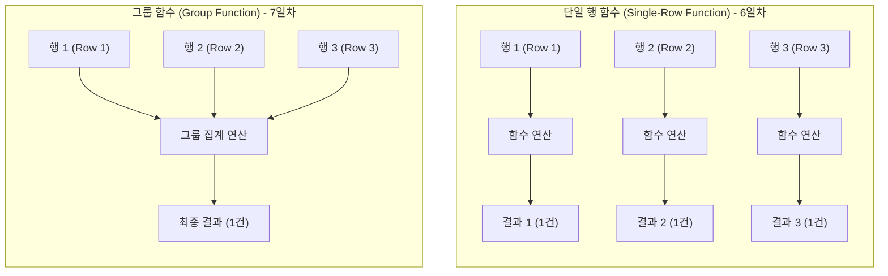

# Oracle SQL 그룹 함수(Group Functions) 및 데이터 집계 실습 가이드

오라클 SQL에서 **그룹 함수**(Group Function 또는 집계 함수 Aggregate Function)는 여러 행(Row)의 데이터를 입력받아 합계, 평균, 최댓값, 최솟값, 건수 등의 **단 하나의 요약 결과 행을 반환**하는 핵심 함수입니다.

이번 실습에서는 교재 내용을 바탕으로 **기본 집계 함수**(COUNT, SUM, AVG, MAX, MIN, 통계 함수)부터 데이터를 기준 컬럼별로 소그룹화하는 **GROUP BY 절**, 집계 결과에 조건을 부여하는 **HAVING 절**, 그리고 실무에서 다차원 분석 보고서 작성 시 활용되는 **고급 집계**(ROLLUP, CUBE, GROUPING SETS) 및 **행/열 변환**(PIVOT, UNPIVOT, LISTAGG), 마지막으로 **윈도우/순위 함수**(RANK, DENSE_RANK, ROW_NUMBER)까지 단계별 실습 예제와 함께 학습합니다.

> [!NOTE]
> **📖 SQL 문법 표기 규칙 안내**
> 본 가이드의 함수 및 SQL 문법 설명에 사용되는 기호는 다음과 같습니다:
> - `[ ]` (대괄호): 생략 가능한 **선택 사항**(Optional)을 나타냅니다. *(실제 SQL 작성 시 대괄호 기호는 입력하지 않습니다)*
> - `|` (파이프): 나열된 옵션 중 **하나를 선택**(OR)함을 나타냅니다.

---

## 0. 사전 준비: 실습 사용자 및 세션 확인

모든 SQL 실습은 관리자(`SYSTEM`) 계정이 아닌 **실습용 일반 사용자**(`KOREA_MALL`) 세션의 SQL 편집기에서 진행합니다.

```sql
-- 현재 접속 계정 확인 (결과가 KOREA_MALL 이어야 함)
SELECT USER FROM DUAL;
```

> 🎯 **핵심 배움 포인트** (실습 환경 확인):
> - 데이터베이스 카탈로그 오염을 방지하고 보안 원칙을 준수하기 위해 DDL/DML 및 집계 쿼리 실습은 반드시 일반 계정(`KOREA_MALL`) 세션에서 실행합니다.

---

## 1. 그룹 함수(Group Functions)의 핵심 원리와 분류 체계

SQL 함수는 처리하는 행(Row)의 개수에 따라 크게 **단일 행 함수**와 **그룹 함수**로 분류됩니다.

| 구분 | 설명 | 대표 예시 | 다루는 차수 |
| :---: | :--- | :--- | :---: |
| **단일 행 함수**<br>(Single-Row Function) | 한 행을 입력받아 각 행마다 하나의 결과를 반환 | `LENGTH`, `ROUND`, `SYSDATE`, `TO_CHAR` 등 | [6일차 (이전 섹션)](../sec06/06_01_function_guide.md) |
| **그룹 함수**(집계 함수)<br>(Group / Aggregate Function) | 여러 행을 입력받아 하나의 집계 결과를 반환 | `COUNT`, `SUM`, `AVG`, `MAX`, `MIN` 등 | **7일차** (현재 섹션) |



### 1.1 그룹 함수의 3대 핵심 특징
1. **NULL 값의 자동 제외**: 대부분의 그룹 함수(`SUM`, `AVG`, `MAX`, `MIN`, `COUNT(컬럼)`)는 연산 시 `NULL` 값을 자동으로 무시(제외)하고 계산합니다. 단, `COUNT(*)`는 `NULL`을 포함한 **전체 물리적 행의 수**를 카운트합니다.
2. **단일행 컬럼과의 동시 조회 불가**(ORA-00937): `SELECT` 절에 일반 컬럼과 그룹 함수를 함께 명시하면 출력 행 수가 일치하지 않아 `ORA-00937: 단일 그룹의 그룹 함수가 아닙니다` 오류가 발생합니다. 일반 컬럼과 함께 조회하려면 반드시 `GROUP BY` 절을 명시해야 합니다.
3. **WHERE 절에서 그룹 함수 사용 불가**(ORA-00934): `WHERE` 절은 각 행을 개별적으로 검사하는 필터링 단계이므로 그룹 함수를 조건식에 쓸 수 없습니다 (`ORA-00934: 그룹 함수는 허가되지 않습니다`). 그룹 집계 결과에 조건을 걸 때는 반드시 `HAVING` 절을 사용해야 합니다.

### 1.2 주요 그룹(집계) 함수 요약

| 함수명 | 기본 문법 | 설명 | NULL 처리 |
| :--- | :--- | :--- | :--- |
| `COUNT` | `COUNT(*)` \| `COUNT([DISTINCT] 컬럼)` | 조회된 행의 총 건수 반환 | `*`는 NULL 포함, 컬럼 지정 시 NULL 제외 |
| `SUM` | `SUM([DISTINCT] 컬럼)` | 지정된 컬럼 값의 총합 계산 | NULL 자동 제외 |
| `AVG` | `AVG([DISTINCT] 컬럼)` | 지정된 컬럼 값의 산술 평균 계산 | NULL 자동 제외 |
| `MAX` | `MAX([DISTINCT] 컬럼)` | 지정된 컬럼의 최댓값 반환 (숫자, 날짜, 문자열 지원) | NULL 자동 제외 |
| `MIN` | `MIN([DISTINCT] 컬럼)` | 지정된 컬럼의 최솟값 반환 (숫자, 날짜, 문자열 지원) | NULL 자동 제외 |
| `VARIANCE` | `VARIANCE(컬럼)` | 표본 분산(Variance) 계산 | NULL 자동 제외 |
| `STDDEV` | `STDDEV(컬럼)` | 표본 표준편차(Standard Deviation) 계산 | NULL 자동 제외 |

---

## 2. 기본 집계 함수 (Aggregate Functions)


## # 실습 예제 1 : 전체 리뷰 건수 구하기

대표적인 집계(그룹) 함수인 `COUNT(*)`를 사용하여 `reviews` 테이블에 적재된 `NULL` 포함 전체 데이터 행(Row)의 총 개수를 집계합니다.

### 1.1 실습 쿼리

```sql
-- 전체 리뷰 건수
SELECT
    COUNT(*) AS "전체리뷰건수"
FROM reviews;
```

### 1.2 쿼리 실행 결과 예시

| 전체리뷰건수 |
| :---: |
| 24 |

*(※ [6일차 실습 가이드](../sec06/06_01_function_guide.md)의 실습 예제 41에서 테스트 리뷰 1건(9001번)을 추가 등록했으므로 기존 23건에서 총 24건으로 조회됩니다. 테스트 데이터를 등록하지 않은 기본 상태라면 23건이 출력됩니다.)*

> 🎯 **핵심 배움 포인트** (COUNT(*)의 집계 원리와 성능 최적화):
> 
> 1. **`COUNT(*)`의 동작 원리**:
>    - 특정 컬럼의 `NULL` 유무와 상관없이 조건을 만족하는 **테이블의 순수 행(Row)의 총 개수**를 카운트합니다.
>    - 모든 컬럼이 `NULL`인 행이라 할지라도 물리적 행이 존재한다면 카운트에 포함됩니다.
> 
> 2. **오라클 옵티마이저의 `COUNT(*)` 최적화**:
>    - 오라클 11g 이후 최신 옵티마이저는 `COUNT(*)`를 실행할 때 무조건 전체 테이블 스캔(Full Table Scan)을 하지 않고, 테이블에 존재하는 **가장 작은 크기의 NOT NULL 인덱스(예: Primary Key 인덱스)를 스캔**하여 매우 빠르게 행 수를 계산합니다.
> 
> 3. **실무 활용 사례**:
>    - 페이징(Paging) 처리를 위한 전체 게시물/주문 건수 산출
>    - 배치(Batch) 작업 전후의 데이터 총량 일치 여부 무결성 검증

---

## # 실습 예제 2 : 특정 상품에 대해 리뷰를 작성한 고객 수 구하기

특정 컬럼명을 인자로 전달하는 `COUNT(컬럼명)` 문법과 `WHERE` 필터 조건을 결합하여, 1번 상품(`product_id = 1`)에 대해 작성된 유효한 리뷰 작성 고객의 총 건수를 집계합니다.

### 2.1 실습 쿼리

```sql
-- product_id = 1번 상품에 대해 리뷰를 작성한 고객 수
SELECT
    COUNT(customer_id) AS "특정상품리뷰작성고객수"
FROM reviews
WHERE product_id = 1;
```

### 2.2 쿼리 실행 결과 예시

| 특정상품리뷰작성고객수 |
| :---: |
| 3 |

*(※ 1번 상품에는 8번 고객의 리뷰(1번 리뷰), 6번 고객의 리뷰(17번 리뷰), 그리고 [6일차](../sec06/06_01_function_guide.md) 실습 예제 41에서 추가한 1번 고객의 테스트 리뷰(9001번)까지 총 3건이 집계됩니다.)*

> 🎯 **핵심 배움 포인트** (COUNT(*) vs COUNT(컬럼명)의 결정적 차이: NULL 카운트 여부):
> 
> 1. **`COUNT(*)` vs `COUNT(컬럼명)`의 핵심 차이**:
>    - `COUNT(*)`: 모든 행의 개수를 센다 (**`NULL` 행 포함**).
>    - `COUNT(컬럼명)`: 지정한 컬럼의 값이 `NULL`이 아닌(NOT NULL) 행만 센다 (`NULL` 자동 제외).
>    - 예시: 만약 어떤 컬럼에 값이 있는 행이 8개, `NULL`인 행이 2개라면 `COUNT(*)`는 `10`, `COUNT(해당컬럼)`은 `8`을 반환합니다.
> 
> 2. **`WHERE` 절과 집계 함수의 실행 순서**:
>    - SQL 실행 순서상 **`WHERE` 절이 집계 함수 연산보다 먼저 실행**됩니다.
>    - 따라서 `WHERE product_id = 1` 조건에 맞는 행들을 먼저 걸러낸 뒤, 필터링된 행들의 `customer_id` 건수를 카운트하게 됩니다.
> 
> 3. 🔥 **실무 꿀팁** (`DISTINCT`와의 결합):
>    - 한 고객이 동일 상품에 리뷰를 여러 번 작성했을 수 있으므로, **순수 중복 없는 작성자 수**(고유 고객 수)를 구할 때는 `DISTINCT` 키워드를 집계 함수 안에 함께 사용합니다:
>      ```sql
>      -- 1번 상품에 리뷰를 작성한 고유 고객 수 (중복 제거)
>      SELECT COUNT(DISTINCT customer_id) AS "고유고객수"
>      FROM reviews
>      WHERE product_id = 1;
>      ```

---

## # 실습 예제 3 : 리뷰를 한 번이라도 작성한 고객 수 구하기 (중복 제외)

집계 함수 `COUNT()`의 인자 내부에 `DISTINCT` 키워드를 결합하여, 한 고객이 여러 건의 리뷰를 작성했더라도 1명으로 취급하여 **실제로 리뷰를 1회 이상 작성한 순수 고유 고객(Unique Customers) 수**를 정확히 산출합니다.

### 3.1 실습 쿼리

```sql
-- 리뷰를 한 번이라도 작성한 고객 수 (중복 제외)
SELECT
    COUNT(DISTINCT customer_id) AS "리뷰작성고객수"
FROM reviews;
```

### 3.2 쿼리 실행 결과 예시

| 리뷰작성고객수 |
| :---: |
| 9 |

*(※ 전체 리뷰 건수는 24건이지만, 한 고객이 여러 개의 상품에 리뷰를 남긴 경우가 많으므로 중복을 제외한 실제 작성 고객은 9명으로 집계됩니다.)*

> 🎯 **핵심 배움 포인트** (COUNT(DISTINCT 컬럼)의 집계 원리와 성능 최적화):
> 
> 1. **`COUNT(DISTINCT 컬럼)`의 동작 메커니즘**:
>    - 지정한 컬럼의 데이터에서 `NULL`을 자동으로 제외한 후, 중복된 값들을 하나로 압축(Unique)하여 고유한 값의 총개수만 카운트합니다.
> 
> 2. **비즈니스 관점의 결정적 차이**:
> 
> | 집계 쿼리 | 집계 결과 | 비즈니스적 의미 |
> | :--- | :---: | :--- |
> | `COUNT(*)` | **24** | 플랫폼에 작성된 **총 누적 리뷰 게시물 수** |
> | `COUNT(customer_id)` | **24** | 고객 ID가 존재하는 유효 리뷰 건수 |
> | `COUNT(DISTINCT customer_id)` | **9** | 리뷰 작성 활동에 참여한 **순수 활성 고객(작성자) 수** |
> 
> 3. ⚠️ **대용량 데이터 환경에서의 성능 주의사항**:
>    - `DISTINCT` 연산은 중복을 제거하기 위해 내부적으로 메모리(PGA)에서 **정렬**(Sort Unique) 또는 **해시 테이블**(Hash Unique)을 생성합니다.
>    - 수천만 건 이상의 대용량 테이블에서 `COUNT(DISTINCT)`를 무분별하게 실행하면 높은 CPU와 임시 테이블스페이스(Temp Tablespace) I/O가 발생할 수 있습니다.
>    - 오라클 12c R2 이상에서는 빅데이터 분석 시 오차 범위 1~2% 내외로 고속 집계하는 `APPROX_COUNT_DISTINCT()` 근사 집계 함수도 제공합니다.
> 
> 4. **실무 핵심 활용 사례**:
>    - **이커머스/플랫폼**: 당일 결제 고객 수(PU, Paying Users), 월간 활성 사용자 수(MAU) 집계
>    - **마케팅 분석**: 특정 프로모션 쿠폰을 실제로 발급받아 사용한 고유 회원 수 측정

---

## # 실습 예제 4 : 전체 매출 합계 구하기

집계 함수 `SUM()`의 인자로 단순 컬럼뿐만 아니라 산술 연산식(`price_each * quantity`)을 전달하여, `order_items` 테이블의 각 주문 품목별 금액을 개별 계산한 후 전체 누적 합계(총매출액)를 집계합니다.

### 4.1 실습 쿼리

```sql
-- 전체 주문 아이템 금액 합계
SELECT
    SUM(price_each * quantity) AS "총매출액"
FROM order_items;
```

### 4.2 쿼리 실행 결과 예시

| 총매출액 |
| :---: |
| 1060200 |

*(※ 전체 39개 주문 상세 항목의 개별 구매액(단가 × 수량)이 모두 누적 합산되어 1,060,200원이 산출됩니다.)*

> 🎯 **핵심 배움 포인트** (SUM 함수의 연산 메커니즘과 NULL 처리 주의사항):
> 
> 1. **산술 표현식의 집계**(Row-level calculation then Aggregate):
>    - `SUM(price_each * quantity)`는 각 행마다 `price_each`와 `quantity`의 곱셈을 먼저 수행하고, 산출된 개별 결과값들을 대상으로 최종 합계를 계산합니다.
> 
> 2. 🔥 **집계 함수의 NULL 자동 제외와 대상 건수 0건일 때의 주의사항**:
>    - `SUM()` 함수는 연산 대상 값 중 `NULL`이 있으면 이를 **자동으로 무시(제외)하고 계산**합니다.
>    - ⚠️ **매우 중요한 실무 함정**: 만약 조회 조건(`WHERE`)에 일치하는 데이터가 1건도 없거나 모든 행의 값이 `NULL`이라면, `SUM()`의 결과는 `0`이 아니라 **`NULL`을 반환**합니다.
>    - 따라서 애플리케이션 화면이나 계산 로직에서 `NullPointerException`이나 계산 오류를 방지하기 위해 **`NVL(SUM(...), 0)` 형태로 방어 코드를 작성하는 것이 실무 표준 원칙**입니다:
>      ```sql
>      -- [실무 표준 패턴] 데이터가 없어도 안전하게 0을 반환하도록 처리
>      SELECT NVL(SUM(price_each * quantity), 0) AS "안전총매출액"
>      FROM order_items
>      WHERE order_id = 9999; -- 존재하지 않는 주문 조회 시 결과: 0
>      ```
> 
> 3. **실무 활용 사례**:
>    - 주문/결제 상세 테이블 기반의 총 결제 금액, 할인 총액, 적립금 합계 계산
>    - 일자별/월별 누적 매출 정산 리포트 산출

---

## # 실습 예제 5 : 전체 상품 평균 가격 구하기

집계 함수 `AVG()`를 사용하여 `products` 테이블에 등록된 전체 25개 상품 정가(`price`)의 산술 평균값을 계산합니다.

### 5.1 실습 쿼리

```sql
-- 전체 상품 평균 가격
SELECT
    AVG(price) AS "평균상품가격"
FROM products;
```

### 5.2 쿼리 실행 결과 예시

| 평균상품가격 |
| :---: |
| 12104 |

*(※ 등록된 25개 상품의 총합인 302,600원을 전체 상품 수(25)로 나눈 산술 평균값 12,104원이 출력됩니다.)*

> 🎯 **핵심 배움 포인트** (AVG 함수의 NULL 처리 메커니즘과 ROUND 결합):
> 
> 1. **`AVG()` 함수의 연산 원리**:
>    - 숫자형 컬럼의 모든 유효 행 합계를 유효 행 개수로 나눈 산술 평균(`SUM / COUNT`)을 반환합니다.
> 
> 2. 🔥 **시험 및 실무 최빈출: `AVG(컬럼)`의 NULL 처리와 `NVL` 결합의 차이**:
>    - `AVG(price)`: `NULL`인 행을 **분모(카운트)에서 완전히 제외**하고 평균을 계산합니다 (`SUM(price) / COUNT(price)`).
>    - `AVG(NVL(price, 0))`: `NULL`인 행을 0으로 치환하여 **전체 행을 분모에 포함**시켜 평균을 계산합니다 (`SUM(price) / COUNT(*)`).
>    - 데이터에 `NULL`이 존재할 경우 두 방식의 결과값이 완전히 달라지므로, '**누락된 데이터를 제외한 순수 평균**'인지 '**누락 건수를 0점으로 포함한 전체 모집단 평균**'인지 비즈니스 요건을 명확히 정의해야 합니다.
> 
> 3. **소수점 제어 함수와의 실무 결합**:
>    - 평균값 계산 시 소수점이 길게 발생할 수 있으므로, 실무에서는 단일행 숫자 함수인 `ROUND()`나 `TRUNC()`를 함께 중첩하여 표기하는 패턴이 기본 표준입니다:
>      ```sql
>      -- 소수점 첫째 자리까지 반올림
>      SELECT ROUND(AVG(price), 1) AS "반올림평균가격"
>      FROM products;
>      ```
> 
> 4. **실무 활용 사례**:
>    - 카테고리별/브랜드별 상품 평균 판매 단가 산출
>    - 고객별 평균 결제 단가(AOV, Average Order Value), 객단가 분석 지표 산출

---

## # 실습 예제 6 : 상품 최고가와 최저가 구하기

집계 함수 `MAX()`와 `MIN()`을 함께 사용하여 `products` 테이블에 등록된 전체 상품 중 가장 비싼 정가(최고가)와 가장 저렴한 정가(최저가)를 한 번의 쿼리로 동시에 산출합니다.

### 6.1 실습 쿼리

```sql
-- 전체 상품 가격의 최고가와 최저가
SELECT
    MAX(price) AS "최고가",
    MIN(price) AS "최저가"
FROM products;
```

### 6.2 쿼리 실행 결과 예시

| 최고가 | 최저가 |
| :---: | :---: |
| 17000 | 4100 |

*(※ 최고가는 '나는 내가 죽었다고 생각했습니다'의 17,000원, 최저가는 '성공하는 사람들의 7가지 습관'의 4,100원이 산출됩니다.)*

> 🎯 **핵심 배움 포인트** (MAX/MIN 함수의 다양한 데이터 타입 지원과 ORA-00937 에러 방지):
> 
> 1. **다양한 데이터 타입 지원** (숫자, 문자, 날짜):
>    - `MAX`와 `MIN`은 숫자뿐만 아니라 정렬 순서가 존재하는 모든 데이터 타입에 적용할 수 있습니다:
>      - **숫자**: 가장 큰 수치 vs 가장 작은 수치
>      - **문자**(VARCHAR2): 사전순 맨 뒤의 문자열 vs 맨 앞의 문자열
>      - **날짜**(DATE): **가장 최근(미래)의 일시**(`MAX(created_at)`) vs **가장 오래된(과거) 일시**(`MIN(created_at)`)
> 
> 2. ⚠️ **가장 흔한 초보자 실수: `ORA-00937 (단일 그룹의 그룹 함수가 아닙니다)`**:
>    - 최고가인 상품의 **이름(`name`)까지 같이 보고 싶어서** 다음과 같이 쿼리를 작성하면 오류가 발생합니다:
>      ```sql
>      -- [오류 발생] 단일행 컬럼(name)과 다중행 집계함수(MAX)의 무단 혼용
>      SELECT name, MAX(price) FROM products;
>      -- ORA-00937: 단일 그룹의 그룹 함수가 아닙니다
>      ```
>    - **오류 원인**: `MAX(price)`는 전체 25개 행을 1개 행으로 압축하여 반환하는데, `name`은 25개의 개별 행이므로 행의 개수가 맞지 않아 오라클이 결과를 조립할 수 없습니다.
>    - **올바른 해결 방법**: 최고가인 상품의 상세 정보를 함께 보려면 서브쿼리(Subquery)를 사용해야 합니다:
>      ```sql
>      -- [올바른 방법] 서브쿼리를 이용해 최고가를 가진 상품 정보 조회
>      SELECT name, price
>      FROM products
>      WHERE price = (SELECT MAX(price) FROM products);
>      ```
> 
> 3. **인덱스를 활용한 MAX/MIN 성능 최적화** (Index Min/Max Scan):
>    - `price` 컬럼에 B-Tree 인덱스가 생성되어 있다면, 오라클은 테이블 전체를 읽지 않고 **인덱스 트리의 맨 앞 1건(MIN)과 맨 뒤 1건(MAX)만 단 한 번의 I/O로 즉시 조회**하여 수천만 건의 대용량 테이블에서도 0.001초 만에 응답합니다.
> 
> 4. **실무 활용 사례**:
>    - 쇼핑몰 상품 검색 필터의 가격 범위 슬라이더(최소~최대 가격 바운더리) 설정
>    - 회원의 최초 가입일시(`MIN(registered_date)`)와 최근 로그인일시(`MAX(last_login_at)`) 파악

---

## # 실습 예제 7 : 최근 주문일과 최초 주문일 구하기

날짜형(`DATE`) 컬럼에 집계 함수 `MAX()`와 `MIN()`을 적용하여 `orders` 테이블에 기록된 전체 주문 중 가장 최근에 발생한 마지막 주문 일자와 가장 오래전에 발생한 최초 주문 일자를 한 번에 조회합니다.

### 7.1 실습 쿼리

```sql
-- 전체 주문 중 최근 주문일과 최초 주문일
SELECT
    MAX(order_date) AS "최근주문일",
    MIN(order_date) AS "최초주문일"
FROM orders;
```

### 7.2 쿼리 실행 결과 예시

| 최근주문일 | 최초주문일 |
| :---: | :---: |
| 2025-06-12 00:00:00 | 2025-05-24 00:00:00 |

*(※ 전체 20건의 주문 데이터 중 가장 최근 날짜는 2025년 6월 12일, 가장 오래된 첫 주문 날짜는 2025년 5월 24일로 정확하게 집계됩니다.)*

> 🎯 **핵심 배움 포인트** (날짜 데이터에서의 MAX/MIN 원리와 TO_CHAR 중첩):
> 
> 1. **날짜 데이터에서의 `MAX` vs `MIN` 의미**:
>    - 시간의 흐름상 과거에서 미래로 갈수록 날짜 값이 커지므로:
>      - `MAX(date)`: 가장 미래/나중의 시점 ➔ **가장 최근 일자**(Latest Date)
>      - `MIN(date)`: 가장 과거/앞선 시점 ➔ **가장 오래된 최초 일자**(Earliest Date)
> 
> 2. **날짜 포맷 함수(`TO_CHAR`)와의 중첩 결합**:
>    - 시·분·초까지 출력되는 `DATE` 포맷을 연-월-일만 깔끔하게 출력하려면 단일행 함수 `TO_CHAR()`를 바깥쪽에 감싸서 포맷팅합니다:
>      ```sql
>      -- [실무 표준 포맷팅] 연-월-일 형태로 정제하여 출력
>      SELECT
>          TO_CHAR(MAX(order_date), 'YYYY-MM-DD') AS "최근주문일자",
>          TO_CHAR(MIN(order_date), 'YYYY-MM-DD') AS "최초주문일자"
>      FROM orders;
>      ```
> 
> 3. **날짜 간격 연산**(서비스 운영 기간 분석):
>    - `MAX(order_date) - MIN(order_date)` 연산을 통해 전체 데이터가 누적된 **총 영업/운영 일수**(기간)를 손쉽게 계산할 수 있습니다:
>      ```sql
>      SELECT MAX(order_date) - MIN(order_date) AS "총영업일수"
>      FROM orders;
>      -- 결과: 19일
>      ```
> 
> 4. **실무 활용 사례**:
>    - **RFM 고객 분석**: 고객별 최근 구매일(Recency) 파악을 위한 `MAX(order_date)` 집계
>    - **고객 생애 가치**(LTV): 첫 구매일(`MIN`)부터 최근 구매일(`MAX`)까지의 고객 활동 유지 기간 분석

---

## # 실습 예제 8 : 상품명 기준 사전순 첫 번째와 마지막 구하기

문자열(`VARCHAR2`) 컬럼에 집계 함수 `MIN()`과 `MAX()`를 적용하여, `products` 테이블의 전체 상품명을 사전순(가나다순/알파벳순/문자 코드순)으로 정렬했을 때 가장 처음에 위치하는 상품명과 가장 마지막에 위치하는 상품명을 추출합니다.

### 8.1 실습 쿼리

```sql
-- 상품명을 사전순으로 정렬시 첫 번째와 마지막 상품
SELECT
    MIN(name) AS "사전순첫상품",
    MAX(name) AS "사전순마지막상품"
FROM products;
```

### 8.2 쿼리 실행 결과 예시

| 사전순첫상품 | 사전순마지막상품 |
| :--- | :--- |
| 1984 | 하버드 새벽 4시 반 |

*(※ 오라클의 기본 문자셋 정렬 기준상 숫자(`'1984'`)가 한글/영문보다 앞서므로 첫 상품은 `'1984'`, 한글 자음 중 가장 뒤인 'ㅎ'으로 시작하는 `'하버드 새벽 4시 반'`이 마지막 상품으로 집계됩니다.)*

> 🎯 **핵심 배움 포인트** (문자열에서의 MIN/MAX 사전순 비교 원리와 정렬 체계):
> 
> 1. **문자열 데이터에서의 `MIN` vs `MAX` 동작 메커니즘**:
>    - 문자의 바이트 코드값(ASCII / Unicode)을 기준으로 **사전 편찬 순서**(Lexicographical Order)로 크기를 비교합니다:
>      - `MIN(name)`: 사전순으로 **가장 앞선(작은) 문자열**
>      - `MAX(name)`: 사전순으로 **가장 뒤에 나오는(큰) 문자열**
> 
> 2. **오라클의 기본 문자 정렬 순서** (오름차순 기준):
>    - 일반적인 환경(`NLS_SORT = BINARY`)에서 문자의 크기 순서는 다음과 같습니다:
>      $$\text{공백/특수문자} < \text{숫자 (0~9)} < \text{영문 대문자 (A~Z)} < \text{영문 소문자 (a~z)} < \text{한글 (가~힣)}$$
>    - 따라서 숫자로 시작하는 `'1984'`가 가장 작으므로 `MIN` 결과가 되고, 한글 '하'로 시작하는 상품이 가장 크므로 `MAX` 결과가 됩니다.
> 
> 3. **데이터 타입별 `MIN` / `MAX` 핵심 종합 정리**:
> 
> | 데이터 타입 | `MIN(컬럼)` | `MAX(컬럼)` |
> | :---: | :--- | :--- |
> | **숫자형** (NUMBER) | 가장 작은 수치 (예: 최저 가격) | 가장 큰 수치 (예: 최고 가격) |
> | **날짜형** (DATE) | 가장 과거/오래된 날짜 (예: 최초 주문일) | 가장 최근/미래의 날짜 (예: 최근 주문일) |
> | **문자형** (VARCHAR2) | 사전순 맨 앞의 단어 (예: '1984') | 사전순 맨 뒤의 단어 (예: '하버드...') |
> 
> 4. **실무 활용 사례**:
>    - 회원 이름, 부서명, 카테고리명의 가나다순 인덱스 색인 범위(ㄱ~ㅎ) 가이드라인 설정
>    - 커서 기반 페이징(Cursor-based Pagination) 구현 시 시작과 끝의 기준 키값 추출

---

## # 실습 예제 9 : 주문 상품 금액의 최대·최소 구하기

집계 함수 `MAX()`와 `MIN()`의 인자로 컬럼 간의 산술 연산식(`price_each * quantity`)을 전달하여, `order_items` 테이블에서 각 주문 항목별 구매 총액(단가 × 수량) 중 가장 큰 금액(최대 주문 금액)과 가장 작은 금액(최소 주문 금액)을 계산합니다.

### 9.1 실습 쿼리

```sql
-- (단가 * 수량) 기준 최대 금액과 최소 금액
SELECT
    MAX(price_each * quantity) AS "최대주문상품금액",
    MIN(price_each * quantity) AS "최소주문상품금액"
FROM order_items;
```

### 9.2 쿼리 실행 결과 예시

| 최대주문상품금액 | 최소주문상품금액 |
| :---: | :---: |
| 49500 | 7500 |

*(※ 전체 39개 주문 항목 중 단일 품목 최대 구매액은 16,500원 × 3개 = 49,500원, 최소 구매액은 7,500원 × 1개 = 7,500원으로 산출됩니다.)*

> 🎯 **핵심 배움 포인트** (산술식 기반 집계 연산과 함수 기반 인덱스 최적화):
> 
> 1. **표현식 기반의 집계 연산 메커니즘**:
>    - 집계 함수(`MAX`, `MIN`, `SUM`, `AVG`)는 단일 컬럼뿐만 아니라 산술 연산자(`*`, `+`, `-`, `/`)나 단일행 함수가 포함된 **복합 표현식**을 인자로 받을 수 있습니다.
>    - 오라클은 각 행마다 `price_each * quantity` 연산을 먼저 수행하고, 그 결과값들의 집합에서 최댓값과 최솟값을 추출합니다.
> 
> 2. ⚠️ **인덱스 스캔 불가와 성능 고려사항**:
>    - `price_each`나 `quantity`에 각각 단일 컬럼 인덱스가 존재하더라도, `price_each * quantity`처럼 컬럼을 연산(가공)하면 **기존 인덱스를 활용한 Min/Max 고속 스캔(Index Min/Max Scan)이 불가능**하며 전체 테이블 스캔(Full Table Scan)이 발생합니다.
>    - 만약 대용량 시스템에서 이러한 산술식 집계가 매우 빈번하다면:
>      1. **함수 기반 인덱스**(FBI): `CREATE INDEX idx_order_items_amt ON order_items(price_each * quantity);`
>      2. **가상 컬럼**(Virtual Column): `ALTER TABLE order_items ADD item_amount AS (price_each * quantity);`
>      등의 오라클 고급 기능을 적용하여 인덱스 스캔 성능을 확보할 수 있습니다.
> 
> 3. **실무 활용 사례**:
>    - 단일 주문 건당 최대 구매 품목 및 최저 구매 품목의 금액대 모니터링
>    - 장바구니/주문서 내에서 무료 배송 조건이나 특정 프로모션 혜택 적용 대상 품목 필터링

---

## # 실습 예제 10 : 상품 가격의 분산 구하기

통계 집계 함수인 `VARIANCE()`를 사용하여 `products` 테이블의 전체 상품 정가(`price`) 데이터가 평균값(12,104원)을 중심으로 얼마나 넓게 흩어져(분포되어) 있는지를 나타내는 **표본 분산**(Sample Variance)을 산출합니다.

### 10.1 실습 쿼리

```sql
-- 전체 상품 가격의 분산
SELECT
    VARIANCE(price) AS "가격분산"
FROM products;
```

### 10.2 쿼리 실행 결과 예시

| 가격분산 |
| :---: |
| 14457900 |

*(※ 각 상품 가격과 평균 가격(12,104원) 간의 편차 제곱합을 표본 자유도인 $(n-1 = 24)$로 나눈 분산 값 약 14,457,900이 출력됩니다.)*

> 🎯 **핵심 배움 포인트** (VARIANCE 함수의 통계적 의미와 분산 집계 제품군):
> 
> 1. **`VARIANCE()` 함수의 통계적 의미**:
>    - 데이터들이 평균(Mean)으로부터 얼마나 멀리 떨어져 분포하는지를 측정하는 대표적인 **산포도**(Dispersion) 지표입니다.
>    - 수치가 0에 가까울수록 데이터들이 평균에 밀집되어 가격대가 고르다는 뜻이고, 수치가 클수록 저가 상품과 고가 상품의 가격 격차가 심하다는 의미입니다.
> 
> 2. **오라클 분산 함수 제품군** (표본 분산 vs 모분산):
> 
> | 함수명 | 표준 구분 | 수학적 정의 | 설명 |
> | :--- | :--- | :---: | :--- |
> | `VARIANCE(expr)` | Oracle 기본 | $\frac{\sum (X - \bar{X})^2}{n - 1}$ | **표본 분산** ($(n-1)$로 나눔, 기본 권장) |
> | `VAR_SAMP(expr)` | ANSI SQL 표준 | $\frac{\sum (X - \bar{X})^2}{n - 1}$ | ANSI 표준 표본 분산 (`VARIANCE`와 동일) |
> | `VAR_POP(expr)` | ANSI SQL 표준 | $\frac{\sum (X - \mu)^2}{n}$ | **모집단 분산** ($n$ 전체 건수로 나눔) |
> 
> 3. **분산의 한계와 표준편차(`STDDEV`)의 필요성**:
>    - 분산은 계산 과정에서 단위를 제곱하므로 원래 데이터의 단위(원)가 아닌 '**원²**' 단위가 되어 수치가 수천만 단위로 비대해지고 직관적인 해석이 어렵습니다.
>    - 따라서 실무에서는 분산에 제곱근(루트)을 씌워 원래 데이터와 동일한 단위로 복원한 **표준편차**(`STDDEV`)를 훨씬 더 널리 사용합니다.
> 
> 4. **실무 활용 사례**:
>    - 금융/투자 도메인: 펀드 및 주가 수익률의 변동성(리스크) 측정
>    - 제조/물류 도메인: 제품 품질 오차 및 배송 소요 시간의 편차 안정성 모니터링

---

## # 실습 예제 11 : 상품 가격 변동성 분석하기

통계 집계 함수인 `VARIANCE()`와 `STDDEV()`를 동시에 조회하여, `products` 테이블의 상품 가격 분산과 함께 분산의 양의 제곱근인 **표준편차**(Standard Deviation)를 산출함으로써 원본 데이터 단위(원) 기준의 직관적인 가격 변동성을 분석합니다.

### 11.1 실습 쿼리

```sql
-- 전체 상품 가격의 분산과 표준편차
SELECT
    VARIANCE(price) AS "가격분산",
    STDDEV(price)   AS "가격표준편차"
FROM products;
```

### 11.2 쿼리 실행 결과 예시

| 가격분산 | 가격표준편차 |
| :---: | :---: |
| 14457900 | 3802.35 |

*(※ 전체 상품 평균 가격(12,104원)을 기준으로 상품 가격들의 표준편차는 약 ±3,802원 수준으로 형성되어 있음을 직관적으로 파악할 수 있습니다.)*

> 🎯 **핵심 배움 포인트** (STDDEV의 통계적 의미와 분산과의 상호 관계):
> 
> 1. **`STDDEV()` 함수의 통계적 의미와 가치**:
>    - 표준편차는 **분산(`VARIANCE`)에 제곱근(루트)을 씌운 값**으로, 데이터의 흩어짐 정도를 **원본 데이터와 동일한 측정 단위**('원')로 복원한 핵심 지표입니다:
>      $$\text{STDDEV}(X) = \sqrt{\text{VARIANCE}(X)}$$
>    - 즉, `SELECT SQRT(VARIANCE(price)) FROM products;`와 `SELECT STDDEV(price) FROM products;`는 완전히 동일한 결과를 산출합니다.
> 
> 2. **오라클 표준편차 함수 제품군**:
> 
> | 함수명 | 표준 구분 | 수학적 정의 | 설명 |
> | :--- | :--- | :---: | :--- |
> | `STDDEV(expr)` | Oracle 기본 | $\sqrt{\frac{\sum (X - \bar{X})^2}{n - 1}}$ | **표본 표준편차** ($(n-1)$ 자유도 기준, 기본 권장) |
> | `STDDEV_SAMP(expr)` | ANSI SQL 표준 | $\sqrt{\frac{\sum (X - \bar{X})^2}{n - 1}}$ | ANSI 표준 표본 표준편차 (`STDDEV`와 동일) |
> | `STDDEV_POP(expr)` | ANSI SQL 표준 | $\sqrt{\frac{\sum (X - \mu)^2}{n}}$ | **모집단 표준편차** ($n$ 전체 건수 기준) |
> 
> 3. **반올림 함수(`ROUND`)와의 실무 결합**:
>    - 표준편차는 제곱근 연산의 특성상 소수점 이하 자리수가 길게 출력되므로, 리포트나 UI에 노출할 때는 `ROUND()`로 소수점을 정제하는 것이 좋습니다:
>      ```sql
>      -- 소수점 둘째 자리까지 반올림
>      SELECT ROUND(STDDEV(price), 2) AS "정제된_표준편차"
>      FROM products;
>      ```
> 
> 4. **실무 활용 사례**:
>    - **이상치 탐지**(Anomaly Detection): 평균 $\pm 2\sigma$ 또는 $\pm 3\sigma$ (정규분포 95%~99.7% 신뢰구간)를 벗어나는 비정상 고가/저가 상품이나 부정 결제(FDS) 적발
>    - **위험 관리**(Risk Management): 일자별 매출 변동폭 모니터링, 고객 결제 주기의 불규칙성 측정

---

## 3. 데이터 그룹화: GROUP BY 절


## # 실습 예제 12 : GROUP BY를 이용한 모든 상품별 리뷰 작성 고객 수 구하기

`GROUP BY` 절을 사용하여 `reviews` 테이블의 전체 리뷰 데이터를 상품 번호(`product_id`)를 기준으로 그룹화한 뒤, 각 상품별로 리뷰를 작성한 고객 수(`COUNT(customer_id)`)를 개별 집계하여 상품 ID 오름차순으로 정렬 출력합니다.

### 12.1 실습 쿼리

```sql
-- 상품별 리뷰 작성 고객 수
SELECT
    product_id AS "상품ID",
    COUNT(customer_id) AS "리뷰작성고객수"
FROM reviews
GROUP BY product_id
ORDER BY 상품ID;
```

### 12.2 쿼리 실행 결과 예시

| 상품ID | 리뷰작성고객수 |
| :---: | :---: |
| 1 | 3 |
| 2 | 1 |
| 3 | 2 |
| 5 | 1 |
| 7 | 1 |
| 9 | 1 |
| 10 | 2 |
| ... | ... |
| 25 | 2 |

*(※ 전체 테이블 단위 1건의 집계가 아니라, `product_id` 고유 값마다 소그룹이 형성되어 상품별 리뷰 건수가 개별 산출됩니다.)*

> 🎯 **핵심 배움 포인트** (GROUP BY의 동작 메커니즘과 ORA-00979 방어 원칙):
> 
> 1. **`GROUP BY` 절의 동작 원리**:
>    - 특정 컬럼의 값이 동일한 행들을 모아서 하나의 **소그룹**(버킷)으로 묶어줍니다.
>    - 집계 함수(`COUNT`, `SUM`, `AVG` 등)는 전체 테이블이 아닌 **각 소그룹 내의 행들을 대상**으로 각각 독립적으로 계산되어 그룹당 1행씩 결과를 반환합니다.
> 
> 2. ⚠️ **가장 중요한 문법 규칙: `ORA-00979 (GROUP BY 표현식이 아닙니다)`**:
>    - 쿼리에 `GROUP BY` 절을 사용하는 순간, `SELECT` 절에는 오직 다음 두 가지만 작성할 수 있습니다:
>      1. **`GROUP BY` 절에 명시한 기준 컬럼** (예: `product_id`)
>      2. **그룹(집계) 함수로 감싸진 표현식** (예: `COUNT(customer_id)`)
>    - 만약 그룹화 기준에 없는 일반 컬럼(예: `rating`, `content`)을 `SELECT` 절에 단독으로 쓰면 오라클은 그룹 내 여러 값 중 어떤 값을 출력해야 할지 알 수 없으므로 **`ORA-00979` 에러**가 발생합니다.
> 
> 3. **SQL 구문 실행 순서와 ALIAS 사용 규칙**:
>    - 오라클 SQL의 실제 내부 실행 순서는 다음과 같습니다:
>      $$\text{① FROM} \rightarrow \text{② WHERE} \rightarrow \text{③ GROUP BY} \rightarrow \text{④ HAVING} \rightarrow \text{⑤ SELECT} \rightarrow \text{⑥ ORDER BY}$$
>    - `SELECT` 절(5번)에서 부여한 별칭(`"상품ID"`)은 그보다 나중에 실행되는 `ORDER BY` 절(6번)에서는 자유롭게 참조하여 정렬 기준으로 사용할 수 있습니다.
>    - 반면 `GROUP BY` 절(3번)은 `SELECT` 절보다 먼저 실행되므로 `GROUP BY 상품ID`처럼 별칭을 사용할 수 없습니다(컬럼명 원본인 `GROUP BY product_id` 명시 필수).
> 
> 4. **실무 활용 사례**:
>    - 카테고리별 등록 상품 수 및 재고 합계 파악
>    - 고객별 누적 주문 건수 및 총 결제 금액 산출
>    - 월별/일별 신규 가입자 수 집계 통계 대시보드

---

## # 실습 예제 13 : 상품별 리뷰 평점 평균 구하기

`GROUP BY` 절을 통해 상품별로 그룹화한 뒤 `AVG(rating)` 함수로 각 상품의 평균 리뷰 평점을 계산하고, 가장 평점이 높은 상품부터 내림차순(`ORDER BY 평균평점 DESC`)으로 정렬하여 출력합니다.

### 13.1 실습 쿼리

```sql
-- 상품별 리뷰 평점 평균
SELECT
    product_id AS "상품ID",
    AVG(rating) AS "평균평점"
FROM reviews
GROUP BY product_id
ORDER BY 평균평점 DESC;
```

### 13.2 쿼리 실행 결과 예시

| 상품ID | 평균평점 |
| :---: | :---: |
| 22 | 5 |
| 13 | 4.5 |
| 25 | 4.5 |
| 1 | 4 |
| 3 | 4 |
| 7 | 4 |
| ... | ... |
| 10 | 3.5 |
| 2 | 3 |

*(※ 평점이 가장 높은 22번 상품(5.0점)이 상단에 배치되고, 평점이 낮은 상품들이 아래쪽에 정렬됩니다.)*

> 🎯 **핵심 배움 포인트** (그룹 집계와 정렬의 결합 및 평점 UI 연동):
> 
> 1. **그룹화와 집계 함수의 독립 계산**:
>    - `GROUP BY product_id`로 인해 `reviews` 테이블이 각 상품별 독립된 소그룹으로 분할되며, `AVG(rating)`는 각 상품 그룹 안의 평점들만 모아서 평균을 계산합니다.
> 
> 2. **집계 별칭(ALIAS)을 이용한 편리한 정렬**:
>    - SQL 실행 순서상 **`SELECT` 절에서 별칭(`평균평점`)이 먼저 정의된 후 `ORDER BY` 절이 실행**되므로, 정렬 절에서 복잡한 집계 수식 대신 깔끔하게 별칭을 사용할 수 있습니다.
>    - `ORDER BY 평균평점 DESC`는 `ORDER BY AVG(rating) DESC`와 완벽히 동일하게 동작합니다.
> 
> 3. **소수점 제어와 평점 뱃지 UI 연동**:
>    - 실제 이커머스 서비스의 '별점(★)' UI에 노출할 때는 단일행 함수 `ROUND()`를 결합하여 소수점 첫째 자리 또는 둘째 자리로 단정하게 표기합니다:
>      ```sql
>      SELECT
>          product_id AS "상품ID",
>          ROUND(AVG(rating), 2) AS "정제된_평균평점"
>      FROM reviews
>      GROUP BY product_id
>      ORDER BY "정제된_평균평점" DESC;
>      ```
> 
> 4. **실무 활용 사례**:
>    - 쇼핑몰 상품 목록의 기본 정렬 옵션 중 하나인 '**평점 높은 순** (리뷰 우수순)' 쿼리 구현
>    - 추천 알고리즘: 평균 평점 4.5 이상인 우수 상품 대상 '베스트 추천 상품' 뱃지 자동 부착

---

## # 실습 예제 14 : 고객별 주문 건수 구하기

`orders` 테이블에서 주문을 발생시킨 고객 번호(`customer_id`)를 기준으로 그룹화하여 각 고객이 지금까지 총 몇 번의 주문을 진행했는지(`COUNT(order_id)`)를 집계합니다.

### 14.1 실습 쿼리

```sql
-- 고객별 주문 건수 구하기
SELECT
    customer_id AS "고객ID",
    COUNT(order_id) AS "주문건수"
FROM orders
GROUP BY customer_id;
```

### 14.2 쿼리 실행 결과 예시

| 고객ID | 주문건수 |
| :---: | :---: |
| 4 | 3 |
| 5 | 3 |
| 6 | 4 |
| 7 | 3 |
| 8 | 5 |
| 9 | 2 |

*(※ 주문 이력이 존재하는 6명의 고객별로 누적 주문 횟수가 각각 2건~5건으로 정확히 분할 집계됩니다.)*

> 🎯 **핵심 배움 포인트** (1:N 관계에서의 그룹 집계와 주문 0건 고객 분석):
> 
> 1. **부모-자식 관계에서의 그룹 집계**:
>    - `customers`(1)와 `orders`(N)의 관계에서, 자식 테이블인 `orders`를 외래키(`customer_id`)로 그룹핑하면 각 부모 개체별 활동량을 빠르게 카운트할 수 있습니다.
> 
> 2. 🔥 실무 최빈출 질문: "**주문한 적이 없는(0건) 고객까지 모두 보려면?**":
>    - 위 쿼리는 `FROM orders`로 주문 테이블만 조회했기 때문에, **최소 1회 이상 주문한 고객(4, 5, 6, 7, 8, 9번)만 결과에 노출**됩니다. (주문한 적이 없는 1, 2, 3, 10번 고객 등은 누락됨)
>    - 만약 전체 고객을 기준으로 "**주문 이력이 없는 고객은 주문건수 0건으로 표시**"하여 모든 고객의 주문량을 파악하려면, `LEFT OUTER JOIN`을 결합해야 합니다:
>      ```sql
>      -- [실무 확장 패턴] 주문 이력이 없는 고객도 0건으로 포함하여 전체 조회
>      SELECT
>          c.customer_id AS "고객ID",
>          c.name AS "고객명",
>          COUNT(o.order_id) AS "주문건수"
>      FROM customers c
>      LEFT OUTER JOIN orders o ON c.customer_id = o.customer_id
>      GROUP BY c.customer_id, c.name
>      ORDER BY c.customer_id;
>      ```
>      *(※ 이때 집계 함수로 `COUNT(*)`가 아닌 `COUNT(o.order_id)`를 사용해야 주문이 없는 고객의 건수가 `NULL`이 아닌 `0`으로 정상 집계됩니다.)*
> 
> 3. **실무 활용 사례**:
>    - **충성 고객(Heavy Buyer) 발굴**: 누적 주문 건수가 5회 이상인 우수 고객 대상 감사 쿠폰 발행
>    - **재구매율(Repurchase Rate) 분석**: 첫 주문 이후 2회 이상 주문한 고객의 비율 산출

---

## # 실습 예제 15 : 상품별·평점별 리뷰 건수 구하기

`GROUP BY` 절에 복수의 컬럼(`product_id, rating`)을 지정하는 **다중 컬럼 그룹화**를 통해, 상품별로 1차 분류한 뒤 그 안에서 평점(1~5점)별로 2차 세분화하여 각 평점 구간에 작성된 리뷰 건수(`COUNT(*)`)를 입체적으로 집계합니다.

### 15.1 실습 쿼리

```sql
-- 상품별, 평점별 리뷰 건수
SELECT
    product_id AS "상품ID",
    rating AS "평점",
    COUNT(*) AS "리뷰건수"
FROM reviews
GROUP BY product_id, rating
ORDER BY product_id, 평점;
```

### 15.2 쿼리 실행 결과 예시

| 상품ID | 평점 | 리뷰건수 |
| :---: | :---: | :---: |
| 1 | 3 | 1 |
| 1 | 4 | 1 |
| 1 | 5 | 1 |
| 2 | 3 | 1 |
| 3 | 3 | 1 |
| 3 | 5 | 1 |
| ... | ... | ... |
| 10 | 3 | 1 |
| 10 | 4 | 1 |
| ... | ... | ... |
| 17 | 3 | 2 |

*(※ 1번 상품의 경우 3점 1건, 4점 1건, 5점 1건으로 평점별 분포가 세부 행으로 분할되어 출력되며, 17번 상품은 3점 리뷰만 2건 존재하므로 1건의 그룹 행으로 압축되어 출력됩니다.)*

> 🎯 **핵심 배움 포인트** (다중 컬럼 GROUP BY의 계층적 집계 원리와 다차원 분석):
> 
> 1. **다중 컬럼 `GROUP BY`의 동작 원리**:
>    - `GROUP BY 컬럼1, 컬럼2`는 나열된 **모든 컬럼 값들의 고유한 조합**(Unique Combination)마다 하나의 그룹 행을 생성합니다.
>    - 엑셀의 다차원 피벗 테이블(Pivot Table)에서 행 레이블에 2개 이상의 항목을 배치한 것과 동일한 원리입니다.
> 
> 2. **`SELECT` 절과 `GROUP BY` 컬럼의 일치 규칙**:
>    - `GROUP BY` 절에 명시된 컬럼(`product_id`, `rating`)은 모두 `SELECT` 절에 일반 컬럼으로 자유롭게 나열할 수 있습니다.
>    - `SELECT` 절에 작성하는 집계 함수(`COUNT(*)`)는 해당 `(상품ID, 평점)` 조합에 속한 행들의 개수만을 세어줍니다.
> 
> 3. **다중 컬럼 정렬(`ORDER BY`)과의 완벽한 조화**:
>    - 1차 정렬 기준: `product_id` (상품 번호 순서대로 묶음)
>    - 2차 정렬 기준: `평점` (동일 상품 내에서 평점 오름차순 정렬)
>    - 가독성이 극대화되어 데이터의 계층 구조를 한눈에 파악할 수 있습니다.
> 
> 4. **실무 활용 사례**:
>    - **이커머스 리뷰 분포 차트**: 상품 상세 페이지 상단의 '평점별 리뷰 비율 히스토그램(5점: 70%, 4점: 20%...)' 데이터 백엔드 API
>    - **시계열 다차원 매출 분석**: 연도별/월별/결제수단별 매출액 집계 (`GROUP BY TO_CHAR(order_date, 'YYYY'), status`)
>    - **고객 세그먼트 분석**: 회원 등급별/성별 고객 수 및 평균 객단가 산출

---

## # 실습 예제 16 : 고객별 주문 상태별 주문 건수 구하기

`orders` 테이블에서 고객 ID(`customer_id`)와 주문 상태(`status`)의 두 컬럼을 기준으로 다차원 그룹화를 수행하여, 각 고객이 현재 어떤 상태의 주문(결제완료, 배송중, 배송완료, 주문취소)을 몇 건씩 보유하고 있는지(`COUNT(*)`) 상세하게 집계합니다.

### 16.1 실습 쿼리

```sql
-- 고객별, 주문 상태별 주문 건수
SELECT
    customer_id AS "고객ID",
    status AS "주문상태",
    COUNT(*) AS "주문건수"
FROM orders
GROUP BY customer_id, status
ORDER BY customer_id, 주문상태;
```

### 16.2 쿼리 실행 결과 예시

| 고객ID | 주문상태 | 주문건수 |
| :---: | :--- | :---: |
| 4 | 결제완료 | 1 |
| 4 | 배송완료 | 1 |
| 4 | 배송중 | 1 |
| 5 | 결제완료 | 1 |
| 5 | 배송완료 | 1 |
| 5 | 배송중 | 1 |
| 6 | 결제완료 | 2 |
| 6 | 배송완료 | 1 |
| 6 | 배송중 | 1 |
| 7 | 결제완료 | 1 |
| ... | ... | ... |
| 8 | 결제완료 | 2 |
| 8 | 배송완료 | 1 |
| 8 | 배송중 | 1 |
| 8 | 주문취소 | 1 |
| 9 | 결제완료 | 1 |
| 9 | 배송완료 | 1 |

*(※ 8번 고객의 경우 총 5건의 주문이 '결제완료 2건', '배송완료 1건', '배송중 1건', '주문취소 1건'으로 상태별 건수가 명확히 세분화되어 출력됩니다.)*

> 🎯 **핵심 배움 포인트** (비즈니스 다차원 집계와 조건부 집계(PIVOT) 확장 테크닉):
> 
> 1. **고객별 상태 다차원 분석**:
>    - `GROUP BY customer_id, status`는 "고객 단위의 거시적 관점"과 "주문 상태별 미시적 관점"을 결합하여, 고객별 진행 중인 주문 내역의 라이프사이클 분포를 한눈에 파악하게 해줍니다.
> 
> 2. **다중 컬럼 정렬 기준**:
>    - `ORDER BY customer_id, 주문상태`를 통해 동일 고객의 데이터가 연속으로 묶여 표시되고, 그 안에서 한글 가나다순(결제완료 ➔ 배송완료 ➔ 배송중 ➔ 주문취소)으로 단정하게 정렬됩니다.
> 
> 3. 🔥 **실무 심화: 행(Row) 데이터를 열(Column)로 펼치는 가로 피벗(PIVOT) 테크닉**:
>    - 위 쿼리처럼 세로 행으로 길게 출력되는 결과는 사용자 화면(마이페이지 대시보드)에 표기하기에 불편할 수 있습니다.
>    - 이때 앞서 배운 `CASE` 또는 `DECODE` 표현식을 집계 함수 `COUNT` 안에 중첩하면 **가로 열 형태의 피벗 집계**가 완성됩니다:
>      ```sql
>      -- [실무 표준 대시보드 쿼리] 고객별 주문 상태를 가로 컬럼으로 피벗 집계
>      SELECT
>          customer_id AS "고객ID",
>          COUNT(CASE WHEN status = '결제완료' THEN 1 END) AS "결제완료",
>          COUNT(CASE WHEN status = '배송중'   THEN 1 END) AS "배송중",
>          COUNT(CASE WHEN status = '배송완료' THEN 1 END) AS "배송완료",
>          COUNT(CASE WHEN status = '주문취소' THEN 1 END) AS "주문취소"
>      FROM orders
>      GROUP BY customer_id
>      ORDER BY customer_id;
>      ```
>    - **동작 원리 (`COUNT(CASE WHEN ... THEN 1 END)`)**:
>      - 조건이 참일 때 `THEN 1`로 값(`1`)을 반환하고, 불일치 시 `NULL`을 반환합니다.
>      - `COUNT` 함수는 `NULL`을 무시하고 값이 있는 행만 세므로, 해당 조건에 맞는 행의 건수만 카운트됩니다.
> 
> 4. **실무 활용 사례**:
>    - 쇼핑몰 마이페이지 상단 '주문/배송 현황 (입금전 0 | 결제완료 2 | 배송중 1 | 배송완료 5)' 요약판
>    - CS/고객상담 센터의 고객별 클레임/취소/반품 이력 요약 화면

---

## 4. 그룹 조건 필터링: HAVING 절


## # 실습 예제 17 : 고객별 주문 건수가 3건 이상인 고객 조회하기

`GROUP BY` 절 뒤에 `HAVING` 절(그룹 조건절)을 결합하여, 고객별로 집계된 누적 주문 건수(`COUNT(order_id)`)가 3건 이상인 우수 충성 고객 그룹만 필터링한 뒤 주문건수 내림차순으로 정렬 조회합니다.

### 17.1 실습 쿼리

```sql
-- 고객별 주문 건수가 3건 이상인 고객을 조회
SELECT
    customer_id AS "고객ID",
    COUNT(order_id) AS "주문건수"
FROM orders
GROUP BY customer_id
HAVING COUNT(order_id) >= 3
ORDER BY 주문건수 DESC;
```

### 17.2 쿼리 실행 결과 예시

| 고객ID | 주문건수 |
| :---: | :---: |
| 8 | 5 |
| 6 | 4 |
| 4 | 3 |
| 5 | 3 |
| 7 | 3 |

*(※ 전체 주문 고객 중 주문 건수가 2건인 9번 고객은 `HAVING COUNT(order_id) >= 3` 조건에 의해 집계 결과에서 제외되고, 3건 이상 주문한 5명의 고객만 주문건수 내림차순으로 출력됩니다.)*

> 🎯 **핵심 배움 포인트** (HAVING 절의 동작 메커니즘과 WHERE 절과의 결정적 차이점):
> 
> 1. **`HAVING` 절의 정의와 목적**:
>    - `GROUP BY`를 통해 그룹화된 **집계 결과 집합에 조건을 부여하여 특정 그룹을 걸러내는**(Filtering) 전용 조건절입니다.
> 
> 2. 🔥 **시험/면접/실무 불변의 법칙: `WHERE` vs `HAVING`의 차이**:
> 
> | 비교 항목 | `WHERE` 절 | `HAVING` 절 |
> | :--- | :--- | :--- |
> | **필터링 대상** | 테이블의 **개별 행**(Row) 필터링 | 그룹화된 **소그룹 집계 결과** 필터링 |
> | **실행 시점** | `GROUP BY` 연산 **이전** (사전 필터링) | `GROUP BY` 연산 **이후** (사후 필터링) |
> | **집계 함수 사용** | **절대 불가** (`ORA-00934` 오류 발생) | **사용 필수 및 자유로움** (`COUNT`, `SUM` 등) |
> 
>    - ⚠️ **초보자 최빈출 오류 `ORA-00934: 그룹 함수는 허가되지 않습니다`**:
>      ```sql
>      -- [오류 발생] WHERE 절에 집계 함수 사용 시도
>      SELECT customer_id, COUNT(order_id)
>      FROM orders
>      WHERE COUNT(order_id) >= 3 -- ❌ 문법 오류! WHERE 절 실행 시점엔 아직 집계가 안 됨!
>      GROUP BY customer_id;
>      -- ORA-00934: group function is not allowed here
>      ```
>    - 집계된 결과 수치에 조건을 걸 때는 반드시 `GROUP BY ... HAVING COUNT(...) >= 3` 문법을 사용해야 합니다.
> 
> 3. **SQL 내부 실행 순서와 ALIAS 사용 규칙**:
>    $$\text{① FROM} \rightarrow \text{② WHERE} \rightarrow \text{③ GROUP BY} \rightarrow \text{④ HAVING} \rightarrow \text{⑤ SELECT} \rightarrow \text{⑥ ORDER BY}$$
>    - `HAVING` 절(4번)은 `SELECT` 절(5번)보다 **먼저 실행**됩니다.
>    - 따라서 `HAVING` 절에서는 `SELECT` 절에서 선언한 컬럼 별칭(`HAVING 주문건수 >= 3`)을 사용할 수 없으며, 반드시 **집계 함수 원본 표현식**(`HAVING COUNT(order_id) >= 3`)을 적어주어야 합니다.
> 
> 4. **실무 활용 사례**:
>    - **VIP 고객 세그먼트**: 누적 주문 건수 N회 이상 또는 누적 결제액 N원 이상 고객 타겟팅
>    - **품질 모니터링**: 1점/2점 평점 리뷰가 5건 이상 등록된 요주의 불량 상품 필터링
>    - **재고 관리**: 카테고리 내 보유 재고 합계가 10개 미만인 재입고 시급 카테고리 추출

---

## # 실습 예제 18 : 별칭 사용 시 주의점

`HAVING` 절에 `SELECT` 절에서 선언한 컬럼 별칭(`order_count`)을 직접 참조하려 할 때 발생하는 오류 현상(`ORA-00904`)을 직접 재현하고, SQL 쿼리의 논리적 실행 순서를 통해 그 원인과 올바른 수정 방법을 학습합니다.

### 18.1 오류 발생 쿼리 (실습 재현)

```sql
-- 오류 발생 예시
SELECT
    customer_id,
    COUNT(order_id) AS order_count
FROM orders
GROUP BY customer_id
HAVING order_count >= 3;  -- 오류 발생: 별칭 사용 불가
```

### 18.2 쿼리 실행 결과 (오류 발생)

```text
SQL 오류: ORA-00904: "ORDER_COUNT": 부적합한 식별자
00904. 00000 -  "%s: invalid identifier"
*Cause:    The specified column name is not recognized.
*Action:   Check the column name or spelling.
```

> [!NOTE] Oracle 23ai 버전 동작 안내
> - **Oracle 21c 이하 및 표준 ANSI SQL**: 논리적 실행 순서에 의해 위와 같이 `ORA-00904` 오류가 발생합니다. (SQLD/SQLP 등 자격 시험 기준)
> - **Oracle 23ai 이상**: `GROUP BY` 및 `HAVING` 절에서 `SELECT` 별칭 참조 기능이 신규 지원되어 위 오류 쿼리도 정상 실행될 수 있습니다. 단, DBeaver 등 툴의 파서는 여전히 경고(빨간 밑줄)를 표시할 수 있으며 타 DB 및 이전 버전 호환성을 위해 집계식 원형 사용을 권장합니다.

### 18.3 올바른 수정 쿼리

```sql
-- [올바른 수정] 별칭 대신 집계 함수 원본 표현식을 명시
SELECT
    customer_id,
    COUNT(order_id) AS order_count
FROM orders
GROUP BY customer_id
HAVING COUNT(order_id) >= 3;
```

> 🎯 **핵심 배움 포인트** (ORA-00904 원인 분석과 SQL 6대 구문 실행 순서):
> 
> 1. **`ORA-00904 (부적합한 식별자)` 발생 원인**:
>    - 오라클 SQL 파서의 실행 순서상 **`HAVING` 절이 실행되는 시점에는 아직 `SELECT` 절이 실행되지 않았습니다**.
>    - 따라서 `SELECT` 절에서 정의한 별칭 `order_count`는 아직 생성조차 되지 않은 상태이므로, 오라클은 이를 테이블에 존재하지 않는 컬럼으로 판단하여 `ORA-00904: 부적합한 식별자` 오류를 발생시킵니다.
> 
> 2. 🔥 **SQL 6대 구문의 논리적 실행 순서** (반드시 암기):
> 
> ```mermaid
> flowchart LR
>     A["1. FROM<br>(테이블 로드)"] --> B["2. WHERE<br>(개별 행 필터링)"]
>     B --> C["3. GROUP BY<br>(소그룹 묶기)"]
>     C --> D["4. HAVING<br>(그룹 집계 필터링)"]
>     D --> E["5. SELECT<br>(컬럼/별칭 생성)"]
>     E --> F["6. ORDER BY<br>(최종 정렬)"]
> ```
> 
> - `HAVING` 절(4번)은 `SELECT` 절(5번)보다 **앞서 실행**되므로 ➔ **별칭 사용 절대 불가!**
> - `ORDER BY` 절(6번)은 `SELECT` 절(5번)보다 **나중에 실행**되므로 ➔ **별칭 사용 완벽 지원!**
> 
> 3. **구문별 별칭(ALIAS) 사용 가능 여부 총정리**:
> 
> | SQL 절 | 실행 순서 | 별칭(ALIAS) 사용 가능 여부 | 설명 |
> | :---: | :---: | :---: | :--- |
> | `WHERE` | 2번째 | ❌ **사용 불가** | `SELECT`보다 앞서 실행되므로 별칭 인식 불가 (`ORA-00904`) |
> | `GROUP BY` | 3번째 | ❌ **사용 불가** | 컬럼 원본명 명시 필수 (`ORA-00904`) |
> | `HAVING` | 4번째 | ❌ **사용 불가** | 집계 함수 원본식 명시 필수 (`ORA-00904`) |
> | `SELECT` | 5번째 | ⭕ **별칭 정의** | `AS 별칭` 형태로 새 이름 선언 |
> | `ORDER BY` | 6번째 | ⭕ **사용 가능** | 이미 정의된 별칭을 자유롭게 참조하여 정렬 가능 |
> 
> 4. **실무 꿀팁** (서브쿼리를 이용한 별칭 활용):
>    - 만약 복잡한 집계 수식의 별칭을 조건절에서 반드시 재사용하고 싶다면, 서브쿼리(인라인 뷰)로 한 번 감싸서 바깥쪽 `WHERE` 절에서 참조하는 방식을 사용합니다:
>      ```sql
>      -- 서브쿼리를 사용하여 별칭을 바깥 WHERE 절에서 조건으로 재활용
>      SELECT customer_id, order_count
>      FROM (
>          SELECT customer_id, COUNT(order_id) AS order_count
>          FROM orders
>          GROUP BY customer_id
>      )
>      WHERE order_count >= 3;
>      ```

---

## # 실습 예제 19 : 평균 평점이 4.0 이상인 상품만 조회하기

`GROUP BY` 절을 통해 상품별로 그룹화한 후, `HAVING AVG(rating) >= 4.0` 조건절을 적용하여 고객 만족도 평균 평점이 4.0점 이상인 고평점 우수 상품만을 선별하고, 최고 평점순(`ORDER BY 평균평점 DESC`)으로 정렬하여 출력합니다.

### 19.1 실습 쿼리

```sql
-- 평균 평점이 4.0 이상인 상품만 조회
SELECT
    product_id AS "상품ID",            -- 상품 식별자
    AVG(rating) AS "평균평점"          -- 각 상품의 평점 평균값 계산
FROM reviews                           -- 리뷰 테이블에서 조회
GROUP BY product_id                    -- 상품ID별로 그룹화
HAVING AVG(rating) >= 4.0              -- 평균평점이 4.0 이상인 그룹만 선택
ORDER BY 평균평점 DESC;                -- 평균평점 기준 내림차순 정렬
```

### 19.2 쿼리 실행 결과 예시

| 상품ID | 평균평점 |
| :---: | :---: |
| 22 | 5 |
| 13 | 4.5 |
| 25 | 4.5 |
| 1 | 4 |
| 3 | 4 |
| 7 | 4 |
| 9 | 4 |
| 11 | 4 |
| 14 | 4 |
| 19 | 4 |
| 21 | 4 |
| 23 | 4 |

*(※ 평균 평점이 3.0점 또는 3.5점인 상품(2, 5, 10, 15, 17번 등)은 HAVING 조건에 의해 최종 결과 집합에서 안전하게 필터링되어 제외됩니다.)*

> 🎯 **핵심 배움 포인트** (WHERE rating >= 4.0 vs HAVING AVG(rating) >= 4.0의 치명적 차이):
> 
> 1. 🔥 **실무 데이터 왜곡의 주범: `WHERE` 조건 vs `HAVING` 조건의 완벽 비교**:
>    - `WHERE rating >= 4.0` (오류 가능성 매우 높음!):
>      - 그룹을 묶기 전에 개별 리뷰 행 중 4점과 5점짜리 리뷰만 남기고 1, 2, 3점 리뷰를 먼저 제거합니다.
>      - 만약 어떤 상품에 '5점 리뷰 1개'와 '1점 리뷰 9개'가 있다면, 1점 리뷰들이 모두 증발하여 평균이 5.0점으로 왜곡되는 치명적인 논리 오류가 발생합니다.
>    - `HAVING AVG(rating) >= 4.0` (올바른 접근):
>      - 모든 리뷰(1점~5점)를 온전히 반영하여 상품의 **진정한 전체 평균 평점**을 먼저 계산한 뒤, 그 평균값이 4.0 이상인 상품 그룹만 통과시킵니다.
> 
> 2. **`HAVING` 절에서의 집계 함수 직접 기술 원칙**:
>    - 앞선 실습 예제 18(별칭 사용 시 주의점)에서 확인했듯이 `HAVING` 절은 `SELECT` 절보다 먼저 실행되므로, `HAVING 평균평점 >= 4.0`처럼 별칭을 쓰지 않고 반드시 `HAVING AVG(rating) >= 4.0` 원본 집계 표현식을 작성해야 합니다.
> 
> 3. **소수점 제어와 정렬의 결합**:
>    - `SELECT` 절에서 계산된 `AVG(rating)`는 `ORDER BY 평균평점 DESC`를 통해 가장 높은 평점을 기록한 상품부터 차례대로 정렬됩니다.
> 
> 4. **실무 활용 사례**:
>    - 쇼핑몰 상품 검색 필터: "**★ 4.0 이상 상품만 모아보기**" 체크박스 필터링 백엔드 쿼리
>    - 이커머스 메인 페이지의 "**MD 추천 베스트 평점 상품**" 위젯 데이터 자동 공급

---

## # 실습 예제 20 : 잘못된 사용 (예 : WHERE 절에 AVG를 사용할 경우)

집계(그룹) 함수를 개별 행 필터링 구문인 `WHERE` 절에 직접 사용하려 할 때 발생하는 오라클의 대표적 문법 오류인 `ORA-00934: 그룹 함수는 허가되지 않습니다` 현상을 재현하고, 구문 실행 순서 관점에서 그 근본 원인과 올바른 작성법을 학습합니다.

### 20.1 오류 발생 쿼리 (실습 재현)

```sql
-- 오류 발생 예제
SELECT
    product_id AS "상품ID",
    AVG(rating) AS "평균평점"
FROM reviews
WHERE AVG(rating) >= 4.0
GROUP BY product_id
ORDER BY 평균평점 DESC;
```

### 20.2 쿼리 실행 결과 (오류 발생)

```text
SQL 오류: ORA-00934: 그룹 함수는 허가되지 않습니다
00934. 00000 -  "group function is not allowed here"
*Cause:    
*Action:
```

### 20.3 올바른 수정 쿼리

```sql
-- [올바른 수정] 집계 함수 조건은 WHERE 절이 아닌 HAVING 절에 작성
SELECT
    product_id AS "상품ID",
    AVG(rating) AS "평균평점"
FROM reviews
GROUP BY product_id
HAVING AVG(rating) >= 4.0
ORDER BY 평균평점 DESC;
```

> 🎯 **핵심 배움 포인트** (ORA-00934 에러의 발생 원인과 WHERE/HAVING 역할 분담):
> 
> 1. **`ORA-00934 (그룹 함수는 허가되지 않습니다)` 발생 원인**:
>    - SQL 실행 엔진의 파이프라인 순서상 **`WHERE` 절은 `GROUP BY` 및 집계 연산보다 먼저 실행**됩니다.
>    - 테이블에서 원본 행들을 한 줄씩 읽어 들이는 `WHERE` 절 평가 시점에는 **아직 그룹화가 이루어지지 않았고 `AVG(rating)` 집계 결과도 존재하지 않는 상태**입니다.
>    - 아직 존재하지도 않는 집계 함수 결과를 필터 조건으로 평가할 수 없기 때문에 오라클은 `WHERE` 절 내의 모든 집계 함수(`SUM`, `AVG`, `COUNT`, `MAX`, `MIN` 등) 사용을 엄격히 금지하며 즉시 `ORA-00934` 오류를 반환합니다.
> 
> 2. 🔥 **실행 순서로 정리하는 WHERE 절 vs HAVING 절 완벽 구분법**:
> 
> ```mermaid
> flowchart TD
>     A["1. FROM reviews (테이블 접근)"] --> B["2. WHERE 절 (개별 행 필터링)<br>⚠️ 집계 함수 절대 불가 (ORA-00934)"]
>     B --> C["3. GROUP BY product_id (그룹화)"]
>     C --> D["4. HAVING 절 (그룹 집계 필터링)<br>⭕ HAVING AVG(rating) >= 4.0 (정상)"]
>     D --> E["5. SELECT (컬럼 출력 및 별칭 부여)"]
>     E --> F["6. ORDER BY (최종 정렬)"]
> ```
> 
> 3. **조건절 작성 시 실무 체크리스트**:
>    - ❓ "**내가 걸려는 조건이 개별 행의 원래 컬럼 값인가?**" ➔ `WHERE` 절 사용
>      - 예: `WHERE rating >= 4` (개별 평점이 4점 이상인 리뷰만 조회)
>      - 예: `WHERE status = '배송완료'` (배송이 완료된 주문만 조회)
>    - ❓ "**내가 걸려는 조건이 그룹으로 묶여 계산된 집계 수치인가?**" ➔ `HAVING` 절 사용
>      - 예: `HAVING AVG(rating) >= 4.0` (상품의 평균 평점이 4.0 이상인 상품만 조회)
>      - 예: `HAVING COUNT(*) >= 5` (주문 건수가 5건 이상인 고객만 조회)

---

## # 실습 예제 21 : 2025년 6월 이후 주문 중 주문 3건 이상 고객 조회하기

개별 행 필터링(`WHERE`), 그룹화(`GROUP BY`), 그룹 집계 필터링(`HAVING`), 그리고 정렬(`ORDER BY`)이 모두 결합된 종합 쿼리입니다. 2025년 6월 1일 이후 발생한 유효 주문 데이터만 먼저 걸러낸 뒤 고객별로 그룹화하고, 해당 기간 내 주문 건수가 3건 이상인 고객을 선별하여 주문건수 내림차순으로 정렬합니다.

### 21.1 실습 쿼리

```sql
-- 2025년 이후 주문 데이터 중, 고객별 주문 건수가 3건 이상인 고객 조회
SELECT
    customer_id AS "고객ID",
    COUNT(order_id) AS "주문건수"
FROM orders
WHERE order_date >= DATE '2025-06-01'      -- (1) 개별 행 필터링
GROUP BY customer_id                       -- (2) 고객별 그룹화
HAVING COUNT(order_id) >= 3                -- (3) 집계 결과 필터링
ORDER BY 주문건수 DESC;
```

### 21.2 쿼리 실행 결과 예시

| 고객ID | 주문건수 |
| :---: | :---: |
| 4 | 3 |
| 5 | 3 |

*(※ 전체 기간 누적 주문 1위였던 8번 고객(총 5건)은 2025년 6월 이후 주문이 2건에 불과하므로 `WHERE` 필터에 의해 대상 모수가 줄어들어 최종 `HAVING` 조건을 통과하지 못하고, 6월에 집중적으로 3건씩 주문한 4번과 5번 고객만 최종 선발됩니다.)*

> 🎯 **핵심 배움 포인트** (WHERE와 HAVING의 유기적 협업 및 SQL 6단계 라이프사이클 총정리):
> 
> 1. **`WHERE` 절과 `HAVING` 절의 유기적 단계별 협업**:
>    - **1단계** (`WHERE order_date >= ...`): 그룹화하기 전에 5월 이전 주문 데이터(8건)를 먼저 버림으로써, 데이터베이스 메모리가 처리해야 할 데이터 행 수를 20건에서 12건으로 대폭 축소시킵니다 (사전 최적화).
>    - **2단계** (`GROUP BY customer_id`): 살아남은 6월 주문 12건을 고객별로 묶어 소그룹을 형성합니다.
>    - **3단계** (`HAVING COUNT(...) >= 3`): 그룹별 6월 주문 수가 3건 이상인 고객(4번, 5번)만 최종 결과로 통과시킵니다 (사후 필터링).
> 
> 2. 🔥 DBA/개발자 필수 성능 튜닝 원칙: "**필터링은 무조건 WHERE에서 최대한 일찍!**":
>    - 집계 대상에서 제외할 수 있는 조건(날짜, 상태, 삭제 여부 등)을 `WHERE` 절에서 미리 제거하지 않으면, 오라클이 거대한 데이터를 쓸데없이 `GROUP BY` 메모리(PGA)에 올려 정렬하고 집계하느라 엄청난 성능 저하가 발생합니다.
>    - "**개별 행 조건은 반드시 WHERE 절에서 먼저 쳐내고, 그룹 집계 결과에 대한 조건만 HAVING 절에 맡긴다**"는 원칙은 SQL 튜닝의 기본 중 기본입니다.
> 
> 3. **ANSI 표준 날짜 리터럴 문법** (`DATE 'YYYY-MM-DD'`):
>    - `TO_DATE('2025-06-01', 'YYYY-MM-DD')` 대신 ANSI SQL 표준 표기법인 `DATE '2025-06-01'` 리터럴을 사용하면 코드가 더욱 간결하고 가독성이 높아집니다.
> 
> 4. **실무 활용 사례**:
>    - **특정 캠페인 기간 충성 고객 선별**: "지난 블랙프라이데이 주간 동안 3회 이상 주문한 고객에게 VIP 감사 쿠폰 지급"
>    - **기간별 활성 판매자(Seller) 추출**: "최근 1개월간 50건 이상의 판매를 달성한 파워셀러 목록 추출"

---

## 5. 다차원 소계 및 고급 분석 (ROLLUP, CUBE, GROUPING SETS)


## # 실습 예제 22 : 카테고리별 상품 수 구하기

`GROUP BY` 절을 사용하여 `products` 테이블의 상품 데이터를 카테고리 식별자(`category_id`) 기준으로 그룹화한 뒤, 각 카테고리별로 등록된 상품 수(`COUNT(*)`)를 집계하여 카테고리 ID 순으로 정렬(`ORDER BY category_id`)하여 출력합니다.

### 22.1 실습 쿼리

```sql
-- 카테고리별 상품 수
SELECT
    category_id AS "카테고리ID",
    COUNT(*) AS "상품수"
FROM products
GROUP BY category_id
ORDER BY category_id;
```

### 22.2 쿼리 실행 결과 예시

| 카테고리ID | 상품수 |
| :---: | :---: |
| 7 | 7 |
| 8 | 6 |
| 9 | 4 |
| 10 | 3 |
| 11 | 5 |

*(※ 전체 25개 상품이 카테고리별로 7번 7개, 8번 6개, 9번 4개, 10번 3개, 11번 5개로 각각 소그룹으로 묶여 정확히 집계되며, 카테고리ID 오름차순으로 정렬되어 출력됩니다.)*

> 🎯 **핵심 배움 포인트** (GROUP BY의 동작 메커니즘과 카테고리별 집계 패턴):
> 
> 1. **`GROUP BY category_id`의 그룹 형성 원리**:
>    - `products` 테이블의 행들을 `category_id` 컬럼의 값이 동일한 데이터끼리 하나의 소그룹(버킷)으로 묶어줍니다.
>    - `COUNT(*)`는 각 소그룹에 속한 행(상품 건수)의 총개수를 세어 각 그룹당 1개의 결과 행을 반환합니다.
> 
> 2. **명시적 정렬(`ORDER BY`)의 필수성**:
>    - 오라클 SQL에서 `GROUP BY`를 단독으로 사용한다고 해서 그룹 기준 컬럼 순서대로 정렬된다고 보장할 수 없습니다 (오라클 옵티마이저가 Hash Group By 방식으로 연산할 경우 임의의 순서로 반환될 수 있음).
>    - 따라서 정돈된 순서로 결과를 얻기 위해서는 반드시 마지막에 `ORDER BY category_id`를 명시적으로 작성해야 합니다.
> 
> 3. 🔥 **실무 확장**: 카테고리명(`category_name`) 함께 조회하기 (JOIN 연계):
>    - 카테고리 ID 번호만으로는 어떤 상품군인지 직관적으로 알기 어려우므로, 실무에서는 `categories` 테이블과 조인하여 카테고리명을 함께 표시하는 패턴을 가장 흔하게 사용합니다:
>      ```sql
>      -- [실무 확장 패턴] 카테고리명을 포함한 카테고리별 상품 수 조회
>      SELECT
>          c.category_id   AS "카테고리ID",
>          c.category_name AS "카테고리명",
>          COUNT(p.product_id) AS "상품수"
>      FROM categories c
>      JOIN products p ON c.category_id = p.category_id
>      GROUP BY c.category_id, c.category_name
>      ORDER BY c.category_id;
>      ```
> 
> 4. **실무 활용 사례**:
>    - 이커머스 카테고리 네비게이션 메뉴의 카테고리별 등록 상품 개수 뱃지 표시 (예: 소설 (7), 인문 (5) 등)
>    - 카테고리별 상품 구성 비율 분석 및 상품 소싱(MD) 기획 지표

---

## # 실습 예제 23 : ROLLUP을 이용한 카테고리·상품별 재고 + 전체 합계 구하기

`GROUP BY` 절에 `ROLLUP` 확장 구문을 사용하여 카테고리(`category_id`) 및 상품(`name`)별 상세 재고 수량을 집계함과 동시에, 각 카테고리별 **중간 소계**(Subtotal)와 전체 상품의 **총계**(Grand Total)를 단일 쿼리로 한 번에 산출하고 정렬(`ORDER BY category_id, name`)하여 출력합니다.

### 23.1 실습 쿼리

```sql
-- 카테고리와 상품명 기준으로 재고 수량 누적 집계
SELECT
    category_id AS "카테고리ID",
    name AS "상품명",
    SUM(stock_quantity) AS "총재고"
FROM products
GROUP BY ROLLUP(category_id, name)
ORDER BY category_id, name;
```

### 23.2 쿼리 실행 결과 예시

| 카테고리ID | 상품명 | 총재고 |
| :---: | :--- | :---: |
| 7 | 고급 노트북 | 12 |
| 7 | 나는 내가 죽었다고 생각했습니다 | 51 |
| 7 | 성공의 정석 | 274 |
| 7 | 소크라테스의 변명 | 233 |
| 7 | 아주 작은 습관의 힘 | 402 |
| 7 | 위대한 개츠비 | 107 |
| 7 | 철학의 위안 | 187 |
| **7** | *(null)* | **1266** |
| 8 | 1984 | 418 |
| ... | ... | ... |
| **8** | *(null)* | **1964** |
| ... | ... | ... |
| **11** | *(null)* | **1867** |
| *(null)* | *(null)* | **7060** |

*(※ 카테고리 및 개별 상품별 상세 재고 행뿐만 아니라, `name`이 `NULL`인 **카테고리별 중간 소계**(Subtotal) 행과 맨 마지막에 둘 다 `NULL`로 표시되는 **전체 총계**(Grand Total = 7,060개) 행이 자동으로 생성되어 출력됩니다.)*

> 🎯 **핵심 배움 포인트** (ROLLUP의 계층적 집계 메커니즘과 GROUPING 함수):
> 
> 1. **`ROLLUP`의 계층적(Hierarchical) 집계 원리**:
>    - `ROLLUP`은 명시된 컬럼 리스트의 오른쪽에서 왼쪽 순서로 소그룹을 그룹 해제해가며 총 **$(N + 1)$개의 집계 레벨**을 자동으로 결합합니다:
>      - **1단계**: `(category_id, name)` ➔ 상품별 상세 집계
>      - **2단계**: `(category_id)` ➔ 카테고리별 중간 소계 (`name` 자리는 `NULL`로 채움)
>      - **3단계**: `()` ➔ 전체 총합계 (`category_id`, `name` 모두 `NULL`로 채움)
>    - 과거 `UNION ALL`을 사용해 3개의 독립된 `GROUP BY` 쿼리를 결합하던 방식 대비, 단 한 번의 테이블 풀스캔으로 모든 집계를 해결하여 **I/O 성능을 획기적으로 개선**합니다.
> 
> 2. **인자(컬럼) 작성 순서의 결정적 중요성**:
>    - `ROLLUP`은 컬럼의 **나열 순서에 따라 계층 구조가 완전히 달라집니다**:
>      - `ROLLUP(category_id, name)`: 카테고리별 소계 + 전체 총계 산출 (올바른 계층)
>      - `ROLLUP(name, category_id)`: 상품별 소계 + 전체 총계 산출 (비즈니스 요구와 어긋남)
>    - 반드시 상위 대분류 기준을 왼쪽에, 하위 상세 분류 기준을 오른쪽에 배치해야 합니다.
> 
> 3. 🔥 **실무 심화: 실제 NULL과 ROLLUP 집계 NULL의 차이 및 `GROUPING()` 함수**:
>    - **두 NULL의 본질적 차이점**:
>      | 구분 | 실제 데이터의 NULL (Stored NULL) | ROLLUP에 의한 NULL (Generated NULL) |
>      | :--- | :--- | :--- |
>      | **발생 원인** | 원본 테이블의 컬럼 값 자체가 비어있음 (`IS NULL`) | 소계/총계를 집계하면서 DBMS가 가상으로 채워 넣음 |
>      | **의미** | "값이 아직 없거나 알 수 없음(미정)" | "해당 컬럼의 모든 그룹 값을 아울러 합산함(전체/Total)" |
>      | **GROUP BY 동작** | NULL 끼리 묶여서 **하나의 일반 그룹**을 형성 | 계층 집계 단계를 나타내는 요약 행의 자리표시자 |
>      | **`GROUPING(컬럼)` 반환값** | `0` (실제 그룹 집계에 참여한 일반 행) | `1` (소계/총계 연산으로 축약·제외된 행) |
>    - **단순 `NVL` 사용 시의 치명적 함정**:
>      - 만약 원본 테이블에 실제 `NULL` 값(예: 카테고리 미지정 상품)이 존재할 때 단순 `NVL(category_id, '기타')`처럼 치환하면, **실제 카테고리가 미지정된 데이터 행과 ROLLUP이 만들어낸 전체 총계 행이 둘 다 똑같이 '기타'로 표시되어 구분 불가능**해집니다.
>    - **해결책** (`GROUPING` 함수를 결합한 완벽한 라벨 분기):
>      - `GROUPING(컬럼) = 1` 여부를 먼저 검사하여 소계/총계인지 판별하고, 그 다음 실제 데이터의 NULL 여부를 검사하는 것이 실무 표준 리포트 작성 패턴입니다:
>      ```sql
>      -- [실무 표준 리포트 쿼리] 실제 NULL과 ROLLUP 집계 NULL을 완벽히 분기한 라벨 표기
>      SELECT
>          CASE 
>              WHEN GROUPING(category_id) = 1 THEN '전체총계'
>              WHEN category_id IS NULL THEN '미지정'
>              ELSE TO_CHAR(category_id)
>          END AS "카테고리ID",
>          CASE 
>              WHEN GROUPING(name) = 1 THEN '카테고리소계'
>              WHEN name IS NULL THEN '상품명미등록'
>              ELSE name
>          END AS "상품명",
>          SUM(stock_quantity) AS "총재고"
>      FROM products
>      GROUP BY ROLLUP(category_id, name)
>      ORDER BY category_id NULLS LAST, name NULLS LAST;
>      ```
>      *(※ `GROUPING(컬럼) = 1`은 해당 컬럼이 ROLLUP에 의해 소계/총계로 집계되어 가상 NULL이 채워진 행임을 나타내고, `0`은 원본 테이블에 NULL이 있더라도 일반 데이터 그룹으로 참여한 행임을 나타냅니다.)*
> 
> 4. **실무 활용 사례**:
>    - **ERP/SCM 재고 리포트**: 창고별/품목별 실재고 수량 및 전사 통합 총재고 파악
>    - **재무/매출 결산 리포트**: 연도별/분기별/월별 매출 소계 및 전사 누적 연매출 총계 산출

---

## # 실습 예제 24 : 카테고리, 상품별, 전체 재고 조합 모두 출력하기

`GROUP BY` 절에 **`CUBE` 확장 구문**을 사용하여 카테고리(`category_id`) 및 상품(`name`) 간에 가능한 **모든 다차원 집계 조합**($2^2 = 4$가지 경우)의 재고 수량을 단일 쿼리로 한 번에 산출하고 정렬(`ORDER BY category_id, name`)하여 출력합니다.

### 24.1 실습 쿼리

```sql
-- 모든 조합별로 총 재고 수량 확인
SELECT
    category_id AS "카테고리ID",
    name AS "상품명",
    SUM(stock_quantity) AS "총재고"
FROM products
GROUP BY CUBE(category_id, name)
ORDER BY category_id, name;
```

### 24.2 쿼리 실행 결과 예시

| 카테고리ID | 상품명 | 총재고 | 집계 조합 설명 |
| :---: | :--- | :---: | :--- |
| 7 | 고급 노트북 | 12 | (category_id, name) 상세 집계 |
| 7 | 나는 내가 죽었다고 생각했습니다 | 51 | (category_id, name) 상세 집계 |
| 7 | 성공의 정석 | 274 | (category_id, name) 상세 집계 |
| 7 | 소크라테스의 변명 | 233 | (category_id, name) 상세 집계 |
| 7 | 아주 작은 습관의 힘 | 402 | (category_id, name) 상세 집계 |
| 7 | 위대한 개츠비 | 107 | (category_id, name) 상세 집계 |
| 7 | 철학의 위안 | 187 | (category_id, name) 상세 집계 |
| **7** | *(null)* | **1266** | `(category_id)` 카테고리 7 소계 |
| 8 | 1984 | 418 | (category_id, name) 상세 집계 |
| ... | ... | ... | ... |
| **8** | *(null)* | **1964** | `(category_id)` 카테고리 8 소계 |
| ... | ... | ... | ... |
| **11** | *(null)* | **1867** | `(category_id)` 카테고리 11 소계 |
| *(null)* | 1984 | 418 | `(name)` 상품명별 소계 |
| *(null)* | 82년생 김지영 | 455 | `(name)` 상품명별 소계 |
| ... | ... | ... | *(총 25개 개별 상품별 집계 행)* |
| *(null)* | 책상용 독서대 | 303 | `(name)` 상품명별 소계 |
| *(null)* | 철학의 위안 | 187 | `(name)` 상품명별 소계 |
| (**null**) | (**null**) | **7060** | `()` 전체 총계 (Grand Total) |

*(※ 전체 결과 행수는 총 **56건**[상세 집계 25건 + 카테고리별 소계 5건 + 상품명별 집계 25건 + 전체 총계 1건]으로, `ROLLUP` 결과(31건)에는 포함되지 않던 `(name)` 기준의 개별 상품 집계 행들까지 모두 산출됩니다.)*

> 🎯 **핵심 배움 포인트** (CUBE의 다차원 교차 집계 메커니즘과 ROLLUP과의 차이):
> 
> 1. `CUBE`의 다차원 조합 집계 원리 ($2^N$ 조합):
>    - `CUBE`는 괄호 안에 지정된 $N$개의 컬럼으로 구성할 수 있는 **모든 가능한 서브셋 조합**($2^N$개 집계 레벨)을 자동으로 생성하여 결합합니다:
>      - `CUBE(category_id, name)`의 4가지 집계 레벨 ($2^2 = 4$):
>        1. `(category_id, name)`: 카테고리 및 상품별 상세 집계
>        2. `(category_id)`: 카테고리별 소계 (`name` 자리는 NULL)
>        3. `(name)`: 상품명별 소계 (`category_id` 자리는 NULL) ➔ **`ROLLUP`에는 없는 CUBE만의 추가 조합**
>        4. `()`: 전체 총합계 (`category_id`, `name` 모두 NULL)
> 
> 2. **`ROLLUP` vs `CUBE` 핵심 비교**:
>    | 비교 항목 | `ROLLUP(A, B)` | `CUBE(A, B)` |
>    | :--- | :--- | :--- |
>    | **집계 성격** | 계층적(Hierarchical) 소계 및 총계 | 다차원(Multidimensional) 모든 교차 집계 |
>    | **결과 집계 레벨 수** | **$N + 1$개** (2개 컬럼 시 3단계) | **$2^N$개** (2개 컬럼 시 4단계) |
>    | **컬럼 나열 순서** | **순서가 매우 중요함** (결과가 달라짐) | **순서와 무관함** (모든 조합을 생성하므로 동일) |
>    | **포함되는 조합** | `(A, B)`, `(A)`, `()` | `(A, B)`, `(A)`, `(B)`, `()` |
>    | **주요 활용 목적** | 연도-월-일, 본부-팀-담당자 등 계층 보고서 | 다차원 분석(OLAP), 피벗 테이블(Crosstab) 기초 데이터 |
> 
> 3. 🔥 **실무 심화: `GROUPING_ID()`를 활용한 다차원 집계 레벨 필터링 및 분석**:
>    - CUBE는 다차원 집계 행이 한꺼번에 쏟아져 나오므로, 각 행이 어떤 조합으로 집계된 행인지 쉽게 식별하기 위해 비트 벡터를 정수로 환산해 주는 `GROUPING_ID()` 함수를 병행합니다:
>      ```sql
>      SELECT
>          category_id AS "카테고리ID",
>          name AS "상품명",
>          SUM(stock_quantity) AS "총재고",
>          GROUPING_ID(category_id, name) AS "GID"
>      FROM products
>      GROUP BY CUBE(category_id, name)
>      ORDER BY "GID", category_id, name;
>      ```
>      - `GID = 0` (이진수 `00`): `(category_id, name)` 상세 데이터 행
>      - `GID = 1` (이진수 `01`): `(category_id)` 카테고리별 소계 행
>      - `GID = 2` (이진수 `10`): `(name)` 상품별 소계 행
>      - `GID = 3` (이진수 `11`): `()` 전체 총계 행
> 
> 4. ⚠️ **실무 주의점** (Cube Explosion: 조합 폭증):
>    - 컬럼 수가 늘어날수록 생성되는 집계 행의 수가 지수 함수($2^N$)로 급증합니다 (예: 5개 컬럼 시 $2^5 = 32$개 조합, 10개 컬럼 시 $2^{10} = 1,024$개 조합).
>    - 대량 데이터 환경에서 무분별한 `CUBE` 사용은 데이터베이스 I/O와 정렬 메모리(PGA Temp Tablespace) 사용량을 폭증시켜 성능 저하를 유발하므로, 보통 2~3개 이하의 독립 분석 축에만 사용하거나 필요한 조합만 `GROUPING SETS`로 선별하는 것이 권장됩니다.

---

## # 실습 예제 25 : 카테고리별 또는 상품별 재고 합계만 출력하기

`GROUP BY` 절에 **`GROUPING SETS` 확장 구문**을 사용하여 불필요한 전체 총계나 세부 교차 조합을 제외하고, 비즈니스 리포트에서 필요로 하는 **카테고리별 재고 합계**와 **상품별 재고 합계**라는 두 가지 개별 그룹 집계 결과만을 단일 쿼리로 선별하여 산출하고 정렬(`ORDER BY category_id, name`)하여 출력합니다.

### 25.1 실습 쿼리

```sql
-- 카테고리별 또는 상품별 재고 합계만 출력
SELECT
    category_id AS "카테고리ID",
    name AS "상품명",
    SUM(stock_quantity) AS "총재고"
FROM products
GROUP BY GROUPING SETS (
    (category_id),
    (name)
)
ORDER BY category_id, name;
```

### 25.2 쿼리 실행 결과 예시

| 카테고리ID | 상품명 | 총재고 | 집계 대상 설명 |
| :---: | :--- | :---: | :--- |
| **7** | *(null)* | **1266** | `(category_id)` 7번 카테고리 재고 합계 |
| **8** | *(null)* | **1964** | `(category_id)` 8번 카테고리 재고 합계 |
| **9** | *(null)* | **1104** | `(category_id)` 9번 카테고리 재고 합계 |
| **10** | *(null)* | **859** | `(category_id)` 10번 카테고리 재고 합계 |
| **11** | *(null)* | **1867** | `(category_id)` 11번 카테고리 재고 합계 |
| *(null)* | 1984 | 418 | `(name)` 상품별 개별 재고 합계 |
| *(null)* | 82년생 김지영 | 455 | `(name)` 상품별 개별 재고 합계 |
| *(null)* | EQ 감성지능 | 421 | `(name)` 상품별 개별 재고 합계 |
| *(null)* | 고급 노트북 | 12 | `(name)` 상품별 개별 재고 합계 |
| ... | ... | ... | *(총 25개 개별 상품별 집계 행)* |
| *(null)* | 책상용 독서대 | 303 | `(name)` 상품별 개별 재고 합계 |
| *(null)* | 철학의 위안 | 187 | `(name)` 상품별 개별 재고 합계 |
| *(null)* | 하버드 새벽 4시 반 | 217 | `(name)` 상품별 개별 재고 합계 |

*(※ 전체 결과 행수는 총 **30건**[카테고리별 합계 5건 + 상품별 합계 25건]입니다. `ROLLUP`이나 `CUBE`와 달리 상세 조합 `(category_id, name)`이나 전체 총합계 `()`는 생성되지 않고, 괄호 안에 지정된 그룹들만 정확하게 연산됩니다.)*

> 🎯 **핵심 배움 포인트** (GROUPING SETS의 선택적 집계 메커니즘과 성능 최적화):
> 
> 1. **`GROUPING SETS`의 선택적(Custom) 집계 원리**:
>    - `GROUPING SETS`는 나열된 각 집합(컬럼 또는 컬럼의 조합)을 **개별적인 독립 `GROUP BY` 그룹으로 취급**하여 그 결과들을 하나로 결합합니다:
>      - `GROUP BY GROUPING SETS (category_id, name)`은 내부적으로 다음 두 쿼리를 `UNION ALL`로 합친 것과 동일한 결과를 냅니다:
>        ```sql
>        SELECT category_id, NULL AS name, SUM(stock_quantity) FROM products GROUP BY category_id
>        UNION ALL
>        SELECT NULL AS category_id, name, SUM(stock_quantity) FROM products GROUP BY name;
>        ```
>      - 하지만 `UNION ALL`과 달리 **테이블을 단 1회만 스캔**(Single Pass)하므로 시스템 I/O 부하와 실행 시간을 대폭 줄여줍니다.
> 
> 2. **`ROLLUP`, `CUBE`, `GROUPING SETS` 3대 다차원 집계 확장 비교**:
>    | 확장 구문 | 집계 특성 | 산출되는 그룹 조합 (예: 컬럼 A, B 기준) |
>    | :--- | :--- | :--- |
>    | `ROLLUP(A, B)` | 계층형 소계/총계 | `(A, B)`, `(A)`, `()` ➔ 계층적 $(N + 1)$개 |
>    | `CUBE(A, B)` | 모든 차원의 교차 집계 | `(A, B)`, `(A)`, `(B)`, `()` ➔ $2^N$개 모든 조합 |
>    | `GROUPING SETS(A, B)` | **선택적 개별 집계** | **`(A)`, `(B)`** ➔ 명시적으로 지정한 그룹만 산출 |
> 
> 3. 🔥 **실무 심화: 다중 컬럼 결합 및 전체 총계 추가 패턴**:
>    - `GROUPING SETS` 안에서는 괄호 `()`를 사용하여 다중 컬럼 묶음이나 전체 총계를 자유자재로 구성할 수 있습니다:
>      ```sql
>      -- [복합 그룹 및 전체 총계 구성 예시]
>      GROUP BY GROUPING SETS (
>          (category_id, name), -- 상세 집계
>          category_id,          -- 카테고리 소계
>          ()                    -- 빈 괄호는 전체 총합계(Grand Total)를 의미
>      )
>      ```
>      *(※ 이렇게 구성하면 필요한 조합만 취하면서도 `CUBE`의 불필요한 조합 폭증을 완벽하게 방지할 수 있습니다.)*
> 
> 4. **실무 활용 사례**:
>    - **사용자 맞춤형 리포트**: 불필요한 중간 집계 단계를 건너뛰고 특정 차원(예: 부서별 합계 vs 직급별 합계)의 핵심 요약 지표만 비교 출력할 때
>    - **대용량 DW/BI 배치 튜닝**: 불필요한 집계 행 생성을 차단하여 메모리와 디스크 I/O를 절감하고 배치 작업 시간을 단축할 때

---

## # 실습 예제 26 : 상품별, 카테고리별, 전체 재고 합계를 모두 출력하기

`GROUP BY` 절에 **`GROUPING SETS` 확장 구문**을 사용하여 **카테고리 및 상품별 상세 집계 `(category_id, name)`**, **카테고리별 소계 `(category_id)`**, 그리고 **전체 총합계 `()`**를 명시적으로 결합하여, `ROLLUP(category_id, name)`과 동일한 계층적 집계 결과를 산출하고 정렬(`ORDER BY category_id, name`)하여 출력합니다.

### 26.1 실습 쿼리

```sql
-- 상품별, 카테고리별, 전체 재고 합계를 모두 출력
SELECT
    category_id AS "카테고리ID",
    name AS "상품명",
    SUM(stock_quantity) AS "총재고"
FROM products
GROUP BY GROUPING SETS (
    (category_id, name),  -- 카테고리 + 상품별
    (category_id),         -- 카테고리별
    ()                     -- 전체 합계
)
ORDER BY category_id, name;
```

### 26.2 쿼리 실행 결과 예시

| 카테고리ID | 상품명 | 총재고 | 집계 대상 설명 |
| :---: | :--- | :---: | :--- |
| 7 | 고급 노트북 | 12 | `(category_id, name)` 상세 집계 |
| 7 | 나는 내가 죽었다고 생각했습니다 | 51 | `(category_id, name)` 상세 집계 |
| 7 | 성공의 정석 | 274 | `(category_id, name)` 상세 집계 |
| 7 | 소크라테스의 변명 | 233 | `(category_id, name)` 상세 집계 |
| 7 | 아주 작은 습관의 힘 | 402 | `(category_id, name)` 상세 집계 |
| 7 | 위대한 개츠비 | 107 | `(category_id, name)` 상세 집계 |
| 7 | 철학의 위안 | 187 | `(category_id, name)` 상세 집계 |
| **7** | *(null)* | **1266** | `(category_id)` 7번 카테고리 소계 |
| 8 | 1984 | 418 | `(category_id, name)` 상세 집계 |
| ... | ... | ... | ... |
| **8** | *(null)* | **1964** | `(category_id)` 8번 카테고리 소계 |
| ... | ... | ... | ... |
| **11** | *(null)* | **1867** | `(category_id)` 11번 카테고리 소계 |
| (**null**) | (**null**) | **7060** | `()` 전체 총계 (Grand Total) |

*(※ 전체 결과 행수는 총 **31건**[상세 집계 25건 + 카테고리 소계 5건 + 전체 총계 1건]으로, [실습 예제 23]의 `ROLLUP(category_id, name)` 실행 결과와 100% 동일합니다.)*

> 🎯 **핵심 배움 포인트** (GROUPING SETS의 괄호() 표현식과 ROLLUP과의 동치 관계):
> 
> 1. `GROUPING SETS`로 `ROLLUP` 완벽 재현 (동치 관계):
>    - `ROLLUP(A, B)` 구문은 사실 오라클 내부적으로 다음과 같은 `GROUPING SETS` 형태로 변환되어 실행됩니다:
>      $$\text{ROLLUP}(A, B) \iff \text{GROUPING SETS}\bigl((A, B), (A), ()\bigr)$$
>    - 따라서 `GROUPING SETS`는 `ROLLUP`과 `CUBE`의 기능을 완전히 포괄하는 **가장 상위의 범용 다차원 집계 표준 구문**입니다.
> 
> 2. **빈 괄호 `()`의 문법적 의미** (전체 총계 / Grand Total):
>    - `GROUPING SETS` 내부에서 빈 괄호 `()`는 "**어떤 컬럼으로도 그룹화하지 않는다**"는 의미입니다.
>    - 즉, 테이블의 전체 행을 하나의 단일 그룹으로 간주하여 계산한 **최상위 총합계**(Grand Total)를 산출할 때 사용하는 표준 표현식입니다.
> 
> 3. 🔥 **실무 심화: `GROUPING SETS`가 제공하는 맞춤형 집계의 강점**:
>    - `ROLLUP`은 항상 고정된 순서로 모든 중간 소계와 총계를 강제 산출하지만, 실무에서는 특정 중간 소계가 필요 없는 경우가 많습니다.
>    - 예컨대 "상세 데이터와 전체 총합계만 필요하고, 중간 카테고리 소계는 필요 없는 경우":
>      ```sql
>      -- 중간 소계를 건너뛰고 상세 + 전체 총합계만 깔끔하게 산출하는 패턴
>      GROUP BY GROUPING SETS (
>          (category_id, name),
>          ()
>      )
>      ```
>      이처럼 불필요한 중간 집계 행을 원천 배제하여 데이터 전송량과 메모리(PGA) 소비를 최소화할 수 있습니다.
> 
> 4. **실무 활용 사례**:
>    - **ERP/회계 시스템 맞춤 결산서**: 계정 과목별 상세 내역과 전사 통합 합계만 빠르게 결산 출력할 때
>    - **BI 대시보드 API 최적화**: 화면 UI 컴포넌트가 요구하는 정확한 집계 차원 데이터셋만 단일 쿼리로 패치할 때

---

## # 실습 예제 27 : 카테고리별, 상품별 재고 수량 합계 및 요약 행 구분하기

`ROLLUP` 집계 결과에서 오라클의 **`GROUPING()` 함수**를 사용하여 각 행이 일반 상세 데이터 행인지, 카테고리별 중간 소계(Subtotal) 행인지, 아니면 전체 총합계(Grand Total) 행인지를 구분하는 플래그 값(`0` 또는 `1`)을 함께 조회하고 정렬(`ORDER BY category_id, name`)하여 출력합니다.

### 27.1 실습 쿼리

```sql
-- 카테고리별 상품별 재고 수량 합계 및 요약 행 구분
SELECT
    category_id AS "카테고리ID",
    name AS "상품명",
    SUM(stock_quantity) AS "총재고",
    GROUPING(category_id) AS "카테고리_요약여부",
    GROUPING(name) AS "상품명_요약여부"
FROM products
GROUP BY ROLLUP(category_id, name)
ORDER BY category_id, name;
```

### 27.2 쿼리 실행 결과 예시

| 카테고리ID | 상품명 | 총재고 | 카테고리_요약여부 | 상품명_요약여부 | 행의 집계 레벨(성격) |
| :---: | :--- | :---: | :---: | :---: | :--- |
| 7 | 고급 노트북 | 12 | 0 | 0 | 일반 상세 데이터 행 |
| 7 | 나는 내가 죽었다고 생각했습니다 | 51 | 0 | 0 | 일반 상세 데이터 행 |
| 7 | 성공의 정석 | 274 | 0 | 0 | 일반 상세 데이터 행 |
| 7 | 소크라테스의 변명 | 233 | 0 | 0 | 일반 상세 데이터 행 |
| 7 | 아주 작은 습관의 힘 | 402 | 0 | 0 | 일반 상세 데이터 행 |
| 7 | 위대한 개츠비 | 107 | 0 | 0 | 일반 상세 데이터 행 |
| 7 | 철학의 위안 | 187 | 0 | 0 | 일반 상세 데이터 행 |
| **7** | *(null)* | **1266** | **0** | **1** | **카테고리 7 소계 행** |
| 8 | 1984 | 418 | 0 | 0 | 일반 상세 데이터 행 |
| ... | ... | ... | ... | ... | ... |
| **8** | *(null)* | **1964** | **0** | **1** | **카테고리 8 소계 행** |
| ... | ... | ... | ... | ... | ... |
| **11** | *(null)* | **1867** | **0** | **1** | **카테고리 11 소계 행** |
| (**null**) | (**null**) | **7060** | **1** | **1** | **전체 총계 행** (Grand Total) |

*(※ 일반 상세 행은 두 요약 여부가 모두 `(0, 0)`이며, `name`이 소계로 묶인 카테고리 소계 행은 `(0, 1)`, 최상위 전체 총계 행은 `(1, 1)`로 명확하게 구분됩니다.)*

> 🎯 **핵심 배움 포인트** (GROUPING() 함수의 반환값 규칙과 요약 행 식별 메커니즘):
> 
> 1. **`GROUPING(컬럼)` 함수의 상태 판별 기준**:
>    - **`0` 반환**: 해당 컬럼이 일반 집계 그룹화에 직접 참여했음을 의미합니다. (원본 테이블의 컬럼 값 자체가 `NULL`인 데이터 행이라 하더라도 `GROUPING()`은 `0`을 반환합니다.)
>    - **`1` 반환**: 해당 컬럼이 `ROLLUP`이나 `CUBE`의 집계 연산 과정에서 축약(요약)되어 **DBMS에 의해 가상 NULL이 채워진 요약 행**임을 의미합니다.
> 
> 2. **조합별 요약 레벨 매핑 표**:
>    | `GROUPING(category_id)` | `GROUPING(name)` | 행의 의미 | 비고 |
>    | :---: | :---: | :--- | :--- |
>    | `0` | `0` | 개별 상품별 상세 재고 데이터 | 일반 행 |
>    | `0` | `1` | **카테고리별 중간 소계** (Subtotal) | `name`이 요약됨 |
>    | `1` | `1` | **전체 총합계** (Grand Total) | 모든 차원이 요약됨 |
> 
> 3. 🔥 **실무 심화: 프론트엔드 연동 및 보고서 시각화 활용**:
>    - 실무 화면 개발(웹 그리드, 엑셀 다운로드 등) 시 이 `0`과 `1` 값을 플래그 컬럼으로 활용하여:
>      - `카테고리_요약여부 = 1` 또는 `상품명_요약여부 = 1`인 행에 **배경색(하이라이트), 글자 굵게(Bold), 상단 구분선** 등의 CSS 스타일을 동적으로 입힐 때 필수적으로 사용됩니다.
>    - 또한 `CASE WHEN` 문과 결합하여 `(null)` 대신 사용자 친화적인 라벨을 붙일 때 완벽한 기준값으로 작동합니다.
> 
> > [!TIP]
> > **미리보기: 0과 1을 사람이 읽기 편한 글자로 바꾸려면?**
> > - `GROUPING()` 함수의 결과인 `0`과 `1`을 `CASE WHEN` 조건문과 결합하면, 모호한 `(null)` 대신 `'카테고리 소계'`나 `'전체합계'` 같은 직관적인 한글 라벨로 손쉽게 변환할 수 있습니다.
> > - 이 실무 완성형 패턴은 바로 이어지는 [실습 예제 28](#-실습-예제-28--카테고리-소계-및-전체-합계-구분하기)에서 단계별로 자세히 다룹니다!
> 
> 4. **실무 활용 사례**:
>    - **대시보드 차트/그리드 컴포넌트**: 소계/총계 행과 일반 행의 UI 컴포넌트 분기 처리
>    - **재무/회계 리포트**: 결산 집계 레벨별 소계/누계 행 스타일링 및 필터링 제어

---

## # 실습 예제 28 : 카테고리 소계 및 전체 합계 구분하기

`ROLLUP` 집계 결과에서 `GROUPING()` 함수를 `CASE` 조건문과 결합하여, 모호하게 `(null)`로 노출되는 요약 행에 대해 **카테고리별 중간 소계**(`category_id || '번카테고리소계'`)와 **전체 총합계**(`'전체합계'`)라는 명확한 비즈니스 텍스트 라벨을 부여하고, 전체 합계 행이 결과의 맨 마지막에 정확히 위치하도록 정렬(`ORDER BY GROUPING(category_id), category_id, name`)하여 출력합니다.

### 28.1 실습 쿼리

```sql
-- 그룹 요약 수준에 따라 '카테고리 소계' 및 '전체 합계' 구분
SELECT
    CASE
        WHEN GROUPING(category_id) = 1 AND GROUPING(name) = 1 THEN '전체합계'
        WHEN GROUPING(name) = 1 THEN category_id || '번카테고리소계'
        ELSE name
    END AS "구분",
    SUM(stock_quantity) AS "총재고"
FROM products
GROUP BY ROLLUP(category_id, name)
ORDER BY GROUPING(category_id), category_id, name;
```

### 28.2 쿼리 실행 결과 예시

| 구분 | 총재고 | 설명 |
| :--- | :---: | :--- |
| 고급 노트북 | 12 | 7번 카테고리 개별 상품 |
| 나는 내가 죽었다고 생각했습니다 | 51 | 7번 카테고리 개별 상품 |
| 성공의 정석 | 274 | 7번 카테고리 개별 상품 |
| 소크라테스의 변명 | 233 | 7번 카테고리 개별 상품 |
| 아주 작은 습관의 힘 | 402 | 7번 카테고리 개별 상품 |
| 위대한 개츠비 | 107 | 7번 카테고리 개별 상품 |
| 철학의 위안 | 187 | 7번 카테고리 개별 상품 |
| **7번카테고리소계** | **1266** | `GROUPING(name) = 1` ➔ 7번 소계 행 |
| 1984 | 418 | 8번 카테고리 개별 상품 |
| ... | ... | ... |
| **8번카테고리소계** | **1964** | `GROUPING(name) = 1` ➔ 8번 소계 행 |
| ... | ... | ... |
| **11번카테고리소계** | **1867** | `GROUPING(name) = 1` ➔ 11번 소계 행 |
| **전체합계** | **7060** | `GROUPING(category_id)=1 AND GROUPING(name)=1` ➔ 전체 총계 행 |

*(※ 각 카테고리의 개별 상품 상세 행이 끝나는 지점마다 카테고리별 소계 행(`7번카테고리소계`, `8번카테고리소계` 등)이 깔끔한 라벨로 삽입되며, 최종 결산 값인 `전체합계(7,060개)`가 표의 최하단에 정확히 배치됩니다.)*

> 🎯 **핵심 배움 포인트** (CASE문과 GROUPING 함수의 결합 및 정렬 최적화):
> 
> 1. **`CASE` 평가 순서와 집계 계층의 우선순위**:
>    - `CASE` 조건문은 위에서부터 순차적으로 평가되므로, **가장 좁고 구체적인(상위 집계) 조건**을 먼저 작성해야 합니다:
>      1. **1순위** (최상위 총계): `GROUPING(category_id) = 1 AND GROUPING(name) = 1` ➔ `'전체합계'`
>      2. **2순위** (중간 소계): `GROUPING(name) = 1` ➔ `category_id || '번카테고리소계'`
>      3. **3순위** (일반 상세 행): `ELSE name` ➔ 개별 상품명 그대로 노출
> 
> 2. `ORDER BY GROUPING(category_id)`의 결정적 역할 (정렬 안정성):
>    - `ORDER BY category_id, name`만 단독으로 사용하면, 오라클 기본 세팅(`NULLS LAST`)에 의해 `전체합계` 행이 뒤로 가더라도 컬럼 값 변환이나 DB 환경에 따라 정렬 순서가 흔들릴 위험이 있습니다.
>    - 첫 번째 정렬 기준으로 `GROUPING(category_id)`를 명시함으로써:
>      - 일반 행 및 카테고리 소계 행은 `0`이므로 앞쪽에 배치되고,
>      - 전체 총계 행은 `1`이므로 **환경과 무관하게 무조건 최하단(맨 마지막)으로 완벽하게 밀려나 정렬**됩니다.
> 
> 3. 🔥 **실무 심화: 단일 컬럼 통합형 리포트 디자인 패턴**:
>    - 실무 리포트나 대시보드에서는 카테고리ID 컬럼과 상품명 컬럼을 별도로 두어 여백을 낭비하는 대신, 이처럼 단일 '구분' 컬럼에 계층 구조와 소계 텍스트를 함께 녹여내는 형태를 매우 선호합니다.
> 
> 4. **실무 활용 사례**:
>    - **경영진 보고용 단일 그리드 요약표**: 별도 후처리(Excel 수식 등) 없이 데이터베이스 쿼리 한 방으로 소계와 총계 텍스트가 완성된 리포트 출력
>    - **모바일/태블릿 반응형 UI**: 가로 폭이 좁은 모바일 화면에서 컬럼 수를 줄여 가독성을 극대화한 매출/재고 결산 화면 구성

---

## # 실습 예제 29 : 카테고리와 상품명 기준 재고 합계 및 요약단계 구분하기

`ROLLUP` 집계 결과에서 여러 컬럼의 요약 상태를 이진수 비트마스크 형태로 결합하여 단일 정수 값으로 변환해 주는 오라클의 **`GROUPING_ID()` 함수**를 활용하여, 각 행의 **요약 단계**(Level: 0, 1, 3)를 산출하고 요약단계 및 카테고리/상품명 순(`ORDER BY "요약단계", category_id, name`)으로 정렬하여 출력합니다.

### 29.1 실습 쿼리

```sql
-- 카테고리와 상품명 기준 재고 합계 및 요약단계 구분
SELECT
    category_id AS "카테고리ID",
    name AS "상품명",
    SUM(stock_quantity) AS "총재고",
    GROUPING_ID(category_id, name) AS "요약단계"
FROM products
GROUP BY ROLLUP(category_id, name)
ORDER BY "요약단계", category_id, name;
```

### 29.2 쿼리 실행 결과 예시

| 카테고리ID | 상품명 | 총재고 | 요약단계 | 집계 성격 및 비트 연산 설명 |
| :---: | :--- | :---: | :---: | :--- |
| 7 | 고급 노트북 | 12 | **0** | `(0, 0)` ➔ 이진수 `00` (10진수 0) : 일반 상세 데이터 행 |
| 7 | 나는 내가 죽었다고 생각했습니다 | 51 | **0** | `(0, 0)` ➔ 상세 데이터 행 |
| 7 | 성공의 정석 | 274 | **0** | `(0, 0)` ➔ 상세 데이터 행 |
| ... | ... | ... | **0** | *(총 25건의 개별 상품 상세 데이터 행이 상단에 일괄 배치됨)* |
| 11 | 하버드 새벽 4시 반 | 217 | **0** | `(0, 0)` ➔ 상세 데이터 행 |
| **7** | *(null)* | **1266** | **1** | `(0, 1)` ➔ 이진수 `01` (10진수 1) : 카테고리 7 소계 행 |
| **8** | *(null)* | **1964** | **1** | `(0, 1)` ➔ 카테고리 8 소계 행 |
| **9** | *(null)* | **1104** | **1** | `(0, 1)` ➔ 카테고리 9 소계 행 |
| **10** | *(null)* | **859** | **1** | `(0, 1)` ➔ 카테고리 10 소계 행 |
| **11** | *(null)* | **1867** | **1** | `(0, 1)` ➔ 카테고리 11 소계 행 |
| (**null**) | (**null**) | **7060** | **3** | `(1, 1)` ➔ 이진수 `11` (10진수 3) : 전체 총합계 (Grand Total) |

*(※ `ORDER BY "요약단계"`로 정렬하였으므로, 소계가 상품 중간중간에 끼어들지 않고 **상세 데이터 영역**(0단계: 25건) ➔ **카테고리별 요약 영역**(1단계: 5건) ➔ **전체 총합계 영역**(3단계: 1건) 순서로 명확하게 3단계로 분리되어 출력됩니다.)*

> 🎯 **핵심 배움 포인트** (GROUPING_ID의 비트마스크 환산 원리와 다단계 정렬/필터링):
> 
> 1. **`GROUPING_ID()` 함수의 2진수 ➔ 10진수 비트마스크 변환 원리**:
>    - `GROUPING_ID(col1, col2)`는 각 컬럼에 대한 `GROUPING()` 함수의 반환값(0 또는 1)을 이진 비트열로 나열한 뒤 이를 10진수 정수로 변환합니다:
>      $$\text{GROUPING\_ID}(A, B) = \bigl(\text{GROUPING}(A) \times 2^1\bigr) + \bigl(\text{GROUPING}(B) \times 2^0\bigr)$$
>    - **반환값 매핑 테이블**:
>      | `GROUPING(category_id)` | `GROUPING(name)` | 이진수 | 10진수 (`GROUPING_ID`) | 행의 집계 레벨 |
>      | :---: | :---: | :---: | :---: | :--- |
>      | `0` | `0` | `00`₂ | `0` | 개별 상품 상세 데이터 행 |
>      | `0` | `1` | `01`₂ | `1` | 카테고리별 중간 소계 행 |
>      | `1` | `0` | `10`₂ | `2` | 상품명별 소계 행 *(CUBE 연산 시 발생)* |
>      | `1` | `1` | `11`₂ | `3` | 전체 총합계 행 (Grand Total) |
> 
> 2. **복잡한 `AND/OR` 조건을 정수 하나로 단순화**:
>    - 이전 예제처럼 `WHERE`나 `CASE`문에서 `GROUPING(A) = 1 AND GROUPING(B) = 1`과 같이 긴 논리식을 쓸 필요 없이, 단지 `GROUPING_ID(A, B) = 3` 또는 `GROUPING_ID(A, B) IN (1, 3)` 처럼 정수 하나로 집계 단계를 직관적이고 강력하게 통제할 수 있습니다.
> 
> 3. 🔥 **실무 심화: `HAVING` 절과의 결합을 통한 특정 집계 레벨만 선별하기**:
>    - `ROLLUP`으로 전체 연산을 수행한 뒤, `HAVING` 절에 `GROUPING_ID()`를 사용하면 원하는 레벨의 집계 행만 손쉽게 필터링할 수 있습니다:
>      ```sql
>      -- [소계와 총계만 조회하고 상세 데이터는 제외하는 실무 튜닝 패턴]
>      SELECT category_id, name, SUM(stock_quantity) AS "총재고"
>      FROM products
>      GROUP BY ROLLUP(category_id, name)
>      HAVING GROUPING_ID(category_id, name) IN (1, 3);
>      ```
> 
> 4. **실무 활용 사례**:
>    - **다차원 데이터마트**(DW/OLAP): 계층형 큐브 팩트 테이블 구축 시 집계 레벨 식별 컬럼(`LEVEL_ID`)으로 저장
>    - **단계별 요약 보고서**: 상세 목록, 중간 소계 목록, 전체 총계를 별도의 탭이나 영역으로 분리하여 렌더링하는 엔터프라이즈 ERP 화면 구현

---

## 6. 행/열 변환 및 집계 문자열 결합 (PIVOT, UNPIVOT, LISTAGG)


## # 실습 예제 30 : 상품별 평점 분포 확인하기

`reviews` 테이블의 행(Row) 형태로 저장된 리뷰 평점 데이터를 **`PIVOT` 연산자**를 사용하여 상품 식별자(`product_id`)를 기준 축으로 삼고, 각 평점(1점부터 5점까지)을 열(Column)로 회전(행 ➔ 열 변환)시켜 각 평점대별 리뷰 건수(`COUNT(rating)`)를 교차 집계(Crosstab)하여 출력합니다.

### 30.1 실습 쿼리

```sql
-- 상품별 평점 분포를 PIVOT으로 조회
SELECT *
FROM (
    SELECT product_id, rating
    FROM reviews
)
PIVOT (
    COUNT(rating)
    FOR rating IN (1 AS "1점", 2 AS "2점", 3 AS "3점", 4 AS "4점", 5 AS "5점")
)
ORDER BY product_id;
```

### 30.2 쿼리 실행 결과 예시

| PRODUCT_ID | 1점 | 2점 | 3점 | 4점 | 5점 |
| :---: | :---: | :---: | :---: | :---: | :---: |
| 1 | 0 | 0 | 1 | 1 | 0 |
| 2 | 0 | 0 | 1 | 0 | 0 |
| 3 | 0 | 0 | 1 | 0 | 1 |
| 5 | 0 | 0 | 1 | 0 | 0 |
| 7 | 0 | 0 | 0 | 1 | 0 |
| 9 | 0 | 0 | 0 | 1 | 0 |
| 10 | 0 | 0 | 1 | 1 | 0 |
| 11 | 0 | 0 | 0 | 1 | 0 |
| 13 | 0 | 0 | 0 | 1 | 1 |
| 14 | 0 | 0 | 0 | 1 | 0 |
| 15 | 0 | 0 | 1 | 0 | 0 |
| 17 | 0 | 0 | 2 | 0 | 0 |
| 19 | 0 | 0 | 0 | 1 | 0 |
| 21 | 0 | 0 | 0 | 1 | 0 |
| 22 | 0 | 0 | 0 | 0 | 1 |
| 23 | 0 | 0 | 0 | 1 | 0 |
| 25 | 0 | 0 | 0 | 1 | 1 |

*(※ 리뷰가 등록된 총 17개 상품에 대해 1점부터 5점까지의 평점별 건수가 가로(컬럼) 방향으로 전개되어 한눈에 파악됩니다. `COUNT` 집계 특성상 해당 평점 리뷰가 없는 구간은 자동으로 `0`으로 채워집니다.)*

> 🎯 **핵심 배움 포인트** (PIVOT 연산자의 동작 원리와 인라인 뷰 필수 작성 이유):
> 
> 1. **`PIVOT`의 3대 핵심 구성 요소**:
>    - **집계 함수 절** (`COUNT(rating)`): 회전된 교차 셀(Cell)에 들어갈 계산 값
>    - **피벗 대상 컬럼 절** (`FOR rating`): 행에서 열(컬럼 헤더)로 전환할 기준 컬럼
>    - **피벗 값 목록 절** (`IN (1 AS "1점", ...)`): 새로운 열로 생성할 구체적인 값들과 컬럼 별칭(Alias)
> 
> 2. **인라인 뷰(Inline View)를 통한 '컬럼 격리'의 결정적 중요성**:
>    - `FROM reviews` 전체를 직접 `PIVOT`하지 않고, 반드시 `FROM (SELECT product_id, rating FROM reviews)`처럼 인라인 뷰로 필요한 컬럼만 추출하여 전달해야 합니다:
>    - **이유**: `PIVOT` 연산자는 집계 대상 컬럼(`COUNT`)과 피벗 컬럼(`FOR`)으로 명시되지 않은 **나머지 모든 컬럼들을 암묵적으로 `GROUP BY`의 기준 컬럼으로 자동 포함**합니다.
>    - 만약 `reviews` 전체 테이블을 넘기면 `review_id`, `content`, `created_at` 등 행마다 값이 고유한 컬럼들 때문에 각 행이 그룹으로 묶이지 못하고 전부 낱낱이 흩어지는 오류가 발생합니다.
> 
> 3. 🔥 **실무 심화: 과거 방식(`COUNT(CASE ...)` / `DECODE`)과의 비교**:
>    - 오라클 11g 이전에는 피벗 테이블을 만들기 위해 복잡한 조건문 집계 패턴을 사용했습니다:
>      ```sql
>      -- [레거시 호환 패턴] CASE WHEN을 이용한 피벗 수동 구현
>      SELECT
>          product_id AS "PRODUCT_ID",
>          COUNT(CASE WHEN rating = 1 THEN 1 END) AS "1점",
>          COUNT(CASE WHEN rating = 2 THEN 1 END) AS "2점",
>          COUNT(CASE WHEN rating = 3 THEN 1 END) AS "3점",
>          COUNT(CASE WHEN rating = 4 THEN 1 END) AS "4점",
>          COUNT(CASE WHEN rating = 5 THEN 1 END) AS "5점"
>      FROM reviews
>      GROUP BY product_id
>      ORDER BY product_id;
>      ```
>      오라클의 전용 `PIVOT` 구문은 이처럼 길고 반복적인 SQL을 압도적으로 간결하고 직관적으로 줄여줍니다.
> 
> 4. **실무 활용 사례**:
>    - **고객 만족도 및 설문 조사 분석**: 상품별/서비스별 만족도 점수(1~5점) 분포 현황 매트릭스 리포트
>    - **월별/분기별 매출 크로스테이블**: 월(1월~12월) 또는 분기(Q1~Q4)를 컬럼으로 펼쳐 전년 대비 추이를 비교하는 재무 손익계산서

---

## # 실습 예제 31 : 상품별 평점 분포를 CASE WHEN으로 구현하기

오라클 전용 `PIVOT` 연산자를 사용하지 않고, 전통적인 ANSI 표준 방식인 `COUNT(CASE WHEN ... END)` **조건부 집계**(Conditional Aggregation) 패턴을 사용하여 상품(`product_id`)별 1점부터 5점까지의 평점 분포를 가로(컬럼)로 집계하고 정렬(`ORDER BY product_id`)하여 출력합니다.

### 31.1 실습 쿼리

```sql
-- 상품별 평점 분포를 전통적인 방식(CASE WHEN)으로 구현
SELECT
    product_id, -- 상품 ID
    COUNT(CASE WHEN rating = 1 THEN 1 END) AS "1점",
    COUNT(CASE WHEN rating = 2 THEN 1 END) AS "2점",
    COUNT(CASE WHEN rating = 3 THEN 1 END) AS "3점",
    COUNT(CASE WHEN rating = 4 THEN 1 END) AS "4점",
    COUNT(CASE WHEN rating = 5 THEN 1 END) AS "5점"
FROM reviews
GROUP BY product_id
ORDER BY product_id;
```

### 31.2 쿼리 실행 결과 예시

| PRODUCT_ID | 1점 | 2점 | 3점 | 4점 | 5점 |
| :---: | :---: | :---: | :---: | :---: | :---: |
| 1 | 0 | 0 | 1 | 1 | 0 |
| 2 | 0 | 0 | 1 | 0 | 0 |
| 3 | 0 | 0 | 1 | 0 | 1 |
| 5 | 0 | 0 | 1 | 0 | 0 |
| 7 | 0 | 0 | 0 | 1 | 0 |
| 9 | 0 | 0 | 0 | 1 | 0 |
| 10 | 0 | 0 | 1 | 1 | 0 |
| 11 | 0 | 0 | 0 | 1 | 0 |
| 13 | 0 | 0 | 0 | 1 | 1 |
| 14 | 0 | 0 | 0 | 1 | 0 |
| 15 | 0 | 0 | 1 | 0 | 0 |
| 17 | 0 | 0 | 2 | 0 | 0 |
| 19 | 0 | 0 | 0 | 1 | 0 |
| 21 | 0 | 0 | 0 | 1 | 0 |
| 22 | 0 | 0 | 0 | 0 | 1 |
| 23 | 0 | 0 | 0 | 1 | 0 |
| 25 | 0 | 0 | 0 | 1 | 1 |

*(※ [실습 예제 30]의 `PIVOT` 결과와 100% 동일하게 총 17개 상품의 평점 분포가 산출됩니다.)*

> 🎯 **핵심 배움 포인트** (조건부 집계 메커니즘과 PIVOT 대비 장단점):
> 
> 1. **`COUNT(CASE WHEN ... END)`의 집계 메커니즘**:
>    - `CASE WHEN rating = 1 THEN 1 END` 구문은 조건이 참(`rating = 1`)일 때 숫자 `1`을 반환하고, 조건이 거짓이면 `ELSE`가 생략되어 자동으로 `NULL`을 반환합니다.
>    - 집계 함수인 `COUNT()`는 `NULL` 값을 건수 집계에서 무조건 **제외**(Ignore)하므로, 조건에 맞는 행들만 정확하게 개수가 누적됩니다.
>    - ⚠️ **초보자의 흔한 실수**:
>      `COUNT(CASE WHEN rating = 1 THEN 1 ELSE 0 END)`처럼 `ELSE 0`을 작성하면, `0` 역시 `NULL`이 아닌 유효한 값이므로 조건이 맞지 않는 행까지 전부 카운트되어 전체 행수가 반환되는 치명적 논리 오류가 발생합니다. (단, `SUM`을 쓸 때는 `SUM(CASE WHEN rating = 1 THEN 1 ELSE 0 END)`처럼 작성해야 합니다.)
> 
> 2. **`PIVOT` 연산자 vs `CASE WHEN` 조건부 집계 비교**:
>    | 비교 항목 | `PIVOT` 연산자 | `CASE WHEN` 조건부 집계 |
>    | :--- | :--- | :--- |
>    | **SQL 간결성** | 매우 간결하고 선언적임 | 컬럼마다 `CASE`문이 반복되어 길어짐 |
>    | **이식성** (호환성) | Oracle 11g+, SQL Server 등 특정 DBMS 지원 | **모든 RDBMS(MySQL, PostgreSQL 등) 100% 호환** |
>    | **인라인 뷰 필수 여부** | **필수** (불필요한 컬럼 격리 목적) | **불필요** (`GROUP BY`에 기준 컬럼만 적으면 됨) |
>    | **복합 조건 처리** | 단일 컬럼 값 목록에 최적화 | 여러 컬럼이 얽힌 복잡한 비즈니스 조건 가능 |
> 
> 3. 🔥 **실무 심화: 다중 조건 및 범위 집계로의 확장성**:
>    - `PIVOT`은 `rating = 1`처럼 단순 일치(Equal) 조건에 적합하지만, `CASE WHEN` 방식은 **범위 조건이나 다중 조건 피벗**에 절대적인 강점을 가집니다:
>      ```sql
>      -- [실무 확장 패턴] 평점 구간별(저평점/보통/고평점) 리뷰 수 집계
>      SELECT
>          product_id,
>          COUNT(CASE WHEN rating BETWEEN 1 AND 2 THEN 1 END) AS "저평점(1~2점)",
>          COUNT(CASE WHEN rating = 3 THEN 1 END)             AS "보통(3점)",
>          COUNT(CASE WHEN rating BETWEEN 4 AND 5 THEN 1 END) AS "고평점(4~5점)"
>      FROM reviews
>      GROUP BY product_id
>      ORDER BY product_id;
>      ```
> 
> 4. **실무 활용 사례**:
>    - **이기종 데이터베이스 전환**(Migration): 특정 벤더 전용 구문(PIVOT)을 배제하고 표준 SQL로 통합 유지보수할 때
>    - **구간별/연령대별 버킷 크로스 집계**: 연령대(20대, 30대, 40대 등) 또는 금액대 구간별 집계 리포트

---

## # 실습 예제 32 : UNPIVOT을 활용한 정규화 쿼리

가로 형태의 열(Column)로 피벗되어 있는 평점 데이터(`"1점"`, `"2점"`, `"3점"`, `"4점"`, `"5점"`)를 오라클의 **`UNPIVOT` 연산자**를 사용하여 다시 세로 형태의 정규화된 행(Row) 구조(`rating_label`, `리뷰건수`)로 복원(열 ➔ 행 변환)하고 정렬(`ORDER BY product_id, rating_label`)하여 출력합니다.

### 32.1 실습 쿼리

```sql
-- 상품별 평점별 리뷰 수 데이터를 정규화된 행 구조로 복원
SELECT
    product_id,        -- 고정열: 상품 ID
    rating_label,      -- 피벗결과열림: 평점 구분 (열 이름 -> 값)
    리뷰건수           -- 피벗값컬럼: 해당 평점의 리뷰 수
FROM (
    SELECT
        product_id,
        COUNT(CASE WHEN rating = 1 THEN 1 END) AS "1점",
        COUNT(CASE WHEN rating = 2 THEN 1 END) AS "2점",
        COUNT(CASE WHEN rating = 3 THEN 1 END) AS "3점",
        COUNT(CASE WHEN rating = 4 THEN 1 END) AS "4점",
        COUNT(CASE WHEN rating = 5 THEN 1 END) AS "5점"
    FROM reviews
    GROUP BY product_id
)
UNPIVOT (
    리뷰건수 FOR rating_label IN (
        "1점" AS "1점",
        "2점" AS "2점",
        "3점" AS "3점",
        "4점" AS "4점",
        "5점" AS "5점"
    )
)
ORDER BY product_id, rating_label;
```

### 32.2 쿼리 실행 결과 예시

| PRODUCT_ID | RATING_LABEL | 리뷰건수 | 비고 |
| :---: | :---: | :---: | :--- |
| 1 | 1점 | 0 | 1번 상품 1점 리뷰 수 |
| 1 | 2점 | 0 | 1번 상품 2점 리뷰 수 |
| 1 | 3점 | 1 | 1번 상품 3점 리뷰 수 |
| 1 | 4점 | 1 | 1번 상품 4점 리뷰 수 |
| 1 | 5점 | 0 | 1번 상품 5점 리뷰 수 |
| 2 | 1점 | 0 | 2번 상품 1점 리뷰 수 |
| 2 | 2점 | 0 | 2번 상품 2점 리뷰 수 |
| 2 | 3점 | 1 | 2번 상품 3점 리뷰 수 |
| 2 | 4점 | 0 | 2번 상품 4점 리뷰 수 |
| 2 | 5점 | 0 | 2번 상품 5점 리뷰 수 |
| ... | ... | ... | ... |
| 25 | 1점 | 0 | 25번 상품 1점 리뷰 수 |
| 25 | 2점 | 0 | 25번 상품 2점 리뷰 수 |
| 25 | 3점 | 0 | 25번 상품 3점 리뷰 수 |
| 25 | 4점 | 1 | 25번 상품 4점 리뷰 수 |
| 25 | 5점 | 1 | 25번 상품 5점 리뷰 수 |

*(※ 피벗되어 있던 5개의 컬럼이 행으로 풀리면서, 리뷰가 존재하는 17개 상품 $\times$ 5개 평점 구분 = **총 85건의 완벽히 정규화된 행 데이터**로 변환되어 출력됩니다.)*

> 🎯 **핵심 배움 포인트** (UNPIVOT의 열 ➔ 행 역회전 메커니즘과 정규화):
> 
> 1. **`UNPIVOT`의 3대 핵심 구성 요소**:
>    - **피벗 값 컬럼** (`리뷰건수`): 각 컬럼 셀에 들어있던 실제 데이터 수치가 들어갈 새로운 결과 컬럼명
>    - **피벗 식별 컬럼** (`FOR rating_label`): 기존 컬럼 헤더 이름이 행 데이터로 들어갈 새로운 결과 컬럼명
>    - **변환 대상 컬럼 목록** (`IN ("1점" AS "1점", ...)`): 행으로 풀어낼 기존 컬럼들의 목록 및 매핑 텍스트
> 
> 2. **데이터 정규화(Normalization)와 모델링 관점의 의의**:
>    - 가로로 길게 늘어선 비정규형 교차 테이블(Wide Format)은 사람이 눈으로 보기엔 편하지만, SQL 조건 검색(`WHERE`), 인덱싱, 추가적인 집계 및 조인 연산에는 매우 비효율적입니다.
>    - `UNPIVOT`을 적용하면 데이터를 표준 세로형 관계형 구조(Long/Narrow Format)로 즉시 복원하여 **RDBMS의 강력한 집계 및 조인 성능을 100% 활용**할 수 있습니다.
> 
> 3. 🔥 **실무 심화: `INCLUDE NULLS` vs `EXCLUDE NULLS` 옵션 제어**:
>    - `UNPIVOT`은 기본적으로 `EXCLUDE NULLS`가 적용되어, 값이 `NULL`인 행은 결과에서 자동으로 제외됩니다.
>    - 만약 값이 비어있는(`NULL`) 항목까지 누락 없이 모두 행으로 보존하고 싶다면 `UNPIVOT INCLUDE NULLS (...)` 옵션을 명시적으로 지정할 수 있습니다.
> 
> 4. **실무 활용 사례**:
>    - **비정형 엑셀 업로드 데이터 정규화**: 현업에서 월별(1월~12월) 또는 분기별로 가로 입력한 엑셀 데이터를 DB 테이블로 임포트한 뒤 시계열 팩트 데이터로 정규화할 때
>    - **BI / 시각화 도구(Tableau, Power BI) 전처리**: 대시보드 차트 엔진이 요구하는 세로형(Long Format) 데이터 파이프라인 생성

---

## # 실습 예제 33 : 월별 주문 상태별 건수 집계하기

날짜 변환 함수인 `TO_CHAR(order_date, 'MM')`를 활용하여 주문 일시를 월 단위로 가공한 후, 주문 상태(`status`)와 함께 다중 컬럼 `GROUP BY`를 수행하여 2025년 4월 이후의 **월별·상태별 주문 건수**(`COUNT(order_id)`)를 집계하고 정렬(`ORDER BY order_month, 주문상태`)하여 출력합니다.

### 33.1 실습 쿼리

```sql
-- 월별 주문 상태별 건수 집계
SELECT
    TO_CHAR(order_date, 'MM') || '월' AS order_month,
    status AS "주문상태",
    COUNT(order_id) AS "건수"
FROM orders
WHERE order_date >= TO_DATE('2025-04-01', 'YYYY-MM-DD')
GROUP BY TO_CHAR(order_date, 'MM'), status
ORDER BY order_month, 주문상태;
```

### 33.2 쿼리 실행 결과 예시

| ORDER_MONTH | 주문상태 | 건수 | 설명 |
| :---: | :---: | :---: | :--- |
| 04월 | 결제완료 | 2 | 4월 중 결제완료 건수 |
| 04월 | 배송완료 | 1 | 4월 중 배송완료 건수 |
| 04월 | 취소 | 1 | 4월 중 주문 취소 건수 |
| 05월 | 결제완료 | 3 | 5월 중 결제완료 건수 |
| 05월 | 배송중 | 4 | 5월 중 배송중 건수 |
| 05월 | 취소 | 1 | 5월 중 주문 취소 건수 |
| 06월 | 결제완료 | 4 | 6월 중 결제완료 건수 |
| 06월 | 배송완료 | 1 | 6월 중 배송완료 건수 |
| 06월 | 취소 | 3 | 6월 중 주문 취소 건수 |

*(※ 2025년 4월부터 6월까지의 전체 20건의 주문이 월별(`04월`, `05월`, `06월`) 및 상태별(결제완료, 배송중, 배송완료, 취소)로 정확히 소그룹화되어 총 9개 행으로 집계됩니다.)*

> 🎯 **핵심 배움 포인트** (날짜 가공 함수를 결합한 시계열 그룹화와 실행 순서):
> 
> 1. **시계열 데이터의 날짜 포맷팅 그룹화 원리**:
>    - `order_date`는 시/분/초까지 저장되는 `DATE` 타입이므로, 날짜 컬럼을 그대로 `GROUP BY`하면 초 단위까지 완전히 동일한 행끼리만 묶여 그룹화의 의미가 퇴색됩니다.
>    - 따라서 `TO_CHAR(order_date, 'MM')` 또는 `TO_CHAR(order_date, 'YYYY-MM')`처럼 집계하려는 비즈니스 단위(월별/연도별)로 변환한 표현식을 `GROUP BY` 절에 명시해야 원하는 기간 단위 집계가 이루어집니다.
> 
> 2. **SQL 처리 순서와 컬럼 별칭(Alias) 사용 규칙**:
>    - SQL 쿼리의 내부 실행 순서는 다음과 같습니다:
>      $$\text{FROM} \longrightarrow \text{WHERE} \longrightarrow \text{GROUP BY} \longrightarrow \text{HAVING} \longrightarrow \text{SELECT} \longrightarrow \text{ORDER BY}$$
>    - 따라서 `GROUP BY` 단계에서는 아직 `SELECT` 절의 별칭(`order_month`, `주문상태`)이 생성되기 이전이므로, **`GROUP BY order_month`처럼 별칭을 쓰면 에러(`ORA-00904`)가 발생**하며 반드시 표현식 원본(`TO_CHAR(...)`)을 작성해야 합니다.
>    - 반면 `ORDER BY` 단계는 `SELECT` 절 이후에 실행되므로, `ORDER BY order_month, 주문상태`처럼 별칭을 자유롭게 사용할 수 있습니다.
> 
> 3. 🔥 **실무 심화: 연도 경계(Year Boundary)와 포맷 선택**:
>    - 데이터가 1년 이상 축적된 실무 데이터베이스에서는 포맷을 단순히 `'MM'`으로만 주면 서로 다른 연도의 같은 달(예: 2024년 5월과 2025년 5월)이 하나의 그룹으로 합산되어 데이터가 왜곡됩니다.
>    - 따라서 연도를 초과하는 시계열 리포트를 작성할 때는 반드시 `TO_CHAR(order_date, 'YYYY-MM')` 포맷을 사용하는 것이 실무 표준입니다.
> 
> 4. **실무 활용 사례**:
>    - **월별 주문/배송 운영 현황판**: 월별 주문량 추이 및 배송 지연/처리 현황 트래킹
>    - **월별 취소율 모니터링**: 결제 대비 취소 건수 비율을 분석하여 이커머스 이상 징후 조기 감지

---

## # 실습 예제 34 : LISTAGG를 활용한 그룹 문자열 결합 및 요약하기

오라클의 문자열 그룹 집계 함수인 `LISTAGG()`를 단계별로 실습합니다. 먼저 그룹별 문자열을 구분자로 연결하는 기본 문법을 확인한 후, `DISTINCT` 키워드를 함께 사용하여 중복 상태값을 제거하고 정렬하여 요약하는 실무 패턴까지 학습합니다.

### 34.1 기본 실습: 카테고리별 상품 목록 한 줄로 연결하기 (기본 LISTAGG)

```sql
-- 카테고리(category_id)별 상품명을 가나다순으로 쉼표(,) 연결하여 출력
SELECT
    category_id,
    LISTAGG(name, ', ')
        WITHIN GROUP (ORDER BY name) AS "상품목록"
FROM products
GROUP BY category_id
ORDER BY category_id;
```

#### 쿼리 실행 결과 예시

| CATEGORY_ID | 상품목록 | 비고 |
| :---: | :--- | :--- |
| **1** | 기계식 키보드, 노이즈캔슬링 헤드폰, 무선 마우스, 스마트워치 Pro | 전자제품 카테고리 상품 목록 |
| **2** | 린넨 셔츠, 슬림핏 슬랙스, 오버핏 맨투맨 | 패션의류 카테고리 상품 목록 |
| **3** | 객체지향의 사실과 오해, 데이터베이스 개론, 혼자 공부하는 SQL | 도서 카테고리 상품 목록 |

*(※ 각 카테고리에 속한 여러 행의 상품명들이 `WITHIN GROUP (ORDER BY name)`에 지정된 순서대로 쉼표(`, `)로 결합되어 단일 행의 문자열로 집계됩니다.)*

---

### 34.2 심화 실습: 월별 주문 상태 요약하기 (LISTAGG + DISTINCT)

만약 그룹 내에 중복된 값들이 여러 번 등장하는 경우(예: 한 달 동안 '결제완료'가 수십 번 발생), `DISTINCT` 키워드를 지정하여 고유한 상태값만 1회씩 남겨 깔끔하게 요약합니다.

```sql
-- 월별로 등장한 고유한 주문 상태를 쉼표로 연결하여 출력 (Oracle 19c+)
SELECT
    TO_CHAR(order_date, 'MM') || '월' AS order_month,
    LISTAGG(DISTINCT status, ', ')
        WITHIN GROUP (ORDER BY status) AS "상태목록"
FROM orders
WHERE order_date >= TO_DATE('2025-04-01', 'YYYY-MM-DD')
GROUP BY TO_CHAR(order_date, 'MM')
ORDER BY order_month;
```

#### 쿼리 실행 결과 예시

| ORDER_MONTH | 상태목록 | 비고 |
| :---: | :--- | :--- |
| **04월** | 결제완료, 배송완료, 취소 | 4월 중 발생한 고유 주문 상태 목록 |
| **05월** | 결제완료, 배송중, 취소 | 5월 중 발생한 고유 주문 상태 목록 |
| **06월** | 결제완료, 배송완료, 취소 | 6월 중 발생한 고유 주문 상태 목록 |

*(※ 각 월에 속한 주문들의 중복된 상태값들이 제거되고 가나다순으로 정렬되어 쉼표로 연결된 단일 문자열로 깔끔하게 요약 출력됩니다.)*

> 🎯 **핵심 배움 포인트** (LISTAGG 함수의 문자열 집계 원리와 DISTINCT 중복 제거):
> 
> 1. **`LISTAGG() WITHIN GROUP (...)` 함수의 기본 문법 구조**:
>    - 여러 행(Row)으로 나뉘어 있는 텍스트 데이터를 하나의 행에 구분자(Delimiter)로 연결하여 표현하는 대표적인 문자열 그룹 집계 함수입니다.
>    - **문법**:
>      ```sql
>      LISTAGG([DISTINCT] 집계컬럼, '구분자') WITHIN GROUP (ORDER BY 정렬컬럼 [ASC|DESC])
>      ```
>    - `WITHIN GROUP (ORDER BY ...)` 절은 결합될 문자열들의 순서를 결정하는 필수 구문입니다.
> 
> 2. `LISTAGG(DISTINCT ...)`의 중복 제거 (Oracle 19c+ 신기능):
>    - Oracle 19c 이전 버전에서는 `LISTAGG` 내부에서 `DISTINCT`를 지원하지 않아, 중복을 제거하려면 인라인 뷰에서 먼저 `DISTINCT`를 수행하거나 정규식 함수(`REGEXP_REPLACE`)를 조합해야 하는 번거로움이 있었습니다.
>    - Oracle 19c부터는 `LISTAGG(DISTINCT 컬럼, 구분자)` 구문을 공식 지원하므로, 동일한 그룹 내에서 중복되는 문자열 값을 손쉽게 1회만 결합할 수 있습니다.
> 
> 3. 🔥 **실무 심화: 문자열 길이 초과 에러(`ORA-01489`) 방지 기법**:
>    - `LISTAGG`의 기본 반환 데이터 타입은 `VARCHAR2`(최대 4,000바이트)입니다. 집계할 데이터 건수가 많아 결합 결과가 4,000바이트를 넘어가면 `ORA-01489: result of string concatenation is too long` 치명적 런타임 에러가 발생합니다.
>    - 오라클 12c R2부터 제공되는 `ON OVERFLOW TRUNCATE` 절을 추가하면 4,000바이트 초과 시 자동으로 말줄임표(`...`)와 생략된 건수를 붙여 쿼리가 중단되지 않고 안전하게 실행됩니다:
>      ```sql
>      -- [실무 안전 패턴] 4,000바이트 초과 시 자동 말줄임 처리
>      LISTAGG(DISTINCT status, ', ' ON OVERFLOW TRUNCATE '...' WITH COUNT)
>          WITHIN GROUP (ORDER BY status)
>      ```
> 
> 4. **실무 활용 사례**:
>    - **주문/장바구니 품목 한 줄 요약**: "주문번호 10번: 아주 작은 습관의 힘, 소크라테스의 변명 외 2건"
>    - **다대다(M:N) 관계 태그 목록 조회**: 게시글별 연결된 태그 목록(예: `#SQL, #오라클, #집계함수`), 사용자별 권한 목록 결합

---

## 7. 분석 함수 및 순위 함수 맛보기 (RANK, DENSE_RANK, ROW_NUMBER)


## # 실습 예제 35 : 상품 가격 기준으로 순위 부여하기

오라클의 대표적인 윈도우 순위 함수(Window Ranking Functions)인 `RANK()`, `DENSE_RANK()`, `ROW_NUMBER()`의 개념과 차이점을 단계별 실습을 통해 학습합니다. 먼저 각 함수의 기본 동작 원리를 개별 예제로 확인한 뒤, `PARTITION BY`를 결합하여 카테고리별로 순위를 동시에 비교하는 종합 실습까지 진행합니다.

### 35.1 기본 실습 1: `RANK()`로 순위 부여하기 (공동 순위 건너뜀)

동일한 가격의 상품이 있을 때 공동 순위를 부여하고, 그 다음 순위는 동점자 수만큼 **건너뛰는(Skip)** 전통적인 스포츠 순위 방식입니다.

```sql
-- 도서 카테고리(category_id = 9) 상품을 가격이 높은 순으로 RANK() 순위 부여
SELECT
    product_id,
    name AS product_name,
    price,
    RANK() OVER (ORDER BY price DESC) AS rank_순위
FROM products
WHERE category_id = 9
ORDER BY price DESC;
```

#### 쿼리 실행 결과 예시

| PRODUCT_ID | PRODUCT_NAME | PRICE | RANK_순위 | 순위 부여 특징 |
| :---: | :--- | :---: | :---: | :--- |
| 57 | 노르웨이의 숲 | 15700 | **1** | 공동 1위 |
| 58 | 니코마코스 윤리학 | 15700 | **1** | 공동 1위 |
| 60 | 밤의 여행자들 | 4700 | **3** | 🔥 **2위를 건너뛰고 3위 부여!** (1 ➔ 1 ➔ 3) |
| 59 | 성공하는 사람들의 7가지 습관 | 4100 | 4 | 4위 |

*(※ 가격이 15,700원으로 동일한 두 상품에 공동 1위가 부여되고, 2위는 건너뛴 채 다음 상품에 3위가 부여됩니다.)*

---

### 35.2 기본 실습 2: `DENSE_RANK()`로 순위 부여하기 (공동 순위 연속 부여)

동점자가 발생해도 다음 순위를 건너뛰지 않고 **빈틈없이(Dense) 연속된 번호**를 부여하는 방식입니다. 할인 등급이나 성적 티어 산정에 주로 사용됩니다.

```sql
-- 도서 카테고리(category_id = 9) 상품을 가격이 높은 순으로 DENSE_RANK() 순위 부여
SELECT
    product_id,
    name AS product_name,
    price,
    DENSE_RANK() OVER (ORDER BY price DESC) AS dense_rank_순위
FROM products
WHERE category_id = 9
ORDER BY price DESC;
```

#### 쿼리 실행 결과 예시

| PRODUCT_ID | PRODUCT_NAME | PRICE | DENSE_RANK_순위 | 순위 부여 특징 |
| :---: | :--- | :---: | :---: | :--- |
| 57 | 노르웨이의 숲 | 15700 | **1** | 공동 1위 |
| 58 | 니코마코스 윤리학 | 15700 | **1** | 공동 1위 |
| 60 | 밤의 여행자들 | 4700 | **2** | 🔥 **순위를 건너뛰지 않고 2위 부여!** (1 ➔ 1 ➔ 2) |
| 59 | 성공하는 사람들의 7가지 습관 | 4100 | 3 | 3위 |

*(※ 공동 1위가 존재함에도 다음 순위가 2위로 이어지므로, 순위 번호 사이에 빈틈(Gap)이 생기지 않습니다.)*

---

### 35.3 기본 실습 3: `ROW_NUMBER()`로 순위 부여하기 (고유 일련번호)

동점자가 있더라도 정렬 기준에 따라 무조건 **고유한 행 번호(1, 2, 3...)**를 부여합니다. 웹 애플리케이션의 페이징(Paging)이나 특정 그룹의 단독 1위를 뽑을 때 필수적으로 활용됩니다.

```sql
-- 도서 카테고리(category_id = 9) 상품을 가격이 높은 순으로 ROW_NUMBER() 순번 부여
SELECT
    product_id,
    name AS product_name,
    price,
    ROW_NUMBER() OVER (ORDER BY price DESC) AS row_num
FROM products
WHERE category_id = 9
ORDER BY price DESC;
```

#### 쿼리 실행 결과 예시

| PRODUCT_ID | PRODUCT_NAME | PRICE | ROW_NUM | 순위 부여 특징 |
| :---: | :--- | :---: | :---: | :--- |
| 57 | 노르웨이의 숲 | 15700 | **1** | 고유 번호 1번 |
| 58 | 니코마코스 윤리학 | 15700 | **2** | 🔥 **동일 가격이어도 고유 번호 2번 부여!** (1 ➔ 2 ➔ 3) |
| 60 | 밤의 여행자들 | 4700 | 3 | 고유 번호 3번 |
| 59 | 성공하는 사람들의 7가지 습관 | 4100 | 4 | 고유 번호 4번 |

*(※ 가격이 동일하더라도 공동 순위 없이 무조건 1부터 1씩 증가하는 일련번호가 고유하게 부여됩니다.)*

---

### 35.4 종합 실습: `PARTITION BY`로 카테고리별 그룹 분할 및 3대 순위 함수 비교

`PARTITION BY`를 추가하여 데이터를 카테고리(`category_id`)별로 독립 분할한 뒤, 세 가지 순위 함수를 하나의 쿼리에서 동시에 비교하여 동점자 처리 차이를 최종 확인합니다.

```sql
-- 카테고리별 상품 가격 기준으로 RANK, DENSE_RANK, ROW_NUMBER 동시 비교
SELECT
    category_id,                -- 카테고리 ID
    name AS product_name,       -- 상품명
    price,                      -- 상품 가격
    RANK() OVER (
        PARTITION BY category_id
        ORDER BY price DESC
    ) AS RANK_순위,
    DENSE_RANK() OVER (
        PARTITION BY category_id
        ORDER BY price DESC
    ) AS DENSE_RANK_순위,
    ROW_NUMBER() OVER (
        PARTITION BY category_id
        ORDER BY price DESC
    ) AS ROW_NUMBER_순위
FROM products
ORDER BY category_id, price DESC;
```

#### 쿼리 실행 결과 예시

| CATEGORY_ID | PRODUCT_NAME | PRICE | RANK_순위 | DENSE_RANK_순위 | ROW_NUMBER_순위 | 동점자 처리 특징 비교 |
| :---: | :--- | :---: | :---: | :---: | :---: | :--- |
| 7 | 나는 내가 죽었다고 생각했습니다 | 17000 | 1 | 1 | 1 | 단독 1위 |
| 7 | 고급 노트북 | 16300 | 2 | 2 | 2 | 2위 |
| 7 | 철학의 위안 | 13300 | 3 | 3 | 3 | 3위 |
| 7 | 소크라테스의 변명 | 12400 | 4 | 4 | 4 | 4위 |
| 7 | 위대한 개츠비 | 10800 | 5 | 5 | 5 | 5위 |
| 7 | 아주 작은 습관의 힘 | 9200 | 6 | 6 | 6 | 6위 |
| 7 | 성공의 정석 | 7500 | 7 | 7 | 7 | 7위 |
| 8 | 몰입 | 16500 | 1 | 1 | 1 | 단독 1위 |
| ... | ... | ... | ... | ... | ... | ... |
| **9** | **노르웨이의 숲** | **15700** | **1** | **1** | **1** | **동점자** (15,700원) |
| **9** | **니코마코스 윤리학** | **15700** | **1** | **1** | **2** | **동점자** (15,700원) |
| **9** | **밤의 여행자들** | **4700** | **3** | **2** | **3** | **🔥 순위 차이 발생 지점!** |
| 9 | 성공하는 사람들의 7가지 습관 | 4100 | 4 | 3 | 4 | 4번째 상품 |
| 10 | 프로이트 심리학 | 14200 | 1 | 1 | 1 | 단독 1위 |
| 10 | 책상용 독서대 | 9600 | 2 | 2 | 2 | 2위 |
| 10 | EQ 감성지능 | 9000 | 3 | 3 | 3 | 3위 |
| 11 | 지구 끝의 온실 | 14900 | 1 | 1 | 1 | 단독 1위 |
| 11 | 82년생 김지영 | 14000 | 2 | 2 | 2 | 2위 |
| 11 | 소년이 온다 | 12000 | 3 | 3 | 3 | 3위 |
| 11 | 북마크 세트 | 11800 | 4 | 4 | 4 | 4위 |
| 11 | 하버드 새벽 4시 반 | 10100 | 5 | 5 | 5 | 5위 |

*(※ 카테고리 9번을 보면 가격이 15,700원으로 동일한 두 도서에 대해, `RANK()`는 **1위 ➔ 1위 ➔ 3위**(2위 건너뜀), `DENSE_RANK()`는 **1위 ➔ 1위 ➔ 2위**(연속 순위), `ROW_NUMBER()`는 **1위 ➔ 2위 ➔ 3위**(고유 번호)로 각각 다르게 부여되는 차이를 한눈에 확인할 수 있습니다.)*

> 🎯 **핵심 배움 포인트** (3대 순위 함수의 동작 차이와 윈도우 파티션 원리):
> 
> 1. **윈도우(분석) 함수의 기본 구조**:
>    - `함수() OVER (PARTITION BY ... ORDER BY ...)`:
>      - `PARTITION BY`: 데이터를 순위를 매길 소그룹(카테고리별)으로 독립 분할합니다.
>      - `ORDER BY`: 파티션 내부에서 어떤 컬럼을 기준으로 순위를 매길지 정렬 방향을 지정합니다.
>    - **`GROUP BY`와의 결정적 차이**:
>      - `GROUP BY`는 여러 행을 집계하여 행의 수를 줄이지만, **분석 함수는 행의 수를 줄이지 않고 각 행마다 순위 값을 함께 출력**합니다.
> 
> 2. **3대 순위 함수의 동점자(Tie) 처리 방식 완벽 비교**:
>    | 순위 함수 | 동점자(동일 값) 처리 | 다음 순위 처리 | 비유 | 주요 사용처 |
>    | :--- | :--- | :--- | :--- | :--- |
>    | `RANK()` | **동일 순위** 부여 | 동점자 수만큼 **건너뜀** ($1 \to 1 \to 3$) | 올림픽 메달 (공동 금메달 시 은메달 없음) | 정통 통계 랭킹, 성적 석차 |
>    | `DENSE_RANK()` | **동일 순위** 부여 | 순위를 건너뛰지 않고 **연속 부여** ($1 \to 1 \to 2$) | 빽빽한(Dense) 순위 | 할인 등급 부여, 가격대별 티어 구분 |
>    | `ROW_NUMBER()` | **고유 순번** 부여 | 무조건 **1씩 증가** ($1 \to 2 \to 3$) | 줄 세우기 (일련번호) | **웹 페이징(Paging), Top-N 단독 1위 추출** |
> 
> 3. 🔥 **실무 심화: 인라인 뷰를 활용한 카테고리별 Top-N 추출 패턴**:
>    - 윈도우 함수는 `WHERE` 절에서 직접 사용할 수 없으므로, 인라인 뷰로 감싸서 특정 순위 이하만 필터링하는 것이 실무 표준입니다:
>      ```sql
>      -- [실무 표준 Top-N 쿼리] 카테고리별 최고가 상품 1위만 추출
>      SELECT category_id, product_name, price
>      FROM (
>          SELECT
>              category_id,
>              name AS product_name,
>              price,
>              ROW_NUMBER() OVER (PARTITION BY category_id ORDER BY price DESC) AS rnk
>          FROM products
>      )
>      WHERE rnk = 1;
>      ```
> 
> 4. **실무 활용 사례**:
>    - **이커머스 베스트셀러 랭킹**: 카테고리별 판매량 기준 주간 Top 10 상품 추출
>    - **인사/급여 관리**: 부서별 연봉 상위 5% 임직원 조회 및 성과급 구간 분류


---

## 다음 학습 안내

7일차 그룹 함수 및 데이터 집계 실습을 모두 완료했습니다!
이어서 연습문제를 통해 학습한 내용을 복습해 보세요.

👉 [**7일차 그룹 함수 및 집계 연습문제 풀기**](./07_02_group_function_exercise.md)

이후 8일차에서는 여러 테이블의 데이터를 연결하여 조회하는 **다중 테이블 조인**(INNER JOIN, OUTER JOIN)을 학습합니다.
