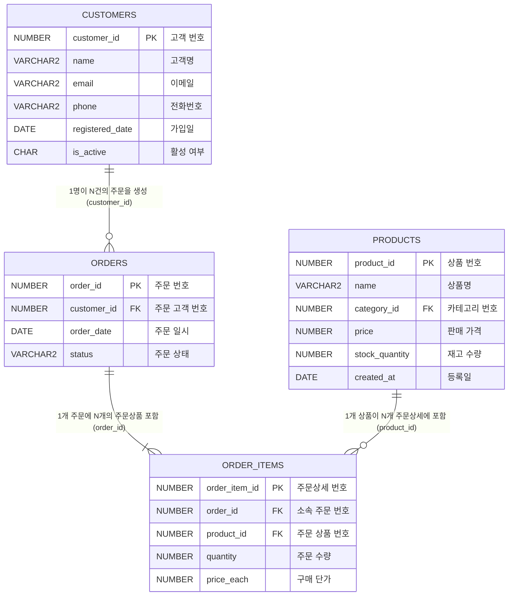
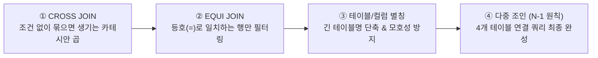
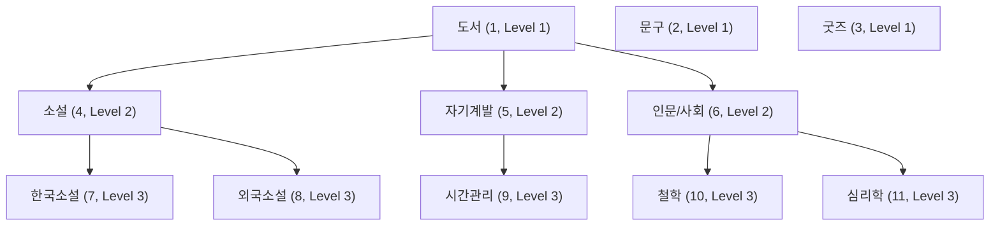
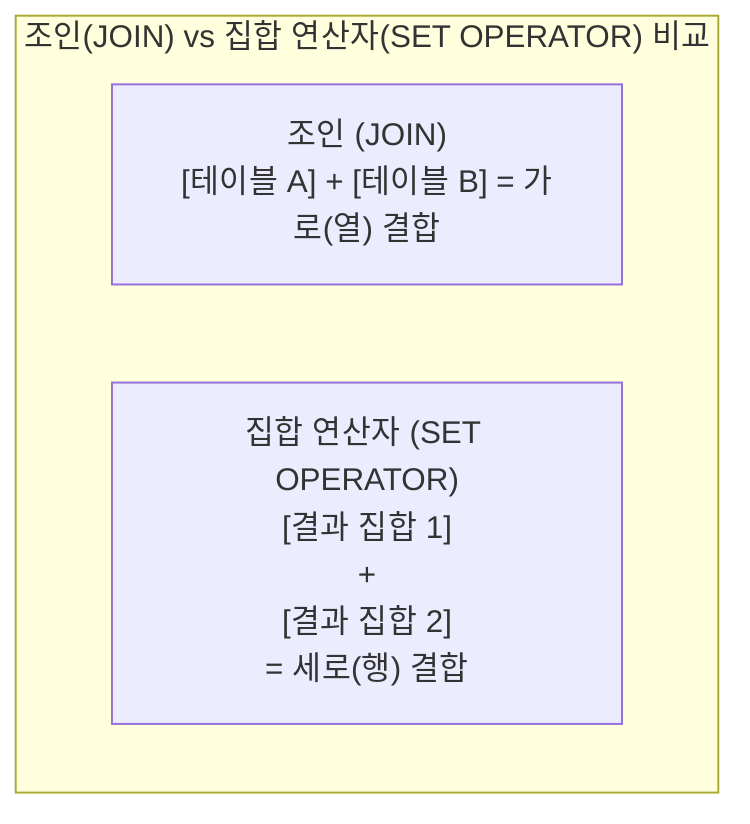

# Oracle SQL 다중 테이블 조인(Join) 실습 가이드

관계형 데이터베이스(RDBMS, Relational Database Management System)의 핵심이자 꽃은 바로 **조인**(JOIN)입니다. 관계형 데이터베이스에서는 데이터의 중복을 제거하고 무결성을 유지하기 위해 데이터를 주제별로 분할(정규화, Normalization)하여 저장합니다. 분할되어 서로 다른 테이블에 저장된 데이터를 비즈니스 요구사항에 맞게 결합하여 마치 하나의 테이블처럼 조회할 때 사용하는 문법이 바로 **조인**(JOIN)입니다.

이번 8일차 실습에서는 관계형 데이터베이스의 테이블 간 참조 관계(PK-FK)를 파악하는 기초 단계부터, **동등 조인**(Equi Join), **내부 조인**(INNER JOIN), 누락된 행까지 포함하여 조회하는 **외부 조인**(OUTER JOIN: LEFT/RIGHT/FULL), 모든 가능한 조합을 생성하는 **교차 조인**(CROSS JOIN), 동일 테이블을 조인하는 **자체 조인**(SELF JOIN), 그리고 오라클 전용 구문(`WHERE =`, `(+)`)과 ANSI/ISO SQL-99 표준 구문(`JOIN ON`, `JOIN USING`, `NATURAL JOIN`)의 문법적 차이와 원리를 단계별 실습 예제와 함께 학습합니다.

> [!TIP]
> 💡 **오라클 전통 구문 vs ANSI 표준 문법**(MySQL 등)**의 관계와 본 가이드의 학습 방식**
> 
> 1. **ANSI SQL이란?**
>    - 미국국립표준협회(ANSI)와 국제표준화기구(ISO)가 제정한 **관계형 데이터베이스의 공식 국제 표준 규격**입니다.
>    - MySQL, PostgreSQL 등 현대 대다수 RDBMS는 이 **ANSI 표준 문법**(`JOIN ... ON`)을 **기본 규격**으로 채택하고 있습니다.
> 
> 2. **오라클**(Oracle)**과의 관계**
>    - 오라클은 ANSI 표준 제정 이전부터 독자적인 문법(`WHERE =`, `(+)`)을 사용해 왔으며, Oracle 9i 버전부터 ANSI 표준을 전면 수용하여 현재는 **두 방식을 모두 100% 완벽하게 지원**합니다.
> 
> 3. **문법 비교 요약 표**:
> 
>    | 구분 | 오라클 전통 문법 | ANSI SQL-99 표준 문법 (MySQL, PostgreSQL 등 공통) |
>    | :--- | :--- | :--- |
>    | **내부 조인** | `FROM A, B WHERE A.id = B.id` | `FROM A INNER JOIN B ON A.id = B.id` |
>    | **외부 조인** | `WHERE A.id = B.id(+)` *(오라클 전용)* | `FROM A LEFT [OUTER] JOIN B ON A.id = B.id` |
>    | **완전 외부** | ❌ `(+)` 양쪽 지정 불가<br>*(ANSI FULL JOIN으로 해결)* | `FROM A FULL [OUTER] JOIN B ON A.id = B.id` |
>    | **이식성** | 오라클 전용 (타 DBMS 이식 시 수정 필요) | 모든 DBMS 공통 지원 (높은 이식성 & 현대 표준) |
> 
> 4. **본 실습 가이드의 진행 방식 안내**
>    - 각 단계마다 "**이전 단계의 한계점**"을 짚어보고, 이를 해결하기 위해 새로운 조인 기법이 왜 등장했는지 스토리텔링 방식으로 차근차근 진행합니다.
>    - 2~4절에서는 기본 원리를 직관적으로 이해할 수 있는 **오라클 전통 구문**(동등 조인 및 외부 조인)으로 기초를 다집니다.
>    - 5절에서는 동일 테이블의 계층 관계를 푸는 **자체 조인**(SELF JOIN)을 실습합니다.
>    - 6절에서는 오라클 전용 구문의 한계를 극복하는 현대 표준인 **ANSI SQL-99 표준 문법**을 집중 실습합니다.
>    - 마지막 7절에서는 수평 결합(조인)과 대비되는 수직 결합인 **집합 연산자**(SET OPERATOR)로 마무리합니다.

> [!NOTE]
> **📖 SQL 문법 표기 규칙 안내**
> 본 가이드의 함수 및 SQL 문법 설명에 사용되는 기호는 다음과 같습니다:
> - `[ ]` (대괄호): 생략 가능한 **선택 사항**(Optional)을 나타냅니다. *(실제 SQL 작성 시 대괄호 기호는 입력하지 않습니다)*
> - `|` (파이프): 나열된 옵션 중 **하나를 선택**(OR)함을 나타냅니다.

---

## 0. 사전 준비: 실습 사용자 및 세션 확인

모든 SQL 실습은 관리자(`SYSTEM`) 계정이 아닌 **실습용 일반 사용자**(`KOREA_MALL`) 세션의 SQL 편집기에서 진행합니다.

```sql
-- 현재 접속 계정 확인 (결과가 KOREA_MALL 이어야 함)
SELECT USER FROM DUAL;
```

> 🎯 **핵심 배움 포인트** (실습 환경 확인):
> - 데이터베이스 카탈로그 오염을 방지하고 보안 원칙을 준수하기 위해 모든 DDL, DML, 조인 쿼리 실습은 반드시 일반 계정(`KOREA_MALL`) 세션에서 실행합니다.

---

## 1. 조인(JOIN)의 핵심 개념과 관계형 모델

### 1.1 왜 테이블을 분할하고 조인하는가?
하나의 거대한 테이블에 고객 정보, 주문 정보, 주문 품목 정보, 상품 정보를 모두 모아서 저장하면 다음과 같은 문제가 발생합니다:
- **데이터 중복**: 고객이 10번 주문하면 고객 이름, 전화번호, 이메일이 10번 중복 저장됩니다.
- **이상 현상**(Anomaly): 고객 주소 변경 시 모든 행을 일일이 수정해야 하며(수정 이상), 주문하지 않은 고객 정보는 저장하기 어렵고(삽입 이상), 주문 내역 삭제 시 고객 정보까지 함께 지워질 수 있습니다(삭제 이상).

#### [비정규화 예시] 모든 데이터를 한 테이블에 합쳤을 때
| 주문번호 | 고객ID | 고객명 | 전화번호 | 상품명 | 수량 | 발생 문제 (이상 현상) |
|:---:|:---:|:---:|:---:|:---:|:---:|:---|
| 101 | 1 | **홍길동** | **010-1111-2222** | 게이밍 마우스 | 1 | **수정 이상**: 연락처 변경 시 모든 행을 다 고쳐야 함 |
| 101 | 1 | **홍길동** | **010-1111-2222** | 기계식 키보드 | 1 | (같은 주문에 여러 품목 구매 시 고객·주문 정보가 반복 중복됨) |
| 102 | 2 | 이순신 | 010-3333-4444 | 게이밍 마우스 | 2 | **삭제 이상**: 102번 주문 취소 시 '이순신' 고객 정보도 영구 삭제됨 |
| *(없음)* | 3 | 강감찬 | 010-5555-6666 | *(없음)* | - | **삽입 이상**: 주문하지 않은 신규 회원은 빈칸(NULL) 없이는 등록 불가 |

#### [정규화 예시] 관심사별 4대 핵심 테이블로 분리했을 때

##### 1) 고객 테이블 (`customers`)
| 고객ID (PK) | 고객명 | 전화번호 | 해결된 문제 |
|:---:|:---:|:---:|:---|
| 1 | 홍길동 | 010-1111-2222 | **수정 이상 해결**: 연락처가 바뀌어도 **1개 행만 수정**하면 반영 완료 |
| 2 | 이순신 | 010-3333-4444 | **삭제 이상 해결**: 주문이 취소되거나 삭제되어도 고객 데이터는 온전히 보존 |
| 3 | 강감찬 | 010-5555-6666 | **삽입 이상 해결**: 주문 이력이 없어도 신규 고객 정보를 깔끔하게 단독 등록 가능 |

##### 2) 주문 테이블 (`orders`) — "누가 언제 주문했는가?"
| 주문번호 (PK) | 고객ID (FK) | 주문일자 |
|:---:|:---:|:---:|
| 101 | **1** | 2026-03-01 |
| 102 | **2** | 2026-03-02 |

##### 3) 주문상세 테이블 (`order_items`) — "어떤 주문에 어떤 상품을 몇 개 담았는가?"
| 주문상세ID (PK) | 주문번호 (FK) | 상품ID (FK) | 수량 |
|:---:|:---:|:---:|:---:|
| 1 | **101** | **10** | 1 |
| 2 | **101** | **20** | 1 |
| 3 | **102** | **10** | 2 |

##### 4) 상품 테이블 (`products`) — "어떤 상품이 얼마인가?"
| 상품ID (PK) | 상품명 | 가격 | 해결된 문제 |
|:---:|:---:|:---:|:---|
| 10 | 게이밍 마우스 | 35,000 | **수정 이상 해결**: 상품명이나 가격 변경 시 **1개 행만 수정** |
| 20 | 기계식 키보드 | 89,000 | **삭제 이상 해결**: 주문 품목이 삭제되어도 상품 정보는 안전하게 보존 |
| 30 | 4K 모니터 | 450,000 | **삽입 이상 해결**: 아직 판매되지 않은 신상품도 단독으로 등록 가능 |

> 💡 **정규화와 다중 테이블 조인**(Multi-table JOIN)**의 관계**:
> * 하나의 거대한 비정규화 테이블을 4대 핵심 테이블(`customers`, `orders`, `order_items`, `products`)로 정규화하면 데이터 중복과 각종 이상 현상이 원천 차단됩니다.
> * 이후 "홍길동 고객이 101번 주문에서 구매한 상품명과 수량은 무엇인가?"처럼 분리된 데이터를 다시 한 화면에서 조회할 때, 각 테이블의 공통 연결고리(`PK-FK`)를 이어주는 문법이 바로 **조인**(JOIN)입니다.


따라서 RDBMS는 **데이터 정규화**(Normalization)를 통해 `고객(customers)`, `주문(orders)`, `상품(products)`, `주문상세(order_items)` 등으로 테이블을 분리하고, 필요한 시점에 **공통 컬럼**(기본키-외래키)을 연결고리 삼아 결합(JOIN)합니다.

### 1.2 실습 쇼핑몰 4대 핵심 테이블의 관계도 (ERD)



---

## 2. 사전 준비: 조인 대상 테이블 구조 점검

조인 쿼리를 작성하기 위해서는 조인 대상이 되는 각 테이블에 어떤 컬럼이 존재하는지, 그리고 테이블 간에 어떤 컬럼이 연결고리(공통 컬럼) 역할을 하는지 먼저 파악해야 합니다.

오라클 데이터 딕셔너리 뷰인 `USER_TAB_COLUMNS`를 조회하면 현재 사용자 세션에 생성된 각 테이블의 컬럼 구성과 데이터 타입을 한눈에 확인할 수 있습니다.

---

## # 실습 예제 1 : 여러 테이블의 컬럼 구조를 함께 조회하기

> 💡 **이번 실습의 목적**:
> - 테이블들이 쪼개져 있으므로, 서로 어떤 공통 컬럼(PK-FK)으로 연결되어 있는지 확인해야 올바른 조인 쿼리를 작성할 수 있습니다.
> - 조인의 대상이 될 쇼핑몰 핵심 테이블 4종(`customers`, `products`, `orders`, `order_items`)의 컬럼 이름, 데이터 타입, 길이를 오라클 데이터 사전에서 일괄 조회합니다.

### 1.1 실습 쿼리

```sql
-- 'customers', 'products', 'orders', 'order_items' 테이블의 컬럼 구조를 함께 조회
SELECT table_name, column_name, data_type, data_length
FROM user_tab_columns
WHERE table_name IN ('CUSTOMERS', 'PRODUCTS', 'ORDERS', 'ORDER_ITEMS')
ORDER BY table_name, column_id;
```

### 1.2 쿼리 실행 결과 예시

| TABLE_NAME | COLUMN_NAME | DATA_TYPE | DATA_LENGTH |
| :--- | :--- | :--- | :---: |
| **CUSTOMERS** | CUSTOMER_ID | NUMBER | 22 |
| **CUSTOMERS** | NAME | VARCHAR2 | 100 |
| **CUSTOMERS** | EMAIL | VARCHAR2 | 100 |
| **CUSTOMERS** | PHONE | VARCHAR2 | 20 |
| **CUSTOMERS** | REGISTERED_DATE | DATE | 7 |
| **CUSTOMERS** | IS_ACTIVE | CHAR | 1 |
| **ORDERS** | ORDER_ID | NUMBER | 22 |
| **ORDERS** | CUSTOMER_ID | NUMBER | 22 |
| **ORDERS** | ORDER_DATE | DATE | 7 |
| **ORDERS** | STATUS | VARCHAR2 | 20 |
| **ORDER_ITEMS** | ORDER_ITEM_ID | NUMBER | 22 |
| **ORDER_ITEMS** | ORDER_ID | NUMBER | 22 |
| **ORDER_ITEMS** | PRODUCT_ID | NUMBER | 22 |
| **ORDER_ITEMS** | QUANTITY | NUMBER | 22 |
| **ORDER_ITEMS** | PRICE_EACH | NUMBER | 22 |
| **PRODUCTS** | PRODUCT_ID | NUMBER | 22 |
| **PRODUCTS** | NAME | VARCHAR2 | 200 |
| **PRODUCTS** | CATEGORY_ID | NUMBER | 22 |
| **PRODUCTS** | PRICE | NUMBER | 22 |
| **PRODUCTS** | STOCK_QUANTITY | NUMBER | 22 |
| **PRODUCTS** | CREATED_AT | DATE | 7 |

> 🎯 **핵심 배움 포인트** (테이블 구조 파악과 조인의 연결고리):
> 
> 1. **조인을 위한 공통 키**(Key) **식별**:
>    - `CUSTOMERS` 테이블의 `CUSTOMER_ID` (PK) $\leftrightarrow$ `ORDERS` 테이블의 `CUSTOMER_ID` (FK)
>    - `ORDERS` 테이블의 `ORDER_ID` (PK) $\leftrightarrow$ `ORDER_ITEMS` 테이블의 `ORDER_ID` (FK)
>    - `PRODUCTS` 테이블의 `PRODUCT_ID` (PK) $\leftrightarrow$ `ORDER_ITEMS` 테이블의 `PRODUCT_ID` (FK)
>    - 위와 같이 테이블 간에 의미와 데이터 타입이 일치하는 공통 컬럼이 조인 조건식의 기준이 됩니다.
> 
> 2. **오라클 데이터 딕셔너리** `USER_TAB_COLUMNS`의 **주요 컬럼**:
>    - `TABLE_NAME`: 컬럼이 속한 테이블 이름
>    - `COLUMN_NAME`: 컬럼의 이름
>    - `DATA_TYPE`: 데이터 형식 (`NUMBER`, `VARCHAR2`, `DATE`, `CHAR` 등)
>    - `DATA_LENGTH`: 컬럼의 물리적 최대 바이트 길이 (`NUMBER`는 오라클 내부적으로 최대 22바이트 부동소수점 저장)
>    - `COLUMN_ID`: 테이블 생성 시 정의된 컬럼의 순번(1부터 시작)
> 
> 3. **데이터 사전 조회 시 대소문자 주의사항**:
>    - 오라클은 별도의 따옴표 없이 테이블을 생성하면 데이터 딕셔너리에 **테이블명과 컬럼명을 모두 대문자**(UPPERCASE)로 저장합니다.
>    - 따라서 `WHERE table_name IN ('CUSTOMERS', 'PRODUCTS', ...)`와 같이 리터럴 값을 **반드시 대문자로 지정**해야 정상적으로 조회됩니다. 소문자(`'customers'`)로 입력하면 아무 행도 반환되지 않습니다.

---

## 3. 오라클 전통 조인(Oracle Join)과 다중 테이블 결합

오라클 SQL에서 둘 이상의 테이블을 결합하는 가장 전통적인 방식은 `FROM` 절에 조인 대상 테이블들을 **콤마**(\`,\`)**로 나열**하고, `WHERE` 절에 컬럼 간의 **일치 조건**(\`=\`)**을 명시**하는 방식입니다.

초보 학습자가 가장 많이 겪는 실수와 허들을 예방하기 위해, "**조건 없이 무작정 묶었을 때의 위험성**"부터 시작하여 차근차근 단계별로 빌드업합니다.



---

## # 실습 예제 2 : CROSS JOIN 실습하기 (조건 없는 조인의 한계)

> 💡 **이전 단계의 한계와 이번 실습의 목적**:
> - "두 테이블을 합치고 싶어서 `FROM products, categories`처럼 조건 없이 그냥 나열하면 어떻게 될까요?"
> - 연결고리(조인 조건)가 빠졌을 때 첫 번째 테이블의 모든 행이 두 번째 테이블의 모든 행과 하나씩 무차별 매칭되는 **카테시안 곱**(Cartesian Product) 현상을 눈으로 확인하고, 왜 '조인 조건'이 반드시 필요한지 체감합니다.

### 2.1 실습 쿼리

```sql
-- 상품과 카테고리를 임의로 조합 (CROSS JOIN - 카테시안 곱)
SELECT products.name, categories.category_name
FROM products, categories;
```

### 2.2 쿼리 실행 결과 예시

| NAME | CATEGORY_NAME |
| :--- | :--- |
| 82년생 김지영 | 도서 |
| 소년이 온다 | 도서 |
| 채식주의자 | 도서 |
| 노르웨이의 숲 | 도서 |
| 위대한 개츠비 | 도서 |
| 1984 | 도서 |
| 몰입 | 도서 |
| 성공하는 사람들의 7가지 습관 | 도서 |
| 아주 작은 습관의 힘 | 도서 |
| 소크라테스의 변명 | 도서 |
| 니코마코스 윤리학 | 도서 |
| ... | *(중략)* |
| 책상용 독서대 | 심리학 |

*(상품 25건 $\times$ 카테고리 11건 = 총 275개 행이 조회됩니다)*

> 🎯 **핵심 배움 포인트** (CROSS JOIN과 카테시안 곱의 원리):
> 
> 1. **카테시안 곱**(Cartesian Product)**의 수학적 계산 원리**:
>    - 조인 조건이 주어지지 않으면 오라클은 첫 번째 테이블(상품 25건)의 각 행을 두 번째 테이블(카테고리 11건)의 모든 행과 순차적으로 매칭합니다.
>    - 최종 결과 행 수:
>      $$\text{상품 테이블 행 수 (25)} \times \text{카테고리 테이블 행 수 (11)} = \mathbf{275\text{행}}$$
>    - 상품 '82년생 김지영' 하나에 대해 '도서', '문구', '굿즈', '소설' 등 존재하는 11개 카테고리가 모두 결합되어 엉뚱한 가짜 행들이 대량 발생합니다.
> 
> 2. **⚠️ 대형 테이블에서의 위험성**:
>    - 실무에서 수만~수백만 건의 테이블에 조인 조건을 누락하면 순식간에 수억 건의 조합이 만들어지며 DBMS의 메모리(TEMP 테이블스페이스)가 고갈되고 시스템 장애로 이어질 수 있습니다.
>    - 따라서 원하는 데이터만 정확히 결합하려면 **반드시 두 테이블을 연결해 주는 조건식**이 들어가야 합니다.

---

## # 실습 예제 3 : EQUI JOIN 실습하기 (일치하는 행만 걸러내기)

> 💡 **이전 단계의 한계와 이번 실습의 목적**:
> - 앞선 예제 2에서는 조건이 없어 275개의 엉뚱한 조합이 나왔습니다.
> - "고객이 작성한 '진짜 리뷰'만 뽑으려면 어떻게 해야 할까요?"
> - 조인 조건에 등호(`=`) 연산자를 사용하여, 양쪽 테이블의 공통 키(`customer_id`) 값이 정확히 일치하는 행들만 결합하는 가장 기본적이고 보편적인 **동등 조인**(EQUI JOIN)을 실습합니다.

### 3.1 실습 쿼리

```sql
-- 고객이 작성한 리뷰 목록 조회 (동등 조인)
SELECT customers.name, reviews.rating, reviews.content, reviews.created_at
FROM customers, reviews
WHERE customers.customer_id = reviews.customer_id;
```

### 3.2 쿼리 실행 결과 예시

| NAME | RATING | CONTENT | CREATED_AT |
| :--- | :---: | :--- | :---: |
| 김하늘 | 4 | 읽고 나서 삶의 태도를 바꾸게 되었어요. | 2025-06-01 |
| 박서준 | 3 | 좋은 내용인데 집중이 잘 안 됐어요. | 2025-06-01 |
| 박서준 | 3 | 메시지는 좋지만 전개가 아쉬웠습니다. | 2025-06-02 |
| 정해인 | 3 | 감정선은 좋았는데 결말이 아쉬웠어요. | 2025-06-02 |
| 정해인 | 3 | 분위기는 좋았지만 스토리는 평이했어요. | 2025-06-02 |
| 정해인 | 3 | 기대한 것보단 평범했어요. | 2025-06-02 |
| 정해인 | 4 | 일상에 동기부여가 되는 책이었어요. | 2025-06-01 |
| 정해인 | 4 | 기초 개념 잡기에 좋은 책입니다. | 2025-06-01 |
| 신민아 | 4 | 생각보다 내용이 깊고 재미있었어요. | 2025-06-02 |
| ... | ... | *(중략)* | ... |
| 김태리 | 5 | 너무 재미있게 읽었어요. 추천합니다! | 2025-06-02 |
| 유연석 | 4 | 튼튼하고 디자인도 마음에 들어요. | 2025-06-01 |

*(기본 샘플 데이터 기준 총 23개 행이 조회됩니다)*

> 🎯 **핵심 배움 포인트** (EQUI JOIN의 일치 조건과 데이터 필터링 원리):
> 
> 1. **동등 조인**(EQUI JOIN)**의 매칭 메커니즘**:
>    - `WHERE customers.customer_id = reviews.customer_id` 조건은 `customers`의 기본키와 `reviews`의 외래키 값이 **양쪽 모두에 존재하고 정확히 같은 행만 결합**합니다.
>    - 카테시안 곱으로 발생하던 엉뚱한 행들이 깨끗하게 사라지고 유효한 23건의 리뷰만 남습니다.
> 
> 2. **리뷰를 작성하지 않은 고객의 처리**:
>    - 전체 고객 10명 중 리뷰를 한 번도 작성하지 않은 고객(예: 3번 이보영 고객)은 `reviews` 테이블에 일치하는 데이터가 없으므로 이번 조회 결과에서 완전히 제외됩니다.

---

## # 실습 예제 4 : 테이블 별칭(Table Alias)으로 쿼리 간결화하기

> 💡 **이전 단계의 한계와 이번 실습의 목적**:
> - 앞선 예제처럼 `customers.customer_id = reviews.customer_id`처럼 매번 긴 테이블명을 적는 것은 번거롭고 오타가 나기 쉽습니다.
> - `FROM` 절에서 **테이블 별칭**(Table Alias)을 지정하여 쿼리를 한결 짧고 직관적으로 작성하는 요령을 익힙니다.

### 4.1 실습 쿼리

```sql
-- 테이블 별칭(c, o)을 활용하여 고객명과 주문일자 조회
SELECT c.name, o.order_date
FROM customers c, orders o
WHERE c.customer_id = o.customer_id;
```

### 4.2 쿼리 실행 결과 예시

| NAME | ORDER_DATE |
| :--- | :---: |
| 김하늘 | 2025-06-13 |
| 김하늘 | 2025-04-08 |
| 박서준 | 2025-05-08 |
| 정해인 | 2025-06-30 |
| 정해인 | 2025-06-27 |
| 정해인 | 2025-06-11 |
| 정해인 | 2025-05-11 |
| 정해인 | 2025-06-08 |
| 신민아 | 2025-05-14 |
| 이종석 | 2025-05-02 |
| ... | *(중략)* |
| 유연석 | 2025-05-08 |

*(총 20개 행이 조회됩니다)*

> 🎯 **핵심 배움 포인트** (테이블 별칭의 규칙과 주의사항):
> 
> 1. **테이블 별칭**(Table Alias)**의 장점**:
>    - `FROM customers c, orders o`처럼 공백을 두고 약칭을 지정하면 모든 절에서 `customers.name` 대신 `c.name`으로 간결하게 작성할 수 있습니다.
> 
> 2. **★ 오라클 테이블 별칭 작성 시 주의사항** (`AS` 사용 금지):
>    - 컬럼 별칭에는 `AS`를 쓸 수 있지만, 오라클의 `FROM` 절 테이블 별칭에는 `AS`를 쓰면 **문법 에러**가 발생합니다 (`ORA-00933`).
>      ```sql
>      FROM customers AS c, orders AS o  -- ❌ 에러 발생 (AS 키워드 금지)
>      FROM customers c, orders o        -- ⭕ 올바른 작성법
>      ```
> 
> 3. **별칭 선언 후 원래 테이블명 사용 불가 원칙**:
>    - 별칭을 부여하는 순간 오라클 파서는 원래 테이블명을 잊어버립니다. 따라서 `SELECT customers.name FROM customers c`처럼 혼용하면 `ORA-00904` 에러가 발생하므로 반드시 일관되게 `c.name`을 써야 합니다.

---

## # 실습 예제 5 : 컬럼 식별자 모호성 해결과 컬럼 별칭(Column Alias)

> 💡 **이전 단계의 한계와 이번 실습의 목적**:
> - 앞선 예제 4에서는 `c.name`, `o.order_date`처럼 각 테이블에만 존재하는 고유 컬럼들을 조회했습니다.
> - 하지만 `customers`와 `orders` 두 테이블 모두에 존재하는 공통 컬럼인 `customer_id`를 `SELECT customer_id ...`처럼 소속 없이 적는다면 어떻게 될까요?
> - 오라클은 누구의 `customer_id`인지 구분하지 못해 <b>`ORA-00918: 열의 정의가 애매합니다`</b> 에러를 발생시킵니다.
> - 이를 방지하기 위해 `c.customer_id`처럼 소속(테이블 별칭)을 명확히 밝혀주고, 최종 결과 화면의 가독성을 높이기 위해 **컬럼 별칭**(`AS "고객번호"`, `AS "주문일자"`)을 부여하는 방법을 익힙니다.

### 5.1 실습 쿼리

```sql
-- 공통 컬럼 모호성 해결(c.customer_id) 및 컬럼 별칭 부여
SELECT c.customer_id AS "고객번호",
       c.name        AS "고객명",
       o.order_id    AS "주문번호",
       o.order_date  AS "주문일자"
FROM customers c, orders o
WHERE c.customer_id = o.customer_id;
```

### 5.2 쿼리 실행 결과 예시

| 고객번호 | 고객명 | 주문번호 | 주문일자 |
| :---: | :--- | :---: | :---: |
| 8 | 남주혁 | 1 | 2025-06-01 |
| 8 | 남주혁 | 2 | 2025-05-25 |
| 4 | 정해인 | 3 | 2025-06-11 |
| 1 | 김하늘 | 4 | 2025-06-13 |
| ... | ... | ... | *(중략)* |
| 2 | 박서준 | 20 | 2025-05-08 |

*(총 20개 행이 조회됩니다)*

> 🎯 **핵심 배움 포인트** (테이블 별칭 vs 컬럼 별칭):
> 
> | 비교 항목 | 테이블 별칭 (Table Alias) | 컬럼 별칭 (Column Alias) |
> | :--- | :--- | :--- |
> | **작성 위치** | `FROM` 절 테이블명 뒤 | `SELECT` 절 컬럼 표현식 뒤 |
> | `AS` **키워드 지원** | ❌ **사용 불가** (ORA-00933 에러) | ⭕ **사용 가능** (`AS` 생략도 가능) |
> | **쌍따옴표**(`" "`) **사용** | 사용 불가 (일반 식별자) | ⭕ **사용 권장** (한글, 공백 지원) |
> | **작성 목적** | SQL 내부에서 컬럼 참조 경로 단축 | 최종 출력 결과의 헤더 명칭을 직관적으로 변경 |

---

## # 실습 예제 6 : 4개 테이블 다중 조인 최종 완성하기 ($N-1$ 조건식 황금률)

> 💡 **이전 단계의 한계와 이번 실습의 목적**:
> - 2개 테이블 조인은 마스터했습니다. 하지만 실제 이커머스 화면에서는 **고객 정보, 주문 정보, 주문 품목, 상품 정보**가 한 화면에 나와야 합니다.
> - "4개 테이블을 엮으려면 조인 조건이 몇 개나 필요하고, 어떻게 점진적으로 완성해야 할까요?"
> - 조인의 핵심 공식인 '**$N - 1$ 조건식 황금률**'과 **4단계 빌드업**을 통해 복잡한 다중 조인 쿼리를 최종 완성합니다.


### 6.1 실습 쿼리

```sql
-- '김하늘' 고객이 주문한 모든 상품명과 수량 조회 (4개 테이블 다중 조인)
SELECT c.name AS "고객명", p.name AS "상품명", oi.quantity AS "주문수량"
FROM customers c, orders o, order_items oi, products p
WHERE c.customer_id = o.customer_id     -- 조인 조건 1: 고객 <-> 주문
  AND o.order_id = oi.order_id          -- 조인 조건 2: 주문 <-> 주문상세
  AND oi.product_id = p.product_id      -- 조인 조건 3: 주문상세 <-> 상품
  AND c.name = '김하늘';                 -- 일반 검색 조건 (필터링)
```

### 6.2 쿼리 실행 결과 예시

| 고객명 | 상품명 | 주문수량 |
| :--- | :--- | :---: |
| 김하늘 | 아주 작은 습관의 힘 | 1 |
| 김하늘 | 채식주의자 | 2 |
| 김하늘 | 몰입 | 2 |

> 🎯 **핵심 배움 포인트** (다중 테이블 조인의 $N-1$ 황금률):
> 
> 1. **다중 조인의** '**$N - 1$ 조건식**' **황금률**:
>    - 조인하려는 테이블의 개수가 **$N$개**라면, 모든 테이블을 정상적으로 연결하기 위한 **최소 조인 조건식은 반드시 $N - 1$개**가 필요합니다.
>    - 본 예제에서는 총 **4개**의 테이블이 참여하므로, 최소 **3개**의 조인 조건식이 반드시 필요합니다:
>      1. `c.customer_id = o.customer_id` (고객 $\leftrightarrow$ 주문 연결)
>      2. `o.order_id = oi.order_id` (주문 $\leftrightarrow$ 주문상세 연결)
>      3. `oi.product_id = p.product_id` (주문상세 $\leftrightarrow$ 상품 연결)
>    - 만약 이 중 단 하나라도 누락되면 해당 테이블과 나머지 사이에 카테시안 곱(예제 2)이 발생하여 데이터가 기하급수적으로 부풀어 오릅니다.
> 
> 2. **조인 조건과 필터링 조건의 결합**:
>    - `WHERE` 절 안에 테이블을 엮어주는 **조인 조건 3개**와 특정 고객만 골라내는 **일반 필터 조건**(`c.name = '김하늘'`)이 `AND`로 함께 나열됩니다.

---

## 4. 외부 조인(OUTER JOIN)과 오라클 (+) 연산자

일반적인 내부 조인(INNER JOIN / EQUI JOIN)은 양쪽 테이블 모두에 데이터가 존재하는 **교집합** 데이터만 반환합니다. 따라서 매칭되는 데이터가 없는 행(예: 아직 판매되지 않은 신상품, 주문 내역이 없는 신규 고객, 리뷰가 작성되지 않은 상품)은 조회 결과에서 완전히 누락되는 한계가 있습니다.

이러한 문제를 해결하기 위해, 기준이 되는 테이블의 행을 하나도 빠뜨리지 않고 모두 출력하면서 반대편 테이블에 일치하는 데이터가 없을 경우 `NULL`로 채워 함께 조회하는 기법이 바로 **외부 조인**(OUTER JOIN)입니다.

오라클 전통 문법에서는 외부 조인을 표현할 때 `(+)` **기호**를 사용합니다.

```mermaid
flowchart TD
    subgraph INNER ["내부 조인 (INNER JOIN)"]
        direction LR
        I1["상품 (products)"] <-->|교집합 매칭 (리뷰 있는 상품만)| I2["리뷰 (reviews)"]
    end

    subgraph OUTER ["외부 조인 (LEFT OUTER JOIN)"]
        direction LR
        O1["기준: 상품 (products) - 전체 25건 보존"] -->|불일치 행은 NULL로 보충| O2["참조: 리뷰 (reviews)"]
    end
```

### 4.1 외부 조인의 3대 유형과 핵심 원리

| 조인 종류 | 보존 대상 (기준) | 핵심 동작 원리 | 짝꿍이 없는 경우의 처리 |
| :--- | :--- | :--- | :---: |
| `LEFT OUTER JOIN` | **왼쪽**(A) **테이블** | 왼쪽 테이블의 모든 행은 무조건 100% 보존 | 오른쪽 짝꿍 컬럼에 `NULL` 채움 |
| `RIGHT OUTER JOIN` | **오른쪽**(B) **테이블** | 오른쪽 테이블의 모든 행은 무조건 100% 보존 | 왼쪽 짝꿍 컬럼에 `NULL` 채움 |
| `FULL OUTER JOIN` | **양쪽**(A, B) **테이블 모두** | 짝꿍이 있든 없든 양쪽 데이터를 단 하나도 버리지 않음 (합집합) | 일치하지 않는 쪽에 `NULL` 채움 |

> 💡 **오라클** `(+)` **연산자의 위치 암기 팁**:
> * 오라클 전통 문법에서는 "**데이터가 부족해서 채워 넣어야 하는 쪽에 플러스**(`(+)`)**를 달아준다!**"라고 기억하면 헷갈리지 않습니다.
>   - 왼쪽(상품)을 다 살리고 싶다면? ➔ 데이터가 부족한 오른쪽 리뷰 컬럼에 `(+)` 표시: `p.product_id = r.product_id(+)`

---

## # 실습 예제 7 : LEFT OUTER JOIN 실습하기 (누락된 상품 구출하기)

> 💡 **이전 단계의 한계와 이번 실습의 목적**:
> - 앞서 배운 EQUI JOIN으로 상품과 리뷰를 묶으면, 리뷰가 단 1건도 등록되지 않은 신상품 8개는 결과에서 통째로 누락됩니다.
> - "리뷰가 없더라도 전체 25개 상품 목록을 빠짐없이 확인하고 싶다면 어떻게 해야 할까요?"
> - 오라클의 `(+)` 연산자를 활용하여 상품 테이블 전체를 보존하는 `LEFT OUTER JOIN`을 수행합니다.

### 7.1 실습 쿼리

```sql
-- 고객이 작성한 리뷰등급 조회(리뷰가 없는 경우에도 상품 전체 보존)
SELECT p.name AS "상품명", r.rating AS "리뷰평점"
FROM products p, reviews r
WHERE p.product_id = r.product_id(+);
```

### 7.2 쿼리 실행 결과 예시

| 상품명 | 리뷰평점 | 비고 |
| :--- | :---: | :--- |
| 82년생 김지영 | 3 | 리뷰 등록 상품 |
| 82년생 김지영 | 4 | 리뷰 등록 상품 (복수 리뷰) |
| 소년이 온다 | 3 | 리뷰 등록 상품 |
| 채식주의자 | 5 | 리뷰 등록 상품 |
| **노르웨이의 숲** | *(null)* | **리뷰 미등록 상품** (보존됨) |
| 위대한 개츠비 | 3 | 리뷰 등록 상품 |
| **1984** | *(null)* | **리뷰 미등록 상품** (보존됨) |
| 몰입 | 4 | 리뷰 등록 상품 |
| **성공하는 사람들의 7가지 습관** | *(null)* | **리뷰 미등록 상품** (보존됨) |
| 아주 작은 습관의 힘 | 4 | 리뷰 등록 상품 |
| **철학의 위안** | *(null)* | **리뷰 미등록 상품** (보존됨) |
| ... | ... | *(중략)* |
| **북마크 세트** | *(null)* | **리뷰 미등록 상품** (보존됨) |
| 책상용 독서대 | 5 | 리뷰 등록 상품 |
| 책상용 독서대 | 4 | 리뷰 등록 상품 |

*(리뷰가 등록된 상품 행 23건 + 리뷰가 없는 상품 행 8건 = 총 31개 행이 조회됩니다)*

> 🎯 **핵심 배움 포인트** (오라클 (+) 연산자의 위치와 동작 원리):
> 
> 1. `(+)` **기호의 위치 규칙**:
>    - `products` 테이블의 모든 행을 살려야 하므로, 상대적으로 매칭 데이터가 부족하여 `NULL`로 채워져야 하는 우측 리뷰 컬럼 `r.product_id(+)`에 `(+)`를 붙입니다.
> 
> 2. 오라클 `(+)` **연산자의 문법적 제약**:
>    - **양쪽 동시 부여 불가**: `p.product_id(+) = r.product_id(+)`처럼 양쪽에 동시에 붙여 `FULL OUTER JOIN`을 표현하는 것은 오라클에서 허용되지 않습니다 (`ORA-01468`). (이는 뒤 6절의 ANSI FULL OUTER JOIN으로 해결합니다.)

---

## # 실습 예제 8 : RIGHT OUTER JOIN 실습하기 (반대편 기준 보존)

> 💡 **이전 단계의 한계와 이번 실습의 목적**:
> - 이번에는 상품이 아니라, 작성된 모든 리뷰(`reviews`)를 **기준**으로 삼아 상품 정보의 유무와 상관없이 리뷰 데이터를 빠짐없이 보존하는 `RIGHT OUTER JOIN`을 실습합니다.
> - 우측 테이블을 보존하기 위해 반대편인 좌측 테이블 컬럼에 `(+)` 기호가 들어가는 원리를 익힙니다.

### 8.1 실습 쿼리

```sql
-- 작성된 리뷰를 기준으로 상품 정보를 결합 (RIGHT OUTER JOIN)
SELECT p.name AS "상품명", r.rating AS "리뷰등급"
FROM products p, reviews r
WHERE p.product_id(+) = r.product_id;
```

### 8.2 쿼리 실행 결과 예시

| 상품명 | 리뷰등급 | 비고 |
| :--- | :---: | :--- |
| 82년생 김지영 | 3 | 정상 매칭 |
| 82년생 김지영 | 4 | 정상 매칭 |
| 소년이 온다 | 3 | 정상 매칭 |
| 채식주의자 | 5 | 정상 매칭 |
| 위대한 개츠비 | 3 | 정상 매칭 |
| ... | ... | *(중략)* |
| 라인프렌즈 볼펜 | 4 | 정상 매칭 |
| 책상용 독서대 | 5 | 정상 매칭 |
| 책상용 독서대 | 4 | 정상 매칭 |

*(리뷰 테이블의 전체 23개 행이 모두 보존되어 조회됩니다)*

> 🎯 **핵심 배움 포인트** (RIGHT OUTER JOIN의 기준과 (+) 기호 위치):
> 
> | 비교 항목 | 실습 예제 7 (LEFT OUTER JOIN) | 실습 예제 8 (RIGHT OUTER JOIN) |
> | :--- | :--- | :--- |
> | **오라클 조건식** | `p.product_id = r.product_id(+)` | `p.product_id(+) = r.product_id` |
> | **기준**(보존) **테이블** | 왼쪽의 `products` (상품 25건 전체) | 오른쪽의 `reviews` (리뷰 23건 전체) |
> | **NULL 발생 컬럼** | 리뷰 평점 (`r.rating`) | 상품명 (`p.name`) |
> | **조회 결과 건수** | **31건** (리뷰 없는 8개 상품 보존) | **23건** (존재하는 모든 리뷰 보존) |

---

## # 실습 예제 9-1 : 1단계 reviews 테이블을 복제하여 제약조건 없는 테이블 생성하기

> 💡 **이전 단계의 한계와 이번 실습의 목적**:
> - 앞선 예제 8에서는 모든 리뷰가 실제 상품을 가리키고 있어서, 상품명이 `NULL`로 떨어지는 실제 고아 데이터 사례를 눈으로 보기 어려웠습니다.
> - 또한 원본 `reviews` 테이블에는 외래키(FK) 제약조건이 걸려 있어 존재하지 않는 가상의 상품 번호를 넣으려 하면 `ORA-02291` 에러가 납니다.
> - 이를 극복하기 위해 **CTAS**(`CREATE TABLE AS SELECT`) 기법으로 제약조건이 없는 임시 테스트 테이블(`review_test`)을 복제 생성합니다.

### 9-1.1 실습 쿼리

```sql
-- 리뷰 테이블의 모든 컬럼을 조회한 결과값으로 review_test 테이블 복제 생성
CREATE TABLE review_test AS SELECT * FROM reviews;

-- 생성된 review_test 테이블 확인
SELECT * FROM review_test;
```

### 9-1.2 쿼리 실행 결과 예시

```
Table REVIEW_TEST이(가) 생성되었습니다.
```

| REVIEW_ID | CUSTOMER_ID | PRODUCT_ID | RATING | CONTENT | CREATED_AT |
| :---: | :---: | :---: | :---: | :--- | :---: |
| 1 | 8 | 8 | 4 | 주제는 무거웠지만 쉽게 읽혀서 좋았어요. | 2025-06-02 |
| 2 | 8 | 1 | 4 | 고전이지만 지금 읽어도 흥미롭습니다. | 2025-06-02 |
| ... | ... | ... | ... | *(중략)* | ... |
| 23 | 8 | 22 | 4 | 귀엽고 실용적이라 만족합니다. | 2025-06-01 |

*(기본 샘플 데이터 기준 원본과 동일한 23개 행이 정상 복제되어 조회됩니다)*

> 🎯 **핵심 배움 포인트** (CTAS의 제약조건 복제 특성):
> - CTAS로 복제 시 `NOT NULL` 제약조건만 **유일하게 상속**되고, `PRIMARY KEY`, `FOREIGN KEY`, `UNIQUE` 등은 복제되지 않습니다.
> - 따라서 `review_test` 테이블에는 외래키 제약조건이 사라져, 다음 단계에서 부모 테이블에 없는 임의의 상품 번호를 에러 없이 넣을 수 있게 됩니다.

---

## # 실습 예제 9-2 : 2단계 존재하지 않는 상품(product_id = 999)에 대한 리뷰 추가하기

> 💡 **이전 단계의 한계와 이번 실습의 목적**:
> - 제약조건이 해제된 `review_test` 테이블에, 상품 테이블(`products`)에는 존재하지 않는 가상의 `product_id = 999`번을 참조하는 테스트 리뷰를 인위적으로 삽입합니다.
> - 이로써 상품 정보가 누락된 **고아 레코드**(Orphan Record)가 준비되어 외부 조인의 진정한 동작을 검증할 수 있습니다.

### 9-2.1 실습 쿼리

```sql
-- 존재하지 않는 상품 ID 999번에 대한 가상 리뷰 삽입
INSERT INTO review_test (review_id, customer_id, product_id, rating, content, created_at)
VALUES (9999, 1, 999, 4, '없는 상품에 대한 리뷰', SYSDATE);

-- review_test 테이블 조회하여 확인
SELECT * FROM review_test;
```

### 9-2.2 쿼리 실행 결과 예시

```
1개 행이 삽입되었습니다.
```

[**추가된 9999번 데이터 확인**]
| REVIEW_ID | CUSTOMER_ID | PRODUCT_ID | RATING | CONTENT | CREATED_AT |
| :---: | :---: | :---: | :---: | :--- | :---: |
| ... | ... | ... | ... | *(기존 23건 중략)* | ... |
| **9999** | **1** | **999** | **4** | **없는 상품에 대한 리뷰** | **2026-11-02** |

*(총 24개 행이 준비되었습니다)*

---

## # 실습 예제 9-3 : 3단계 RIGHT OUTER JOIN으로 고아 리뷰 보존 확인하기

> 💡 **이번 실습의 목적**:
> - 9-2단계에서 만든 유령 리뷰(9999번)를 포함하여 우측 `review_test`를 기준으로 삼는 `RIGHT OUTER JOIN`을 실행합니다.
> - 짝이 없는 고아 리뷰 데이터가 어떻게 살아남고, 상품명 자리에 어떻게 `NULL`이 채워지는지 직접 확인합니다.

### 9-3.1 실습 쿼리

```sql
-- review_test를 기준으로 RIGHT OUTER JOIN 실행
SELECT p.name AS "상품명", r.rating AS "리뷰등급"
FROM products p, review_test r
WHERE p.product_id(+) = r.product_id;
```

### 9-3.2 쿼리 실행 결과 예시

| 상품명 | 리뷰등급 | 비고 |
| :--- | :---: | :--- |
| 82년생 김지영 | 3 | 정상 매칭 |
| 채식주의자 | 5 | 정상 매칭 |
| ... | ... | *(중략)* |
| 라인프렌즈 볼펜 | 4 | 정상 매칭 |
| `(null)` | **4** | **상품이 없는 고아 리뷰** (보존됨, 상품명은 NULL) |

*(우측 `review_test` 테이블의 전체 행 수에 맞춰 총 24개 행이 조회됩니다)*

> 🎯 **핵심 배움 포인트**:
> - 일반 `INNER JOIN`이었다면 9999번 리뷰는 무조건 누락되었을 것입니다.
> - 하지만 `RIGHT OUTER JOIN`을 수행했기 때문에 9999번 리뷰의 평점(`4`)이 온전히 살아남고 매칭되지 않는 상품명 자리에만 정확히 <b>`NULL`</b>이 채워집니다.

---

## 5. 자체 조인(SELF JOIN)과 계층형 데이터 결합

지금까지는 서로 다른 두 테이블을 연결했습니다. 그런데 만약 **쇼핑몰의 카테고리**(대분류-중분류-소분류)나 **회사의 조직도**(사원-상사)처럼 **하나의 물리적 테이블 안에 상하 계층 관계가 함께 들어있다면** 어떻게 한 줄로 펼쳐서 조회할 수 있을까요?

**자체 조인**(SELF JOIN)이란 서로 다른 두 테이블을 조인하는 것이 아니라, **하나의 물리적 테이블을 마치 서로 다른 두 개의 테이블인 것처럼 가상으로 분리하여 자기 자신과 조인하는 기법**입니다.



---

## # 실습 예제 10 : 카테고리 테이블의 모든 데이터 조회하기 (자기 참조 구조 확인)

> 💡 **이번 실습의 목적**:
> - 자체 조인을 수행하기 전, `categories` 테이블의 데이터를 조회하여 `parent_id` 컬럼이 어떻게 자기 테이블의 `category_id`를 가리키고 있는지 구조를 먼저 파악합니다.

### 10.1 실습 쿼리

```sql
-- 카테고리 테이블의 모든 컬럼 데이터 조회
SELECT *
FROM categories c;
```

### 10.2 쿼리 실행 결과 예시

| CATEGORY_ID | PARENT_ID | CATEGORY_NAME | CATEGORY_LEVEL | 설명 |
| :---: | :---: | :--- | :---: | :--- |
| 1 | *(null)* | 도서 | 1 | 최상위 대분류 (부모 없음) |
| 2 | *(null)* | 문구 | 1 | 최상위 대분류 (부모 없음) |
| 3 | *(null)* | 굿즈 | 1 | 최상위 대분류 (부모 없음) |
| 4 | 1 | 소설 | 2 | 중분류 ('도서'의 하위) |
| 5 | 1 | 자기계발 | 2 | 중분류 ('도서'의 하위) |
| 6 | 1 | 인문/사회 | 2 | 중분류 ('도서'의 하위) |
| 7 | 4 | 한국소설 | 3 | 소분류 ('소설'의 하위) |
| 8 | 4 | 외국소설 | 3 | 소분류 ('소설'의 하위) |
| 9 | 5 | 시간관리 | 3 | 소분류 ('자기계발'의 하위) |
| 10 | 6 | 철학 | 3 | 소분류 ('인문/사회'의 하위) |
| 11 | 6 | 심리학 | 3 | 소분류 ('인문/사회'의 하위) |

*(총 11개 행이 조회됩니다)*

> 🎯 **핵심 배움 포인트** (자기 참조 외래키의 식별):
> - `parent_id`는 자기 자신의 기본키 `category_id`를 참조하는 **자기 참조 외래키**(Self-Referencing Foreign Key)입니다.
> - 최상위 대분류(도서, 문구, 굿즈)는 부모가 없으므로 `PARENT_ID`에 `NULL`이 들어 있습니다.

---

## # 실습 예제 11 : 셀프 조인을 이용한 상위-하위 카테고리 결합

> 💡 **이전 단계의 한계와 이번 실습의 목적**:
> - 단일 테이블 조회 결과에서는 `parent_id` 숫자만 보여서 직관적인 상위 카테고리명을 알 수 없습니다.
> - `categories` 테이블에 서로 다른 별칭(`c1`: 하위, `c2`: 상위)을 부여하여 하나의 테이블을 둘로 쪼개고, 하위 카테고리명과 그에 대응하는 상위 카테고리명을 나란히 조회합니다.

### 11.1 실습 쿼리

```sql
-- 하위 카테고리와 상위 카테고리명을 함께 조회하는 셀프 조인
SELECT
    c1.category_id AS "하위_카테고리_ID",
    c1.category_name AS "하위_카테고리명",
    c2.category_id AS "상위_카테고리_ID",
    c2.category_name AS "상위_카테고리명"
FROM categories c1
JOIN categories c2
  ON c1.parent_id = c2.category_id;
```

### 11.2 쿼리 실행 결과 예시

| 하위_카테고리_ID | 하위_카테고리명 | 상위_카테고리_ID | 상위_카테고리명 |
| :---: | :--- | :---: | :--- |
| 4 | 소설 | 1 | 도서 |
| 5 | 자기계발 | 1 | 도서 |
| 6 | 인문/사회 | 1 | 도서 |
| 7 | 한국소설 | 4 | 소설 |
| 8 | 외국소설 | 4 | 소설 |
| 9 | 시간관리 | 5 | 자기계발 |
| 10 | 철학 | 6 | 인문/사회 |
| 11 | 심리학 | 6 | 인문/사회 |

*(상위 부모 카테고리가 존재하는 총 8개 행이 조회됩니다)*

> 🎯 **핵심 배움 포인트**:
> 1. 동일한 테이블이 2번 참조되므로 테이블 별칭(`c1`, `c2`) 지정이 **필수**입니다.
> 2. 최상위 대분류(도서, 문구, 굿즈) 3건은 `parent_id`가 `NULL`이라 일반 `JOIN`(INNER) 조건 `c1.parent_id = c2.category_id`를 만족하지 못해 탈락하고 8건만 출력됩니다.

---

## # 실습 예제 12 : SELF JOIN으로 3단계 카테고리 트리 표현하기

> 💡 **이전 단계의 한계와 이번 실습의 목적**:
> - 1단계 조인으로는 중분류의 부모(대분류)만 알 수 있고, 소분류의 조부모(최상위 대분류)까지 한 줄에 파악할 수 없었습니다.
> - 동일한 `categories` 테이블을 3번 연속 결합(`c1`, `c2`, `c3`)하는 **3단 SELF LEFT OUTER JOIN**을 적용하여 최상위 대분류까지 모두 보존하고, 시각적 트리 들여쓰기(`CASE WHEN`)와 경로 기반 정렬키(`LPAD`)를 단계별로 완성합니다.

### 12.1 단계별 쿼리 빌드업

한 번에 복잡한 쿼리를 작성하기보다, 조인 뼈대 구성부터 들여쓰기 함수 및 패딩 함수(`LPAD`)를 차례대로 덧붙여가며 완성해 봅니다.

---

#### [1단계] 3단 SELF LEFT JOIN으로 계층 데이터 펼치기
- 동일한 `categories` 테이블을 3번 참조(`c1`: 현재 카테고리, `c2`: 부모 카테고리, `c3`: 조부모/최상위 카테고리)합니다.
- 대분류는 부모가 없으므로 일반 `JOIN` 대신 `LEFT OUTER JOIN`을 사용해야 11개 카테고리가 모두 누락 없이 조회됩니다.

```sql
-- [1단계] 3단 LEFT OUTER JOIN으로 현재-상위-최상위 데이터 한눈에 펼치기
SELECT
    c1.category_id,
    c1.category_name   AS "현재카테고리",
    c2.category_name   AS "상위카테고리",
    c3.category_name   AS "최상위카테고리"
FROM categories c1
LEFT OUTER JOIN categories c2 ON c1.parent_id = c2.category_id
LEFT OUTER JOIN categories c3 ON c2.parent_id = c3.category_id;
```

---

#### [2단계] `CASE WHEN`으로 시각적 트리 들여쓰기 추가하기
- `parent_id`의 존재 여부(부모가 있는지, 부모의 부모가 있는지)에 따라 계층 깊이를 판단하고 문자열 결합 연산자(`||`)로 들여쓰기(`ㄴ `, `   ㄴ `)를 부여합니다.

```sql
-- [2단계] CASE WHEN으로 레벨별 들여쓰기(Indent) 입히기
SELECT
    c1.category_id,
    CASE
        WHEN c1.parent_id IS NULL THEN c1.category_name
        WHEN c2.parent_id IS NULL THEN 'ㄴ ' || c1.category_name
        ELSE '   ㄴ ' || c1.category_name
    END AS "트리_카테고리명",
    c2.category_name AS "상위카테고리",
    c3.category_name AS "최상위카테고리"
FROM categories c1
LEFT OUTER JOIN categories c2 ON c1.parent_id = c2.category_id
LEFT OUTER JOIN categories c3 ON c2.parent_id = c3.category_id;
```

> ⚠️ **문제점 발견**: 들여쓰기는 적용되었으나, `ORDER BY`가 없어 부모 아래에 자식 카테고리가 곧바로 정렬되지 않고 행이 뒤섞여 출력됩니다.

---

#### [3단계] `LPAD` 함수와 계층 정렬키(Path Key) 생성 원리 이해하기

> 💡 **왜 계층 정렬키가 필요하며, 왜 `LPAD`를 사용해야 할까요?**
> 1. **정렬 순서 문제**: 단순히 `ORDER BY category_id`를 적용하면 `1(도서), 2(문구), 3(굿즈), 4(소설)...` 순으로 정렬되어, '도서' 바로 아래에 자식 카테고리 '소설'이 위치하지 못합니다.
> 2. **문자열 정렬 오류 방지**(`LPAD`):
>    - 부모부터 자식까지의 ID를 문자열로 합쳐 정렬키를 만들 때, `1`, `4`, `10` 등의 숫자를 단순히 연결하면 사전식 문자열 정렬 특성상 `'11010'`이 `'147'`보다 앞서 정렬되는 치명적인 순서 왜곡이 발생합니다.
>    - 이를 방지하기 위해 `LPAD(ID, 2, '0')`를 사용해 숫자를 항상 **2자리 고정 포맷**(`01`, `04`, `10`)으로 맞춥니다.
>    - `LPAD('4', 2, '0')` ➔ `'04'`, `LPAD('10', 2, '0')` ➔ `'10'`처럼 자릿수가 일정해지면 문자열 정렬 결과가 실제 계층 순서와 정확히 일치하게 됩니다.

```sql
-- [3단계 실습] LPAD 패딩과 NVL을 활용한 계층 경로 코드 조립
SELECT
    c1.category_id,
    c1.category_name,
    -- 1) 최상위 코드 (없으면 상위, 상위도 없으면 현재 ID를 2자리 패딩)
    LPAD(NVL(c3.category_id, NVL(c2.category_id, c1.category_id)), 2, '0') AS "최상위코드",
    -- 2) 상위 코드 (상위가 없으면 현재 ID를 2자리 패딩)
    LPAD(NVL(c2.category_id, c1.category_id), 2, '0') AS "상위코드",
    -- 3) 현재 코드 (2자리 패딩)
    LPAD(c1.category_id, 2, '0') AS "현재코드",
    -- 4) 결합 정렬키: 최상위(2) + 상위(2) + 현재(2) = 총 6자리 경로 코드
    LPAD(NVL(c3.category_id, NVL(c2.category_id, c1.category_id)), 2, '0') ||
    LPAD(NVL(c2.category_id, c1.category_id), 2, '0') ||
    LPAD(c1.category_id, 2, '0') AS "정렬키"
FROM categories c1
LEFT OUTER JOIN categories c2 ON c1.parent_id = c2.category_id
LEFT OUTER JOIN categories c3 ON c2.parent_id = c3.category_id;
```

---

#### [4단계] 최종 완성 쿼리

앞서 작성한 3단계 조인, 2단계 들여쓰기(`CASE WHEN`), 3단계 계층 정렬키(`LPAD`)를 하나로 통합하고 `ORDER BY "정렬키"`를 적용합니다.

```sql
-- [4단계] 최종 완성: 3단계 계층 트리 구조 표현 및 정렬
SELECT
    c1.category_id,
    CASE
        WHEN c1.parent_id IS NULL THEN c1.category_name
        WHEN c2.parent_id IS NULL THEN 'ㄴ ' || c1.category_name
        ELSE '   ㄴ ' || c1.category_name
    END AS "트리_카테고리명",
    c1.parent_id,
    c2.category_name AS "상위카테고리",
    c3.category_name AS "최상위카테고리",
    -- 경로 기반 정렬키: 최상위 -> 상위 -> 현재
    LPAD(NVL(c3.category_id, NVL(c2.category_id, c1.category_id)), 2, '0') ||
    LPAD(NVL(c2.category_id, c1.category_id), 2, '0') ||
    LPAD(c1.category_id, 2, '0') AS "정렬키"
FROM categories c1
LEFT OUTER JOIN categories c2 ON c1.parent_id = c2.category_id
LEFT OUTER JOIN categories c3 ON c2.parent_id = c3.category_id
ORDER BY "정렬키";
```

### 12.2 쿼리 실행 결과 예시

| CATEGORY_ID | 트리_카테고리명 | PARENT_ID | 상위카테고리 | 최상위카테고리 | 정렬키 |
| :---: | :--- | :---: | :--- | :--- | :---: |
| 1 | 도서 | *(null)* | *(null)* | *(null)* | 010101 |
| 4 | ㄴ 소설 | 1 | 도서 | *(null)* | 010104 |
| 7 | &nbsp;&nbsp;&nbsp;ㄴ 한국소설 | 4 | 소설 | 도서 | 010407 |
| 8 | &nbsp;&nbsp;&nbsp;ㄴ 외국소설 | 4 | 소설 | 도서 | 010408 |
| 5 | ㄴ 자기계발 | 1 | 도서 | *(null)* | 010105 |
| 9 | &nbsp;&nbsp;&nbsp;ㄴ 시간관리 | 5 | 자기계발 | 도서 | 010509 |
| 6 | ㄴ 인문/사회 | 1 | 도서 | *(null)* | 010106 |
| 10 | &nbsp;&nbsp;&nbsp;ㄴ 철학 | 6 | 인문/사회 | 도서 | 010610 |
| 11 | &nbsp;&nbsp;&nbsp;ㄴ 심리학 | 6 | 인문/사회 | 도서 | 010611 |
| 2 | 문구 | *(null)* | *(null)* | *(null)* | 020202 |
| 3 | 굿즈 | *(null)* | *(null)* | *(null)* | 030303 |

*(계층 트리 순서에 맞춰 총 11개 행이 완벽하게 정렬되어 조회됩니다)*

> 🎯 **핵심 배움 포인트**:
> 1. **LEFT OUTER JOIN의 필수성**: 부모가 없는 대분류(도서, 문구, 굿즈)도 누락되지 않고 11개 행 전체가 안전하게 보존됩니다.
> 2. **동적 들여쓰기 구현**(`CASE WHEN`): 카테고리의 부모 존재 여부에 따라 깊이를 판단하여 트리 시각 효과를 연출합니다.
> 3. **계층 정렬키 조립**(`LPAD`, `NVL`): 고정 자릿수 패딩(`LPAD`)과 결합 연산자(`||`)로 전체 계층 경로(대-중-소)를 만들어 부모 밑에 직속 자식들이 바로 이어지도록 정렬합니다.

---

## 6. ANSI/ISO SQL-99 표준 조인 문법

오라클 전통 조인 방식은 `FROM` 절에 콤마(`,`)를 쓰고 `WHERE` 절에 조인 조건과 필터링 조건을 한꺼번에 작성했습니다. 하지만 이는 다음과 같은 명확한 한계를 갖습니다:
1. **가독성 저하**: 테이블이 4~5개 이상 늘어나면 어느 조건이 테이블을 잇는 조인 조건이고 어느 조건이 검색 조건인지 한눈에 구분하기 어렵습니다.
2. **이식성 부족**: 오라클 전용 구문(`(+)`)은 MySQL, PostgreSQL 등 타 DBMS에서 동작하지 않습니다.
3. **기능적 한계**: 오라클 전통 문법으로는 양쪽 테이블의 누락 데이터를 모두 살리는 `FULL OUTER JOIN`을 **작성할 수 없습니다**.

이를 해결하기 위해 제정된 국제 공식 규격이 바로 **ANSI/ISO SQL-99 표준 조인**입니다.

---

## # 실습 예제 13 : ANSI CROSS JOIN으로 고객과 상품 조합 조회하기

> 💡 **이전 단계의 한계와 이번 실습의 목적**:
> - 오라클 전통 구문 `FROM customers, products`는 개발자가 조인 조건을 깜빡 잊은 '실수'인지 의도된 카테시안 곱인지 코드만 보고 알 수 없습니다.
> - ANSI 표준의 `CROSS JOIN` **키워드**를 명시하여 의도적인 전체 조합임을 명확히 선언합니다.

### 13.1 실습 쿼리

```sql
-- ANSI CROSS JOIN을 사용한 모든 고객과 모든 상품의 조합 조회
SELECT c.customer_id, c.name, p.product_id, p.name
FROM customers c
CROSS JOIN products p;
```

### 13.2 쿼리 실행 결과 예시

| CUSTOMER_ID | NAME (고객명) | PRODUCT_ID | NAME (상품명) |
| :---: | :--- | :---: | :--- |
| 1 | 김하늘 | 1 | 82년생 김지영 |
| 1 | 김하늘 | 2 | 소년이 온다 |
| ... | ... | ... | *(중략)* |
| 10 | 유연석 | 25 | 책상용 독서대 |

*(고객 10건 $\times$ 상품 25건 = 총 250개 행이 조회됩니다)*

---

## # 실습 예제 14 : 고객과 주문 정보 조회하기 (ANSI INNER JOIN ... ON)

> 💡 **이전 단계의 한계와 이번 실습의 목적**:
> - 조인 조건과 일반 검색 조건이 `WHERE` 절에 뒤섞이는 전통 방식의 가독성 문제를 극복합니다.
> - 테이블 결합 조건을 `FROM` 절의 <b>`INNER JOIN ... ON`</b>으로 격리하고, 순수한 필터링만 `WHERE` 절에 남겨 쿼리의 목적을 투명하게 드러냅니다.

### 14.1 실습 쿼리

```sql
-- ANSI INNER JOIN ... ON 구문을 활용한 고객 및 주문 정보 조회
SELECT
    c.customer_id,
    c.name AS "고객명",
    o.order_id,
    TO_CHAR(o.order_date, 'YYYY-MM-DD') AS "주문일자"
FROM customers c
INNER JOIN orders o
  ON c.customer_id = o.customer_id;
```

### 14.2 쿼리 실행 결과 예시

| CUSTOMER_ID | 고객명 | ORDER_ID | 주문일자 |
| :---: | :--- | :---: | :---: |
| 8 | 남주혁 | 1 | 2025-06-01 |
| 8 | 남주혁 | 2 | 2025-05-25 |
| 4 | 정해인 | 3 | 2025-06-11 |
| 1 | 김하늘 | 4 | 2025-06-13 |
| ... | ... | ... | *(중략)* |
| 2 | 박서준 | 20 | 2025-05-08 |

*(총 20개 행이 조회됩니다)*

> 🎯 **핵심 배움 포인트**:
> - `INNER` 키워드는 기본값이므로 생략하여 `FROM customers c JOIN orders o ON ...`으로 작성해도 완전히 동일합니다.
> - 테이블 결합 관계가 `FROM` 절에서 완결되므로 이후 `WHERE` 검색 조건을 추가하기가 훨씬 수월해집니다.

---

### 14.3 [심화 실습] EQUI와 구분되는 비동등 내부 조인(NON-EQUI INNER JOIN) 실습

> 💡 **이번 실습의 목적**:
> - 지금까지 배운 조인은 등호(`=`)를 사용하는 EQUI JOIN이었습니다.
> - "등호(`=`)를 전혀 쓰지 않는 순수한 INNER JOIN도 성립할까요?"
> - 가상 가격 등급표를 정의하고, 등호 대신 `BETWEEN ... AND` **범위 연산자**를 사용하여 상품별 가격 등급을 매칭하는 비동등 내부 조인을 실습합니다.

#### 14.3.1 실습 쿼리

```sql
-- 가상 가격 등급 구간을 활용한 비동등 내부 조인 (NON-EQUI INNER JOIN)
WITH price_tier AS (
    SELECT '실속형 (1만원 미만)'   AS tier_name, 0 AS min_price, 9999 AS max_price FROM DUAL UNION ALL
    SELECT '표준형 (1만~1만5천원)', 10000, 14999 FROM DUAL UNION ALL
    SELECT '고급형 (1만5천원 이상)', 15000, 999999 FROM DUAL
)
SELECT p.product_id AS "상품ID",
       p.name AS "상품명",
       p.price AS "가격",
       t.tier_name AS "가격등급"
FROM products p
INNER JOIN price_tier t
  ON p.price BETWEEN t.min_price AND t.max_price
ORDER BY p.price DESC;
```

#### 14.3.2 쿼리 실행 결과 예시

| 상품ID | 상품명 | 가격 | 가격등급 |
| :---: | :--- | :---: | :--- |
| 14 | 나는 내가 죽었다고 생각했습니다 | 17000 | 고급형 (1만5천원 이상) |
| 7 | 몰입 | 16500 | 고급형 (1만5천원 이상) |
| 22 | 고급 노트북 | 16300 | 고급형 (1만5천원 이상) |
| 17 | 지구 끝의 온실 | 14900 | 표준형 (1만~1만5천원) |
| ... | *(중략)* | ... | ... |
| 8 | 성공하는 사람들의 7가지 습관 | 4100 | 실속형 (1만원 미만) |

*(총 25개 상품이 자신의 가격 구간에 매핑되어 조회됩니다)*

> 🎯 **핵심 배움 포인트**:
> 1. 유효 데이터(교집합)만 남기므로 **INNER JOIN**입니다.
> 2. 등호(`=`) 대신 범위를 썼으므로 **NON-EQUI JOIN**입니다. 즉, 등호 없이도 얼마든지 INNER JOIN이 성립합니다.

---

## # 실습 예제 15 : USING 절을 사용한 INNER JOIN 간소화

> 💡 **앞선 실습 예제 14와의 비교 및 이번 실습의 목적**:
> - 실습 예제 14처럼 두 테이블의 공통 컬럼명이 `customer_id`로 완전히 동일한 경우, 매번 `ON c.customer_id = o.customer_id`처럼 양쪽을 다 적는 것은 번거로울 수 있습니다.
> - <b>`USING (공통컬럼명)`</b> 절을 사용하여 동일한 내부 조인을 훨씬 짧고 깔끔하게 표현하는 방법을 배웁니다.

### 15.1 실습 쿼리

```sql
-- USING 절을 사용하여 간결하게 작성한 INNER JOIN
SELECT customer_id, name, order_date
FROM customers
JOIN orders
USING (customer_id);
```

### 15.2 쿼리 실행 결과 예시

| CUSTOMER_ID | NAME | ORDER_DATE |
| :---: | :--- | :---: |
| 1 | 김하늘 | 2025-06-13 |
| 1 | 김하늘 | 2025-04-08 |
| ... | ... | *(중략)* |
| 10 | 유연석 | 2025-05-08 |

*(총 20개 행이 조회됩니다)*

> 🎯 **핵심 배움 포인트** (USING 절의 규칙과 ORA-25154 에러):
> - **★ 테이블 접두사 금지**: `USING` 절에 명시된 컬럼은 두 테이블에서 하나로 통합된 고유 기준 컬럼으로 간주되므로, `SELECT` 절에서 `customers.customer_id`처럼 접두사를 붙이면 <b>`ORA-25154: USING 절의 열 부분은 식별자를 가질 수 없음`</b> 에러가 발생합니다. 반드시 단독(`customer_id`)으로 적어야 합니다.

---

## # 실습 예제 16 : NATURAL JOIN (자연 조인)

> 💡 **이전 단계의 한계와 이번 실습의 목적**:
> - `USING`조차 적기 귀찮을 때, 두 테이블에서 이름이 같은 컬럼을 데이터베이스가 스스로 찾아 자동으로 등호(`=`) 결합해 주는 <b>`NATURAL JOIN`</b>을 실습합니다.
> - 동시에 왜 실무에서는 이 편리한 문법을 엄격히 금지하는지 그 위험성을 함께 배웁니다.

### 16.1 실습 쿼리

```sql
-- customers와 orders를 customer_id 기준으로 자동 Natural Join
SELECT *
FROM customers
NATURAL JOIN orders;
```

### 16.2 쿼리 실행 결과 예시

| CUSTOMER_ID | NAME | EMAIL | PHONE | REGISTERED_DATE | IS_ACTIVE | ORDER_ID | ORDER_DATE | STATUS |
| :---: | :--- | :--- | :--- | :---: | :---: | :---: | :---: | :--- |
| 8 | 남주혁 | njh@mm.com | 010-1000-0008 | 2025-02-12 | Y | 1 | 2025-06-01 | 결제완료 |
| ... | ... | ... | ... | ... | ... | ... | ... | *(중략)* |

*(총 20개 행이 조회됩니다)*

> 🎯 **핵심 배움 포인트** (⚠️ 실무에서 NATURAL JOIN을 금기시하는 이유):
> - 만약 두 테이블에 `CREATED_AT`, `STATUS` 등 우연히 같은 이름의 컬럼이 여러 개 있다면, NATURAL JOIN은 **그 모든 컬럼을 모조리 AND 조건으로 엮어버립니다**.
> - 이로 인해 의도치 않게 결과가 0건이 되거나 엉뚱한 결과가 반환되는 치명적인 잠재 버그를 유발합니다. 따라서 실무에서는 항상 명시적인 `JOIN ... ON`이나 `JOIN ... USING`을 사용해야 합니다.

---

## # 실습 예제 17 : ANSI LEFT OUTER JOIN

> 💡 **이전 단계의 한계와 이번 실습의 목적**:
> - 오라클 전용 구문의 `(+)` 기호는 '부족한 쪽에 붙인다'는 특성 때문에 방향을 헷갈리기 쉽고 타 DBMS에서 작동하지 않습니다.
> - ANSI 표준 문법인 <b>`LEFT OUTER JOIN ... ON`</b>으로 기준 테이블을 직관적으로 명시하여 리뷰 없는 상품까지 모두 보존하는 실습을 진행합니다.

### 17.1 실습 쿼리

```sql
-- ANSI LEFT OUTER JOIN으로 리뷰 없는 상품도 모두 조회
SELECT p.name AS "상품명", r.rating AS "리뷰평점", r.content AS "리뷰내용"
FROM products p
LEFT OUTER JOIN reviews r
  ON p.product_id = r.product_id;
```

### 17.2 쿼리 실행 결과 예시

| 상품명 | 리뷰평점 | 리뷰내용 | 비고 |
| :--- | :---: | :--- | :--- |
| 82년생 김지영 | 3 | 내용은 평범하지만 생각할 거리를 주는 책이에요. | 리뷰 등록 상품 |
| ... | ... | *(중략)* | ... |
| **노르웨이의 숲** | *(null)* | *(null)* | **리뷰 미등록 상품** (보존됨) |
| **1984** | *(null)* | *(null)* | **리뷰 미등록 상품** (보존됨) |
| 책상용 독서대 | 5 | 선물용으로 딱입니다. | 리뷰 등록 상품 |

*(총 31개 행이 조회됩니다)*

---

## # 실습 예제 18 : ANSI RIGHT OUTER JOIN

> 💡 **이번 실습의 목적**:
> - 우측 테스트 테이블(`review_test`)의 24건 전체를 보존하여 상품 정보가 없는 고아 리뷰(9999번)까지 살려내는 ANSI 표준 문법인 <b>`RIGHT OUTER JOIN ... ON`</b>을 실습합니다.

### 18.1 실습 쿼리

```sql
-- ANSI RIGHT OUTER JOIN으로 고아 리뷰 보존 조회
SELECT r.review_id, r.rating, p.name AS "상품명"
FROM products p
RIGHT OUTER JOIN review_test r
  ON r.product_id = p.product_id;
```

### 18.2 쿼리 실행 결과 예시

| REVIEW_ID | RATING | 상품명 | 비고 |
| :---: | :---: | :--- | :--- |
| 1 | 3 | 82년생 김지영 | 정상 매칭 |
| ... | ... | *(중략)* | ... |
| **9999** | **4** | `(null)` | **상품이 없는 고아 리뷰** (보존됨, 상품명은 NULL) |

*(우측 `review_test` 테이블 24건 전체가 보존됩니다)*

---

## # 실습 예제 19 : ANSI FULL OUTER JOIN (오라클 전통 구문의 한계 극복)

> 💡 **이전 단계의 한계와 이번 실습의 목적**:
> - 오라클 전용 구문에서는 `WHERE p.id(+) = r.id(+)`와 같이 양쪽에 `(+)`를 붙이는 것이 원천적으로 불가능했습니다 (`ORA-01468`). 과거에는 이를 구현하기 위해 LEFT JOIN과 RIGHT JOIN을 각각 짜서 UNION으로 합쳐야 했습니다.
> - ANSI SQL-99의 <b>`FULL OUTER JOIN`</b>을 사용하여, 리뷰가 없는 상품과 상품이 없는 고아 리뷰를 단 한 줄의 쿼리로 양방향 모두 보존하는 합집합 조인을 완성합니다.

### 19.1 실습 쿼리

```sql
-- ANSI FULL OUTER JOIN으로 양방향 누락 데이터 완전 보존
SELECT r.review_id, p.product_id, p.name AS "상품명", r.rating AS "리뷰평점"
FROM products p
FULL OUTER JOIN review_test r
  ON r.product_id = p.product_id;
```

### 19.2 쿼리 실행 결과 예시

| REVIEW_ID | PRODUCT_ID | 상품명 | 리뷰평점 | 데이터 유형 및 비고 |
| :---: | :---: | :--- | :---: | :--- |
| 1 | 1 | 82년생 김지영 | 3 | **양쪽 정상 매칭** (교집합) |
| *(null)* | **4** | **노르웨이의 숲** | *(null)* | **왼쪽만 존재** (리뷰 미등록 상품) |
| *(null)* | **6** | **1984** | *(null)* | **왼쪽만 존재** (리뷰 미등록 상품) |
| ... | ... | *(중략)* | ... | ... |
| **9999** | *(null)* | *(null)* | **4** | **오른쪽만 존재** (상품 없는 고아 리뷰) |

*(교집합 23건 + 좌측 차집합 8건 + 우측 차집합 1건 = 총 32개 행이 조회됩니다)*

> 🎯 **핵심 배움 포인트** (SQL 4대 조인 유형 최종 총정리):
> 
> | 조인 유형 | ANSI 표준 문법 | 오라클 전통 문법 | 반환 데이터 집합 | 실습 결과 건수 |
> | :--- | :--- | :--- | :--- | :---: |
> | **내부 조인** (INNER) | `FROM A INNER JOIN B ON ...` | `WHERE A.id = B.id` | 양쪽 모두 일치하는 교집합 행만 반환 | **23건** |
> | **왼쪽 외부 조인** (LEFT) | `FROM A LEFT JOIN B ON ...` | `WHERE A.id = B.id(+)` | 왼쪽 A 전량 보존 + B 일치 행 | **31건** |
> | **오른쪽 외부 조인** (RIGHT) | `FROM A RIGHT JOIN B ON ...` | `WHERE A.id(+) = B.id` | 오른쪽 B 전량 보존 + A 일치 행 | **24건** |
> | **완전 외부 조인** (FULL) | `FROM A FULL JOIN B ON ...` | ❌ `(+)` 양쪽 지정 불가<br>*(ANSI FULL JOIN으로 해결)* | 양쪽 테이블 모든 행 전량 보존 (합집합) | **32건** |

---

## 7. 집합 연산자(Set Operators) : 수평 결합 vs 수직 결합

지금까지 학습한 모든 **조인**(JOIN)이 여러 테이블의 컬럼을 옆으로 덧붙이는 **가로**(수평, Horizontal) **결합**이었다면, **집합 연산자**(Set Operator)는 두 개 이상의 `SELECT` 조회 결과를 위아래로 쌓아 올리는 **세로**(수직, Vertical) **결합**입니다.



> [!IMPORTANT]
> **📖 집합 연산자 사용 시 4대 필수 규칙**:
> 1. 두 `SELECT` 문의 **컬럼 개수가 반드시 일치**해야 합니다.
> 2. 대응하는 각 컬럼의 **데이터 타입이 상호 호환**되어야 합니다.
> 3. 최종 출력 결과의 컬럼명은 첫 번째 `SELECT` 문의 **컬럼명**을 따릅니다.
> 4. `ORDER BY` 절은 각 쿼리마다가 아니라 **전체 쿼리의 맨 마지막 줄에 단 한 번만 기술**할 수 있습니다.
> 
> 💡 **수직 결합의 4대 연산자 실습 안내**:
> - 지금까지 배운 **조인**(JOIN)이 두 테이블의 컬럼을 가로(열)로 붙이는 수평 결합이었다면, 이어지는 **실습 예제 20~23**은 각 `SELECT`의 결과 행들을 위아래(세로)로 쌓아 올리는 4가지 대표적인 **수직 결합**(`UNION`, `UNION ALL`, `INTERSECT`, `MINUS`)을 차례대로 실습합니다.

---

## # 실습 예제 20 : UNION 연산자 (수직 결합 1: 중복 제거 합집합)

> 💡 **이번 실습의 목적**:
> - 고객 4번과 고객 8번이 남긴 리뷰 평점 목록을 위아래(세로)로 합치되, `UNION` 연산자를 사용하여 동일한 (평점, 고객번호) 조합을 자동으로 1건씩 중복 제거하고 정렬하는 수직 결합 과정을 확인합니다.

### 20.1 실습 쿼리

```sql
-- 고객 4번과 8번의 리뷰 평점을 합쳐 중복 제거 (UNION)
SELECT rating, customer_id
FROM reviews
WHERE customer_id = 4

UNION

SELECT rating, customer_id
FROM reviews
WHERE customer_id = 8;
```

### 20.2 쿼리 실행 결과 예시

| RATING | CUSTOMER_ID | 설명 |
| :---: | :---: | :--- |
| 3 | 4 | 고객 4번의 평점 3점 (기존 3건 중복 제거 $\rightarrow$ 1건) |
| 4 | 4 | 고객 4번의 평점 4점 (기존 2건 중복 제거 $\rightarrow$ 1건) |
| 3 | 8 | 고객 8번의 평점 3점 (1건) |
| 4 | 8 | 고객 8번의 평점 4점 (기존 2건 중복 제거 $\rightarrow$ 1건) |
| 5 | 8 | 고객 8번의 평점 5점 (기존 2건 중복 제거 $\rightarrow$ 1건) |

*(총 10건의 원본 리뷰 데이터가 중복 제거 및 자동 정렬되어 총 5개 행으로 압축 조회됩니다)*

---

## # 실습 예제 21 : UNION ALL 연산자 (수직 결합 2: 중복 보존 초고속 결합)

> 💡 **이전 단계의 한계와 이번 실습의 목적**:
> - 앞선 `UNION`은 중복을 제거하기 위해 내부적으로 정렬(`SORT UNIQUE`)을 수행하므로 대용량 데이터에서 성능이 저하됩니다.
> - 중복 검사 없이 두 집합을 있는 그대로 초고속으로 이어붙이는 <b>`UNION ALL`</b>의 동작과 성능상 이점을 확인합니다.

### 21.1 실습 쿼리

```sql
-- 고객 4번과 8번의 리뷰 평점을 중복 제거 없이 모두 출력 (UNION ALL)
SELECT rating, customer_id
FROM reviews
WHERE customer_id = 4

UNION ALL

SELECT rating, customer_id
FROM reviews
WHERE customer_id = 8;
```

### 21.2 쿼리 실행 결과 예시

| RATING | CUSTOMER_ID | 비고 |
| :---: | :---: | :--- |
| 3 | 4 | 고객 4번 리뷰 (첫 번째 집합) |
| 4 | 4 | 고객 4번 리뷰 |
| 3 | 4 | 고객 4번 리뷰 (중복 보존) |
| 4 | 4 | 고객 4번 리뷰 (중복 보존) |
| 3 | 4 | 고객 4번 리뷰 (중복 보존) |
| 3 | 8 | 고객 8번 리뷰 (두 번째 집합) |
| 5 | 8 | 고객 8번 리뷰 |
| 5 | 8 | 고객 8번 리뷰 (중복 보존) |
| 4 | 8 | 고객 8번 리뷰 |
| 4 | 8 | 고객 8번 리뷰 (중복 보존) |

*(중복 제거 없이 5건 + 5건 = 총 10개 원본 행이 그대로 조회됩니다)*

> 🎯 **핵심 배움 포인트** (`UNION` vs `UNION ALL`):
> - `UNION ALL`은 정렬 부하가 전혀 없으므로 중복을 제거할 필요가 없거나 집계성 쿼리를 짤 때는 항상 `UNION ALL`을 **기본 원칙으로 선택**해야 시스템 성능을 보호할 수 있습니다.

---

## # 실습 예제 22 : INTERSECT 연산자 (수직 결합 3: 교집합 추출)

> 💡 **이번 실습의 목적**:
> - 전체 회원 목록(`customers`)과 리뷰를 작성한 이력(`reviews`) 두 결과 집합 간의 **교집합**(`INTERSECT`)을 구하여, 실제로 리뷰를 1건 이상 남긴 고객 번호를 추출하는 수직 결합을 실습합니다.

### 22.1 실습 쿼리

```sql
-- 리뷰를 1건 이상 작성한 고객 조회 (교집합)
SELECT customer_id
FROM customers

INTERSECT

SELECT customer_id
FROM reviews;
```

### 22.2 쿼리 실행 결과 예시

| CUSTOMER_ID | 설명 |
| :---: | :--- |
| 1 | 김하늘 (리뷰 작성 이력 있음) |
| 2 | 박서준 (리뷰 작성 이력 있음) |
| 4 | 정해인 (리뷰 작성 이력 있음) |
| 5 | 신민아 (리뷰 작성 이력 있음) |
| 6 | 이종석 (리뷰 작성 이력 있음) |
| 7 | 김소현 (리뷰 작성 이력 있음) |
| 8 | 남주혁 (리뷰 작성 이력 있음) |
| 9 | 김태리 (리뷰 작성 이력 있음) |
| 10 | 유연석 (리뷰 작성 이력 있음) |

*(전체 고객 10명 중 리뷰를 작성하지 않은 3번 이보영 고객을 제외한 총 9개 행이 조회됩니다)*

---

## # 실습 예제 23 : MINUS 연산자 (수직 결합 4: 차집합 추출)

> 💡 **이번 실습의 목적**:
> - 오라클의 차집합 연산자인 <b>`MINUS`</b>를 사용하여, 고객 1번이 작성한 전체 리뷰 상품 중에서 평점 5점을 준 상품을 제외한 나머지 차집합 상품을 추출하는 수직 결합을 실습합니다.

### 23.1 실습 쿼리

```sql
-- 고객 1번이 작성한 상품 중 평점이 5점이 아닌 상품 조회 (차집합)
SELECT product_id
FROM reviews
WHERE customer_id = 1

MINUS

SELECT product_id
FROM reviews
WHERE customer_id = 1 AND rating = 5;
```

### 23.2 쿼리 실행 결과 예시

| PRODUCT_ID | 설명 |
| :---: | :--- |
| **7** | '몰입' 상품 (고객 1번이 평점 4점을 남겼으므로 5점 제외 목록에 남아 최종 출력됨) |

*(기본 샘플 데이터 기준 1개 행이 조회됩니다)*

> 🎯 **핵심 배움 포인트** (MINUS 차집합의 순서 주의):
> - `UNION`과 `INTERSECT`는 순서를 바꿔도 결과가 같지만, `MINUS`는 **순서를 바꾸면 완전히 다른 결과**가 나옵니다 ($A - B \neq B - A$). 따라서 기준이 되는 전체 집합을 반드시 첫 번째 쿼리에 배치해야 합니다.
> - PostgreSQL이나 SQL Server 등 타 DBMS에서는 ANSI 표준인 <b>`EXCEPT`</b> 키워드를 사용합니다.

---

## 다음 학습 안내

8일차 다중 테이블 조인(Join) 실습 가이드를 모두 완료했습니다!  
이어서 연습문제를 통해 학습한 내용을 복습하고 실전 감각을 키워보세요.

👉 [**8일차 다중 테이블 조인 연습문제 풀기**](./08_02_join_exercise.md)

이후 9일차에서는 쿼리 안에 또 다른 쿼리를 중첩하여 사용하는 **다중 테이블 서브쿼리**(Subquery)를 학습합니다.
- [09일차 서브쿼리 실습 가이드 바로가기](../sec09/09_01_subquery_guide.md)
