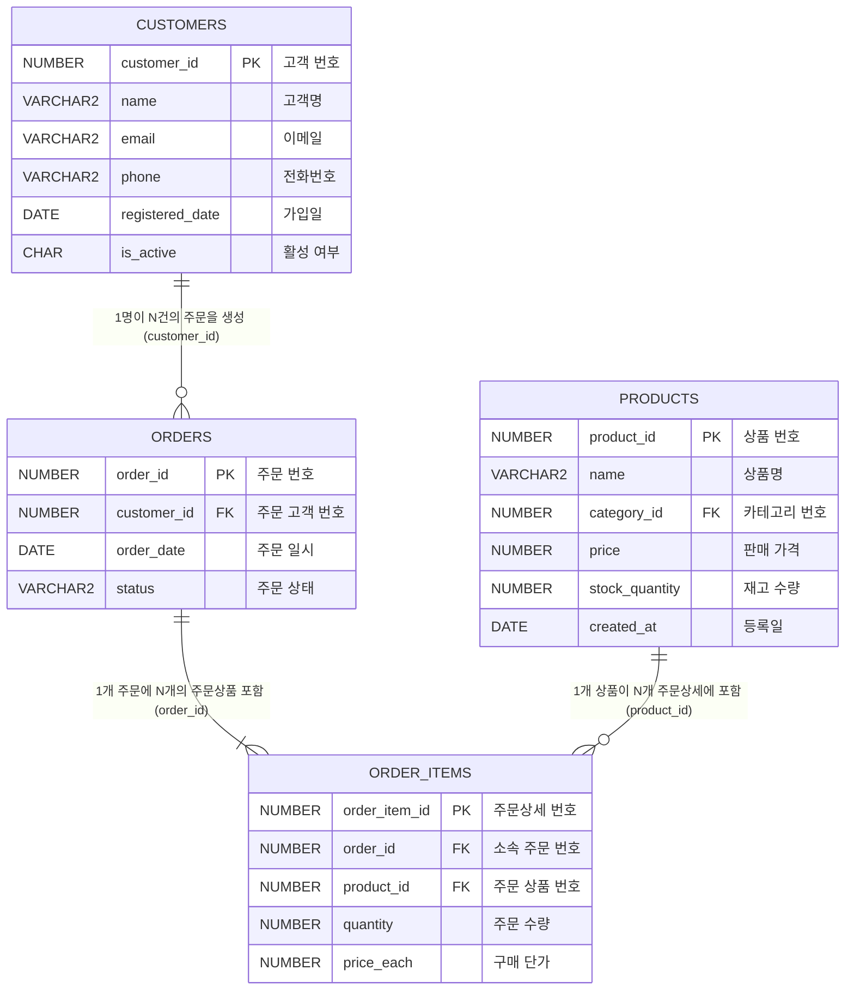
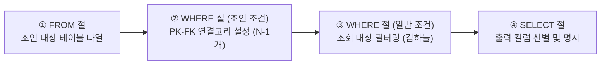
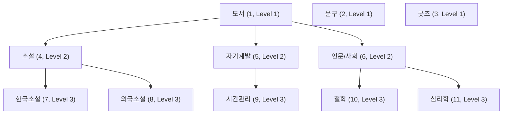
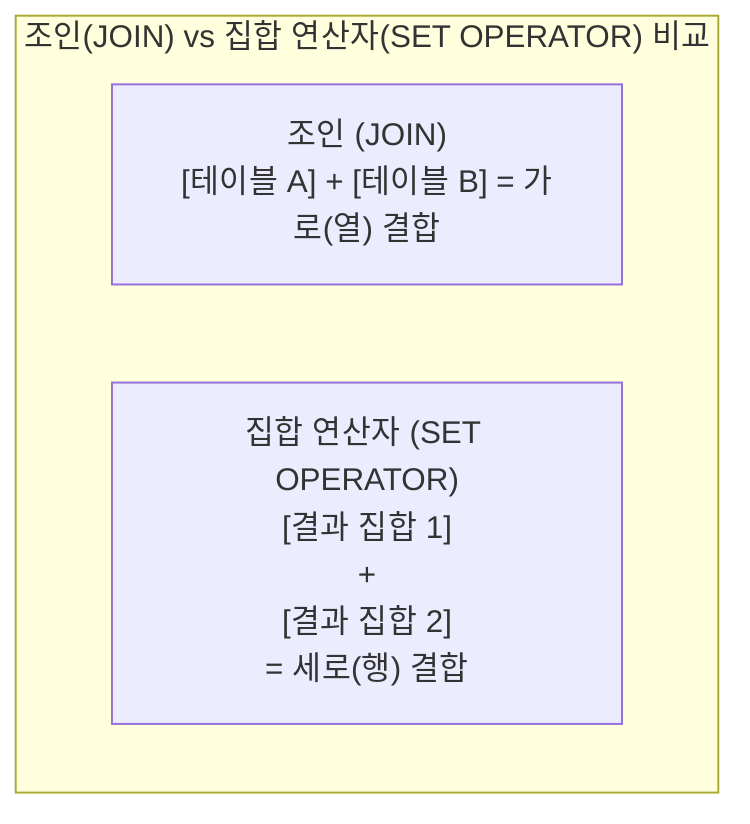

# Oracle SQL 다중 테이블 조인(Join) 실습 가이드

관계형 데이터베이스(RDBMS, Relational Database Management System)의 핵심이자 꽃은 바로 **조인**(JOIN)입니다. 관계형 데이터베이스에서는 데이터의 중복을 제거하고 무결성을 유지하기 위해 데이터를 주제별로 분할(정규화, Normalization)하여 저장합니다. 분할되어 서로 다른 테이블에 저장된 데이터를 비즈니스 요구사항에 맞게 결합하여 마치 하나의 테이블처럼 조회할 때 사용하는 문법이 바로 **조인**(JOIN)입니다.

이번 8일차 실습에서는 관계형 데이터베이스의 테이블 간 참조 관계(PK-FK)를 파악하는 기초 단계부터, **동등 조인**(Equi Join), **내부 조인**(INNER JOIN), 누락된 행까지 포함하여 조회하는 **외부 조인**(OUTER JOIN: LEFT/RIGHT/FULL), 모든 가능한 조합을 생성하는 **교차 조인**(CROSS JOIN), 동일 테이블을 조인하는 **자체 조인**(SELF JOIN), 그리고 오라클 전용 구문(`WHERE =`, `(+)`)과 ANSI/ISO SQL-99 표준 구문(`JOIN ON`, `JOIN USING`, `NATURAL JOIN`)의 문법적 차이와 원리를 단계별 실습 예제와 함께 학습합니다.

> [!NOTE]
> **📖 SQL 문법 표기 규칙 안내**
> 본 가이드의 함수 및 SQL 문법 설명에 사용되는 기호는 다음과 같습니다:
> - `[ ]` (대괄호): 생략 가능한 **선택 사항**(Optional)을 나타냅니다. *(실제 SQL 작성 시 대괄호 기호는 입력하지 않습니다)*
> - `|` (파이프): 나열된 옵션 중 **하나를 선택**(OR)함을 나타냅니다.

---

## 0. 사전 준비: 실습 사용자 및 세션 확인

모든 SQL 실습은 관리자(`SYSTEM`) 계정이 아닌 **실습용 일반 사용자**(`KOREA_MALL`) 세션의 SQL 편집기에서 진행합니다.

```sql
-- 현재 접속 계정 확인 (결과가 KOREA_MALL 이어야 함)
SELECT USER FROM DUAL;
```

> 🎯 **핵심 배움 포인트** (실습 환경 확인):
> - 데이터베이스 카탈로그 오염을 방지하고 보안 원칙을 준수하기 위해 모든 DDL, DML, 조인 쿼리 실습은 반드시 일반 계정(`KOREA_MALL`) 세션에서 실행합니다.

---

## 1. 조인(JOIN)의 핵심 개념과 관계형 모델

### 1.1 왜 테이블을 분할하고 조인하는가?
하나의 거대한 테이블에 고객 정보, 주문 정보, 주문 품목 정보, 상품 정보를 모두 모아서 저장하면 다음과 같은 문제가 발생합니다:
- **데이터 중복**: 고객이 10번 주문하면 고객 이름, 전화번호, 이메일이 10번 중복 저장됩니다.
- **이상 현상**(Anomaly): 고객 주소 변경 시 모든 행을 일일이 수정해야 하며(수정 이상), 주문하지 않은 고객 정보는 저장하기 어렵고(삽입 이상), 주문 내역 삭제 시 고객 정보까지 함께 지워질 수 있습니다(삭제 이상).

#### [비정규화 예시] 모든 데이터를 한 테이블에 합쳤을 때
| 주문번호 | 고객ID | 고객명 | 전화번호 | 상품명 | 수량 | 발생 문제 (이상 현상) |
|:---:|:---:|:---:|:---:|:---:|:---:|:---|
| 101 | 1 | **홍길동** | **010-1111-2222** | 게이밍 마우스 | 1 | **수정 이상**: 연락처 변경 시 모든 행을 다 고쳐야 함 |
| 101 | 1 | **홍길동** | **010-1111-2222** | 기계식 키보드 | 1 | (같은 주문에 여러 품목 구매 시 고객·주문 정보가 반복 중복됨) |
| 102 | 2 | 이순신 | 010-3333-4444 | 게이밍 마우스 | 2 | **삭제 이상**: 102번 주문 취소 시 '이순신' 고객 정보도 영구 삭제됨 |
| *(없음)* | 3 | 강감찬 | 010-5555-6666 | *(없음)* | - | **삽입 이상**: 주문하지 않은 신규 회원은 빈칸(NULL) 없이는 등록 불가 |

#### [정규화 예시] 관심사별 4대 핵심 테이블로 분리했을 때

##### 1) 고객 테이블 (`customers`)
| 고객ID (PK) | 고객명 | 전화번호 | 해결된 문제 |
|:---:|:---:|:---:|:---|
| 1 | 홍길동 | 010-1111-2222 | **수정 이상 해결**: 연락처가 바뀌어도 **1개 행만 수정**하면 반영 완료 |
| 2 | 이순신 | 010-3333-4444 | **삭제 이상 해결**: 주문이 취소되거나 삭제되어도 고객 데이터는 온전히 보존 |
| 3 | 강감찬 | 010-5555-6666 | **삽입 이상 해결**: 주문 이력이 없어도 신규 고객 정보를 깔끔하게 단독 등록 가능 |

##### 2) 주문 테이블 (`orders`) — "누가 언제 주문했는가?"
| 주문번호 (PK) | 고객ID (FK) | 주문일자 |
|:---:|:---:|:---:|
| 101 | **1** | 2026-03-01 |
| 102 | **2** | 2026-03-02 |

##### 3) 주문상세 테이블 (`order_items`) — "어떤 주문에 어떤 상품을 몇 개 담았는가?"
| 주문상세ID (PK) | 주문번호 (FK) | 상품ID (FK) | 수량 |
|:---:|:---:|:---:|:---:|
| 1 | **101** | **10** | 1 |
| 2 | **101** | **20** | 1 |
| 3 | **102** | **10** | 2 |

##### 4) 상품 테이블 (`products`) — "어떤 상품이 얼마인가?"
| 상품ID (PK) | 상품명 | 가격 | 해결된 문제 |
|:---:|:---:|:---:|:---|
| 10 | 게이밍 마우스 | 35,000 | **수정 이상 해결**: 상품명이나 가격 변경 시 **1개 행만 수정** |
| 20 | 기계식 키보드 | 89,000 | **삭제 이상 해결**: 주문 품목이 삭제되어도 상품 정보는 안전하게 보존 |
| 30 | 4K 모니터 | 450,000 | **삽입 이상 해결**: 아직 판매되지 않은 신상품도 단독으로 등록 가능 |

> 💡 **정규화와 다중 테이블 조인(Multi-table JOIN)의 관계**:
> * 하나의 거대한 비정규화 테이블을 4대 핵심 테이블(`customers`, `orders`, `order_items`, `products`)로 정규화하면 데이터 중복과 각종 이상 현상이 원천 차단됩니다.
> * 이후 "홍길동 고객이 101번 주문에서 구매한 상품명과 수량은 무엇인가?"처럼 분리된 데이터를 다시 한 화면에서 조회할 때, 각 테이블의 공통 연결고리(`PK-FK`)를 이어주는 문법이 바로 **조인**(JOIN)입니다.


따라서 RDBMS는 **데이터 정규화**(Normalization)를 통해 `고객(customers)`, `주문(orders)`, `상품(products)`, `주문상세(order_items)` 등으로 테이블을 분리하고, 필요한 시점에 **공통 컬럼**(기본키-외래키)을 연결고리 삼아 결합(JOIN)합니다.

### 1.2 실습 쇼핑몰 4대 핵심 테이블의 관계도 (ERD)



---

## 2. 사전 준비: 조인 대상 테이블 구조 점검

조인 쿼리를 작성하기 위해서는 조인 대상이 되는 각 테이블에 어떤 컬럼이 존재하는지, 그리고 테이블 간에 어떤 컬럼이 연결고리(공통 컬럼) 역할을 하는지 먼저 파악해야 합니다.

오라클 데이터 딕셔너리 뷰인 `USER_TAB_COLUMNS`를 조회하면 현재 사용자 세션에 생성된 각 테이블의 컬럼 구성과 데이터 타입을 한눈에 확인할 수 있습니다.

---

## # 실습 예제 1 : 여러 테이블의 컬럼 구조를 함께 조회하기

조인의 대상이 될 쇼핑몰 핵심 테이블 4종(`customers`, `products`, `orders`, `order_items`)의 컬럼 이름, 데이터 타입, 데이터 길이를 데이터 사전에서 일괄 조회합니다.

### 1.1 실습 쿼리

```sql
-- 'customers', 'products', 'orders', 'order_items' 테이블의 컬럼 구조를 함께 조회
SELECT table_name, column_name, data_type, data_length
FROM user_tab_columns
WHERE table_name IN ('CUSTOMERS', 'PRODUCTS', 'ORDERS', 'ORDER_ITEMS')
ORDER BY table_name, column_id;
```

### 1.2 쿼리 실행 결과 예시

| TABLE_NAME | COLUMN_NAME | DATA_TYPE | DATA_LENGTH |
| :--- | :--- | :--- | :---: |
| **CUSTOMERS** | CUSTOMER_ID | NUMBER | 22 |
| **CUSTOMERS** | NAME | VARCHAR2 | 100 |
| **CUSTOMERS** | EMAIL | VARCHAR2 | 100 |
| **CUSTOMERS** | PHONE | VARCHAR2 | 20 |
| **CUSTOMERS** | REGISTERED_DATE | DATE | 7 |
| **CUSTOMERS** | IS_ACTIVE | CHAR | 1 |
| **ORDERS** | ORDER_ID | NUMBER | 22 |
| **ORDERS** | CUSTOMER_ID | NUMBER | 22 |
| **ORDERS** | ORDER_DATE | DATE | 7 |
| **ORDERS** | STATUS | VARCHAR2 | 20 |
| **ORDER_ITEMS** | ORDER_ITEM_ID | NUMBER | 22 |
| **ORDER_ITEMS** | ORDER_ID | NUMBER | 22 |
| **ORDER_ITEMS** | PRODUCT_ID | NUMBER | 22 |
| **ORDER_ITEMS** | QUANTITY | NUMBER | 22 |
| **ORDER_ITEMS** | PRICE_EACH | NUMBER | 22 |
| **PRODUCTS** | PRODUCT_ID | NUMBER | 22 |
| **PRODUCTS** | NAME | VARCHAR2 | 200 |
| **PRODUCTS** | CATEGORY_ID | NUMBER | 22 |
| **PRODUCTS** | PRICE | NUMBER | 22 |
| **PRODUCTS** | STOCK_QUANTITY | NUMBER | 22 |
| **PRODUCTS** | CREATED_AT | DATE | 7 |

> 🎯 **핵심 배움 포인트** (테이블 구조 파악과 조인의 연결고리):
> 
> 1. **조인을 위한 공통 키(Key) 식별**:
>    - `CUSTOMERS` 테이블의 `CUSTOMER_ID` (PK) $\leftrightarrow$ `ORDERS` 테이블의 `CUSTOMER_ID` (FK)
>    - `ORDERS` 테이블의 `ORDER_ID` (PK) $\leftrightarrow$ `ORDER_ITEMS` 테이블의 `ORDER_ID` (FK)
>    - `PRODUCTS` 테이블의 `PRODUCT_ID` (PK) $\leftrightarrow$ `ORDER_ITEMS` 테이블의 `PRODUCT_ID` (FK)
>    - 위와 같이 테이블 간에 의미와 데이터 타입이 일치하는 공통 컬럼이 조인 조건식의 기준이 됩니다.
> 
> 2. **오라클 데이터 딕셔너리 `USER_TAB_COLUMNS`의 주요 컬럼**:
>    - `TABLE_NAME`: 컬럼이 속한 테이블 이름
>    - `COLUMN_NAME`: 컬럼의 이름
>    - `DATA_TYPE`: 데이터 형식 (`NUMBER`, `VARCHAR2`, `DATE`, `CHAR` 등)
>    - `DATA_LENGTH`: 컬럼의 물리적 최대 바이트 길이 (`NUMBER`는 오라클 내부적으로 최대 22바이트 부동소수점 저장)
>    - `COLUMN_ID`: 테이블 생성 시 정의된 컬럼의 순번(1부터 시작)
> 
> 3. **데이터 사전 조회 시 대소문자 주의사항**:
>    - 오라클은 별도의 따옴표 없이 테이블을 생성하면 데이터 딕셔너리에 **테이블명과 컬럼명을 모두 대문자**(UPPERCASE)로 저장합니다.
>    - 따라서 `WHERE table_name IN ('CUSTOMERS', 'PRODUCTS', ...)`와 같이 리터럴 값을 **반드시 대문자로 지정**해야 정상적으로 조회됩니다. 소문자(`'customers'`)로 입력하면 아무 행도 반환되지 않습니다.
> 
> 4. **`ORDER BY table_name, column_id`의 의미**:
>    - 테이블별로 먼저 묶고, 각 테이블 내부에서는 `COLUMN_ID` 순서대로 정렬하여 테이블을 설계하고 생성했던 원래 순서대로 가독성 있게 확인할 수 있습니다.

---

## 3. 오라클 전통 조인(Oracle Join)과 다중 테이블 결합

오라클 SQL에서 둘 이상의 테이블을 결합하는 가장 전통적인 방식은 **`FROM` 절에 조인 대상 테이블들을 콤마(`,`)로 나열**하고, **`WHERE` 절에 컬럼 간의 일치 조건(`=`)을 명시**하는 방식입니다.

여러 테이블에 걸쳐 있는 복잡한 비즈니스 데이터를 한 번에 조회할 때는 머릿속으로 한 번에 완성하려 하지 말고, 다음 **4단계 빌드업 흐름**을 거쳐 점진적으로 완성하는 것이 실수를 방지하는 핵심 요령입니다.



---

## # 실습 예제 2 : 최종 쿼리 완성하기

이제 실제로 조회하고 싶은 컬럼을 `SELECT` 절에 명시합니다.

고객(`customers`), 주문(`orders`), 주문상세(`order_items`), 상품(`products`) 4개 테이블을 연결하여 '김하늘' 고객이 주문한 **모든 상품명과 수량**을 조회하는 최종 쿼리를 완성합니다.

### 2.1 실습 쿼리

```sql
-- '김하늘' 고객이 주문한 모든 상품명과 수량 조회 쿼리문 ④
SELECT customers.name, products.name, order_items.quantity
FROM customers, orders, order_items, products
WHERE customers.customer_id = orders.customer_id
  AND orders.order_id = order_items.order_id
  AND order_items.product_id = products.product_id
  AND customers.name = '김하늘';
```

### 2.2 쿼리 실행 결과 예시

| NAME | NAME | QUANTITY |
| :--- | :--- | :---: |
| 김하늘 | 아주 작은 습관의 힘 | 1 |
| 김하늘 | 채식주의자 | 2 |
| 김하늘 | 몰입 | 2 |

> 🎯 **핵심 배움 포인트** (다중 테이블 조인의 4대 원칙과 주의점):
> 
> 1. **다중 테이블 조인의 '$N - 1$ 조건식' 황금률**:
>    - 조인하려는 테이블의 개수가 **$N$개**라면, 모든 테이블을 정상적으로 연결하기 위한 **최소 조인 조건식은 반드시 $N - 1$개**가 필요합니다.
>    - 본 예제에서는 총 **4개**의 테이블(`customers`, `orders`, `order_items`, `products`)이 참여하므로, 최소 **3개**의 조인 조건식이 반드시 필요합니다:
>      1. `customers.customer_id = orders.customer_id` (고객 $\leftrightarrow$ 주문 연결)
>      2. `orders.order_id = order_items.order_id` (주문 $\leftrightarrow$ 주문상세 연결)
>      3. `order_items.product_id = products.product_id` (주문상세 $\leftrightarrow$ 상품 연결)
> 
> 2. **조인 조건 누락 시 카테시안 곱(Cartesian Product) 주의**:
>    - 만약 조인 조건 중 단 하나라도 누락되면, 관계없는 행들끼리 서로 곱해져(Cross Join) 원치 않는 방대한 양의 엉뚱한 가짜 행들이 생성되고 데이터베이스 성능이 심각하게 저하됩니다.
> 
> 3. **컬럼 식별자 모호성 방지** (테이블 접두사 명시):
>    - `customers` 테이블과 `products` 테이블은 둘 다 이름 정보를 나타내는 `name`이라는 동일한 컬럼명을 가지고 있습니다.
>    - 만약 `SELECT name, ...` 또는 `WHERE name = '김하늘'`과 같이 테이블명 없이 컬럼명만 쓰면, 오라클은 어느 테이블의 컬럼인지 알 수 없어 다음과 같은 오류를 발생시킵니다:
>      ```
>      ORA-00918: 열의 정의가 애매합니다 (column ambiguously defined)
>      ```
>    - 따라서 여러 테이블에 동일한 이름의 컬럼이 존재할 때는 반드시 `테이블명.컬럼명` 형식(예: `customers.name`, `products.name`)으로 소속 테이블을 명확하게 지정해야 합니다.
> 
> 4. **조인 조건(Join Condition)과 필터링 조건(Filter Condition)의 결합**:
>    - 전통적인 오라클 조인에서는 `WHERE` 절 안에 테이블들을 엮어주는 **조인 조건**(1~3번)과 특정 고객 행만 걸러내는 **일반 필터링 조건**(`customers.name = '김하늘'`)이 `AND` 연산자로 함께 나열됩니다.
>    - 오라클 옵티마이저는 `customers.name = '김하늘'` 조건을 먼저 평가하여 대상 고객을 찾은 뒤, 연결된 주문과 상품 행만 효율적으로 찾아 결합(조인)합니다.

---

## # 실습 예제 3 : 고객명과 주문일자 조회하기

고객 테이블(`customers`)과 주문 테이블(`orders`)을 연결하여 각 고객이 언제 주문했는지 주문 일자를 조회합니다.

매번 긴 테이블명을 접두사로 붙이는 불편함을 줄이기 위해, `FROM` 절에서 **테이블 별칭**(Table Alias)을 정의하여 간결하고 읽기 쉬운 쿼리를 작성하는 실습을 진행합니다.

### 3.1 실습 쿼리

```sql
-- 고객과 주문 정보를 연결하여 주문일자를 조회
SELECT c.name, o.order_date
FROM customers c, orders o
WHERE c.customer_id = o.customer_id;
```

### 3.2 쿼리 실행 결과 예시

| NAME | ORDER_DATE |
| :--- | :---: |
| 김하늘 | 2025-06-13 |
| 김하늘 | 2025-04-08 |
| 박서준 | 2025-05-08 |
| 정해인 | 2025-06-30 |
| 정해인 | 2025-06-27 |
| 정해인 | 2025-06-11 |
| 정해인 | 2025-05-11 |
| 정해인 | 2025-06-08 |
| 신민아 | 2025-05-14 |
| 이종석 | 2025-05-02 |
| 이종석 | 2025-06-16 |
| 이종석 | 2025-05-23 |
| 이종석 | 2025-04-14 |
| 김소현 | 2025-06-11 |
| 남주혁 | 2025-05-25 |
| 남주혁 | 2025-06-01 |
| 남주혁 | 2025-04-13 |
| 남주혁 | 2025-06-11 |
| 김태리 | 2025-05-23 |
| 유연석 | 2025-05-08 |

*(총 20개 행이 조회됩니다)*

> 🎯 **핵심 배움 포인트** (테이블 별칭(Alias) 활용과 조인의 결과 행 수):
> 
> 1. **테이블 별칭(Table Alias)의 강력한 장점**:
>    - `FROM customers c, orders o`처럼 테이블명 뒤에 한 칸 공백을 두고 약칭(`c`, `o`)을 지정하면, 쿼리 전체에서 긴 테이블명 대신 1~2글자의 간결한 별칭으로 컬럼을 식별할 수 있습니다 (`customers.name` $\rightarrow$ `c.name`).
>    - 조인하는 테이블 수가 많아질수록 쿼리의 가독성과 작성 효율이 극대화됩니다.
> 
> 2. **★ 오라클 테이블 별칭 지정 시 주의사항** (`AS` 키워드 사용 금지):
>    - `SELECT` 절의 **컬럼 별칭**에는 `AS`를 사용할 수 있습니다 (`SELECT c.name AS 고객명`).
>    - 하지만 오라클에서는 **`FROM` 절의 테이블 별칭에 `AS` 키워드를 절대 지원하지 않습니다**.
>      ```sql
>      -- ❌ 문법 오류 발생 (ORA-00933: SQL 명령어가 올바르게 종료되지 않았습니다)
>      FROM customers AS c, orders AS o
>      
>      -- ⭕ 올바른 작성법 (공백 한 칸 띄우고 별칭 지정)
>      FROM customers c, orders o
>      ```
> 
> 3. **별칭 선언 후 원래 테이블명 사용 불가 원칙**:
>    - `FROM` 절에서 테이블에 별칭을 부여하는 순간, SQL 파서는 쿼리 내에서 해당 테이블의 원래 이름을 지우고 별칭만 인식합니다.
>    - 따라서 `SELECT customers.name`과 같이 원래 테이블명을 혼용하여 작성하면 `ORA-00904: 열명이 부적합합니다` 에러가 발생하므로, 반드시 모든 절(`SELECT`, `WHERE`, `ORDER BY` 등)에서 별칭(`c.name`)을 일관되게 사용해야 합니다.
> 
> 4. **1:N 관계 조인에서 결과 행 수 결정 원리**:
>    - 고객(`customers`)은 총 10명이지만, 주문(`orders`)은 총 20건입니다.
>    - 1명의 고객(1)이 여러 건의 주문(N)을 생성할 수 있으므로, 두 테이블의 동등 조인(`INNER EQUI-JOIN`) 결과 행 수는 부모(고객) 수가 아니라 **자식 테이블(주문)의 유효 행 수인 20건**이 됩니다.
>    - 한 번도 주문하지 않은 고객(예: 가입만 하고 주문이 없는 고객)은 조건 `c.customer_id = o.customer_id`를 만족하지 못하므로 이번 동등 조인 결과에서 완전히 제외됩니다.

---

## # 실습 예제 4 : 주문상품명과 주문자성명 조회하기 (컬럼 별칭 사용)

[실습 예제 2](#실습-예제-2--최종-쿼리-완성하기)에서는 `customers.name`과 `products.name`을 함께 조회할 때 결과 헤더가 둘 다 모호하게 `NAME`으로 출력되었습니다.

이번 예제에서는 **테이블 별칭**(`c`, `o`, `oi`, `p`)을 활용하여 4개 테이블을 간결하게 조인하고, `AS "컬럼별칭"`을 사용하여 최종 결과 헤더에 '**주문자성명**'과 '**주문상품**'이라는 직관적인 한글 이름을 부여합니다.

### 4.1 실습 쿼리

```sql
-- 주문상품명과 주문자 성명을 조회
SELECT c.name AS "주문자성명", p.name AS "주문상품"
FROM customers c, orders o, order_items oi, products p
WHERE c.customer_id = o.customer_id
  AND o.order_id = oi.order_id
  AND oi.product_id = p.product_id;
```

### 4.2 쿼리 실행 결과 예시

| 주문자성명 | 주문상품 |
| :--- | :--- |
| 남주혁 | 82년생 김지영 |
| 남주혁 | 82년생 김지영 |
| 신민아 | 82년생 김지영 |
| 정해인 | 82년생 김지영 |
| 이종석 | 82년생 김지영 |
| 김소현 | 소년이 온다 |
| 정해인 | 소년이 온다 |
| 남주혁 | 채식주의자 |
| 김하늘 | 채식주의자 |
| 정해인 | 채식주의자 |
| 정해인 | 위대한 개츠비 |
| 남주혁 | 위대한 개츠비 |
| 유연석 | 1984 |
| 김하늘 | 몰입 |
| 남주혁 | 성공하는 사람들의 7가지 습관 |
| 김하늘 | 아주 작은 습관의 힘 |
| 정해인 | 아주 작은 습관의 힘 |
| 이종석 | 소크라테스의 변명 |
| 이종석 | 소크라테스의 변명 |
| 신민아 | 니코마코스 윤리학 |
| ... | *(중략)* |
| 남주혁 | 라인프렌즈 볼펜 |
| 정해인 | 북마크 세트 |
| 남주혁 | 책상용 독서대 |
| 유연석 | 책상용 독서대 |
| 유연석 | 책상용 독서대 |

*(주문상세 전체 내역에 맞춰 총 39개 행이 조회됩니다)*

> 🎯 **핵심 배움 포인트** (컬럼 별칭과 테이블 별칭의 핵심 비교):
> 
> 1. **결과셋 가독성을 위한 컬럼 별칭(Column Alias) 활용**:
>    - 조인 시 서로 다른 테이블에서 동일한 컬럼명(`name`, `id`, `created_at` 등)을 가져올 경우, 컬럼 별칭을 지정하지 않으면 결과 헤더가 중복되어 어느 데이터인지 구분하기 어렵습니다.
>    - `SELECT c.name AS "주문자성명", p.name AS "주문상품"`처럼 별칭을 붙이면 애플리케이션 및 보고서에서 직관적으로 데이터를 식별할 수 있습니다.
> 
> 2. **테이블 별칭(Table Alias) vs 컬럼 별칭(Column Alias) 총정리**:
> 
> | 비교 항목 | 테이블 별칭 (Table Alias) | 컬럼 별칭 (Column Alias) |
> | :--- | :--- | :--- |
> | **작성 위치** | `FROM` 절 테이블명 뒤 | `SELECT` 절 컬럼 표현식 뒤 |
> | **`AS` 키워드 지원** | ❌ **사용 불가** (ORA-00933 에러) | ⭕ **사용 가능** (`AS` 생략 가능) |
> | **쌍따옴표(`" "`) 사용** | 사용 불가 (일반 식별자) | ⭕ **사용 권장** (한글, 공백, 특수문자 지원) |
> | **작성 목적** | SQL 내부에서 컬럼 참조 경로를 단축 | 최종 출력 결과의 헤더 명칭을 직관적으로 변경 |
> | **유효 범위** | 해당 SQL 쿼리 전체(`SELECT`, `WHERE`, `ORDER BY`) | 최종 클라이언트 출력 및 `ORDER BY` 절 |
> 
> 3. **다중 조인 결과 행 수(39건)의 도출 원리**:
>    - 고객(10건) $\rightarrow$ 주문(20건) $\rightarrow$ **주문상세**(39건) $\leftarrow$ 상품(25건)
>    - 조인 체인에서 가장 구체적이고 상세한 단위(가장 하위 자식 테이블)인 `order_items`의 총 건수가 39건이므로, 모든 조인 조건을 만족한 최종 결과 행 수도 39건이 됩니다.

---

## # 실습 예제 5 : CROSS JOIN 실습하기

두 테이블을 결합할 때 `WHERE` 절에 조인 조건(연결고리)을 명시하지 않으면 어떻게 될까요?

이번 예제에서는 조인 조건이 생략되었을 때 첫 번째 테이블의 모든 행이 두 번째 테이블의 모든 행과 하나씩 빠짐없이 맞물려 결합되는 **교차 조인**(CROSS JOIN 또는 카테시안 곱, Cartesian Product)의 동작 방식을 확인합니다.

### 5.1 실습 쿼리

```sql
-- 상품과 카테고리를 임의로 조합 (CROSS JOIN)
SELECT p.name, c.category_name
FROM products p, categories c;
```

### 5.2 쿼리 실행 결과 예시

| NAME | CATEGORY_NAME |
| :--- | :--- |
| 82년생 김지영 | 도서 |
| 소년이 온다 | 도서 |
| 채식주의자 | 도서 |
| 노르웨이의 숲 | 도서 |
| 위대한 개츠비 | 도서 |
| 1984 | 도서 |
| 몰입 | 도서 |
| 성공하는 사람들의 7가지 습관 | 도서 |
| 아주 작은 습관의 힘 | 도서 |
| 소크라테스의 변명 | 도서 |
| 니코마코스 윤리학 | 도서 |
| ... | *(중략)* |
| 책상용 독서대 | 심리학 |

*(상품 25건 $\times$ 카테고리 11건 = 총 275개 행이 조회됩니다)*

> 🎯 **핵심 배움 포인트** (CROSS JOIN과 카테시안 곱의 원리 및 실무 활용):
> 
> 1. **카테시안 곱(Cartesian Product)의 수학적 계산 원리**:
>    - 조인 조건이 주어지지 않으면 오라클은 첫 번째 테이블(상품 25건)의 각 행을 두 번째 테이블(카테고리 11건)의 모든 행과 순차적으로 매칭합니다.
>    - 최종 결과 행 수:
>      $$\text{상품 테이블 행 수 (25)} \times \text{카테고리 테이블 행 수 (11)} = \mathbf{275\text{행}}$$
>    - 상품 '82년생 김지영' 하나에 대해 '도서', '문구', '굿즈', '소설' 등 존재하는 11개 카테고리가 모두 결합되어 출력됩니다.
> 
> 2. **전통 오라클 구문 vs ANSI 표준 `CROSS JOIN` 구문 비교**:
>    ```sql
>    -- ① 오라클 전통 방식 (WHERE 조인 조건 생략)
>    SELECT p.name, c.category_name
>    FROM products p, categories c;
> 
>    -- ② ANSI/ISO SQL-99 표준 방식 (CROSS JOIN 키워드 명시)
>    SELECT p.name, c.category_name
>    FROM products p CROSS JOIN categories c;
>    ```
>    - 실무에서는 조인 조건이 실수로 누락된 버그인지, 의도적인 교차 조인인지 구분을 명확히 하기 위해 ANSI 표준의 **`CROSS JOIN` 키워드 사용을 강력히 권장**합니다.
> 
> 3. **CROSS JOIN의 주의점과 유용한 실무 활용 사례**:
>    - ⚠️ **주의점**: 테이블 규모가 수만~수백만 건인 경우 조인 조건을 누락하면 순식간에 수억 건의 조합이 만들어지며 DBMS의 메모리(TEMP 테이블스페이스)가 고갈되고 시스템이 마비될 수 있습니다.
>    - 💡 **의도적으로 활용하는 실무 사례**:
>      1. **경우의 수 매트릭스 생성**: 색상(3종) $\times$ 사이즈(4종)의 모든 가능한 상품 옵션(SKU) 조합 생성 시
>      2. **보고서 누락 방지**(캘린더 축 생성): 날짜(365일) $\times$ 전 지점(50개)을 교차 조인하여 매출이 0원인 날짜/지점도 누락 없이 표시하는 기준 보고서 뼈대 구축 시
>      3. **대량 더미 데이터 복제**: 성능 테스트를 위해 기존 데이터를 수십~수백 배로 신속하게 복제할 때

---

## # 실습 예제 6 : EQUI JOIN 실습하기

**동등 조인**(EQUI JOIN)은 조인 조건에 등호(`=`) 연산자를 사용하여, 두 테이블 간의 공통 컬럼 값이 정확히 일치하는 행들만 결합하는 가장 기본적이고 보편적인 조인 방식입니다.

고객 테이블(`customers`)과 리뷰 테이블(`reviews`)을 동등 조인하여, 각 고객이 작성한 상품 리뷰 목록과 평점, 작성일을 조회합니다.

### 6.1 실습 쿼리

```sql
-- 고객이 작성한 리뷰 목록 조회
SELECT c.name AS "고객명",
       r.rating AS "평점",
       r.content AS "리뷰내용",
       r.created_at AS "작성일"
FROM customers c, reviews r
WHERE c.customer_id = r.customer_id;
```

### 6.2 쿼리 실행 결과 예시

| 고객명 | 평점 | 리뷰내용 | 작성일 |
| :--- | :---: | :--- | :---: |
| 김하늘 | 4 | 읽고 나서 삶의 태도를 바꾸게 되었어요. | 2025-06-01 |
| 박서준 | 3 | 좋은 내용인데 집중이 잘 안 됐어요. | 2025-06-01 |
| 박서준 | 3 | 메시지는 좋지만 전개가 아쉬웠습니다. | 2025-06-02 |
| 정해인 | 3 | 감정선은 좋았는데 결말이 아쉬웠어요. | 2025-06-02 |
| 정해인 | 3 | 분위기는 좋았지만 스토리는 평이했어요. | 2025-06-02 |
| 정해인 | 3 | 기대한 것보단 평범했어요. | 2025-06-02 |
| 정해인 | 4 | 일상에 동기부여가 되는 책이었어요. | 2025-06-01 |
| 정해인 | 4 | 기초 개념 잡기에 좋은 책입니다. | 2025-06-01 |
| 신민아 | 4 | 생각보다 내용이 깊고 재미있었어요. | 2025-06-02 |
| 이종석 | 3 | 조금 지루한 감이 있었어요. | 2025-06-02 |
| 이종석 | 5 | 퀄리티 대비 가격이 아주 만족스럽습니다. | 2025-06-02 |
| 이종석 | 4 | 실용적인 팁이 많아서 도움이 됐어요. | 2025-06-02 |
| 이종석 | 4 | 다시 생각하게 만드는 이야기였습니다. | 2025-06-02 |
| ... | ... | *(중략)* | ... |
| 김태리 | 5 | 너무 재미있게 읽었어요. 추천합니다! | 2025-06-02 |
| 유연석 | 4 | 튼튼하고 디자인도 마음에 들어요. | 2025-06-01 |

*(기본 샘플 데이터 기준 총 23개 행이 조회됩니다)*

> 🎯 **핵심 배움 포인트** (EQUI JOIN의 일치 조건과 데이터 필터링 원리):
> 
> 1. **동등 조인(EQUI JOIN)의 매칭 메커니즘**:
>    - `WHERE c.customer_id = r.customer_id` 조건은 `customers`의 기본키(`customer_id`)와 `reviews`의 외래키(`customer_id`)의 값이 **양쪽 모두에 존재하고 정확히 같은 행만 결합**합니다.
>    - 값이 서로 일치하지 않거나 어느 한쪽에만 존재하는 행은 결과에서 완전히 배제됩니다.
> 
> 2. **리뷰를 작성하지 않은 고객의 처리**:
>    - 전체 고객 10명 중 리뷰를 한 번도 작성하지 않은 고객(예: 3번 이보영 고객)은 `reviews` 테이블에 본인의 `customer_id`를 가진 행이 존재하지 않습니다.
>    - 따라서 EQUI JOIN 조건(`=`)을 만족할 수 없으므로 이번 조회 결과에서 자동으로 누락됩니다.
>    - 만약 '리뷰를 작성하지 않은 고객'까지 고객 목록에 포함하여 출력하고 싶다면, 뒤에서 다룰 **외부 조인**(OUTER JOIN)을 사용해야 합니다.
> 
> 3. **1:N 관계에서의 행 수 확장**:
>    - 1명의 고객이 여러 개의 리뷰를 작성할 수 있습니다 (예: '정해인' 고객은 5건의 리뷰를 작성).
>    - 따라서 고객 정보(1)가 각 리뷰(N)에 맞춰 반복 출력되면서, 최종 결과 행 수는 자식 테이블인 `reviews`의 행 수(23건)만큼 늘어나게 됩니다.

---

## 4. 외부 조인(OUTER JOIN)과 오라클 (+) 연산자

일반적인 내부 조인(INNER JOIN / EQUI JOIN)은 양쪽 테이블 모두에 데이터가 존재하는 **교집합** 데이터만 반환합니다. 따라서 매칭되는 데이터가 없는 행(예: 아직 판매되지 않은 신상품, 주문 내역이 없는 신규 고객, 리뷰가 작성되지 않은 상품)은 조회 결과에서 완전히 누락되는 한계가 있습니다.

이러한 문제를 해결하기 위해, 기준이 되는 테이블의 행을 하나도 빠뜨리지 않고 모두 출력하면서 반대편 테이블에 일치하는 데이터가 없을 경우 `NULL`로 채워 함께 조회하는 기법이 바로 **외부 조인**(OUTER JOIN)입니다.

오라클 전통 문법에서는 외부 조인을 표현할 때 **`(+)` 기호**를 사용합니다.

```mermaid
flowchart LR
    subgraph InnerJoin ["내부 조인 (INNER JOIN)"]
        A1["상품 (products)"] --- C1["교집합 행만 출력<br>(리뷰가 있는 상품만)"] --- B1["리뷰 (reviews)"]
    end

    subgraph OuterJoin ["외부 조인 (LEFT OUTER JOIN)"]
        A2["기준: 상품 (products)<br>전체 25건 보존"] --> C2["일치 행: 평점 출력<br>불일치 행: NULL 출력"] <-- B2["리뷰 (reviews)<br>(+) 기호로 부족한 곳 보충"]
    end
```

---

## # 실습 예제 7 : LEFT OUTER JOIN 실습하기

고객이 작성한 상품의 리뷰 등급(평점)을 조회합니다. 이때 리뷰가 한 번도 작성되지 않은 상품도 목록에서 누락되지 않고 모두 조회되도록 **오라클의 `(+)` 연산자**를 활용한 `LEFT OUTER JOIN`을 수행합니다.

### 7.1 실습 쿼리

```sql
-- 고객이 작성한 리뷰등급 조회(리뷰가 없는 경우에도 상품 조회)
SELECT p.name, r.rating
FROM products p, reviews r
WHERE p.product_id = r.product_id(+);
```

### 7.2 쿼리 실행 결과 예시

| NAME | RATING | 비고 |
| :--- | :---: | :--- |
| 82년생 김지영 | 3 | 리뷰 등록 상품 |
| 82년생 김지영 | 4 | 리뷰 등록 상품 (복수 리뷰) |
| 소년이 온다 | 3 | 리뷰 등록 상품 |
| 채식주의자 | 5 | 리뷰 등록 상품 |
| **노르웨이의 숲** | *(null)* | **리뷰 미등록 상품** (보존됨) |
| 위대한 개츠비 | 3 | 리뷰 등록 상품 |
| **1984** | *(null)* | **리뷰 미등록 상품** (보존됨) |
| 몰입 | 4 | 리뷰 등록 상품 |
| **성공하는 사람들의 7가지 습관** | *(null)* | **리뷰 미등록 상품** (보존됨) |
| 아주 작은 습관의 힘 | 4 | 리뷰 등록 상품 |
| 소크라테스의 변명 | 4 | 리뷰 등록 상품 |
| **철학의 위안** | *(null)* | **리뷰 미등록 상품** (보존됨) |
| ... | ... | *(중략)* |
| **북마크 세트** | *(null)* | **리뷰 미등록 상품** (보존됨) |
| 책상용 독서대 | 5 | 리뷰 등록 상품 |
| 책상용 독서대 | 4 | 리뷰 등록 상품 |

*(리뷰가 등록된 상품 행 23건 + 리뷰가 없는 상품 행 8건 = 총 31개 행이 조회됩니다)*

> 🎯 **핵심 배움 포인트** (오라클 (+) 연산자의 위치와 동작 원리):
> 
> 1. **`(+)` 기호의 위치 규칙** (핵심 암기 요령):
>    - 오라클 문법에서 `(+)`는 "**정보가 부족하여 `NULL`로 채워져야 하는 쪽**(상대방 컬럼)" 뒤에 붙입니다.
>    - 본 예제에서는 **모든 상품(`products`)을 살리고**, 매칭되는 리뷰가 없는 쪽에 `NULL`을 채워야 하므로 `reviews` 쪽 컬럼인 `r.product_id(+)`에 `(+)`를 붙입니다.
>    - 기준 테이블의 반대편에 `(+)`를 붙인다고 기억하면 직관적입니다.
> 
> 2. **오라클 전통 구문 vs ANSI 표준 `LEFT OUTER JOIN` 비교**:
>    ```sql
>    -- ① 오라클 전용 (+) 문법
>    SELECT p.name, r.rating
>    FROM products p, reviews r
>    WHERE p.product_id = r.product_id(+);
> 
>    -- ② ANSI/ISO SQL-99 표준 문법
>    SELECT p.name, r.rating
>    FROM products p
>    LEFT OUTER JOIN reviews r
>      ON p.product_id = r.product_id;
>    ```
>    - 두 쿼리의 실행 결과와 성능은 100% 동일합니다.
> 
> 3. **오라클 `(+)` 연산자 사용 시 필수 주의사항**:
>    - **양쪽 동시 부여 불가**: `p.product_id(+) = r.product_id(+)`와 같이 양쪽에 `(+)`를 붙여 FULL OUTER JOIN을 수행하는 것은 오라클에서 허용되지 않습니다 (`ORA-01468: a predicate may reference only one outer-joined table`). 양방향 전체 외부 조인은 반드시 ANSI 표준의 `FULL OUTER JOIN`을 써야 합니다.
>    - **IN / OR 연산자 결합 불가**: `(+)`가 붙은 조건식에는 `IN` 연산자나 `OR` 연산자를 함께 사용할 수 없습니다 (`ORA-01719`).

---

## # 실습 예제 8 : RIGHT OUTER JOIN 실습하기

[실습 예제 7](#실습-예제-7--left-outer-join-실습하기)에서는 상품(`products`)을 기준으로 모든 상품을 보존했다면, 이번에는 **리뷰(`reviews`) 테이블을 기준**으로 삼아 작성된 모든 리뷰 데이터를 빠짐없이 보존하는 `RIGHT OUTER JOIN`을 실습합니다.

이 방식은 혹시라도 상품 정보가 삭제되었거나 매칭되는 상품이 존재하지 않더라도, 고객이 작성한 리뷰 등급(평점) 데이터를 온전히 보존하여 조회하고자 할 때 활용됩니다.

### 8.1 실습 쿼리

```sql
-- 고객이 작성한 리뷰등급 조회(상품이 없는 경우에도 리뷰등급 조회)
SELECT p.name AS "상품명", r.rating AS "리뷰등급"
FROM products p, reviews r
WHERE p.product_id(+) = r.product_id;
```

### 8.2 쿼리 실행 결과 예시

| 상품명 | 리뷰등급 | 비고 |
| :--- | :---: | :--- |
| 82년생 김지영 | 3 | 정상 매칭 |
| 82년생 김지영 | 4 | 정상 매칭 |
| 소년이 온다 | 3 | 정상 매칭 |
| 채식주의자 | 5 | 정상 매칭 |
| 채식주의자 | 3 | 정상 매칭 |
| 위대한 개츠비 | 3 | 정상 매칭 |
| 몰입 | 4 | 정상 매칭 |
| 아주 작은 습관의 힘 | 4 | 정상 매칭 |
| 소크라테스의 변명 | 4 | 정상 매칭 |
| 소크라테스의 변명 | 3 | 정상 매칭 |
| ... | ... | *(중략)* |
| 라인프렌즈 볼펜 | 4 | 정상 매칭 |
| 책상용 독서대 | 5 | 정상 매칭 |
| 책상용 독서대 | 4 | 정상 매칭 |

*(리뷰 테이블의 전체 데이터에 맞춰 총 23개 행이 조회됩니다)*

> 🎯 **핵심 배움 포인트** (RIGHT OUTER JOIN의 기준과 (+) 기호 위치):
> 
> 1. **RIGHT OUTER JOIN에서의 `(+)` 기호 위치**:
>    - `FROM products p, reviews r`에서 오른쪽에 명시된 `reviews r`이 기준(Master) 테이블입니다.
>    - 기준 테이블의 모든 행을 살려야 하므로, 데이터가 없을 수 있는 **반대편인 왼쪽 테이블 컬럼 `p.product_id(+)`에 `(+)`**를 붙입니다.
> 
> 2. **실습 예제 7(LEFT)과 실습 예제 8(RIGHT)의 명확한 차이 비교**:
> 
> | 비교 항목 | 실습 예제 7 (LEFT OUTER JOIN) | 실습 예제 8 (RIGHT OUTER JOIN) |
> | :--- | :--- | :--- |
> | **오라클 조건식** | `p.product_id = r.product_id(+)` | `p.product_id(+) = r.product_id` |
> | **기준(보존) 테이블** | 왼쪽의 `products` (상품 25건 전체) | 오른쪽의 `reviews` (리뷰 23건 전체) |
> | **NULL 발생 컬럼** | 리뷰 평점 (`r.rating`) | 상품명 (`p.name`) |
> | **조회 결과 건수** | **31건** (리뷰 없는 8개 상품 보존) | **23건** (존재하는 모든 리뷰 보존) |
> 
> 3. **ANSI/ISO SQL-99 표준 구문 변환**:
>    ```sql
>    -- ① ANSI RIGHT OUTER JOIN
>    SELECT p.name AS "상품명", r.rating AS "리뷰등급"
>    FROM products p
>    RIGHT OUTER JOIN reviews r
>      ON p.product_id = r.product_id;
> 
>    -- ② ANSI LEFT OUTER JOIN (테이블 순서만 바꾼 동일한 표현)
>    SELECT p.name AS "상품명", r.rating AS "리뷰등급"
>    FROM reviews r
>    LEFT OUTER JOIN products p
>      ON r.product_id = p.product_id;
>    ```
>    - 실무에서는 방향이 헷갈리는 `RIGHT JOIN` 대신, 기준 테이블을 `FROM` 절 맨 앞에 두고 `LEFT JOIN`으로 통일하여 작성하는 컨벤션을 선호하는 경우가 많습니다.

---

## # 실습 예제 9-1 : 1단계 reviews 테이블을 복제하여 제약조건 없는 테이블 생성하기

[실습 예제 8](#실습-예제-8--right-outer-join-실습하기)의 기본 데이터 환경에서는 모든 리뷰가 실제 존재하는 상품 번호(`product_id`)를 정상적으로 참조하고 있었기 때문에, 상품명이 `NULL`로 출력되는 극단적인 `RIGHT OUTER JOIN` 사례를 직접 확인하기 어려웠습니다. 또한 원본 `reviews` 테이블에는 외래키(FK) 제약조건이 걸려 있어 상품 테이블에 없는 임의의 상품 번호로 리뷰를 등록할 수도 없습니다 (`ORA-02291` 에러 발생).

따라서 이번 9번 시리즈 실습에서는 **CTAS**(`CREATE TABLE AS SELECT`) 기법을 사용하여 제약조건이 없는 임시 테스트 테이블(`review_test`)을 복제 생성한 후, 상품이 없는 고아 리뷰 데이터를 인위적으로 추가하여 **진정한 `RIGHT OUTER JOIN`과 `FULL OUTER JOIN`의 동작 결과**를 체계적으로 검증합니다.

### 9-1.1 실습 쿼리

```sql
-- 리뷰 테이블의 모든 컬럼을 조회한 결과값으로 review_test 테이블 생성
CREATE TABLE review_test AS SELECT * FROM reviews;

-- 생성된 review_test 테이블 확인
SELECT * FROM review_test;
```

### 9-1.2 쿼리 실행 결과 예시

```
Table REVIEW_TEST이(가) 생성되었습니다.
```

| REVIEW_ID | CUSTOMER_ID | PRODUCT_ID | RATING | CONTENT | CREATED_AT |
| :---: | :---: | :---: | :---: | :--- | :---: |
| 1 | 8 | 8 | 4 | 주제는 무거웠지만 쉽게 읽혀서 좋았어요. | 2025-06-02 |
| 2 | 8 | 1 | 4 | 고전이지만 지금 읽어도 흥미롭습니다. | 2025-06-02 |
| 3 | 4 | 5 | 3 | 감정선은 좋았는데 결말이 아쉬웠어요. | 2025-06-02 |
| 4 | 1 | 9 | 4 | 읽고 나서 삶의 태도를 바꾸게 되었어요. | 2025-06-01 |
| ... | ... | ... | ... | *(중략)* | ... |
| 22 | 8 | 23 | 5 | 선물용으로 딱입니다. 받는 분이 정말 좋아하셨어요. | 2025-06-01 |
| 23 | 8 | 22 | 4 | 귀엽고 실용적이라 만족합니다. | 2025-06-01 |

*(기본 샘플 데이터 기준 원본과 동일한 23개 행이 정상 복제되어 조회됩니다)*

> 🎯 **핵심 배움 포인트** (CTAS의 동작 원리와 제약조건 상속 특성):
> 
> 1. **CTAS (CREATE TABLE ... AS SELECT)의 개념과 강력함**:
>    - 기존 테이블의 컬럼 구조(데이터 타입, 컬럼명)와 실제 데이터 행들을 일괄 복사하여 새로운 독립 테이블을 즉시 생성하는 DDL 명령입니다.
>    - 운영 중인 원본 데이터를 훼손하지 않고 안전하게 DDL/DML 테스트를 수행할 수 있는 샌드박스(Sandbox) 환경을 만들 때 필수적으로 활용됩니다.
> 
> 2. **★ CTAS의 제약조건 복제 규칙** (외래키 제약조건 해제):
>    - CTAS로 테이블을 복제할 때 **`NOT NULL` 제약조건만 유일하게 새 테이블로 상속**됩니다.
>    - **`PRIMARY KEY`, `FOREIGN KEY`, `UNIQUE`, `CHECK` 제약조건 및 인덱스는 전혀 복제되지 않습니다**.
>    - 따라서 `review_test` 테이블에는 외래키(FK) 제약조건이 사라지므로, 다음 단계(9-2)에서 부모 테이블(`products`)에 존재하지 않는 임의의 상품 번호 데이터를 에러 없이 자유롭게 삽입할 수 있게 됩니다.

---

## # 실습 예제 9-2 : 2단계 존재하지 않는 상품(product_id = 999)에 대한 리뷰 추가하기

제약조건이 복제되지 않은 `review_test` 테이블의 특성을 이용하여, 상품 테이블(`products`)에는 전혀 존재하지 않는 가상의 상품 번호인 **`product_id = 999`번**을 참조하는 테스트 리뷰(9999번)를 인위적으로 삽입합니다.

이로써 상품 정보가 누락된 **고아 레코드**(Orphan Record)가 준비되며, 이후 실습에서 `RIGHT OUTER JOIN`과 `FULL OUTER JOIN`이 이를 어떻게 처리하는지 명확하게 확인할 수 있습니다.

### 9-2.1 실습 쿼리

```sql
-- 존재하지 않는 상품 ID 999번에 대한 리뷰 삽입
INSERT INTO review_test (review_id, customer_id, product_id, rating,
    content, created_at)
VALUES (9999, 1, 999, 4, '없는 상품에 대한 리뷰', SYSDATE);

-- review_test 테이블 조회하여 확인
SELECT * FROM review_test;
```

### 9-2.2 쿼리 실행 결과 예시

```
1개 행이 삽입되었습니다.
```

[**추가된 9999번 데이터 확인**]

| REVIEW_ID | CUSTOMER_ID | PRODUCT_ID | RATING | CONTENT | CREATED_AT |
| :---: | :---: | :---: | :---: | :--- | :---: |
| ... | ... | ... | ... | *(기존 23건 중략)* | ... |
| **9999** | **1** | **999** | **4** | **없는 상품에 대한 리뷰** | **2026-11-02** |

*(기존 23건에 신규 테스트 데이터 1건이 추가되어 총 24개 행이 조회됩니다)*

> 🎯 **핵심 배움 포인트** (외래키(FK)의 무결성 보호 역할과 고아 데이터의 의미):
> 
> 1. **외래키(FOREIGN KEY)의 참조 무결성 방어 역할 재확인**:
>    - 만약 복제 테이블(`review_test`)이 아닌 원본 `reviews` 테이블에 동일한 쿼리를 실행했다면 다음과 같은 에러가 발생하며 삽입이 즉시 차단됩니다:
>      ```
>      ORA-02291: 무결성 제약조건(KOREA_MALL.FK_REVIEWS_PRODUCT)이 위배되었습니다 - 부모 키가 없습니다
>      ```
>    - 외래키 제약조건은 이처럼 존재하지 않는 부모 데이터를 자식 테이블이 참조하는 잘못된 데이터(고아 레코드) 생성을 원천 차단해 줍니다.
> 
> 2. **고아 레코드(Orphan Record)와 외부 조인의 관계**:
>    - 이제 `products` 테이블(1~25번 상품)과 `review_test` 테이블(1~25번 상품 리뷰 + 999번 상품 리뷰) 사이에는 **양방향 불일치 데이터**가 모두 완성되었습니다:
>      - **상품은 있지만 리뷰가 없는 데이터**: 8개 상품 (노르웨이의 숲, 1984 등)
>      - **리뷰는 있지만 상품이 없는 데이터**: 9999번 리뷰 (999번 상품)
>    - 이 상태에서 조인 방식에 따라 결과가 어떻게 달라지는지 다음 단계에서 명확하게 비교할 수 있습니다.


이번 예제에서는 **테이블 별칭**(`c`, `o`, `oi`, `p`)을 활용하여 4개 테이블을 간결하게 조인하고, `AS "컬럼별칭"`을 사용하여 최종 결과 헤더에 '**주문자성명**'과 '**주문상품**'이라는 직관적인 한글 이름을 부여합니다.

### 4.1 실습 쿼리

```sql
-- 주문상품명과 주문자 성명을 조회
SELECT c.name AS "주문자성명", p.name AS "주문상품"
FROM customers c, orders o, order_items oi, products p
WHERE c.customer_id = o.customer_id
  AND o.order_id = oi.order_id
  AND oi.product_id = p.product_id;
```

### 4.2 쿼리 실행 결과 예시

| 주문자성명 | 주문상품 |
| :--- | :--- |
| 남주혁 | 82년생 김지영 |
| 남주혁 | 82년생 김지영 |
| 신민아 | 82년생 김지영 |
| 정해인 | 82년생 김지영 |
| 이종석 | 82년생 김지영 |
| 김소현 | 소년이 온다 |
| 정해인 | 소년이 온다 |
| 남주혁 | 채식주의자 |
| 김하늘 | 채식주의자 |
| 정해인 | 채식주의자 |
| 정해인 | 위대한 개츠비 |
| 남주혁 | 위대한 개츠비 |
| 유연석 | 1984 |
| 김하늘 | 몰입 |
| 남주혁 | 성공하는 사람들의 7가지 습관 |
| 김하늘 | 아주 작은 습관의 힘 |
| 정해인 | 아주 작은 습관의 힘 |
| 이종석 | 소크라테스의 변명 |
| 이종석 | 소크라테스의 변명 |
| 신민아 | 니코마코스 윤리학 |
| ... | *(중략)* |
| 남주혁 | 라인프렌즈 볼펜 |
| 정해인 | 북마크 세트 |
| 남주혁 | 책상용 독서대 |
| 유연석 | 책상용 독서대 |
| 유연석 | 책상용 독서대 |

*(주문상세 전체 내역에 맞춰 총 39개 행이 조회됩니다)*

> 🎯 **핵심 배움 포인트** (컬럼 별칭과 테이블 별칭의 핵심 비교):
> 
> 1. **결과셋 가독성을 위한 컬럼 별칭(Column Alias) 활용**:
>    - 조인 시 서로 다른 테이블에서 동일한 컬럼명(`name`, `id`, `created_at` 등)을 가져올 경우, 컬럼 별칭을 지정하지 않으면 결과 헤더가 중복되어 어느 데이터인지 구분하기 어렵습니다.
>    - `SELECT c.name AS "주문자성명", p.name AS "주문상품"`처럼 별칭을 붙이면 애플리케이션 및 보고서에서 직관적으로 데이터를 식별할 수 있습니다.
> 
> 2. **테이블 별칭(Table Alias) vs 컬럼 별칭(Column Alias) 총정리**:
> 
> | 비교 항목 | 테이블 별칭 (Table Alias) | 컬럼 별칭 (Column Alias) |
> | :--- | :--- | :--- |
> | **작성 위치** | `FROM` 절 테이블명 뒤 | `SELECT` 절 컬럼 표현식 뒤 |
> | **`AS` 키워드 지원** | ❌ **사용 불가** (ORA-00933 에러) | ⭕ **사용 가능** (`AS` 생략 가능) |
> | **쌍따옴표(`" "`) 사용** | 사용 불가 (일반 식별자) | ⭕ **사용 권장** (한글, 공백, 특수문자 지원) |
> | **작성 목적** | SQL 내부에서 컬럼 참조 경로를 단축 | 최종 출력 결과의 헤더 명칭을 직관적으로 변경 |
> | **유효 범위** | 해당 SQL 쿼리 전체(`SELECT`, `WHERE`, `ORDER BY`) | 최종 클라이언트 출력 및 `ORDER BY` 절 |
> 
> 3. **다중 조인 결과 행 수(39건)의 도출 원리**:
>    - 고객(10건) $\rightarrow$ 주문(20건) $\rightarrow$ **주문상세**(39건) $\leftarrow$ 상품(25건)
>    - 조인 체인에서 가장 구체적이고 상세한 단위(가장 하위 자식 테이블)인 `order_items`의 총 건수가 39건이므로, 모든 조인 조건을 만족한 최종 결과 행 수도 39건이 됩니다.


### 5.1 실습 쿼리

```sql
-- 상품과 카테고리를 임의로 조합 (CROSS JOIN)
SELECT p.name, c.category_name
FROM products p, categories c;
```

### 5.2 쿼리 실행 결과 예시

| NAME | CATEGORY_NAME |
| :--- | :--- |
| 82년생 김지영 | 도서 |
| 소년이 온다 | 도서 |
| 채식주의자 | 도서 |
| 노르웨이의 숲 | 도서 |
| 위대한 개츠비 | 도서 |
| 1984 | 도서 |
| 몰입 | 도서 |
| 성공하는 사람들의 7가지 습관 | 도서 |
| 아주 작은 습관의 힘 | 도서 |
| 소크라테스의 변명 | 도서 |
| 니코마코스 윤리학 | 도서 |
| ... | *(중략)* |
| 책상용 독서대 | 심리학 |

*(상품 25건 $\times$ 카테고리 11건 = 총 275개 행이 조회됩니다)*

> 🎯 **핵심 배움 포인트** (CROSS JOIN과 카테시안 곱의 원리 및 실무 활용):
> 
> 1. **카테시안 곱(Cartesian Product)의 수학적 계산 원리**:
>    - 조인 조건이 주어지지 않으면 오라클은 첫 번째 테이블(상품 25건)의 각 행을 두 번째 테이블(카테고리 11건)의 모든 행과 순차적으로 매칭합니다.
>    - 최종 결과 행 수:
>      $$\text{상품 테이블 행 수 (25)} \times \text{카테고리 테이블 행 수 (11)} = \mathbf{275\text{행}}$$
>    - 상품 '82년생 김지영' 하나에 대해 '도서', '문구', '굿즈', '소설' 등 존재하는 11개 카테고리가 모두 결합되어 출력됩니다.
> 
> 2. **전통 오라클 구문 vs ANSI 표준 `CROSS JOIN` 구문 비교**:
>    ```sql
>    -- ① 오라클 전통 방식 (WHERE 조인 조건 생략)
>    SELECT p.name, c.category_name
>    FROM products p, categories c;
> 
>    -- ② ANSI/ISO SQL-99 표준 방식 (CROSS JOIN 키워드 명시)
>    SELECT p.name, c.category_name
>    FROM products p CROSS JOIN categories c;
>    ```
>    - 실무에서는 조인 조건이 실수로 누락된 버그인지, 의도적인 교차 조인인지 구분을 명확히 하기 위해 ANSI 표준의 **`CROSS JOIN` 키워드 사용을 강력히 권장**합니다.
> 
> 3. **CROSS JOIN의 주의점과 유용한 실무 활용 사례**:
>    - ⚠️ **주의점**: 테이블 규모가 수만~수백만 건인 경우 조인 조건을 누락하면 순식간에 수억 건의 조합이 만들어지며 DBMS의 메모리(TEMP 테이블스페이스)가 고갈되고 시스템이 마비될 수 있습니다.
>    - 💡 **의도적으로 활용하는 실무 사례**:
>      1. **경우의 수 매트릭스 생성**: 색상(3종) $\times$ 사이즈(4종)의 모든 가능한 상품 옵션(SKU) 조합 생성 시
>      2. **보고서 누락 방지**(캘린더 축 생성): 날짜(365일) $\times$ 전 지점(50개)을 교차 조인하여 매출이 0원인 날짜/지점도 누락 없이 표시하는 기준 보고서 뼈대 구축 시
>      3. **대량 더미 데이터 복제**: 성능 테스트를 위해 기존 데이터를 수십~수백 배로 신속하게 복제할 때


```sql
-- 고객이 작성한 리뷰 목록 조회
SELECT c.name AS "고객명",
       r.rating AS "평점",
       r.content AS "리뷰내용",
       r.created_at AS "작성일"
FROM customers c, reviews r
WHERE c.customer_id = r.customer_id;
```

### 6.2 쿼리 실행 결과 예시

| 고객명 | 평점 | 리뷰내용 | 작성일 |
| :--- | :---: | :--- | :---: |
| 김하늘 | 4 | 읽고 나서 삶의 태도를 바꾸게 되었어요. | 2025-06-01 |
| 박서준 | 3 | 좋은 내용인데 집중이 잘 안 됐어요. | 2025-06-01 |
| 박서준 | 3 | 메시지는 좋지만 전개가 아쉬웠습니다. | 2025-06-02 |
| 정해인 | 3 | 감정선은 좋았는데 결말이 아쉬웠어요. | 2025-06-02 |
| 정해인 | 3 | 분위기는 좋았지만 스토리는 평이했어요. | 2025-06-02 |
| 정해인 | 3 | 기대한 것보단 평범했어요. | 2025-06-02 |
| 정해인 | 4 | 일상에 동기부여가 되는 책이었어요. | 2025-06-01 |
| 정해인 | 4 | 기초 개념 잡기에 좋은 책입니다. | 2025-06-01 |
| 신민아 | 4 | 생각보다 내용이 깊고 재미있었어요. | 2025-06-02 |
| 이종석 | 3 | 조금 지루한 감이 있었어요. | 2025-06-02 |
| 이종석 | 5 | 퀄리티 대비 가격이 아주 만족스럽습니다. | 2025-06-02 |
| 이종석 | 4 | 실용적인 팁이 많아서 도움이 됐어요. | 2025-06-02 |
| 이종석 | 4 | 다시 생각하게 만드는 이야기였습니다. | 2025-06-02 |
| ... | ... | *(중략)* | ... |
| 김태리 | 5 | 너무 재미있게 읽었어요. 추천합니다! | 2025-06-02 |
| 유연석 | 4 | 튼튼하고 디자인도 마음에 들어요. | 2025-06-01 |

*(기본 샘플 데이터 기준 총 23개 행이 조회됩니다)*

> 🎯 **핵심 배움 포인트** (EQUI JOIN의 일치 조건과 데이터 필터링 원리):
> 
> 1. **동등 조인(EQUI JOIN)의 매칭 메커니즘**:
>    - `WHERE c.customer_id = r.customer_id` 조건은 `customers`의 기본키(`customer_id`)와 `reviews`의 외래키(`customer_id`)의 값이 **양쪽 모두에 존재하고 정확히 같은 행만 결합**합니다.
>    - 값이 서로 일치하지 않거나 어느 한쪽에만 존재하는 행은 결과에서 완전히 배제됩니다.
> 
> 2. **리뷰를 작성하지 않은 고객의 처리**:
>    - 전체 고객 10명 중 리뷰를 한 번도 작성하지 않은 고객(예: 3번 이보영 고객)은 `reviews` 테이블에 본인의 `customer_id`를 가진 행이 존재하지 않습니다.
>    - 따라서 EQUI JOIN 조건(`=`)을 만족할 수 없으므로 이번 조회 결과에서 자동으로 누락됩니다.
>    - 만약 '리뷰를 작성하지 않은 고객'까지 고객 목록에 포함하여 출력하고 싶다면, 뒤에서 다룰 **외부 조인**(OUTER JOIN)을 사용해야 합니다.
> 
> 3. **1:N 관계에서의 행 수 확장**:
>    - 1명의 고객이 여러 개의 리뷰를 작성할 수 있습니다 (예: '정해인' 고객은 5건의 리뷰를 작성).
>    - 따라서 고객 정보(1)가 각 리뷰(N)에 맞춰 반복 출력되면서, 최종 결과 행 수는 자식 테이블인 `reviews`의 행 수(23건)만큼 늘어나게 됩니다.


    subgraph OuterJoin ["외부 조인 (LEFT OUTER JOIN)"]
        A2["기준: 상품 (products)<br>전체 25건 보존"] --> C2["일치 행: 평점 출력<br>불일치 행: NULL 출력"] <-- B2["리뷰 (reviews)<br>(+) 기호로 부족한 곳 보충"]
    end
```

---

## # 실습 예제 7 : LEFT OUTER JOIN 실습하기

고객이 작성한 상품의 리뷰 등급(평점)을 조회합니다. 이때 리뷰가 한 번도 작성되지 않은 상품도 목록에서 누락되지 않고 모두 조회되도록 **오라클의 `(+)` 연산자**를 활용한 `LEFT OUTER JOIN`을 수행합니다.

### 7.1 실습 쿼리

```sql
-- 고객이 작성한 리뷰등급 조회(리뷰가 없는 경우에도 상품 조회)
SELECT p.name, r.rating
FROM products p, reviews r
WHERE p.product_id = r.product_id(+);
```

### 7.2 쿼리 실행 결과 예시

| NAME | RATING | 비고 |
| :--- | :---: | :--- |
| 82년생 김지영 | 3 | 리뷰 등록 상품 |
| 82년생 김지영 | 4 | 리뷰 등록 상품 (복수 리뷰) |
| 소년이 온다 | 3 | 리뷰 등록 상품 |
| 채식주의자 | 5 | 리뷰 등록 상품 |
| **노르웨이의 숲** | *(null)* | **리뷰 미등록 상품 (보존됨)** |
| 위대한 개츠비 | 3 | 리뷰 등록 상품 |
| **1984** | *(null)* | **리뷰 미등록 상품 (보존됨)** |
| 몰입 | 4 | 리뷰 등록 상품 |
| **성공하는 사람들의 7가지 습관** | *(null)* | **리뷰 미등록 상품 (보존됨)** |
| 아주 작은 습관의 힘 | 4 | 리뷰 등록 상품 |
| 소크라테스의 변명 | 4 | 리뷰 등록 상품 |
| **철학의 위안** | *(null)* | **리뷰 미등록 상품 (보존됨)** |
| ... | ... | *(중략)* |
| **북마크 세트** | *(null)* | **리뷰 미등록 상품 (보존됨)** |
| 책상용 독서대 | 5 | 리뷰 등록 상품 |
| 책상용 독서대 | 4 | 리뷰 등록 상품 |

*(리뷰가 등록된 상품 행 23건 + 리뷰가 없는 상품 행 8건 = 총 31개 행이 조회됩니다)*

> 🎯 **핵심 배움 포인트 (오라클 (+) 연산자의 위치와 동작 원리)**:
> 
> 1. **`(+)` 기호의 위치 규칙 (핵심 암기 요령)**:
>    - 오라클 문법에서 `(+)`는 **"정보가 부족하여 `NULL`로 채워져야 하는 쪽(상대방 컬럼)"** 뒤에 붙입니다.
>    - 본 예제에서는 **모든 상품(`products`)을 살리고**, 매칭되는 리뷰가 없는 쪽에 `NULL`을 채워야 하므로 `reviews` 쪽 컬럼인 `r.product_id(+)`에 `(+)`를 붙입니다.
>    - 기준 테이블의 반대편에 `(+)`를 붙인다고 기억하면 직관적입니다.
> 
> 2. **오라클 전통 구문 vs ANSI 표준 `LEFT OUTER JOIN` 비교**:
>    ```sql
>    -- ① 오라클 전용 (+) 문법
>    SELECT p.name, r.rating
>    FROM products p, reviews r
>    WHERE p.product_id = r.product_id(+);
> 
>    -- ② ANSI/ISO SQL-99 표준 문법
>    SELECT p.name, r.rating
>    FROM products p
>    LEFT OUTER JOIN reviews r
>      ON p.product_id = r.product_id;
>    ```
>    - 두 쿼리의 실행 결과와 성능은 100% 동일합니다.
> 
> 3. **오라클 `(+)` 연산자 사용 시 필수 주의사항**:
>    - **양쪽 동시 부여 불가**: `p.product_id(+) = r.product_id(+)`와 같이 양쪽에 `(+)`를 붙여 FULL OUTER JOIN을 수행하는 것은 오라클에서 허용되지 않습니다 (`ORA-01468: a predicate may reference only one outer-joined table`). 양방향 전체 외부 조인은 반드시 ANSI 표준의 `FULL OUTER JOIN`을 써야 합니다.
>    - **IN / OR 연산자 결합 불가**: `(+)`가 붙은 조건식에는 `IN` 연산자나 `OR` 연산자를 함께 사용할 수 없습니다 (`ORA-01719`).


| 상품명 | 리뷰등급 | 비고 |
| :--- | :---: | :--- |
| 82년생 김지영 | 3 | 정상 매칭 |
| 82년생 김지영 | 4 | 정상 매칭 |
| 소년이 온다 | 3 | 정상 매칭 |
| 채식주의자 | 5 | 정상 매칭 |
| 채식주의자 | 3 | 정상 매칭 |
| 위대한 개츠비 | 3 | 정상 매칭 |
| 몰입 | 4 | 정상 매칭 |
| 아주 작은 습관의 힘 | 4 | 정상 매칭 |
| 소크라테스의 변명 | 4 | 정상 매칭 |
| 소크라테스의 변명 | 3 | 정상 매칭 |
| ... | ... | *(중략)* |
| 라인프렌즈 볼펜 | 4 | 정상 매칭 |
| 책상용 독서대 | 5 | 정상 매칭 |
| 책상용 독서대 | 4 | 정상 매칭 |

*(리뷰 테이블의 전체 데이터에 맞춰 총 23개 행이 조회됩니다)*

> 🎯 **핵심 배움 포인트 (RIGHT OUTER JOIN의 기준과 (+) 기호 위치)**:
> 
> 1. **RIGHT OUTER JOIN에서의 `(+)` 기호 위치**:
>    - `FROM products p, reviews r`에서 오른쪽에 명시된 `reviews r`이 기준(Master) 테이블입니다.
>    - 기준 테이블의 모든 행을 살려야 하므로, 데이터가 없을 수 있는 **반대편인 왼쪽 테이블 컬럼 `p.product_id(+)`에 `(+)`**를 붙입니다.
> 
> 2. **실습 예제 7(LEFT)과 실습 예제 8(RIGHT)의 명확한 차이 비교**:
> 
> | 비교 항목 | 실습 예제 7 (LEFT OUTER JOIN) | 실습 예제 8 (RIGHT OUTER JOIN) |
> | :--- | :--- | :--- |
> | **오라클 조건식** | `p.product_id = r.product_id(+)` | `p.product_id(+) = r.product_id` |
> | **기준(보존) 테이블** | 왼쪽의 `products` (상품 25건 전체) | 오른쪽의 `reviews` (리뷰 23건 전체) |
> | **NULL 발생 컬럼** | 리뷰 평점 (`r.rating`) | 상품명 (`p.name`) |
> | **조회 결과 건수** | **31건** (리뷰 없는 8개 상품 보존) | **23건** (존재하는 모든 리뷰 보존) |
> 
> 3. **ANSI/ISO SQL-99 표준 구문 변환**:
>    ```sql
>    -- ① ANSI RIGHT OUTER JOIN
>    SELECT p.name AS "상품명", r.rating AS "리뷰등급"
>    FROM products p
>    RIGHT OUTER JOIN reviews r
>      ON p.product_id = r.product_id;
> 
>    -- ② ANSI LEFT OUTER JOIN (테이블 순서만 바꾼 동일한 표현)
>    SELECT p.name AS "상품명", r.rating AS "리뷰등급"
>    FROM reviews r
>    LEFT OUTER JOIN products p
>      ON r.product_id = p.product_id;
>    ```
>    - 실무에서는 방향이 헷갈리는 `RIGHT JOIN` 대신, 기준 테이블을 `FROM` 절 맨 앞에 두고 `LEFT JOIN`으로 통일하여 작성하는 컨벤션을 선호하는 경우가 많습니다.


### 9-1.2 쿼리 실행 결과 예시

```
Table REVIEW_TEST이(가) 생성되었습니다.
```

| REVIEW_ID | CUSTOMER_ID | PRODUCT_ID | RATING | CONTENT | CREATED_AT |
| :---: | :---: | :---: | :---: | :--- | :---: |
| 1 | 8 | 8 | 4 | 주제는 무거웠지만 쉽게 읽혀서 좋았어요. | 2025-06-02 |
| 2 | 8 | 1 | 4 | 고전이지만 지금 읽어도 흥미롭습니다. | 2025-06-02 |
| 3 | 4 | 5 | 3 | 감정선은 좋았는데 결말이 아쉬웠어요. | 2025-06-02 |
| 4 | 1 | 9 | 4 | 읽고 나서 삶의 태도를 바꾸게 되었어요. | 2025-06-01 |
| ... | ... | ... | ... | *(중략)* | ... |
| 22 | 8 | 23 | 5 | 선물용으로 딱입니다. 받는 분이 정말 좋아하셨어요. | 2025-06-01 |
| 23 | 8 | 22 | 4 | 귀엽고 실용적이라 만족합니다. | 2025-06-01 |

*(기본 샘플 데이터 기준 원본과 동일한 23개 행이 정상 복제되어 조회됩니다)*

> 🎯 **핵심 배움 포인트 (CTAS의 동작 원리와 제약조건 상속 특성)**:
> 
> 1. **CTAS (CREATE TABLE ... AS SELECT)의 개념과 강력함**:
>    - 기존 테이블의 컬럼 구조(데이터 타입, 컬럼명)와 실제 데이터 행들을 일괄 복사하여 새로운 독립 테이블을 즉시 생성하는 DDL 명령입니다.
>    - 운영 중인 원본 데이터를 훼손하지 않고 안전하게 DDL/DML 테스트를 수행할 수 있는 샌드박스(Sandbox) 환경을 만들 때 필수적으로 활용됩니다.
> 
> 2. **★ CTAS의 제약조건 복제 규칙 (외래키 제약조건 해제)**:
>    - CTAS로 테이블을 복제할 때 **`NOT NULL` 제약조건만 유일하게 새 테이블로 상속**됩니다.
>    - **`PRIMARY KEY`, `FOREIGN KEY`, `UNIQUE`, `CHECK` 제약조건 및 인덱스는 전혀 복제되지 않습니다**.
>    - 따라서 `review_test` 테이블에는 외래키(FK) 제약조건이 사라지므로, 다음 단계(9-2)에서 부모 테이블(`products`)에 존재하지 않는 임의의 상품 번호 데이터를 에러 없이 자유롭게 삽입할 수 있게 됩니다.

---

## # 실습 예제 9-2 : 2단계 존재하지 않는 상품(product_id = 999)에 대한 리뷰 추가하기

제약조건이 복제되지 않은 `review_test` 테이블의 특성을 이용하여, 상품 테이블(`products`)에는 전혀 존재하지 않는 가상의 상품 번호인 **`product_id = 999`번**을 참조하는 테스트 리뷰(9999번)를 인위적으로 삽입합니다.

이로써 상품 정보가 누락된 **고아 레코드(Orphan Record)**가 준비되며, 이후 실습에서 `RIGHT OUTER JOIN`과 `FULL OUTER JOIN`이 이를 어떻게 처리하는지 명확하게 확인할 수 있습니다.

### 9-2.1 실습 쿼리

```sql
-- 존재하지 않는 상품 ID 999번에 대한 리뷰 삽입
INSERT INTO review_test (review_id, customer_id, product_id, rating,
    content, created_at)
VALUES (9999, 1, 999, 4, '없는 상품에 대한 리뷰', SYSDATE);

-- review_test 테이블 조회하여 확인
SELECT * FROM review_test;
```

### 9-2.2 쿼리 실행 결과 예시

```
1개 행이 삽입되었습니다.
```

**[추가된 9999번 데이터 확인]**

| REVIEW_ID | CUSTOMER_ID | PRODUCT_ID | RATING | CONTENT | CREATED_AT |
| :---: | :---: | :---: | :---: | :--- | :---: |
| ... | ... | ... | ... | *(기존 23건 중략)* | ... |
| **9999** | **1** | **999** | **4** | **없는 상품에 대한 리뷰** | **2026-11-02** |

*(기존 23건에 신규 테스트 데이터 1건이 추가되어 총 24개 행이 조회됩니다)*

> 🎯 **핵심 배움 포인트 (외래키(FK)의 무결성 보호 역할과 고아 데이터의 의미)**:
> 
> 1. **외래키(FOREIGN KEY)의 참조 무결성 방어 역할 재확인**:
>    - 만약 복제 테이블(`review_test`)이 아닌 원본 `reviews` 테이블에 동일한 쿼리를 실행했다면 다음과 같은 에러가 발생하며 삽입이 즉시 차단됩니다:
>      ```
>      ORA-02291: 무결성 제약조건(KOREA_MALL.FK_REVIEWS_PRODUCT)이 위배되었습니다 - 부모 키가 없습니다
>      ```
>    - 외래키 제약조건은 이처럼 존재하지 않는 부모 데이터를 자식 테이블이 참조하는 잘못된 데이터(고아 레코드) 생성을 원천 차단해 줍니다.
> 
> 2. **고아 레코드(Orphan Record)와 외부 조인의 관계**:
>    - 이제 `products` 테이블(1~25번 상품)과 `review_test` 테이블(1~25번 상품 리뷰 + 999번 상품 리뷰) 사이에는 **양방향 불일치 데이터**가 모두 완성되었습니다:
>      - **상품은 있지만 리뷰가 없는 데이터**: 8개 상품 (노르웨이의 숲, 1984 등)
>      - **리뷰는 있지만 상품이 없는 데이터**: 9999번 리뷰 (999번 상품)
>    - 이 상태에서 조인 방식에 따라 결과가 어떻게 달라지는지 다음 단계에서 명확하게 비교할 수 있습니다.


---

## # 실습 예제 9-3 : 3단계 RIGHT OUTER JOIN으로 리뷰 중심 조회 실행하기

[9-2단계](#실습-예제-9-2--2단계-존재하지-않는-상품product_id--999에-대한-리뷰-추가하기)에서 등록한 존재하지 않는 상품(999번)에 대한 테스트 리뷰(9999번)를 포함하여, 우측 테이블인 **`review_test`를 기준**으로 삼는 **`RIGHT OUTER JOIN`**을 실행합니다.

상품 정보가 없는 고아 리뷰 데이터가 `RIGHT OUTER JOIN` 환경에서 어떻게 보존되고 상품명 컬럼에 어떤 값이 채워지는지 직접 확인합니다.

### 9-3.1 실습 쿼리

```sql
-- 고객이 작성한 리뷰등급 조회(상품이 없는 경우에도 리뷰등급 조회)
SELECT p.name AS "상품명", r.rating AS "리뷰등급"
FROM products p, review_test r
WHERE p.product_id(+) = r.product_id;
```

### 9-3.2 쿼리 실행 결과 예시

| 상품명 | 리뷰등급 | 비고 |
| :--- | :---: | :--- |
| 82년생 김지영 | 3 | 정상 매칭 |
| 채식주의자 | 5 | 정상 매칭 |
| 위대한 개츠비 | 3 | 정상 매칭 |
| 책상용 독서대 | 5 | 정상 매칭 |
| 나는 내가 죽었다고 생각했습니다 | 4 | 정상 매칭 |
| 라인프렌즈 볼펜 | 4 | 정상 매칭 |
| 동물농장 | 4 | 정상 매칭 |
| 프로이트 심리학 | 4 | 정상 매칭 |
| 소년이 온다 | 3 | 정상 매칭 |
| 니코마코스 윤리학 | 4 | 정상 매칭 |
| 소크라테스의 변명 | 4 | 정상 매칭 |
| ... | ... | *(기존 23건 중략)* |
| **(null)** | **4** | **상품이 없는 고아 리뷰 (보존됨, 상품명은 NULL)** |

*(우측 `review_test` 테이블의 전체 행 수에 맞춰 총 24개 행이 조회됩니다)*

> 🎯 **핵심 배움 포인트 (RIGHT OUTER JOIN의 실질적 검증과 결과 분석)**:
> 
> 1. **고아 레코드(Orphan Record)의 생존과 NULL 패딩**:
>    - 일반 `INNER JOIN`이었다면 매칭되는 상품이 없는 9999번 리뷰는 조회 결과에서 무조건 탈락했을 것입니다.
>    - 하지만 우측 `review_test`를 기준으로 삼는 `RIGHT OUTER JOIN`(`WHERE p.product_id(+) = r.product_id`)을 수행했기 때문에, 9999번 리뷰의 평점(`4`)은 빠짐없이 출력되고 매칭할 수 없는 상품명(`p.name`) 자리에만 정확하게 **`NULL`**이 채워집니다.
> 
> 2. **조회 결과 건수(24건)의 정확한 산출 원리**:
>    - `products` (25건) $\leftrightarrow$ `review_test` (24건)
>    - `RIGHT OUTER JOIN`은 **오른쪽 테이블(`review_test`)의 24건 전체를 보존**하는 조인이므로, 결과 행 수도 정확히 24건이 됩니다.
>    - 반대로, 리뷰가 등록되지 않은 상품들(노르웨이의 숲 등 8건)은 우측 테이블에 매칭 행이 없으므로 `RIGHT JOIN` 결과에는 포함되지 않습니다.
> 
> 3. **ANSI SQL-99 표준 구문 표기**:
>    ```sql
>    SELECT p.name AS "상품명", r.rating AS "리뷰등급"
>    FROM products p
>    RIGHT OUTER JOIN review_test r
>      ON p.product_id = r.product_id;
>    ```


---

## 5. 자체 조인(SELF JOIN)과 계층형 데이터 결합

**자체 조인(SELF JOIN)**이란 서로 다른 두 테이블을 조인하는 것이 아니라, **하나의 물리적 테이블을 마치 서로 다른 두 개의 테이블인 것처럼 가상으로 분리하여 자기 자신과 조인하는 기법**입니다.

실무에서 다음과 같은 계층형(트리형) 또는 재귀적 참조 모델을 다룰 때 자체 조인이 필수적으로 사용됩니다:
- **쇼핑몰 카테고리**: 상위 카테고리(대분류) $\leftrightarrow$ 하위 카테고리(소분류)
- **회사 조직도**: 담당 사원 $\leftrightarrow$ 직속 상사(관리자)
- **게시판 댓글**: 부모 댓글(원댓글) $\leftrightarrow$ 자식 댓글(대댓글)



---

## # 실습 예제 10 : 카테고리 테이블의 모든 데이터 조회하기

자체 조인을 수행하기 전, 쇼핑몰의 카테고리 구조를 보관하고 있는 `categories` 테이블의 전체 데이터를 조회하여 부모 카테고리 번호(`parent_id`)와 현재 카테고리 번호(`category_id`) 간의 재귀적 연결 관계를 파악합니다.

### 10.1 실습 쿼리

```sql
-- 카테고리 테이블의 모든 컬럼 데이터 조회
SELECT *
FROM categories c;
```

### 10.2 쿼리 실행 결과 예시

| CATEGORY_ID | PARENT_ID | CATEGORY_NAME | CATEGORY_LEVEL | 설명 |
| :---: | :---: | :--- | :---: | :--- |
| 1 | *(null)* | 도서 | 1 | 최상위 대분류 (부모 없음) |
| 2 | *(null)* | 문구 | 1 | 최상위 대분류 (부모 없음) |
| 3 | *(null)* | 굿즈 | 1 | 최상위 대분류 (부모 없음) |
| 4 | 1 | 소설 | 2 | 중분류 ('도서'의 하위) |
| 5 | 1 | 자기계발 | 2 | 중분류 ('도서'의 하위) |
| 6 | 1 | 인문/사회 | 2 | 중분류 ('도서'의 하위) |
| 7 | 4 | 한국소설 | 3 | 소분류 ('소설'의 하위) |
| 8 | 4 | 외국소설 | 3 | 소분류 ('소설'의 하위) |
| 9 | 5 | 시간관리 | 3 | 소분류 ('자기계발'의 하위) |
| 10 | 6 | 철학 | 3 | 소분류 ('인문/사회'의 하위) |
| 11 | 6 | 심리학 | 3 | 소분류 ('인문/사회'의 하위) |

*(총 11개 행이 조회됩니다)*

> 🎯 **핵심 배움 포인트 (자기 참조 외래키와 계층 데이터의 식별)**:
> 
> 1. **자기 참조 외래키 (Self-Referencing Foreign Key)**:
>    - `categories` 테이블의 `parent_id` 컬럼은 별도의 외부 테이블을 참조하는 것이 아니라, **자기 자신 테이블의 기본키(`category_id`)**를 참조합니다.
>    - 이러한 설계를 통해 하나의 테이블 안에서 무한한 깊이의 대-중-소 분류 계층 트리를 유연하게 표현할 수 있습니다.
> 
> 2. **루트 노드(Root Node)의 NULL 값**:
>    - 최상위 대분류인 '도서(1)', '문구(2)', '굿즈(3)'는 상위 부모가 없으므로 `PARENT_ID` 컬럼에 **`NULL`**이 저장되어 있습니다.
>    - 이후 자체 조인 시 상위 카테고리를 함께 결합할 때, 이 `NULL` 값으로 인해 내부 조인(INNER JOIN)에서는 최상위 대분류가 누락될 수 있으므로 주의해야 합니다.
> 
> 3. **자체 조인(SELF JOIN) 구상의 핵심 요령**:
>    - 하나의 테이블을 두 번 사용하므로, **"하위 카테고리 테이블(`child`)"**과 **"상위 카테고리 테이블(`parent`)"**이라는 두 개의 별칭(Alias)을 부여하여 생각하면 조인 조건식을 매우 쉽게 도출할 수 있습니다:
>      $$\text{child.parent\_id} = \text{parent.category\_id}$$


---

## # 실습 예제 11 : 셀프 조인을 이용한 카테고리 조회하기

하위 카테고리와 그에 대응하는 상위 카테고리명을 나란히 조회합니다. 이때 같은 테이블을 구분하기 위해 **별칭(`c1`, `c2`)**을 사용하며, ANSI 표준 문법인 **`JOIN ... ON`** 절을 활용합니다.

### 11.1 실습 쿼리

```sql
-- 하위 카테고리와 상위 카테고리명을 함께 조회하는 셀프 조인
SELECT
    c1.category_id AS "하위_카테고리_ID",
    c1.category_name AS "하위_카테고리명",
    c2.category_id AS "상위_카테고리_ID",
    c2.category_name AS "상위_카테고리명"
FROM categories c1
JOIN categories c2
  ON c1.parent_id = c2.category_id;
```

### 11.2 쿼리 실행 결과 예시

| 하위_카테고리_ID | 하위_카테고리명 | 상위_카테고리_ID | 상위_카테고리명 |
| :---: | :--- | :---: | :--- |
| 4 | 소설 | 1 | 도서 |
| 5 | 자기계발 | 1 | 도서 |
| 6 | 인문/사회 | 1 | 도서 |
| 7 | 한국소설 | 4 | 소설 |
| 8 | 외국소설 | 4 | 소설 |
| 9 | 시간관리 | 5 | 자기계발 |
| 10 | 철학 | 6 | 인문/사회 |
| 11 | 심리학 | 6 | 인문/사회 |

*(상위 부모 카테고리가 존재하는 총 8개 행이 조회됩니다)*

> 🎯 **핵심 배움 포인트 (셀프 조인의 테이블 분리 사고법과 결과 행 수 분석)**:
> 
> 1. **셀프 조인(SELF JOIN)에서 테이블 별칭의 필수성**:
>    - 물리적으로는 단 하나의 `categories` 테이블이지만, SQL 파서에게는 마치 서로 다른 두 개의 테이블인 것처럼 인식시켜야 합니다.
>    - `c1`은 **하위 자식 카테고리(Child)** 역할을, `c2`는 **상위 부모 카테고리(Parent)** 역할을 수행하도록 별칭을 지정합니다.
>    - 셀프 조인에서는 동일한 테이블이 2번 참조되므로, 테이블 별칭을 생략하면 `ORA-00918: 열의 정의가 애매합니다` 에러가 발생하여 쿼리 자체가 성립되지 않습니다.
> 
> 2. **조회 결과가 11건이 아닌 8건인 이유 (INNER JOIN의 특성)**:
>    - 전체 카테고리는 11개이지만, 최상위 대분류인 **'도서(1)', '문구(2)', '굿즈(3)'**는 부모가 없으므로 `parent_id`가 `NULL`입니다.
>    - `JOIN (INNER JOIN)`은 양쪽 조건이 일치하는 행만 반환하므로, `NULL` 값을 가진 최상위 대분류 3건은 조건식 `c1.parent_id = c2.category_id`를 만족하지 못해 결과에서 자동으로 제외되어 8건만 출력됩니다.
>    - 💡 **심화 팁**: 만약 최상위 대분류 3건까지 모두 포함하여 '상위 카테고리명' 자리에 `NULL`을 채워 출력하고 싶다면, 셀프 조인에 **`LEFT OUTER JOIN`**을 적용하면 됩니다:
>      ```sql
>      FROM categories c1
>      LEFT JOIN categories c2
>        ON c1.parent_id = c2.category_id;
>      ```
> 
> 3. **오라클 전통 구문 vs ANSI 표준 구문 비교**:
>    ```sql
>    -- ① ANSI/ISO SQL-99 표준 방식 (실습 쿼리)
>    FROM categories c1
>    JOIN categories c2
>      ON c1.parent_id = c2.category_id;
> 
>    -- ② 오라클 전통 방식
>    FROM categories c1, categories c2
>    WHERE c1.parent_id = c2.category_id;
>    ```


---

## # 실습 예제 12 : SELF JOIN으로 3단계 카테고리 트리 표현하기

1단계 대분류, 2단계 중분류, 3단계 소분류로 구성된 계층형 데이터를 UI/보고서에서 보기 좋은 **트리 들여쓰기 형태**로 표현합니다.

동일한 `categories` 테이블을 3번 연속 결합(`c1`, `c2`, `c3`)하는 **3단계 SELF LEFT OUTER JOIN**과 조건문(`CASE WHEN`), 그리고 부모-자식 관계 순서대로 정렬해 주는 **경로 기반 정렬키(Hierarchical Sort Key)** 알고리즘을 종합 실습합니다.

### 12.1 실습 쿼리

```sql
-- 상하위 카테고리를 트리 구조로 표현
SELECT
    c1.category_id,
    CASE
        WHEN c1.parent_id IS NULL THEN c1.category_name
        WHEN c2.parent_id IS NULL THEN '- ' || c1.category_name
        ELSE '-- ' || c1.category_name
    END AS "트리_카테고리명",
    c1.parent_id,
    c2.category_name AS "상위카테고리",
    c3.category_name AS "최상위카테고리",
    -- 경로 기반 정렬키: 최상위 -> 상위 -> 현재
    LPAD(NVL(c3.category_id, NVL(c2.category_id, c1.category_id)), 2, '0') ||
    LPAD(NVL(c2.category_id, c1.category_id), 2, '0') ||
    LPAD(c1.category_id, 2, '0') AS "정렬키"
FROM categories c1
LEFT OUTER JOIN categories c2 ON c1.parent_id = c2.category_id
LEFT OUTER JOIN categories c3 ON c2.parent_id = c3.category_id
ORDER BY "정렬키";
```

### 12.2 쿼리 실행 결과 예시

| CATEGORY_ID | 트리_카테고리명 | PARENT_ID | 상위카테고리 | 최상위카테고리 | 정렬키 |
| :---: | :--- | :---: | :--- | :--- | :---: |
| 1 | **도서** | *(null)* | *(null)* | *(null)* | 010101 |
| 4 | **- 소설** | 1 | 도서 | *(null)* | 010104 |
| 7 | **-- 한국소설** | 4 | 소설 | 도서 | 010407 |
| 8 | **-- 외국소설** | 4 | 소설 | 도서 | 010408 |
| 5 | **- 자기계발** | 1 | 도서 | *(null)* | 010105 |
| 9 | **-- 시간관리** | 5 | 자기계발 | 도서 | 010509 |
| 6 | **- 인문/사회** | 1 | 도서 | *(null)* | 010106 |
| 10 | **-- 철학** | 6 | 인문/사회 | 도서 | 010610 |
| 11 | **-- 심리학** | 6 | 인문/사회 | 도서 | 010611 |
| 2 | **문구** | *(null)* | *(null)* | *(null)* | 020202 |
| 3 | **굿즈** | *(null)* | *(null)* | *(null)* | 030303 |

*(계층 트리 순서에 맞춰 총 11개 행이 완벽하게 정렬되어 조회됩니다)*

> 🎯 **핵심 배움 포인트 (3단 셀프 조인과 계층 정렬 알고리즘의 원리)**:
> 
> 1. **3단계 SELF LEFT OUTER JOIN의 역할 분담**:
>    - `c1` (**현재 노드**): 전체 11개 카테고리 행을 기준(기준 테이블)으로 조회
>    - `c2` (**직속 상위 노드**): `c1.parent_id = c2.category_id`로 결합하여 직속 부모 카테고리 정보 획득
>    - `c3` (**최상위 노드**): `c2.parent_id = c3.category_id`로 결합하여 조부모(최상위 대분류) 정보 획득
>    - 내부 조인(`INNER JOIN`) 대신 **`LEFT OUTER JOIN`**을 적용했기 때문에, 상위 부모가 없는 대분류(도서, 문구, 굿즈)나 조부모가 없는 중분류(소설 등)도 누락되지 않고 11개 행 전체가 완벽하게 보존됩니다.
> 
> 2. **`CASE` 문을 활용한 시각적 트리 들여쓰기(Indentation)**:
>    - `c1.parent_id IS NULL`: 부모가 없는 최상위 대분류 $\rightarrow$ 들여쓰기 없음 (`도서`)
>    - `c2.parent_id IS NULL`: 조부모가 없는 2단계 중분류 $\rightarrow$ `'- ' || c1.category_name` (`- 소설`)
>    - `ELSE`: 3단계 소분류 $\rightarrow$ `'-- ' || c1.category_name` (`-- 한국소설`)
> 
> 3. **경로 기반 정렬키(Hierarchical Sort Key)의 작동 메커니즘**:
>    - 단순한 `ORDER BY category_id`로는 '소설' 바로 아래에 '한국소설', '외국소설'이 오도록 트리 순서를 맞출 수 없습니다.
>    - 따라서 `LPAD`와 `NVL`을 조합하여 **`최상위ID(2자리) + 직속상위ID(2자리) + 현재ID(2자리)`** 형태의 계층 경로 문자열 키를 동적으로 생성합니다:
>      - `도서`: `01` + `01` + `01` = `010101`
>      - `- 소설`: `01` + `01` + `04` = `010104`
>      - `-- 한국소설`: `01` + `04` + `07` = `010407`
>      - `-- 외국소설`: `01` + `04` + `08` = `010408`
>      - `- 자기계발`: `01` + `01` + `05` = `010105`
>    - 이 정렬키로 오름차순 정렬하면 대분류 $\rightarrow$ 중분류 $\rightarrow$ 소분류 순으로 부모 자식 관계가 끊기지 않고 트리 모양 그대로 화면에 렌더링됩니다.


---

## 7. ANSI/ISO SQL-99 표준 조인 문법

지금까지 학습한 오라클 전통 조인 방식은 `FROM` 절에 테이블을 콤마(`,`)로 나열하고 `WHERE` 절에 조인 조건과 검색 조건을 한꺼번에 작성했습니다. 하지만 테이블이 4~5개 이상 늘어나면 어느 조건이 조인 조건이고 어느 조건이 일반 필터링 조건인지 한눈에 구분하기 어려워집니다.

이를 해결하기 위해 국제 표준화 기구에서 제정한 **ANSI/ISO SQL-99 표준 조인 문법**은 다음과 같은 강력한 장점을 제공합니다:
1. **조인 조건과 검색 조건의 완벽한 분리**: 조인 조건은 `FROM ... JOIN ... ON` 절에 명시하고, 순수한 데이터 검색 조건만 `WHERE` 절에 남겨 쿼리의 목적이 매우 명확해집니다.
2. **높은 이식성(Portability)**: Oracle뿐만 아니라 PostgreSQL, MySQL, SQL Server, BigQuery 등 대부분의 현대 DBMS에서 100% 동일하게 호환됩니다.

---

## # 실습 예제 14 : ANSI CROSS JOIN으로 모든 고객과 모든 상품의 조합 조회하기

모든 고객(`customers`)과 모든 상품(`products`)을 조건 없이 1:1로 결합하여 가능한 모든 고객-상품 경우의 수를 생성하는 ANSI 표준 **`CROSS JOIN`**을 실습합니다.

### 14.1 실습 쿼리

```sql
-- 모든 고객과 모든 상품을 조합한 결과 조회
SELECT c.customer_id, c.name, p.product_id, p.name
FROM customers c
CROSS JOIN products p;
```

### 14.2 쿼리 실행 결과 예시

| CUSTOMER_ID | NAME (고객명) | PRODUCT_ID | NAME (상품명) |
| :---: | :--- | :---: | :--- |
| 1 | 김하늘 | 1 | 82년생 김지영 |
| 1 | 김하늘 | 2 | 소년이 온다 |
| 1 | 김하늘 | 3 | 채식주의자 |
| 1 | 김하늘 | 4 | 노르웨이의 숲 |
| 1 | 김하늘 | 5 | 위대한 개츠비 |
| 1 | 김하늘 | 6 | 1984 |
| 1 | 김하늘 | 7 | 몰입 |
| 1 | 김하늘 | 8 | 성공하는 사람들의 7가지 습관 |
| 1 | 김하늘 | 9 | 아주 작은 습관의 힘 |
| ... | ... | ... | *(1번 고객에 25개 상품 결합)* |
| 2 | 박서준 | 1 | 82년생 김지영 |
| ... | ... | ... | *(중략)* |
| 10 | 유연석 | 25 | 책상용 독서대 |

*(고객 10건 $\times$ 상품 25건 = 총 250개 행이 조회됩니다)*

> 🎯 **핵심 배움 포인트 (ANSI CROSS JOIN의 명시성과 실무 활용)**:
> 
> 1. **ANSI `CROSS JOIN`의 명시적 의도 표현**:
>    - 전통 오라클 구문(`FROM customers c, products p`)은 개발자가 조인 조건을 깜빡 잊은 '실수'인지, 의도적인 데카르트 곱인지 소스 코드 리뷰 시 구별하기 어렵습니다.
>    - 반면 ANSI 표준의 **`CROSS JOIN` 키워드**는 "의도적으로 모든 경우의 수를 조합했다"는 개발자의 명확한 의도를 코드 자체로 증명하므로 유지보수성이 크게 향상됩니다.
> 
> 2. **총 결과 건수 도출식**:
>    $$\text{고객 수 (10명)} \times \text{상품 수 (25개)} = \mathbf{250\text{개 조합}}$$
> 
> 3. **실무 마케팅/추천 시스템 활용 사례**:
>    - **개인화 추천 AI 모델의 입력 그리드**: 모든 고객에 대해 모든 상품의 선호도 예측 점수(Score)를 일괄 계산할 때
>    - **프로모션 전수 시뮬레이션**: 전체 고객 $\times$ 전체 상품 대상 쿠폰 적용 시 예상 할인 비용 산출 시


---

## # 실습 예제 15 : 고객과 주문 정보 조회하기 (INNER JOIN)

고객(`customers`) 테이블과 주문(`orders`) 테이블을 조인하여 실제 주문 기록이 있는 고객의 이름과 주문 상세 정보를 조회해 보겠습니다.

ANSI/ISO SQL-99 표준 문법인 **`INNER JOIN ... ON`** 절을 사용하여 두 테이블 간의 관계를 명확하게 선언합니다.

### 15.1 실습 쿼리

```sql
-- 고객과 주문 정보를 INNER JOIN으로 조회
SELECT
    c.customer_id, -- 고객 ID
    c.name AS "고객명", -- 고객 이름
    o.order_id, -- 주문 ID
    TO_CHAR(o.order_date, 'YYYY-MM-DD') AS "주문일자" -- 주문 일자
FROM customers c
INNER JOIN orders o
  ON c.customer_id = o.customer_id;
```

### 15.2 쿼리 실행 결과 예시

| CUSTOMER_ID | 고객명 | ORDER_ID | 주문일자 |
| :---: | :--- | :---: | :---: |
| 8 | 남주혁 | 1 | 2025-06-01 |
| 8 | 남주혁 | 2 | 2025-05-25 |
| 4 | 정해인 | 3 | 2025-06-11 |
| 1 | 김하늘 | 4 | 2025-06-13 |
| 8 | 남주혁 | 5 | 2025-04-13 |
| 7 | 김소현 | 6 | 2025-06-11 |
| 4 | 정해인 | 7 | 2025-06-30 |
| 5 | 신민아 | 8 | 2025-05-14 |
| 6 | 이종석 | 9 | 2025-05-02 |
| 6 | 이종석 | 10 | 2025-06-16 |
| 9 | 김태리 | 11 | 2025-05-23 |
| 10 | 유연석 | 12 | 2025-05-08 |
| 4 | 정해인 | 13 | 2025-06-27 |
| 6 | 이종석 | 14 | 2025-04-14 |
| 6 | 이종석 | 15 | 2025-05-23 |
| 4 | 정해인 | 16 | 2025-06-08 |
| 8 | 남주혁 | 17 | 2025-06-11 |
| 4 | 정해인 | 18 | 2025-05-11 |
| 1 | 김하늘 | 19 | 2025-04-08 |
| 2 | 박서준 | 20 | 2025-05-08 |

*(실제 주문 내역이 존재하는 총 20개 행이 조회됩니다)*

> 🎯 **핵심 배움 포인트 (ANSI INNER JOIN의 문법 구조와 오라클 방식 비교)**:
> 
> 1. **ANSI `INNER JOIN ... ON`의 기본 문법**:
>    ```sql
>    FROM 기준테이블 [c]
>    INNER JOIN 조인대상테이블 [o]
>      ON 조인조건식 (c.customer_id = o.customer_id)
>    ```
>    - `INNER` 키워드는 **기본값(Default)**이므로 생략하여 `FROM customers c JOIN orders o ON ...`으로 간결하게 작성해도 완전히 동일하게 동작합니다.
> 
> 2. **오라클 전통 구문 vs ANSI 표준 구문의 구조적 차이**:
>    - **오라클 전통 방식**: `FROM customers c, orders o WHERE c.customer_id = o.customer_id`
>      - `WHERE` 절에 테이블을 묶는 조인 조건과 데이터를 걸러내는 검색 조건이 섞여 있어 복잡해집니다.
>    - **ANSI 표준 방식**: `FROM customers c INNER JOIN orders o ON c.customer_id = o.customer_id`
>      - 테이블 결합 관계가 `FROM` 절에서 완전히 끝나므로, 이후 `WHERE c.name = '김하늘'`과 같은 검색 조건을 추가하더라도 조건의 성격이 명확히 구분되어 쿼리의 가독성과 유지보수성이 크게 향상됩니다.
> 
> 3. **내부 조인(INNER JOIN)의 데이터 필터링 원리**:
>    - 양쪽 테이블의 연결 키(`customer_id`)가 모두 존재하는 **교집합 행**만 반환합니다.
>    - 가입만 하고 아직 상품을 주문한 적이 없는 고객(예: 3번 이보영 고객)은 자식 테이블인 `orders`에 대응 행이 없으므로 조회 결과에서 자동으로 제외됩니다.


---

## # 실습 예제 16 : USING을 사용한 INNER JOIN

조인 대상이 되는 두 테이블의 공통 컬럼명이 완전히 동일한 경우(`customer_id`), 긴 `ON c.customer_id = o.customer_id` 구문 대신 **`USING (공통컬럼명)`** 절을 사용하여 훨씬 간결하게 조인을 표현할 수 있습니다.

### 16.1 실습 쿼리

```sql
-- 고객과 주문 정보를 INNER JOIN으로 조회
-- USING 절을 사용하는 조인 예
SELECT name, order_date
FROM customers
JOIN orders
USING (customer_id);
```

### 16.2 쿼리 실행 결과 예시

| NAME | ORDER_DATE |
| :--- | :---: |
| 김하늘 | 2025-06-13 |
| 김하늘 | 2025-04-08 |
| 박서준 | 2025-05-08 |
| 정해인 | 2025-06-30 |
| 정해인 | 2025-06-27 |
| 정해인 | 2025-06-11 |
| 정해인 | 2025-05-11 |
| 정해인 | 2025-06-08 |
| 신민아 | 2025-05-14 |
| 이종석 | 2025-05-02 |
| 이종석 | 2025-06-16 |
| 이종석 | 2025-05-23 |
| 이종석 | 2025-04-14 |
| 김소현 | 2025-06-11 |
| 남주혁 | 2025-05-25 |
| 남주혁 | 2025-06-01 |
| 남주혁 | 2025-04-13 |
| 남주혁 | 2025-06-11 |
| 김태리 | 2025-05-23 |
| 유연석 | 2025-05-08 |

*(총 20개 행이 조회됩니다)*

> 🎯 **핵심 배움 포인트 (USING 절의 편리함과 ORA-25154 식별자 금지 규칙)**:
> 
> 1. **`USING (컬럼명)`의 작성 요건**:
>    - 조인 대상 두 테이블에서 **컬럼명이 완벽히 일치**하고 데이터 타입이 호환되어야 합니다.
>    - 컬럼명은 반드시 **소괄호 `( )`**로 감싸주어야 합니다 (`USING customer_id` ❌ $\rightarrow$ `USING (customer_id)` ⭕).
> 
> 2. **★ USING 기준 컬럼에 테이블 접두사(식별자) 사용 절대 금지 (ORA-25154)**:
>    - `USING` 절에 명시된 공통 컬럼은 두 테이블에서 하나로 통합된 고유 기준 컬럼으로 취급됩니다.
>    - 따라서 `SELECT` 절이나 `WHERE` 절에서 이 컬럼을 참조할 때 테이블명이나 별칭을 붙이면 오라클에서 즉시 에러가 발생합니다:
>      ```sql
>      -- ❌ 문법 오류 발생 (ORA-25154: USING 절의 열 부분은 식별자를 가질 수 없음)
>      SELECT customers.customer_id, name, order_date
>      FROM customers JOIN orders USING (customer_id);
>      
>      -- ⭕ 올바른 작성법 (접두사 없이 단독 기술)
>      SELECT customer_id, name, order_date
>      FROM customers JOIN orders USING (customer_id);
>      ```
> 
> 3. **`JOIN ON` vs `JOIN USING` 문법 비교**:
> 
> | 비교 항목 | `JOIN ... ON` | `JOIN ... USING` |
> | :--- | :--- | :--- |
> | **컬럼명 일치 요건** | 컬럼명이 달라도 사용 가능 (`ON a.id = b.user_id`) | **양쪽 컬럼명이 완전히 동일해야 함** |
> | **문법 형태** | `ON 조건식` (연산자, 함수, 추가 조건 가능) | `USING (컬럼명)` (단순 컬럼명만 괄호 명시) |
> | **기준 컬럼 접두사** | 소속 테이블 명시 필수 (`a.id`, `b.id`) | **테이블 접두사 표기 금지 (단독 명시)** |
> | **활용성** | 가장 범용적이고 실무에서 표준적으로 활용 | 컬럼명이 표준화된 테이블 간 빠른 조인에 유용 |


---

## # 실습 예제 17 : Natural JOIN을 사용한 쿼리문

두 테이블 간에 동일한 이름을 가진 컬럼이 존재할 때, 별도의 조인 조건식(`ON` 또는 `USING`)을 작성하지 않아도 데이터베이스가 공통 컬럼을 자동으로 탐색하여 등호(`=`) 조건으로 결합해 주는 **`NATURAL JOIN` (자연 조인)**을 실습합니다.

### 17.1 실습 쿼리

```sql
-- customers와 orders를 customer_id 기준으로 Natural Join
SELECT *
FROM customers
NATURAL JOIN orders;
```

이 쿼리는 내부적으로 다음과 같은 표준 `INNER JOIN` 쿼리와 100% 동일하게 동작합니다:

```sql
-- 내부적으로 customer_id를 기준으로 조인함
SELECT *
FROM customers c INNER JOIN orders o
  ON c.customer_id = o.customer_id;
```

### 17.2 쿼리 실행 결과 예시

| CUSTOMER_ID | NAME | EMAIL | PHONE | REGISTERED_DATE | IS_ACTIVE | ORDER_ID | ORDER_DATE | STATUS |
| :---: | :--- | :--- | :--- | :---: | :---: | :---: | :---: | :--- |
| 8 | 남주혁 | njh@mm.com | 010-1000-0008 | 2025-02-12 | Y | 1 | 2025-06-01 | 결제완료 |
| 8 | 남주혁 | njh@mm.com | 010-1000-0008 | 2025-02-12 | Y | 2 | 2025-05-25 | 결제완료 |
| 4 | 정해인 | jhi@mm.com | 010-1000-0004 | 2025-01-01 | Y | 3 | 2025-06-11 | 배송완료 |
| 1 | 김하늘 | kh@mm.com | 010-1000-0001 | 2024-12-01 | Y | 4 | 2025-06-13 | 결제완료 |
| 8 | 남주혁 | njh@mm.com | 010-1000-0008 | 2025-02-12 | Y | 5 | 2025-04-13 | 결제완료 |
| ... | ... | ... | ... | ... | ... | ... | ... | *(중략)* |

*(총 20개 행이 조회됩니다)*

> 🎯 **핵심 배움 포인트 (NATURAL JOIN의 자동 매칭 특성과 실무 주의사항)**:
> 
> 1. **자동 컬럼 탐색 메커니즘**:
>    - `customers`와 `orders` 두 테이블의 컬럼 목록을 대조했을 때, 명칭과 데이터 타입이 동일한 컬럼은 오직 **`CUSTOMER_ID`** 하나뿐입니다.
>    - 따라서 오라클은 별도의 지시 없이도 `customer_id`를 공통 조인 키로 자동 인식하여 결합합니다.
> 
> 2. **결과셋 컬럼의 자동 재배치**:
>    - `SELECT *`를 실행했을 때, 조인 기준이 된 공통 컬럼(`CUSTOMER_ID`)이 **결과 테이블의 가장 첫 번째 컬럼으로 중복 없이 딱 1번만 출력**되고, 그 뒤에 각 테이블의 나머지 고유 컬럼들이 차례대로 나열됩니다.
>    - 기준 컬럼(`customer_id`)에는 테이블 접두사(예: `c.customer_id`)를 붙일 수 없습니다.
> 
> 3. **⚠️ 실무에서 NATURAL JOIN 사용을 엄격히 금지/지양하는 이유**:
>    - **우발적 다중 조인 위험**: 만약 두 테이블에 `CREATED_AT`, `STATUS`, `UPDATED_BY` 등 공통된 관리 컬럼이 여러 개 존재할 경우, `NATURAL JOIN`은 **그 모든 동일 명칭 컬럼을 모조리 `AND` 조건으로 결합**해 버립니다.
>      $$\text{customer\_id = customer\_id AND status = status AND created\_at = created\_at}$$
>    - 이로 인해 조인 조건이 지나치게 까다로워져 원치 않게 결과 행이 0건이 되거나 엉뚱한 결과가 반환되는 치명적인 버그가 발생할 수 있습니다.
>    - **스키마 변경에 대한 취약성**: 나중에 누군가 한쪽 테이블에 공통 이름의 컬럼을 하나 추가하는 순간 기존에 잘 돌던 쿼리가 즉시 오동작합니다.
>    - 따라서 실무 프로젝트에서는 어떤 컬럼으로 조인하는지 명확하고 투명하게 드러나는 **`JOIN ... ON`이나 `JOIN ... USING`을 사용하는 것이 표준 규칙**입니다.


---

## # 실습 예제 18 : ANSI LEFT OUTER JOIN을 사용한 쿼리문

모든 상품(`products`)과 해당 상품에 등록된 리뷰 내용(`reviews`)을 함께 조회하되, 아직 리뷰가 등록되지 않은 상품도 누락되지 않고 목록에 나타나도록 ANSI/ISO SQL-99 표준 문법인 **`LEFT OUTER JOIN ... ON`** 절을 실습합니다.

### 18.1 실습 쿼리

```sql
-- 모든 상품과 해당 상품에 대한 리뷰 내용 조회 (없으면 NULL)
SELECT p.name, r.rating, r.content
FROM products p
LEFT OUTER JOIN reviews r
  ON p.product_id = r.product_id;
```

### 18.2 쿼리 실행 결과 예시

| NAME | RATING | CONTENT | 비고 |
| :--- | :---: | :--- | :--- |
| 82년생 김지영 | 3 | 내용은 평범하지만 생각할 거리를 주는 책이에요. | 리뷰 등록 상품 |
| 82년생 김지영 | 4 | 다시 생각하게 만드는 이야기였습니다. | 리뷰 등록 상품 (복수 리뷰) |
| 소년이 온다 | 3 | 감정선은 좋았는데 결말이 아쉬웠어요. | 리뷰 등록 상품 |
| 채식주의자 | 5 | 문장이 너무 아름답고 인상 깊었습니다. | 리뷰 등록 상품 |
| **노르웨이의 숲** | *(null)* | *(null)* | **리뷰 미등록 상품 (보존됨)** |
| 위대한 개츠비 | 3 | 기대한 것보단 평범했어요. | 리뷰 등록 상품 |
| **1984** | *(null)* | *(null)* | **리뷰 미등록 상품 (보존됨)** |
| 몰입 | 4 | 읽고 나서 삶의 태도를 바꾸게 되었어요. | 리뷰 등록 상품 |
| **성공하는 사람들의 7가지 습관** | *(null)* | *(null)* | **리뷰 미등록 상품 (보존됨)** |
| 아주 작은 습관의 힘 | 4 | 일상에 동기부여가 되는 책이었어요. | 리뷰 등록 상품 |
| **철학의 위안** | *(null)* | *(null)* | **리뷰 미등록 상품 (보존됨)** |
| ... | ... | ... | *(중략)* |
| **북마크 세트** | *(null)* | *(null)* | **리뷰 미등록 상품 (보존됨)** |
| 책상용 독서대 | 5 | 선물용으로 딱입니다. 받는 분이 정말 좋아하셨어요. | 리뷰 등록 상품 |
| 책상용 독서대 | 4 | 튼튼하고 디자인도 마음에 들어요. | 리뷰 등록 상품 |

*(리뷰 등록 행 23건 + 리뷰 미등록 상품 8건 = 총 31개 행이 조회됩니다)*

> 🎯 **핵심 배움 포인트 (ANSI LEFT OUTER JOIN의 직관성과 NULL 채우기)**:
> 
> 1. **ANSI `LEFT OUTER JOIN`의 동작 규칙**:
>    - 키워드 앞(왼쪽)에 명시된 **`products` 테이블의 전체 행(25건)을 무조건 보존**합니다.
>    - 오른쪽 `reviews` 테이블에서 `p.product_id = r.product_id` 조건을 만족하는 리뷰 행들을 결합합니다.
>    - 매칭되는 리뷰가 없는 8개 상품의 경우, 오른쪽 테이블의 컬럼(`r.rating`, `r.content`) 자리에 자동으로 **`NULL`**이 채워져 출력됩니다.
>    - `OUTER` 키워드는 생략 가능하므로 `FROM products p LEFT JOIN reviews r ON ...`으로 작성해도 완전히 동일합니다.
> 
> 2. **오라클 전용 구문 `(+)` vs ANSI 표준 구문 비교**:
>    - **오라클 전통 구문**: `WHERE p.product_id = r.product_id(+)`
>      - '데이터가 부족한 쪽에 `(+)`를 붙인다'는 특유의 문법 규칙으로 인해 초보자가 방향을 혼동하기 쉽습니다.
>    - **ANSI 표준 구문**: `FROM products p LEFT OUTER JOIN reviews r ON ...`
>      - 보존할 기준 테이블이 왼쪽에 있음을 직관적으로 명시하므로 가독성이 매우 뛰어나고 다른 DBMS로의 이식성이 보장됩니다.
> 
> 3. **결과 행 수(31건)의 정확한 산출 원리**:
>    $$\text{리뷰가 작성된 상품의 리뷰 건수 (23건)} + \text{리뷰가 전혀 없는 상품 건수 (8건)} = \mathbf{31\text{건}}$$


---

## # 실습 예제 19 : ANSI RIGHT OUTER JOIN을 사용한 쿼리문

고객이 작성한 리뷰 데이터(`review_test`)를 기준으로 삼아, 혹시 매칭되는 상품 정보가 존재하지 않는 리뷰라 할지라도 리뷰 데이터를 누락 없이 모두 보존하여 조회하는 ANSI/ISO SQL-99 표준 문법인 **`RIGHT OUTER JOIN ... ON`** 절을 실습합니다.

### 19.1 실습 쿼리

```sql
-- 고객이 작성한 리뷰등급 조회(상품이 없는 경우에도 리뷰등급 조회)
SELECT r.review_id, r.rating, p.name
FROM products p
RIGHT OUTER JOIN review_test r
  ON r.product_id = p.product_id;
```

### 19.2 쿼리 실행 결과 예시

| REVIEW_ID | RATING | NAME (상품명) | 비고 |
| :---: | :---: | :--- | :--- |
| 1 | 3 | 82년생 김지영 | 정상 매칭 |
| 2 | 5 | 채식주의자 | 정상 매칭 |
| 3 | 3 | 위대한 개츠비 | 정상 매칭 |
| 4 | 5 | 책상용 독서대 | 정상 매칭 |
| 5 | 4 | 나는 내가 죽었다고 생각했습니다 | 정상 매칭 |
| 6 | 4 | 라인프렌즈 볼펜 | 정상 매칭 |
| 7 | 4 | 동물농장 | 정상 매칭 |
| 8 | 4 | 프로이트 심리학 | 정상 매칭 |
| 9 | 3 | 소년이 온다 | 정상 매칭 |
| 10 | 4 | 니코마코스 윤리학 | 정상 매칭 |
| 11 | 4 | 소크라테스의 변명 | 정상 매칭 |
| ... | ... | *(중략)* | ... |
| 23 | 3 | 지구 끝의 온실 | 정상 매칭 |
| **9999** | **4** | **(null)** | **상품이 없는 고아 리뷰 (보존됨, 상품명은 NULL)** |

*(우측 `review_test` 테이블의 전체 24개 행이 모두 보존되어 조회됩니다)*

> 🎯 **핵심 배움 포인트 (ANSI RIGHT OUTER JOIN의 메커니즘과 실무 전환 팁)**:
> 
> 1. **ANSI `RIGHT OUTER JOIN`의 동작 규칙**:
>    - 키워드 오른쪽에 명시된 **`review_test` 테이블(24건)을 기준(Master)**으로 삼아 모든 행을 보존합니다.
>    - 왼쪽 `products` 테이블에서 일치하는 행을 찾아 결합하며, 매칭되는 상품이 없는 9999번 리뷰(999번 상품)는 상품명 컬럼(`p.name`)에 자동으로 **`NULL`**을 채워 출력합니다.
>    - `OUTER` 키워드는 생략 가능하므로 `RIGHT JOIN`으로 작성해도 완전히 동일합니다.
> 
> 2. **오라클 전통 구문 `(+)`과의 1:1 대응 비교**:
>    ```sql
>    -- ① 오라클 전용 구문 (오른쪽을 살리기 위해 왼쪽 컬럼에 (+) 표기)
>    WHERE p.product_id(+) = r.product_id
>    
>    -- ② ANSI 표준 구문 (오른쪽 테이블을 살린다고 명시)
>    FROM products p RIGHT OUTER JOIN review_test r ON ...
>    ```
> 
> 3. **💡 실무 팁: RIGHT JOIN을 LEFT JOIN으로 통일하는 컨벤션**:
>    - 쿼리에서 `LEFT JOIN`과 `RIGHT JOIN`이 뒤섞이면 데이터의 보존 방향을 파악하기 어려워 가독성이 떨어집니다.
>    - 따라서 실무에서는 기준 테이블을 `FROM` 절 맨 앞에 두고 **`LEFT OUTER JOIN`으로 일관되게 통일**하는 코딩 컨벤션을 널리 사용합니다:
>      ```sql
>      -- RIGHT JOIN과 100% 동일한 결과를 내는 LEFT JOIN 표준 전환
>      SELECT r.review_id, r.rating, p.name
>      FROM review_test r
>      LEFT OUTER JOIN products p
>        ON r.product_id = p.product_id;
>      ```


---

## # 실습 예제 20 : ANSI FULL OUTER JOIN을 사용한 쿼리문

왼쪽 테이블(`products`)과 오른쪽 테이블(`review_test`)의 데이터를 어느 한쪽도 빠뜨리지 않고 모두 합쳐서 조회하는 ANSI/ISO SQL-99 표준 문법인 **`FULL OUTER JOIN ... ON`** 절을 실습합니다.

이 조인은 리뷰가 없는 상품과 상품 정보가 없는 고아 리뷰 데이터를 양방향으로 모두 보존합니다.

### 20.1 실습 쿼리

```sql
-- 상품과 리뷰 데이터를 모두 합쳐서 조회 (양쪽의 누락 데이터 포함)
SELECT r.review_id, p.product_id, p.name, r.rating
FROM products p
FULL OUTER JOIN review_test r
  ON r.product_id = p.product_id;
```

### 20.2 쿼리 실행 결과 예시

| REVIEW_ID | PRODUCT_ID | NAME (상품명) | RATING | 데이터 유형 및 비고 |
| :---: | :---: | :--- | :---: | :--- |
| 1 | 1 | 82년생 김지영 | 3 | **양쪽 정상 매칭** |
| 17 | 1 | 82년생 김지영 | 4 | **양쪽 정상 매칭** (복수 리뷰) |
| 9 | 2 | 소년이 온다 | 3 | **양쪽 정상 매칭** |
| *(null)* | **4** | **노르웨이의 숲** | *(null)* | **왼쪽만 존재 (리뷰 미등록 상품)** |
| 3 | 5 | 위대한 개츠비 | 3 | **양쪽 정상 매칭** |
| *(null)* | **6** | **1984** | *(null)* | **왼쪽만 존재 (리뷰 미등록 상품)** |
| 21 | 7 | 몰입 | 4 | **양쪽 정상 매칭** |
| *(null)* | **8** | **성공하는 사람들의 7가지 습관** | *(null)* | **왼쪽만 존재 (리뷰 미등록 상품)** |
| ... | ... | *(중략)* | ... | ... |
| *(null)* | **24** | **북마크 세트** | *(null)* | **왼쪽만 존재 (리뷰 미등록 상품)** |
| 4 | 25 | 책상용 독서대 | 5 | **양쪽 정상 매칭** |
| **9999** | *(null)* | *(null)* | **4** | **오른쪽만 존재 (상품 없는 고아 리뷰)** |

*(양쪽 모든 데이터를 포괄하여 총 32개 행이 조회됩니다)*

> 🎯 **핵심 배움 포인트 (FULL OUTER JOIN의 합집합 원리와 조인 유형 총정리)**:
> 
> 1. **완전 외부 조인(FULL OUTER JOIN)의 3가지 데이터 구성 요소**:
>    - **① 교집합 데이터 (23건)**: 상품과 리뷰가 정상적으로 일치하는 행
>    - **② 왼쪽 차집합 데이터 (8건)**: 상품은 있으나 리뷰가 없는 행 (`review_id`, `rating`에 `NULL` 채움)
>    - **③ 오른쪽 차집합 데이터 (1건)**: 리뷰(9999번)는 있으나 상품이 없는 행 (`product_id`, `name`에 `NULL` 채움)
>    $$\text{총 결과 행 수} = 23 + 8 + 1 = \mathbf{32\text{행}}$$
> 
> 2. **오라클 전통 문법으로는 불가능했던 한계 극복**:
>    - 오라클 `(+)` 문법에서는 양쪽에 동시에 `(+)`를 붙이는 것을 문법적으로 금지하고 있습니다:
>      ```sql
>      -- ❌ 문법 오류 발생 (ORA-01468: a predicate may reference only one outer-joined table)
>      WHERE p.product_id(+) = r.product_id(+)
>      ```
>    - ANSI 표준 이전에는 이를 구현하기 위해 `LEFT JOIN` 쿼리와 `RIGHT JOIN` 쿼리를 각각 작성하고 `UNION` 연산자로 결합해야 하는 큰 불편함이 있었습니다.
>    - ANSI SQL의 **`FULL OUTER JOIN`**은 이 모든 과정을 단 한 줄의 키워드로 깔끔하고 성능 저하 없이 해결합니다.
> 
> 3. **SQL 4대 조인 유형 핵심 마스터 요약 표**:
> 
> | 조인 유형 | ANSI 표준 문법 | 오라클 전통 문법 | 반환 데이터 집합 | 이번 실습 결과 건수 |
> | :--- | :--- | :--- | :--- | :---: |
> | **내부 조인**<br>(INNER JOIN) | `FROM A INNER JOIN B ON 조건` | `WHERE A.key = B.key` | 양쪽 모두 일치하는 교집합 행만 반환 | **23건** |
> | **왼쪽 외부 조인**<br>(LEFT JOIN) | `FROM A LEFT JOIN B ON 조건` | `WHERE A.key = B.key(+)` | 왼쪽 A 테이블 전량 보존 + B 일치 행 | **31건** |
> | **오른쪽 외부 조인**<br>(RIGHT JOIN) | `FROM A RIGHT JOIN B ON 조건` | `WHERE A.key(+) = B.key` | 오른쪽 B 테이블 전량 보존 + A 일치 행 | **24건** |
> | **완전 외부 조인**<br>(FULL JOIN) | `FROM A FULL JOIN B ON 조건` | ❌ *(지원 불가, UNION 대체)* | 양쪽 테이블의 모든 행 전량 보존 (합집합) | **32건** |


---

## 8. 집합 연산자(Set Operators)

지금까지 학습한 **조인(JOIN)**이 여러 테이블의 컬럼을 옆으로 덧붙이는 **가로(Horizontal) 결합**이라면, **집합 연산자(Set Operator)**는 두 개 이상의 `SELECT` 조회 결과를 위아래로 쌓아 올리는 **세로(Vertical) 결합**입니다.

오라클 SQL에서 지원하는 4대 집합 연산자는 다음과 같습니다:
- **`UNION`**: 두 결과 집합의 합집합 (중복 행 자동 제거 및 정렬 수행)
- **`UNION ALL`**: 두 결과 집합의 단순 합집합 (중복 제거 없음, 정렬 안 함, 가장 빠른 성능)
- **`INTERSECT`**: 두 결과 집합의 교집합 (공통된 행만 추출 및 중복 제거)
- **`MINUS`**: 첫 번째 결과 집합에서 두 번째 결과 집합을 뺀 차집합



> [!IMPORTANT]
> **📖 집합 연산자 사용 시 4대 필수 규칙**:
> 1. 두 `SELECT` 문의 **컬럼 개수가 반드시 일치**해야 합니다.
> 2. 대응하는 각 컬럼의 **데이터 타입이 상호 호환**되어야 합니다 (숫자는 숫자, 문자는 문자).
> 3. 최종 출력 결과의 컬럼명(별칭)은 **첫 번째 `SELECT` 문의 컬럼명**을 따릅니다.
> 4. `ORDER BY` 절은 각 `SELECT` 문마다 쓸 수 없으며, **전체 쿼리의 맨 마지막 줄에 단 한 번만 기술**할 수 있습니다.

---

## # 실습 예제 22 : UNION 연산자 사용 예

고객 4번과 고객 8번이 남긴 리뷰 평점 목록을 합쳐 중복 없이 조회해 보겠습니다.

`UNION` 연산자를 활용하여 두 개의 독립된 `SELECT` 쿼리 결과를 합치고, 동일한 (평점, 고객번호) 조합이 자동으로 1건씩만 압축 정렬되는 과정을 확인합니다.

### 22.1 실습 쿼리

```sql
-- 고객 4번과 8번의 리뷰 평점을 합쳐 중복 제거
SELECT rating, customer_id
FROM reviews
WHERE customer_id = 4

UNION

SELECT rating, customer_id
FROM reviews
WHERE customer_id = 8;
```

### 22.2 쿼리 실행 결과 예시

| RATING | CUSTOMER_ID | 설명 |
| :---: | :---: | :--- |
| 3 | 4 | 고객 4번의 평점 3점 (기존 3건 중복 제거 $\rightarrow$ 1건) |
| 4 | 4 | 고객 4번의 평점 4점 (기존 2건 중복 제거 $\rightarrow$ 1건) |
| 3 | 8 | 고객 8번의 평점 3점 (1건) |
| 4 | 8 | 고객 8번의 평점 4점 (기존 2건 중복 제거 $\rightarrow$ 1건) |
| 5 | 8 | 고객 8번의 평점 5점 (기존 2건 중복 제거 $\rightarrow$ 1건) |

*(총 10건의 원본 리뷰 데이터가 중복 제거 및 자동 정렬되어 총 5개 행으로 조회됩니다)*

> 🎯 **핵심 배움 포인트 (UNION 연산자의 중복 제거와 정렬 메커니즘)**:
> 
> 1. **중복 제거(Distinct)와 결과 행 수 산출**:
>    - 고객 4번의 리뷰: 총 5건 (3점 3건, 4점 2건)
>    - 고객 8번의 리뷰: 총 5건 (3점 1건, 4점 2건, 5점 2건)
>    - 두 쿼리의 원본 데이터는 총 $5 + 5 = 10$건이지만, `UNION` 연산자가 동일한 (rating, customer_id) 쌍을 유일한 1건씩으로 중복 제거하여 **최종 5건**이 도출됩니다.
> 
> 2. **자동 정렬(Sort Unique) 발생**:
>    - `UNION`은 중복을 찾아 제거하기 위해 내부적으로 결과 행들을 메모리에서 정렬(`SORT UNIQUE` 연산)합니다.
>    - 따라서 `ORDER BY`를 명시하지 않아도 결과가 첫 번째 컬럼(`rating`), 두 번째 컬럼(`customer_id`) 순서로 오름차순 정렬되어 출력됩니다.
> 
> 3. **성능 고려사항 (`UNION` vs `UNION ALL`)**:
>    - `UNION`은 대용량 데이터에서 중복 제거를 위한 정렬 부하가 큽니다.
>    - 만약 두 집합 간에 중복이 발생할 가능성이 전혀 없거나, 중복을 그대로 보존해도 상관없는 집계성 쿼리라면 정렬 부하가 없는 **`UNION ALL`을 사용하는 것이 성능상 훨씬 유리**합니다.


---

## # 실습 예제 23 : UNION ALL 사용 예

[실습 예제 22](#실습-예제-22--union-연산자-사용-예)에서는 `UNION`을 사용하여 중복을 제거했다면, 이번에는 중복 행을 제거하지 않고 두 결과 집합을 있는 그대로 모두 결합하는 **`UNION ALL`** 연산자를 실습합니다.

고객 4번과 8번이 작성한 총 10건의 리뷰 평점 원본이 누락이나 정렬 없이 그대로 위아래로 이어붙어 출력되는 과정을 확인합니다.

### 23.1 실습 쿼리

```sql
-- 고객 4번과 8번의 리뷰 평점을 합쳐 중복도 모두 출력
SELECT rating, customer_id
FROM reviews
WHERE customer_id = 4

UNION ALL

SELECT rating, customer_id
FROM reviews
WHERE customer_id = 8;
```

### 23.2 쿼리 실행 결과 예시

| RATING | CUSTOMER_ID | 비고 |
| :---: | :---: | :--- |
| 3 | 4 | 고객 4번 리뷰 (첫 번째 집합) |
| 4 | 4 | 고객 4번 리뷰 |
| 3 | 4 | 고객 4번 리뷰 (중복 보존) |
| 4 | 4 | 고객 4번 리뷰 (중복 보존) |
| 3 | 4 | 고객 4번 리뷰 (중복 보존) |
| 3 | 8 | 고객 8번 리뷰 (두 번째 집합) |
| 5 | 8 | 고객 8번 리뷰 |
| 5 | 8 | 고객 8번 리뷰 (중복 보존) |
| 4 | 8 | 고객 8번 리뷰 |
| 4 | 8 | 고객 8번 리뷰 (중복 보존) |

*(중복 제거 없이 첫 번째 쿼리 5건 + 두 번째 쿼리 5건 = 총 10개 행이 그대로 조회됩니다)*

> 🎯 **핵심 배움 포인트 (UNION vs UNION ALL의 완벽 비교와 성능 가이드)**:
> 
> 1. **중복 행 보존과 결과 행 수(10건)**:
>    - `UNION ALL`은 중복 여부를 검사하지 않으므로, 고객 4번의 5건과 고객 8번의 5건이 단순히 순서대로 결합되어 총 **10건**의 행이 반환됩니다.
>    - 첫 번째 `SELECT` 문의 결과가 먼저 출력되고, 그 아래에 두 번째 `SELECT` 문의 결과가 이어서 출력됩니다.
> 
> 2. **정렬(SORT) 부하가 없는 최고 성능**:
>    - `UNION`은 중복을 찾아내기 위해 메모리/디스크에서 대규모 정렬(`SORT UNIQUE`)을 수행하므로 데이터 양이 많을수록 심각한 성능 저하가 발생합니다.
>    - 반면 `UNION ALL`은 정렬 과정을 완전히 생략하고 두 결과셋을 단순히 스트리밍으로 결합하므로 **실행 속도가 압도적으로 빠르고 리소스 소모가 거의 없습니다**.
> 
> 3. **`UNION` vs `UNION ALL` 마스터 비교 표**:
> 
> | 비교 항목 | `UNION` (예제 22) | `UNION ALL` (예제 23) |
> | :--- | :--- | :--- |
> | **중복 행 처리** | ⭕ **중복 행 자동 제거 (Distinct)** | ❌ **중복 행 모두 보존** |
> | **내부 정렬 연산** | ⭕ **정렬 발생 (`SORT UNIQUE`)** | ❌ **정렬 안 함 (단순 병합)** |
> | **실습 결과 건수** | **5건** | **10건** (5건 + 5건) |
> | **실행 성능** | 상대적으로 느림 (CPU/메모리 부하) | **매우 빠름 (최상)** |
> | **실무 권장 기준** | 중복을 반드시 걸러내야만 하는 특수한 경우 | **실무 쿼리 작성 시 기본 권장 원칙** |


---

## # 실습 예제 24 : INTERSECT 사용 예

리뷰를 작성한 고객 ID를 조회해 보겠습니다.

전체 고객 목록(`customers`)과 리뷰 작성 이력(`reviews`) 두 결과 집합 간의 **교집합(`INTERSECT`)**을 구하여, 실제로 리뷰를 1건 이상 남긴 고객 번호를 중복 없이 깔끔하게 추출합니다.

### 24.1 실습 쿼리

```sql
-- 리뷰를 작성한 고객 조회
SELECT customer_id
FROM customers

INTERSECT

SELECT customer_id
FROM reviews;
```

### 24.2 쿼리 실행 결과 예시

| CUSTOMER_ID | 설명 |
| :---: | :--- |
| 1 | 김하늘 (리뷰 작성 이력 있음) |
| 2 | 박서준 (리뷰 작성 이력 있음) |
| 4 | 정해인 (리뷰 작성 이력 있음) |
| 5 | 신민아 (리뷰 작성 이력 있음) |
| 6 | 이종석 (리뷰 작성 이력 있음) |
| 7 | 김소현 (리뷰 작성 이력 있음) |
| 8 | 남주혁 (리뷰 작성 이력 있음) |
| 9 | 김태리 (리뷰 작성 이력 있음) |
| 10 | 유연석 (리뷰 작성 이력 있음) |

*(전체 고객 10명 중 리뷰를 작성하지 않은 3번 이보영 고객을 제외한 총 9개 행이 조회됩니다)*

> 🎯 **핵심 배움 포인트 (INTERSECT의 교집합 원리와 대체 구현 방식)**:
> 
> 1. **교집합(INTERSECT)의 데이터 필터링 메커니즘**:
>    - 첫 번째 집합(전체 고객 1~10번)과 두 번째 집합(리뷰 작성 고객들) **양쪽 모두에 공통으로 존재하는 행만 추출**합니다.
>    - 전체 고객 10명 중 리뷰를 한 번도 쓰지 않은 3번 고객(이보영)은 두 번째 집합에 없으므로 자연스럽게 제외되어 총 **9명**만 출력됩니다.
> 
> 2. **중복 행 자동 제거**:
>    - `reviews` 테이블에는 한 고객이 여러 개의 리뷰를 작성하여 동일한 `customer_id`가 여러 번 등장하지만(예: 4번 정해인 5건, 8번 남주혁 5건 등), `INTERSECT`는 중복을 자동으로 1건씩만 압축하여 반환합니다.
> 
> 3. **💡 동일한 결과를 도출하는 3가지 SQL 표현법 비교**:
>    ```sql
>    -- ① INTERSECT 집합 연산자 방식 (실습 쿼리)
>    SELECT customer_id FROM customers
>    INTERSECT
>    SELECT customer_id FROM reviews;
> 
>    -- ② INNER JOIN + DISTINCT 방식
>    SELECT DISTINCT c.customer_id
>    FROM customers c
>    JOIN reviews r ON c.customer_id = r.customer_id;
> 
>    -- ③ IN 서브쿼리 방식 (9일차 학습 예정)
>    SELECT customer_id
>    FROM customers
>    WHERE customer_id IN (SELECT customer_id FROM reviews);
>    ```
>    - 위 세 쿼리는 실행 결과가 100% 동일하며, 옵티마이저가 상황에 맞게 최적의 실행 계획(해시 조인 또는 세미 조인)을 선택하여 실행합니다.


---

## # 실습 예제 25 : MINUS 사용 예

고객 1번이 리뷰를 작성한 상품 중에서, 평점이 5점이 아닌 상품을 조회해 보겠습니다.

오라클의 차집합 연산자인 **`MINUS`**를 사용하여, 첫 번째 결과 집합에서 두 번째 결과 집합에 속한 데이터를 뺀 나머지 순수 차집합 데이터를 추출합니다.

### 25.1 실습 쿼리

```sql
-- 고객 1번이 리뷰를 작성한 상품 중에서, 평점이 5점이 아닌 상품
SELECT product_id
FROM reviews
WHERE customer_id = 1

MINUS

SELECT product_id
FROM reviews
WHERE customer_id = 1  AND rating = 5;
```

### 25.2 쿼리 실행 결과 예시

| PRODUCT_ID | 설명 |
| :---: | :--- |
| **7** | '몰입' 상품 (고객 1번이 평점 4점을 남겼으므로 5점 제외 목록에 남아 최종 출력됨) |

*(기본 샘플 데이터 기준 고객 1번의 5점이 아닌 리뷰 상품인 7번 상품 1개 행이 조회됩니다)*

> 🎯 **핵심 배움 포인트 (MINUS 차집합의 동작 원리와 작성 순서의 중요성)**:
> 
> 1. **차집합(MINUS)의 연산 메커니즘**:
>    - 첫 번째 집합: 고객 1번이 작성한 전체 리뷰 상품 ($A = \{7\}$)
>    - 두 번째 집합: 고객 1번이 작성한 평점 5점 리뷰 상품 ($B = \emptyset$)
>    - 차집합 계산:
>      $$A - B = \{7\} - \emptyset = \mathbf{\{7\}}$$
>    - 만약 고객 1번이 5점짜리 리뷰를 남긴 상품이 존재했다면 그 상품 번호는 첫 번째 집합에서 깨끗하게 차감(제거)되어 사라집니다.
> 
> 2. **★ MINUS 연산자에서 순서의 절대성 (교환법칙 불성립)**:
>    - `UNION`이나 `INTERSECT`는 두 집합의 순서를 바꾸어도 결과가 동일합니다 ($A \cup B = B \cup A$, $A \cap B = B \cap A$).
>    - 하지만 **`MINUS`는 순서를 바꾸면 완전히 다른 결과**가 나옵니다 ($A - B \neq B - A$):
>      - $A - B$: $A$에는 있고 $B$에는 없는 것
>      - $B - A$: $B$에는 있고 $A$에는 없는 것
>    - 따라서 **기준이 되는 전체 집합을 반드시 첫 번째 `SELECT` 문에 배치**해야 합니다.
> 
> 3. **오라클 `MINUS` vs ANSI 표준 `EXCEPT`**:
>    - 오라클은 전통적으로 차집합 연산자로 **`MINUS`**를 사용해 왔습니다.
>    - PostgreSQL, Microsoft SQL Server, SQLite 등 대부분의 다른 DBMS에서는 ANSI 표준인 **`EXCEPT`** 키워드를 사용합니다.
>    - *(※ Oracle 21c/23ai 이상 최신 버전에서는 ANSI 표준 호환을 위해 `EXCEPT` 키워드도 동일하게 지원합니다)*
> 
> 4. **실무 활용 시나리오 (데이터 불일치 및 미처리 건 탐색)**:
>    - "회원 가입은 했으나 주문을 한 번도 안 한 고객 찾기" (`SELECT customer_id FROM customers MINUS SELECT customer_id FROM orders`)
>    - "상품 마스터에는 등록되어 있으나 한 번도 판매되지 않은 재고 상품 찾기" (`SELECT product_id FROM products MINUS SELECT product_id FROM order_items`)

---

## 다음 학습 안내

8일차 다중 테이블 조인(Join) 실습 가이드를 모두 완료했습니다!  
이어서 연습문제를 통해 학습한 내용을 복습하고 실전 감각을 키워보세요.

👉 **[8일차 다중 테이블 조인 연습문제 풀기](./08_02_join_exercise.md)**

이후 9일차에서는 쿼리 안에 또 다른 쿼리를 중첩하여 사용하는 **다중 테이블 서브쿼리(Subquery)**를 학습합니다.
- [09일차 서브쿼리 실습 가이드 바로가기](../sec09/09_01_subquery_guide.md)

