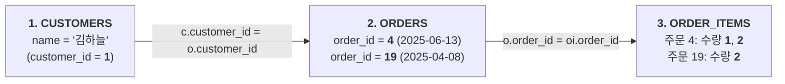
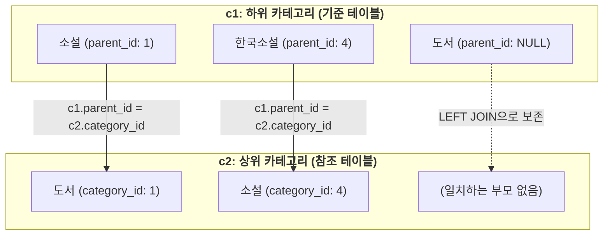
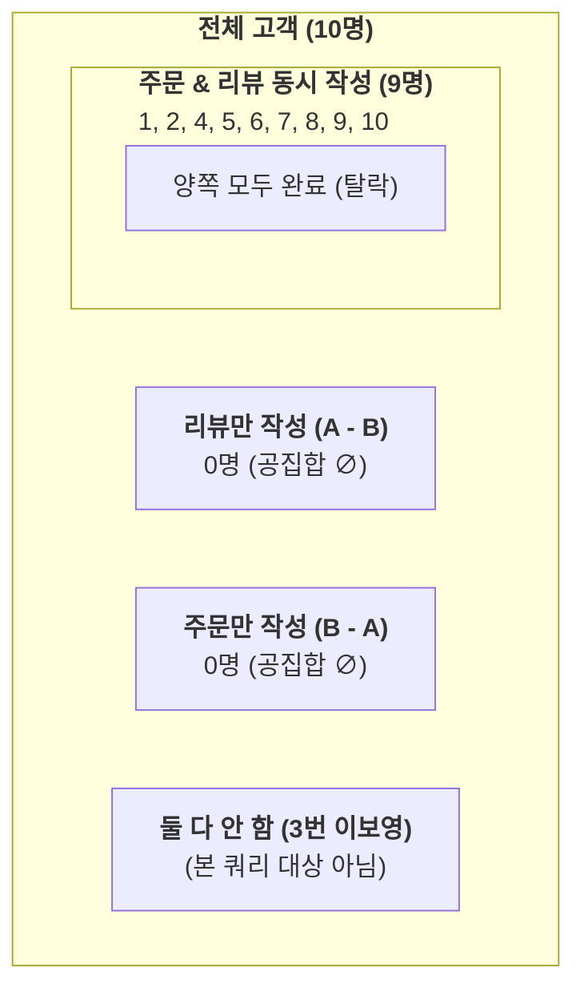

# Oracle SQL 다중 테이블 조인(Join) 연습문제

본 문서는 [08_01_join_guide.md](./08_01_join_guide.md)에서 학습한 다중 테이블 조인(내부 조인 `INNER JOIN`, 외부 조인 `LEFT/RIGHT/FULL OUTER JOIN`, 자체 조인 `SELF JOIN`, 3개 이상 다중 테이블 조인, 집합 연산자와의 결합)의 핵심 원리와 문법을 점검하기 위한 실전 연습문제입니다.

모든 실습 쿼리는 `KOREA_MALL` 일반 사용자 세션에서 실행하도록 작성되었습니다.  
각 문제를 먼저 스스로 풀어본 후, 하단의 **정답 및 해설**을 펼쳐 오라클 전용 구문(`WHERE =`, `(+)`)과 ANSI SQL-99 표준 구문(`JOIN ON`), 실행 결과 예시와 상세 해설을 확인해 보세요.

---

## 0. 사전 준비: 실습 세션 확인

```sql
-- 현재 접속 세션 확인 (KOREA_MALL 이어야 함)
SELECT USER FROM DUAL;
```

---

## Q1. 3개 테이블 조인 및 조건 검색 (다중 테이블 동등 조인)

**`customers`, `orders`, `order_items` 테이블을 조인하여 "김하늘" 고객이 주문한 상품 수량과 주문 일자를 조회하시오.**

* **대상 테이블**: `customers`, `orders`, `order_items`
* **조회 조건**: 고객명(`name`)이 `'김하늘'`인 고객
* **출력 컬럼**: `quantity` (주문 수량), `order_date` (주문 일자)

<details>
<summary>🔍 정답 및 해설 확인</summary>

### **정답 SQL**

#### 1) 오라클 전통 조인 방식 (Oracle Proprietary Join)
```sql
SELECT oi.quantity, o.order_date
FROM customers c, orders o, order_items oi
WHERE c.customer_id = o.customer_id
  AND o.order_id = oi.order_id
  AND c.name = '김하늘';
```

#### 2) ANSI SQL-99 표준 조인 방식 (Recommended)
```sql
SELECT oi.quantity, o.order_date
FROM customers c
JOIN orders o 
  ON c.customer_id = o.customer_id
JOIN order_items oi 
  ON o.order_id = oi.order_id
WHERE c.name = '김하늘';
```

---

### **쿼리 실행 결과**

| QUANTITY | ORDER_DATE |
| :---: | :---: |
| 1 | 2025-06-13 |
| 2 | 2025-06-13 |
| 2 | 2025-04-08 |

*(※ '김하늘' 고객은 주문 2건(4번 주문, 19번 주문)에 걸쳐 총 3건의 주문 품목을 구매하였습니다.)*

---

### **💡 해설**

#### 1) 교재 정답 SQL 분석 (오라클 전통 조인)
교재 원본에 수록된 정답 쿼리는 오라클 전통의 `WHERE` 절 동등 조인(Equi Join) 방식을 사용하고 있습니다:
```sql
SELECT oi.quantity, o.order_date
FROM customers c, orders o, order_items oi
WHERE c.customer_id = o.customer_id
  AND o.order_id = oi.order_id
  AND c.name = '김하늘';
```
- `FROM` 절에 조인 대상 3개 테이블을 콤마(`,`)로 나열합니다.
- `WHERE` 절에 테이블 간의 연결고리(조인 조건 2개)와 데이터 필터 조건(`c.name = '김하늘'`)을 `AND`로 함께 나열합니다.

#### 2) 3개 테이블 조인 흐름 시각화 (데이터 추적)



#### 3) 단계별 데이터 결합 과정 (Trace Table)

| 단계 | 실행 작업 | 연결 컬럼 (PK - FK) | 추출 데이터 |
| :---: | :--- | :--- | :--- |
| **1단계** | `customers`에서 고객명 필터링 | `name = '김하늘'` | `customer_id = 1` 1명 특정 |
| **2단계** | `orders`에서 해당 고객의 주문 조회 | `c.customer_id = o.customer_id` | `order_id = 4` (2025-06-13)<br>`order_id = 19` (2025-04-08) |
| **3단계** | `order_items`에서 각 주문의 상세 품목 결합 | `o.order_id = oi.order_id` | **주문 4**: 수량 `1`, `2`<br>**주문 19**: 수량 `2` |
| **최종** | `SELECT oi.quantity, o.order_date` 프로젝션 | - | **총 3행** 출력 |

#### 4) 핵심 배움 포인트
- **$N$개 테이블 조인 공식**: $N$개의 테이블을 조인하려면 **최소 $(N - 1)$개의 조인 조건**이 반드시 필요합니다. 테이블이 3개이므로 조인 조건 2개(`c.customer_id = o.customer_id`, `o.order_id = oi.order_id`)가 충족되어야 카테시안 곱(Cartesian Product)을 방지할 수 있습니다.
- **연결 다리(Bridge) 테이블**: `customers`와 `order_items`는 직접적인 외래키가 없으므로, 반드시 가운데에서 양쪽을 이어주는 `orders` 테이블이 조인 경로에 포함되어야 합니다.
- **ANSI 조인 권장**: 실무에서는 조인 조건(`ON`)과 검색 조건(`WHERE`)이 명확히 분리되는 ANSI SQL-99 문법(`JOIN ... ON`)이 권장됩니다.

</details>

---

## Q2. 모든 고객과 리뷰 점수 조회 (외부 조인: LEFT OUTER JOIN)

**모든 고객의 이름과 해당 고객이 작성한 리뷰 점수를 조회하시오.** (리뷰를 작성하지 않은 고객도 결과에 함께 포함하여 누락 없이 조회하시오.)

* **대상 테이블**: `customers`, `reviews`
* **요구사항**: 리뷰가 없는 고객도 누락되지 않도록 조회
* **출력 컬럼**: `name` (고객명), `rating` (리뷰 평점)

<details>
<summary>🔍 정답 및 해설 확인</summary>

### **정답 SQL**

#### 1) ANSI SQL-99 표준 조인 방식 (Recommended)
```sql
SELECT c.name, r.rating
FROM customers c
LEFT OUTER JOIN reviews r
  ON c.customer_id = r.customer_id;
```

#### 2) 오라클 전통 조인 방식 (`(+)` 기호)
```sql
SELECT c.name, r.rating
FROM customers c, reviews r
WHERE c.customer_id = r.customer_id(+);
```

---

### **쿼리 실행 결과** (총 24행 중 주요 데이터 예시)

| NAME | RATING | 설명 |
| :--- | :---: | :--- |
| 김하늘 | 4 | 리뷰 1건 작성 |
| 박서준 | 3 | 리뷰 2건 작성 중 1건 |
| 박서준 | 3 | 리뷰 2건 작성 중 1건 |
| **이보영** | **null** | **★ 리뷰를 단 한 번도 작성하지 않은 고객** (외부 조인으로 보존됨) |
| 정해인 | 3 | 리뷰 5건 작성 중 1건 |
| ... | ... | ... |
| 유연석 | 4 | 리뷰 1건 작성 |

*(※ 전체 10명의 고객 중 9명은 리뷰를 작성하였으며, 리뷰가 전혀 없는 '이보영' 고객도 행이 누락되지 않고 평점이 `null`로 정상 출력되어 총 24행이 반환됩니다.)*

---

### **💡 해설**

#### 1) 교재 정답 SQL 분석 (ANSI LEFT OUTER JOIN)
교재 원본에 수록된 정답 쿼리는 ANSI/ISO SQL-99 표준 구문인 `LEFT OUTER JOIN ... ON`을 사용하고 있습니다:
```sql
SELECT c.name, r.rating
FROM customers c
LEFT OUTER JOIN reviews r
  ON c.customer_id = r.customer_id;
```
- `FROM customers c`: 모든 행을 보존할 기준 테이블(왼쪽)을 지정합니다.
- `LEFT OUTER JOIN reviews r`: 오른쪽에 결합할 테이블을 지정하며, 매칭되는 행이 없으면 `NULL`을 채워 반환합니다.
- `ON c.customer_id = r.customer_id`: 두 테이블 간의 연결 조건(고객 번호)입니다.

#### 2) INNER JOIN vs LEFT OUTER JOIN 비교 메커니즘

```mermaid
flowchart TD
    subgraph INNER["<b>INNER JOIN (내부 조인: 총 23건)</b>"]
        direction LR
        I1["고객 9명 (리뷰 작성자)"] <-->|교집합 매칭| I2["리뷰 23건"]
        I3["<b>이보영</b> (리뷰 없음)"] -.->|<b>탈락 (누락)</b>| X["결과 제외 ❌"]
    end

    subgraph OUTER["<b>LEFT OUTER JOIN (외부 조인: 총 24건)</b>"]
        direction LR
        O1["고객 9명 (리뷰 작성자)"] <-->|정상 결합| O2["리뷰 23건 (평점 3~5점)"]
        O3["<b>이보영</b> (리뷰 없음)"] -->|<b>왼쪽 기준 강제 보존</b>| O4["<b>평점 NULL 채움 ✅</b>"]
    end
```

#### 3) 두 조인 방식에 따른 '이보영' 고객 데이터 비교

| 조인 방식 | 고객 수 | 총 행 수 | '이보영' 고객 포함 여부 및 평점 |
| :--- | :---: | :---: | :--- |
| `INNER JOIN` | 9명 | 23행 | ❌ 제외 (리뷰 테이블에 `customer_id=3`이 없어 탈락) |
| `LEFT OUTER JOIN` | **10명** (전원) | **24행** | **✅ 포함** (`rating` 컬럼이 `null`로 보존되어 출력) |

#### 4) 핵심 배움 포인트 및 실무 팁
- **기준 테이블(Left Table) 선정의 중요성**: `LEFT JOIN`은 `FROM` 절 바로 뒤에 오는 **왼쪽 테이블의 모든 행을 무조건 보존**합니다. "모든 고객"을 조회해야 하므로 `customers`가 반드시 왼쪽에 와야 합니다. (순서를 바꾸어 `reviews LEFT JOIN customers`를 쓰면 리뷰가 없는 고객은 여전히 조회되지 않습니다.)
- **오라클 전통 구문 `(+)` 위치 주의**: 오라클 전용 구문(`WHERE c.customer_id = r.customer_id(+)`)에서 `(+)`는 **데이터가 부족하여 NULL을 공급받아야 하는 쪽**(우변)에 붙입니다.
- **실무 팁: NULL 처리**(`NVL` 활용):
  실무 보고서나 웹 화면에서는 `null` 대신 `'미작성'` 또는 기본값 `0`점으로 표시하는 경우가 많습니다:
  ```sql
  -- 리뷰 평점이 없으면 0점으로 표시
  SELECT c.name, NVL(r.rating, 0) AS rating
  FROM customers c
  LEFT OUTER JOIN reviews r
    ON c.customer_id = r.customer_id;
  ```

</details>

---

## Q3. 카테고리 계층 구조 조회 (자체 조인: SELF JOIN)

**카테고리 테이블(`categories`)을 이용하여 각 카테고리명과 그 상위 카테고리명을 조회하시오.** (최상위 대분류 카테고리도 결과에 함께 출력되도록 하시오.)

* **대상 테이블**: `categories` (동일 테이블 조인)
* **요구사항**: 자기 자신을 참조(`parent_id` $\to$ `category_id`)하여 하위 카테고리와 상위 카테고리명을 매핑
* **출력 컬럼**: `하위카테고리` (자식 카테고리명), `상위카테고리` (부모 카테고리명)

<details>
<summary>🔍 정답 및 해설 확인</summary>

### **정답 SQL**

#### 1) ANSI SQL-99 표준 조인 방식 (Recommended)
```sql
SELECT c1.category_name AS "하위카테고리",
       c2.category_name AS "상위카테고리"
FROM categories c1
LEFT OUTER JOIN categories c2
  ON c1.parent_id = c2.category_id;
```

#### 2) 오라클 전통 조인 방식 (`(+)` 기호)
```sql
SELECT c1.category_name AS "하위카테고리",
       c2.category_name AS "상위카테고리"
FROM categories c1, categories c2
WHERE c1.parent_id = c2.category_id(+);
```

---

### **쿼리 실행 결과** (전체 11개 카테고리)

| 하위카테고리 | 상위카테고리 | 비고 |
| :--- | :--- | :--- |
| **도서** | **null** | 최상위 대분류 (부모 없음) |
| **문구** | **null** | 최상위 대분류 (부모 없음) |
| **굿즈** | **null** | 최상위 대분류 (부모 없음) |
| 소설 | 도서 | 중분류 (`parent_id = 1`) |
| 자기계발 | 도서 | 중분류 (`parent_id = 1`) |
| 인문/사회 | 도서 | 중분류 (`parent_id = 1`) |
| 한국소설 | 소설 | 소분류 (`parent_id = 4`) |
| 외국소설 | 소설 | 소분류 (`parent_id = 4`) |
| 시간관리 | 자기계발 | 소분류 (`parent_id = 5`) |
| 철학 | 인문/사회 | 소분류 (`parent_id = 6`) |
| 심리학 | 인문/사회 | 소분류 (`parent_id = 6`) |

---

### **💡 해설**

#### 1) 교재 정답 SQL 분석 (자체 조인 + ANSI LEFT OUTER JOIN)
교재 원본에 수록된 정답 쿼리는 하나의 테이블을 자식과 부모로 분리하여 참조하는 **자체 조인**(Self Join)과 최상위 행을 보존하는 `LEFT OUTER JOIN`을 결합한 표준 구문입니다:
```sql
SELECT c1.category_name AS 하위카테고리,
       c2.category_name AS 상위카테고리
FROM categories c1
LEFT OUTER JOIN categories c2
  ON c1.parent_id = c2.category_id;
```
- `FROM categories c1`: 기준이 되는 **하위(자식) 카테고리** 역할로 테이블을 읽습니다.
- `LEFT OUTER JOIN categories c2`: 부모 정보를 찾기 위해 동일한 테이블을 **상위(부모) 카테고리** 역할(`c2`)로 결합합니다.
- `ON c1.parent_id = c2.category_id`: 자식의 부모 식별자(`parent_id`)와 부모의 고유 식별자(`category_id`)를 연결합니다.

#### 2) 자체 조인(Self Join) 계층 매핑 시각화



#### 3) 계층별 매핑 데이터 상세 분석

| 카테고리 레벨 | 하위카테고리(`c1`) | `parent_id` | 매핑된 상위카테고리(`c2`) | 동작 원리 |
| :---: | :--- | :---: | :--- | :--- |
| **대분류** (1레벨) | 도서, 문구, 굿즈 | **`null` | `null`** | 부모가 없으므로 `LEFT JOIN`에 의해 상위명이 `null`로 보존 |
| **중분류** (2레벨) | 소설, 자기계발, 인문/사회 | `1` | 도서 | `parent_id = 1` $\to$ 1번 카테고리명('도서') 결합 |
| **소분류** (3레벨) | 한국소설, 외국소설 | `4` | 소설 | `parent_id = 4` $\to$ 4번 카테고리명('소설') 결합 |
| **소분류** (3레벨) | 시간관리 | `5` | 자기계발 | `parent_id = 5` $\to$ 5번 카테고리명('자기계발') 결합 |
| **소분류** (3레벨) | 철학, 심리학 | `6` | 인문/사회 | `parent_id = 6` $\to$ 6번 카테고리명('인문/사회') 결합 |

#### 4) 핵심 배움 포인트 및 실무 팁
- **테이블 별칭(Alias)의 필수성**: 동일한 `categories` 테이블을 2번 사용하므로, 별칭(`c1`, `c2`)을 붙이지 않으면 `ORA-00918: 열의 정의가 애매합니다` 에러가 발생합니다.
- **외부 조인 누락 시 발생하는 참사**: 일반 `INNER JOIN`을 사용하면 `parent_id IS NULL`인 대분류 3건('도서', '문구', '굿즈')이 결과에서 누락되어 8건만 조회됩니다.
- **실무 팁: 최상위 카테고리 친절한 라벨 표기**:
  `null` 대신 `'[최상위]'` 등으로 표기하려면 `NVL`을 적용합니다:
  ```sql
  SELECT c1.category_name AS "하위카테고리",
         NVL(c2.category_name, '[최상위 대분류]') AS "상위카테고리"
  FROM categories c1
  LEFT OUTER JOIN categories c2
    ON c1.parent_id = c2.category_id;
  ```

</details>

---

## Q4. 리뷰 작성 고객과 주문 고객의 불일치 비교 (집합 연산과 서브쿼리)

**리뷰를 작성한 고객과 주문을 한 고객을 비교하여, "리뷰만 작성하고 주문은 하지 않은 고객"과 "주문은 했지만 리뷰는 작성하지 않은 고객"을 모두 포함하여 조회하시오.** (힌트: `reviews`와 `orders` 사용)

* **대상 테이블**: `customers`, `reviews`, `orders`
* **출력 컬럼**: `customer_id` (고객 번호), `상태` (구분 텍스트: `'리뷰만 작성'` 또는 `'주문만 함'`)

<details>
<summary>🔍 정답 및 해설 확인</summary>

### **정답 SQL**

#### 1) 교재 원본 정답 (서브쿼리 `NOT IN` + `UNION`)
```sql
SELECT c1.customer_id, '리뷰만 작성' AS 상태
FROM reviews r
JOIN customers c1 ON r.customer_id = c1.customer_id
WHERE c1.customer_id NOT IN (SELECT customer_id FROM orders)
UNION
SELECT c2.customer_id, '주문만 함' AS 상태
FROM orders o
JOIN customers c2 ON o.customer_id = c2.customer_id
WHERE c2.customer_id NOT IN (SELECT customer_id FROM reviews);
```

> 💡 **NULL 방어 팁** (실무 안전 권장):  
> `NOT IN` 서브쿼리 내에 `NULL` 값이 단 1개라도 섞여 있으면 전체 조건이 `UNKNOWN(거짓)`으로 평가되어 조회가 실패합니다. 실무에서는 서브쿼리에 `WHERE customer_id IS NOT NULL`을 명시해 주는 것이 안전합니다.

#### 2) 집합 연산자(`MINUS`) 활용 방식 (가장 직관적이고 간결한 쿼리)
```sql
-- 1. 리뷰 작성 고객 집합 - 주문 고객 집합
(
  SELECT customer_id, '리뷰만 작성' AS "상태"
  FROM reviews
  MINUS
  SELECT customer_id, '리뷰만 작성' AS "상태"
  FROM orders
)
UNION ALL
-- 2. 주문 고객 집합 - 리뷰 작성 고객 집합
(
  SELECT customer_id, '주문만 함' AS "상태"
  FROM orders
  MINUS
  SELECT customer_id, '주문만 함' AS "상태"
  FROM reviews
);
```

#### 3) `FULL OUTER JOIN` 활용 방식 (ANSI 표준 조인 확장)
```sql
SELECT 
    NVL(r.customer_id, o.customer_id) AS customer_id,
    CASE 
        WHEN o.customer_id IS NULL THEN '리뷰만 작성'
        WHEN r.customer_id IS NULL THEN '주문만 함'
    END AS "상태"
FROM (SELECT DISTINCT customer_id FROM reviews) r
FULL OUTER JOIN (SELECT DISTINCT customer_id FROM orders) o
  ON r.customer_id = o.customer_id
WHERE r.customer_id IS NULL 
   OR o.customer_id IS NULL;
```

---

### **쿼리 실행 결과**

*(조회된 행 없음 - 0건)*

> **📌 실습 샘플 데이터 분석 안내**:  
> 현재 `KOREA_MALL` 샘플 데이터베이스의 현황은 다음과 같습니다:
> - 전체 고객 10명 중 9명(1, 2, 4, 5, 6, 7, 8, 9, 10번)은 **주문과 리뷰를 모두 작성**했습니다.
> - 나머지 1명(3번 이보영)은 **주문과 리뷰를 둘 다 하지 않은 고객**입니다.
> - 따라서 "한쪽만 수행한 고객"은 현재 데이터상 존재하지 않아 결과가 0건(공집합)으로 반환되는 것이 데이터 무결성 기준 정상적인 동작입니다.

---

### **💡 해설**

#### 1) 교재 정답 SQL 동작 원리
- **첫 번째 블록** (리뷰만 작성한 고객):
  - `reviews`와 `customers`를 조인하여 리뷰를 남긴 고객 목록을 구합니다.
  - `WHERE c1.customer_id NOT IN (SELECT customer_id FROM orders)` 조건을 통해 주문 이력이 있는 고객들을 목록에서 제외합니다.
- **두 번째 블록** (주문만 한 고객):
  - `orders`와 `customers`를 조인하여 주문을 한 고객 목록을 구합니다.
  - `WHERE c2.customer_id NOT IN (SELECT customer_id FROM reviews)` 조건을 통해 리뷰를 남긴 고객들을 제외합니다.
- **`UNION` 연산자**:
  - 두 독립된 쿼리의 결과를 합집합(UNION)하여 단일 결과 셋으로 반환합니다.

#### 2) 고객 집합 다이어그램 시각화 (대칭 차집합)



#### 3) 핵심 배움 포인트 및 실무 팁
- **대칭 차집합(Symmetric Difference)의 비즈니스 가치**:
  - "구매는 했으나 후기를 안 쓴 고객" $\to$ 리뷰 작성 유도 포인트/쿠폰 발송 타겟 마케팅
  - "구매도 안 했는데 후기만 쓴 비정상 계정" $\to$ 어뷰징/스팸 계정 모니터링
- **`NOT IN` vs `MINUS` 성능 비교**:
  - 교재처럼 `NOT IN (서브쿼리)`를 사용할 수도 있지만, 오라클의 집합 연산자인 `MINUS`를 사용하면 쿼리가 훨씬 간결해지고 실행 계획(Execution Plan) 측면에서도 최적화하기 수월합니다.

</details>

---

## Q5. ANSI JOIN과 GROUP BY 집계 (상품별 총 주문 수량)

**`products`와 `order_items` 테이블을 ANSI JOIN 방식으로 조인하여, 각 상품별 총 주문 수량을 조회하시오.**

* **대상 테이블**: `products`, `order_items`
* **조인 방식**: ANSI JOIN (`JOIN ... ON`)
* **집계 기준**: 상품명 기준 그룹화 (`GROUP BY`)
* **출력 컬럼**: 상품명, `SUM(oi.quantity)` (총수량)

<details>
<summary>🔍 정답 및 해설 확인</summary>

### **정답 SQL**

#### 1) 교재 원본 정답 (교재 표기 기준)
```sql
SELECT p.product_name, SUM(oi.quantity) AS 총수량
FROM products p
JOIN order_items oi ON p.product_id = oi.product_id
GROUP BY p.product_name;
```

#### 2) KOREA_MALL 실습 스키마 적용 쿼리 (Recommended)
> ⚠️ **스키마 컬럼명 참고**:  
> 교재 원본에서는 상품명 컬럼을 `p.product_name`으로 표기하였으나, 우리 실습 환경인 **`KOREA_MALL.PRODUCTS` 테이블의 실제 컬럼명은 `name`**입니다. 따라서 실제 실습 시에는 `p.name`을 조회하고 별칭(`AS product_name`)을 부여하여 실행합니다.

```sql
SELECT p.name AS product_name, 
       SUM(oi.quantity) AS "총수량"
FROM products p
JOIN order_items oi 
  ON p.product_id = oi.product_id
GROUP BY p.name
ORDER BY "총수량" DESC;
```

---

### **쿼리 실행 결과** (주문 이력이 있는 21개 상품)

| PRODUCT_NAME | 총수량 | 비고 |
| :--- | :---: | :--- |
| **82년생 김지영** | **12** | 최다 판매 상품 (5회 주문) |
| 고급 노트북 | 9 | 3회 주문 (각 3개씩) |
| 채식주의자 | 7 | 3회 주문 |
| 책상용 독서대 | 6 | 3회 주문 |
| 지구 끝의 온실 | 5 | 2회 주문 |
| EQ 감성지능 | 5 | 3회 주문 |
| 위대한 개츠비 | 4 | 2회 주문 |
| 프로이트 심리학 | 4 | 2회 주문 |
| 소년이 온다 | 3 | 2회 주문 |
| 아주 작은 습관의 힘 | 3 | 2회 주문 |
| 소크라테스의 변명 | 3 | 2회 주문 |
| 니코마코스 윤리학 | 3 | 1회 주문 |
| 밤의 여행자들 | 3 | 1회 주문 |
| 1984 | 3 | 1회 주문 |
| 라인프렌즈 볼펜 | 3 | 1회 주문 |
| 북마크 세트 | 2 | 1회 주문 |
| 몰입 | 2 | 1회 주문 |
| 동물농장 | 1 | 1회 주문 |
| 나는 내가 죽었다고 생각했습니다 | 1 | 1회 주문 |
| 성공하는 사람들의 7가지 습관 | 1 | 1회 주문 |
| 성공의 정석 | 1 | 1회 주문 |

*(※ 전체 25개 상품 중 한 번이라도 판매된 21개 상품의 주문 총수량이 정확히 집계됩니다.)*

---

### **💡 해설**

#### 1) 교재 정답 SQL 동작 원리 및 조인 집계 흐름
- `JOIN ... ON` (ANSI 내부 조인): `products` 테이블과 `order_items` 테이블을 상품 번호(`product_id`)로 결합하여 주문 상세 행마다 해당하는 상품 정보를 매핑합니다.
- `GROUP BY p.name` (그룹화): 결합된 결과 행들을 동일한 상품명을 기준으로 소그룹으로 묶습니다.
- `SUM(oi.quantity)` (집계 함수): 각 상품 그룹 내에서 주문 수량(`quantity`)의 총합을 계산합니다.

#### 2) 조인 후 집계 실행 파이프라인 시각화

```mermaid
flowchart LR
    P["<b>1. PRODUCTS</b><br>(상품 마스터)"] 
    -->|JOIN ... ON p.product_id = oi.product_id| M["<b>2. 매핑 결과 행</b><br>(82년생 김지영: 수량 1, 3, 3, 3, 2...)"]
    -->|GROUP BY p.name| G["<b>3. 상품별 그룹화</b><br>['82년생 김지영'] 소그룹"]
    -->|SUM(oi.quantity)| R["<b>4. 최종 결과 출력</b><br>82년생 김지영: <b>12개</b>"]
```

#### 3) 핵심 배움 포인트 및 실무 팁
- **`GROUP BY`와 `SELECT` 절의 엄격한 일치 규칙**:
  - `SELECT` 절에 집계 함수(`SUM`)가 아닌 일반 컬럼(`p.name`)이 사용되었다면, 해당 컬럼은 **반드시 `GROUP BY` 절에 명시**되어야 합니다. 누락 시 `ORA-00979: GROUP BY 표현식이 아닙니다` 에러가 발생합니다.
- **주문 없는 상품(4건)도 누락 없이 0개로 보고서에 표시하려면?**:
  - 교재의 `INNER JOIN`을 사용하면 한 번도 주문되지 않은 상품(노르웨이의 숲, 철학의 위안, 데미안, 하버드 새벽 4시 반)은 결과에서 누락됩니다.
  - 이를 방어하려면 **`LEFT OUTER JOIN`과 `NVL`** 함수를 결합합니다:
  ```sql
  SELECT p.name AS product_name, 
         NVL(SUM(oi.quantity), 0) AS "총수량"
  FROM products p
  LEFT JOIN order_items oi 
    ON p.product_id = oi.product_id
  GROUP BY p.name
  ORDER BY "총수량" DESC;
  ```

</details>

---

## 🎯 연습문제 요약 및 학습 가이드

| 문제 | 핵심 기법 | 주요 키워드 | 비즈니스 실무 활용 |
| :---: | :--- | :--- | :--- |
| **Q1** | 다중 테이블(3개) 조인 | `JOIN ... ON`, `WHERE` 조건 | 고객-주문-주문상품 상세 구매 이력 추적 |
| **Q2** | 외부 조인 (LEFT JOIN) | `LEFT OUTER JOIN`, `(+)` | 활동 내역이 없는 고객(미작성/미구매) 현황 파악 |
| **Q3** | 자체 조인 (SELF JOIN) | `c1 LEFT JOIN c2`, `parent_id` | 계층형 카테고리 트리, 조직도(사원-팀장) 매핑 |
| **Q4** | 불일치 데이터 비교 | `UNION`, `NOT IN`, `MINUS` | 마케팅 타겟 추출 (주문만 하고 리뷰 없는 회원 등) |
| **Q5** | 조인 후 그룹 집계 | `JOIN`, `GROUP BY`, `SUM()` | 상품별/카테고리별 누적 판매량 및 실적 리포트 |

