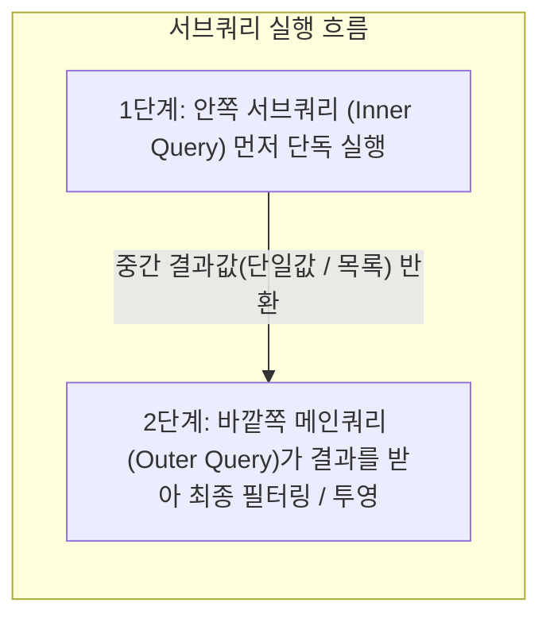

# Oracle SQL 서브쿼리(Subquery) 실습 가이드

오라클 SQL에서 **서브쿼리**(Subquery, 하위 질의)는 하나의 메인 SQL 쿼리문 안에 포함된 또 다른 `SELECT` 쿼리문입니다. 복잡한 비즈니스 로직을 단계별로 나누어 단일 SQL 문으로 해결할 수 있게 해주는 핵심 문법이며, 이전 차수에서 학습한 단일행 함수, 그룹 집계 함수, 조건절(`WHERE`, `HAVING`) 등과 결합하여 강력한 데이터 조회 능력을 제공합니다.

이번 실습에서는 교재 내용을 바탕으로 서브쿼리의 기본 개념과 실행 순서, 중첩 서브쿼리의 구조를 단계별 실습 예제와 함께 학습합니다.

> [!NOTE]
> **📖 SQL 문법 표기 규칙 안내**
> 본 가이드의 함수 및 SQL 문법 설명에 사용되는 기호는 다음과 같습니다:
> - `[ ]` (대괄호): 생략 가능한 **선택 사항**(Optional)을 나타냅니다. *(실제 SQL 작성 시 대괄호 기호는 입력하지 않습니다)*
> - `|` (파이프): 나열된 옵션 중 **하나를 선택**(OR)함을 나타냅니다.

---

## 0. 사전 준비: 실습 사용자 및 세션 확인

모든 SQL 실습은 관리자(`SYSTEM`) 계정이 아닌 **실습용 일반 사용자**(`KOREA_MALL`) 세션의 SQL 편집기에서 진행합니다.

```sql
-- 현재 접속 계정 확인 (결과가 KOREA_MALL 이어야 함)
SELECT USER FROM DUAL;
```

> 🎯 **핵심 배움 포인트** (실습 환경 확인):
> - 데이터베이스 카탈로그 오염을 방지하고 보안 원칙을 준수하기 위해 DDL/DML 및 SELECT 실습은 반드시 일반 계정(`KOREA_MALL`) 세션에서 실행합니다.

---

## 1. 서브쿼리(Subquery)의 핵심 원리와 분류 체계

### 1.1 서브쿼리의 동작 원리

서브쿼리는 **안쪽의 하위 질의**(Inner Query)가 먼저 실행되어 그 결과를 반환하고, 그 결과를 바깥쪽의 **메인 질의**(Outer Query)가 전달받아 최종 연산을 수행하는 2단계 구조로 동작합니다.



### 1.2 서브쿼리 작성 시 필수 규칙
1. **반드시 괄호** `( )`**로 감싼다**: 서브쿼리는 메인 쿼리와 문법적으로 분리하기 위해 항상 소괄호 안에 작성합니다.
2. **비교 연산자의 오른쪽에 위치시킨다**: 관례 및 가독성을 위해 `컬럼명 연산자 (서브쿼리)` 순서로 기술합니다.
3. **단일행 비교 연산자 사용 시 단 하나의 결과만 반환한다**: 서브쿼리 결과가 2건 이상인데 `=` 등의 단일행 연산자를 쓰면 `ORA-01427` 오류가 발생합니다.

---

## 2. WHERE 절 서브쿼리 (중첩 서브쿼리, Nested Subquery)

---

## # 실습 예제 1 : 서브쿼리의 구조와 실행 순서

다음은 전체 상품의 평균 가격보다 높은 가격의 상품만 조회합니다.

### 1.1 실습 쿼리

```sql
-- 평균보다 높은 가격의 상품 조회
SELECT name, price
FROM products
WHERE price > (
    SELECT AVG(price)
    FROM products
);
```

### 1.2 쿼리 실행 결과 예시

| NAME | PRICE |
| :--- | :---: |
| 82년생 김지영 | 14,000 |
| 소년이 온다 | 12,000 |
| 채식주의자 | 12,900 |
| 노르웨이의 숲 | 15,700 |
| 몰입 | 16,500 |
| 소크라테스의 변명 | 12,400 |
| 니코마코스 윤리학 | 15,700 |
| 철학의 위안 | 13,300 |
| 프로이트 심리학 | 14,200 |
| 나는 내가 죽었다고 생각했습니다 | 17,000 |
| 지구 끝의 온실 | 14,900 |
| 데미안 | 13,100 |
| 동물농장 | 15,900 |
| 고급 노트북 | 16,300 |
| 북마크 세트 | 11,800 |

*(※ 전체 25개 상품 중 평균 가격 약 11,704원보다 높은 15건의 상품이 조회됩니다.)*

> 🎯 **핵심 배움 포인트** (서브쿼리의 2단계 평가와 실행 순서):
> 
> ```mermaid
> sequenceDiagram
>     autonumber
>     participant Main as 메인 쿼리 (Outer Query)
>     participant Sub as 서브쿼리 (Inner Query)
>     participant DB as 데이터베이스
> 
>     Main->>Sub: 1. 서브쿼리 먼저 실행 요청
>     Sub->>DB: SELECT AVG(price) FROM products 실행
>     DB-->>Sub: 평균 가격 (11,704) 반환
>     Sub-->>Main: 2. 계산된 단일 값(11704) 전달
>     Main->>DB: SELECT name, price FROM products WHERE price > 11704 실행
>     DB-->>Main: 최종 15건 필터링 결과 반환
> ```
> 
> 1. **서브쿼리가 필요한 이유** (집계 함수와 WHERE 절의 충돌 해결):
>    - SQL에서는 `WHERE price > AVG(price)`와 같이 `WHERE` 절에 집계(그룹) 함수를 직접 기술할 수 없습니다 (`ORA-00934: 그룹 함수는 허가되지 않습니다`).
>    - 그 이유는 SQL 실행 순서상 `WHERE` 절(행 필터링)이 `SELECT` 절(집계 연산)보다 먼저 실행되기 때문입니다.
>    - 따라서 **서브쿼리를 통해 전체 평균값을 독립적으로 먼저 계산한 후, 그 결과 숫자를 메인 쿼리의 비교 조건으로 넘겨주는 방식**으로 문제를 완벽히 해결합니다.
> 2. **단일행 비교 연산자** (`>`):
>    - `SELECT AVG(price)`의 결과가 단 하나의 행(`11,704`)이므로, `>` 연산자와 정상적으로 1:1 비교가 성립합니다.

---

## # 실습 예제 2 : 가장 최근에 주문한 고객의 이름 조회하기

다음 예제에서는 `KOREA_MALL`의 `customers`, `orders` 테이블을 사용하여 가장 최근에 주문한 고객의 이름을 조회합니다.

### 2.1 실습 쿼리

```sql
-- 가장 최근에 주문한 고객의 이름 조회
SELECT name
FROM customers
WHERE customer_id = (
    SELECT customer_id
    FROM orders
    WHERE order_date = (
        SELECT MAX(order_date)
        FROM orders
    )
);
```

### 2.2 쿼리 실행 결과 예시

| NAME |
| :--- |
| 정해인 |

> 🎯 **핵심 배움 포인트** (3단계 중첩 서브쿼리의 구조와 실행 순서):
> 
> ```mermaid
> sequenceDiagram
>     autonumber
>     participant Main as 메인 쿼리 (customers)
>     participant Sub1 as 중간 서브쿼리 (orders)
>     participant Sub2 as 안쪽 서브쿼리 (orders - MAX)
>     participant DB as 데이터베이스
> 
>     Main->>Sub1: customer_id 조회 요청
>     Sub1->>Sub2: 최근 주문일자 확인 요청
>     Sub2->>DB: SELECT MAX(order_date) FROM orders
>     DB-->>Sub2: 1단계: 가장 최근 일자 '2025-06-27' 반환
>     Sub2-->>Sub1: '2025-06-27' 값 전달
>     Sub1->>DB: SELECT customer_id FROM orders WHERE order_date = '2025-06-27'
>     DB-->>Sub1: 2단계: 해당 날짜의 고객 번호 (customer_id = 4) 반환
>     Sub1-->>Main: customer_id = 4 전달
>     Main->>DB: SELECT name FROM customers WHERE customer_id = 4
>     DB-->>Main: 3단계: 고객명 '정해인' 최종 출력
> ```
> 
> 1. **서브쿼리의 다중 중첩** (Multi-level Nesting):
>    - 서브쿼리 안에 또 다른 서브쿼리가 포함되어 총 3단계(메인 쿼리 $\to$ 중간 서브쿼리 $\to$ 가장 안쪽 서브쿼리)로 중첩된 구조입니다.
>    - 괄호가 가장 깊은 **안쪽 서브쿼리부터 바깥쪽 순서로 단계별 평가**가 진행됩니다.
> 
> 2. **단계별 실행 분석**:
>    - **1단계** (가장 안쪽 서브쿼리): `orders` 테이블에서 가장 큰 날짜(`MAX(order_date)`)인 `'2025-06-27'`을 구합니다.
>    - **2단계** (중간 서브쿼리): `'2025-06-27'` 일자에 발생한 주문의 `customer_id`인 `4`번을 추출합니다.
>    - **3단계** (가장 바깥쪽 메인 쿼리): `customers` 테이블에서 `customer_id = 4`인 고객의 이름(`name`)인 `'정해인'`을 최종 출력합니다.
> 
> 3. ⚠️ **실무 주의사항** (동일 일자 복수 주문 시 ORA-01427 대비):
>    - 만약 가장 최근 일자에 서로 다른 두 명 이상의 고객이 주문했다면, 2단계 서브쿼리가 2건 이상의 `customer_id`를 반환하게 됩니다.
>    - 이때 메인 쿼리가 단일행 연산자 `=`를 사용하고 있으면 `ORA-01427: single-row subquery returns more than one row` 에러가 발생합니다.
>    - 따라서 동시 주문이 발생할 수 있는 실제 실무 환경에서는 단일행 연산자 대신 `IN`을 사용하거나, 날짜 컬럼뿐만 아니라 고유 주문 번호(`MAX(order_id)`) 또는 초 단위 타임스탬프(`created_at`)를 기준으로 단일성을 보장하는 것이 권장됩니다:
> ```sql
>      -- [실무 권장] 동일 일자 복수 고객 주문 시에도 안전한 IN 연산자 패턴
>      SELECT name
>      FROM customers
>      WHERE customer_id IN (
>          SELECT customer_id
>          FROM orders
>          WHERE order_date = (
>              SELECT MAX(order_date)
>              FROM orders
>          )
>      );
> ```

---

## # 실습 예제 3-1 : 리뷰가 등록된 상품의 이름 조회하기

다음과 같이 쿼리를 작성했다고 가정해 보겠습니다.

### 3-1.1 실습 쿼리 (오류 발생 예시)

```sql
-- 잘못된 예제 : 리뷰가 등록된 상품의 이름 조회
SELECT name
FROM products
WHERE product_id = (
    SELECT product_id
    FROM reviews
);
```

### 3-1.2 쿼리 실행 결과 (오류 발생)

```text
SQL 오류: ORA-01427: 단일 행 하위 질의에 2개 이상의 행이 리턴되었습니다
01427. 00000 -  "single-row subquery returns more than one row"
*Cause:    The subquery returned more than one row where only one was expected.
*Action:   Rewrite the query so that the subquery returns only one row, or use a multiple-row operator such as IN.
```

> 🎯 **핵심 배움 포인트** (ORA-01427 오류의 발생 원인과 단일행 연산자의 한계):
> 
> 1. **오류 발생 원인 분석**:
>    - 안쪽 서브쿼리인 `SELECT product_id FROM reviews`는 `reviews` 테이블에 등록된 전체 리뷰 데이터(총 23건)의 `product_id` 목록을 반환합니다.
>    - 하지만 바깥쪽 메인 쿼리의 `WHERE product_id = (...)` 조건에서 사용된 등호(`=`)는 **오직 1개의 단일 값**(1행 1열)**만을 비교할 수 있는 단일행 비교 연산자**입니다.
>    - 단 하나의 단일 값을 기대하는 자리에 23건의 행(목록)이 한꺼번에 쏟아져 들어오므로, 오라클 DBMS는 어떤 값과 비교해야 할지 알 수 없어 `ORA-01427: 단일 행 하위 질의에 2개 이상의 행이 리턴되었습니다` 오류를 발생시키며 쿼리 실행을 중단합니다.
> 
> 2. **해결 방향** (다중행 연산자의 필요성):
>    - 서브쿼리가 반환하는 결과가 2건 이상인 다중행(Multi-Row)일 때는 `=` 대신 목록 중 일치하는 항목이 있는지를 검사하는 **다중행 연산자**(예: `IN`)를 사용해야 합니다.

---

## 3. 다중행 서브쿼리 (Multi-Row Subquery)

### 3.1 다중 행 서브쿼리의 정의와 연산자 종류

다중 행 서브쿼리는 여러 개의 행(Row)으로 반환하는 서브쿼리이며, 이를 처리하기 위해 다음과 같은 연산자를 사용합니다.

| 연산자 | 의미 | 조건 평가 방식 |
| :---: | :--- | :--- |
| `IN` | 서브쿼리 결과 목록에 포함된 값과 일치하는지 확인 | 목록 중 하나라도 일치하면 TRUE |
| `ANY` | 서브쿼리 결과 중 하나라도 비교 조건을 만족하는지 확인 | 비교 연산자(`=`, `>`, `<` 등)와 함께 사용, 결과 중 하나라도 조건을 충족하면 TRUE |
| `ALL` | 서브쿼리 결과의 모든 값이 비교 조건을 만족하는지 확인 | 모든 값에 대해 조건을 충족해야 TRUE |
| `EXISTS` | 행의 존재 여부 확인 | 하나라도 존재하면 TRUE |

---

## # 실습 예제 3-2 : 리뷰가 등록된 상품의 이름 조회하기 (올바른 예제)

실습 예제 3-1에서 발생한 `ORA-01427` 오류를 해결하기 위해, 단일행 비교 연산자(`=`) 대신 다중행 연산자 `IN`을 사용하여 리뷰가 1건이라도 등록된 상품의 이름을 조회합니다.

### 3-2.1 실습 쿼리

```sql
-- 리뷰가 등록된 상품의 이름 조회 (올바른 예제)
SELECT name
FROM products
WHERE product_id IN (
    SELECT product_id
    FROM reviews
);
```

### 3-2.2 쿼리 실행 결과 예시

| NAME |
| :--- |
| 82년생 김지영 |
| 소년이 온다 |
| 채식주의자 |
| 위대한 개츠비 |
| 몰입 |
| 아주 작은 습관의 힘 |
| 소크라테스의 변명 |
| 니코마코스 윤리학 |
| 프로이트 심리학 |
| 나는 내가 죽었다고 생각했습니다 |
| EQ 감성지능 |
| 지구 끝의 온실 |
| 동물농장 |
| 성공의 정석 |
| 고급 노트북 |
| 라인프렌즈 볼펜 |
| 책상용 독서대 |

*(※ 전체 25개 상품 중 실제 리뷰가 1건 이상 등록된 17개 상품이 조회됩니다.)*

> 🎯 **핵심 배움 포인트** (IN 연산자를 활용한 다중행 서브쿼리 해결 원리):
> 
> 1. `IN` **연산자의 동작 원리**:
>    - 안쪽 서브쿼리 `(SELECT product_id FROM reviews)`가 반환하는 다중 행 결과 목록(`1, 2, 3, 5, 7, 9, 10, 11, 13, 14, 15, 17, 19, 21, 22, 23, 25`)을 메인 쿼리에 전달합니다.
>    - 메인 쿼리는 `WHERE product_id IN (...)` 조건으로 평가되어, 해당 목록에 포함된 상품 총 17건을 오류 없이 정상적으로 추출합니다.
> 
> 2. `DISTINCT` **생략과 집합 연산 특성**:
>    - `reviews` 테이블에 동일한 상품의 리뷰가 여러 개 등록되어 서브쿼리 결과에 중복된 `product_id`가 나오더라도, `IN` 연산자는 목록 집합 내 존재 여부(OR 조건)만을 판별하므로 메인 쿼리 결과에 중복 행이 발생하지 않습니다.

---

## # 실습 예제 4 : 특정 고객의 평점보다 높은 리뷰 조회하기

고객 ID 4번이 작성한 여러 리뷰 평점 중 **하나라도 초과하는**(`> ANY`) 리뷰의 리뷰 ID(`review_id`), 고객 ID(`customer_id`), 평점(`rating`)을 조회합니다.

### 4.1 실습 쿼리

```sql
-- 고객 ID 4번이 남긴 리뷰 점수 중 하나라도 초과하는 리뷰 조회
SELECT review_id, customer_id, rating
FROM reviews
WHERE rating > ANY (
    SELECT rating
    FROM reviews
    WHERE customer_id = 4
);
```

### 4.2 쿼리 실행 결과 예시

| REVIEW_ID | CUSTOMER_ID | RATING |
| :---: | :---: | :---: |
| 2 | 8 | 5 |
| 4 | 8 | 5 |
| 5 | 8 | 4 |
| 6 | 8 | 4 |
| 7 | 7 | 4 |
| 8 | 4 | 4 |
| 10 | 5 | 4 |
| 11 | 6 | 4 |
| 14 | 9 | 5 |
| 15 | 10 | 4 |
| 16 | 4 | 4 |
| 17 | 6 | 4 |
| 18 | 6 | 4 |
| 19 | 6 | 5 |
| 21 | 1 | 4 |

*(※ 4번 고객이 작성한 평점 목록 [3, 4] 중 최솟값인 3점을 초과하는 4점, 5점 리뷰 총 15건이 출력됩니다.)*

> 🎯 **핵심 배움 포인트** (`> ANY` 연산자의 비교 원리와 최소값 비교 동등성):
> 
> 1. **서브쿼리 반환값과** `ANY`**의 평가 방식**:
>    - 안쪽 서브쿼리 `SELECT rating FROM reviews WHERE customer_id = 4`는 4번 고객이 등록한 평점 목록(`3, 4, 3, 4, 3`)을 반환합니다.
>    - `WHERE rating > ANY (3, 4)`는 *"평점이 3보다 크거나 또는 4보다 크다(OR 조건)"*로 평가됩니다.
>    - 3보다 큰 수(4, 5)는 이미 조건을 만족하므로, 결과적으로 **목록의 최솟값인 3점을 초과하는 모든 리뷰**(`rating > 3`)가 추출됩니다.
> 
> 2. `ANY`**와 집계 함수의 치환 관계**:
>    | 표현식 | 실질적인 의미 | 동일한 단일행 서브쿼리 치환 |
>    | :--- | :--- | :--- |
>    | `> ANY (서브쿼리)` | 결과 목록 중 **하나라도 초과** $\to$ **최솟값보다 크면 참** | `> (SELECT MIN(...) ...)` |
>    | `< ANY (서브쿼리)` | 결과 목록 중 **하나라도 미만** $\to$ **최댓값보다 작으면 참** | `< (SELECT MAX(...) ...)` |
>    | `= ANY (서브쿼리)` | 결과 목록 중 **하나라도 일치** | `IN (서브쿼리)`**와 완벽히 동일** |

---

### 3.2 ALL 연산자의 특징

`ALL` 연산자는 서브쿼리가 반환하는 **모든 결과값에 대해 비교 조건을 동시에 만족**(AND 조건)해야 `TRUE`를 반환하는 다중행 연산자입니다.

| 연산자 형태 | 의미 |
| :---: | :--- |
| `> ALL` | 서브쿼리 결과의 **최댓값보다 크면** TRUE |
| `< ALL` | 서브쿼리 결과의 **최솟값보다 작으면** TRUE |
| `= ALL` | 서브쿼리 결과 값이 **모두 동일하면** TRUE (실무 사용 빈도는 낮음) |
| `!= ALL` | 서브쿼리 결과의 **모든 값과 다르면** TRUE (`NOT IN`과 유사하나 NULL 처리에 주의) |

---

## # 실습 예제 5 : 고객 4번의 모든 리뷰 점수보다 높은 리뷰 조회하기

고객 ID 4번이 작성한 모든 리뷰 평점보다 높은(`> ALL`) 리뷰의 리뷰 ID(`review_id`), 고객 ID(`customer_id`), 평점(`rating`)을 조회합니다.

### 5.1 실습 쿼리

```sql
-- 고객 4번이 남긴 모든 리뷰 점수보다 높은 리뷰 조회
SELECT review_id, customer_id, rating
FROM reviews
WHERE rating > ALL (
    SELECT rating
    FROM reviews
    WHERE customer_id = 4
);
```

### 5.2 쿼리 실행 결과 예시

| REVIEW_ID | CUSTOMER_ID | RATING |
| :---: | :---: | :---: |
| 2 | 8 | 5 |
| 4 | 8 | 5 |
| 14 | 9 | 5 |
| 19 | 6 | 5 |

*(※ 4번 고객의 평점 목록 [3, 4] 중 최댓값인 4점을 모두 초과해야 하므로, 5점 만점 리뷰 4건만 출력됩니다.)*

> 🎯 **핵심 배움 포인트** (`> ALL` 연산자의 비교 원리와 최대값 비교 동등성):
> 
> 1. **서브쿼리 반환값과** `ALL`**의 평가 방식**:
>    - 안쪽 서브쿼리 `SELECT rating FROM reviews WHERE customer_id = 4`는 평점 목록 `[3, 4, 3, 4, 3]`을 반환합니다.
>    - `WHERE rating > ALL (3, 4)`는 *"평점이 3보다 커야 하고, 동시에 4보다도 커야 한다(AND 조건)"*로 평가됩니다.
>    - 3과 4를 모두 동시에 초과하려면 결과적으로 **목록의 최댓값인 4점보다 커야 하므로**(`rating > 4`), 평점이 5점인 최상위 리뷰 4건만 엄격하게 필터링됩니다.
> 
> 2. `ANY` vs `ALL` **비교 총정리**:
>    | 연산자 | 실질적 의미 | 치환 가능한 단일행 서브쿼리 | 비유 |
>    | :--- | :--- | :--- | :--- |
>    | `> ANY` | 목록 중 **하나라도 초과** (OR) | `> (SELECT MIN(...) ...)` | 기준 중 가장 낮은 문턱만 넘으면 됨 |
>    | `> ALL` | 목록의 **모든 값을 초과** (AND) | `> (SELECT MAX(...) ...)` | 기준 중 가장 높은 벽까지 넘어야 함 |
>    | `< ANY` | 목록 중 **하나라도 미만** (OR) | `< (SELECT MAX(...) ...)` | 기준 중 가장 높은 곳보다 아래면 됨 |
>    | `< ALL` | 목록의 **모든 값 미만** (AND) | `< (SELECT MIN(...) ...)` | 기준 중 가장 낮은 곳보다 더 아래여야 함 |

---

## # 실습 예제 6 : 리뷰가 존재하는 상품 조회하기

`EXISTS` 연산자를 활용하여 `reviews` 테이블에 리뷰가 단 1건이라도 존재하는 상품의 상품 ID(`product_id`)와 상품명(`name`)을 조회합니다.

### 6.1 실습 쿼리

```sql
-- 리뷰가 하나라도 존재하는 상품의 이름 조회
SELECT p.product_id, p.name
FROM products p
WHERE EXISTS (
    SELECT 1
    FROM reviews r
    WHERE r.product_id = p.product_id
);
```

### 6.2 쿼리 실행 결과 예시

| PRODUCT_ID | NAME |
| :---: | :--- |
| 1 | 82년생 김지영 |
| 2 | 소년이 온다 |
| 3 | 채식주의자 |
| 5 | 위대한 개츠비 |
| 7 | 몰입 |
| 9 | 아주 작은 습관의 힘 |
| 10 | 소크라테스의 변명 |
| 11 | 니코마코스 윤리학 |
| 13 | 프로이트 심리학 |
| 14 | 나는 내가 죽었다고 생각했습니다 |
| 15 | EQ 감성지능 |
| 17 | 지구 끝의 온실 |
| 19 | 동물농장 |
| 21 | 성공의 정석 |
| 22 | 고급 노트북 |
| 23 | 라인프렌즈 볼펜 |
| 25 | 책상용 독서대 |

*(※ 전체 25개 상품 중 실제 리뷰가 1건 이상 등록된 17개 상품이 조회됩니다.)*

> 🎯 **핵심 배움 포인트** (EXISTS 연산자의 동작 원리와 조기 종료):
> 
> 1. `EXISTS`**의 행 단위 검증 및 조기 종료** (Short-Circuit):
>    - 메인 쿼리의 `products` 테이블 각 행(`p`)에 대해 안쪽 서브쿼리가 실행됩니다.
>    - `reviews` 테이블을 탐색하다가 `r.product_id = p.product_id`를 만족하는 행을 **단 1건이라도 발견하면 탐색을 즉시 중단하고** `TRUE`**를 반환**합니다.
>    - 상품당 리뷰가 수천 건 이상 쌓여 있더라도 1건만 확인되면 탐색을 끝마치므로 대용량 데이터 환경에서 최상의 성능을 발휘합니다.
> 
> 2. `SELECT 1`**을 사용하는 관례**:
>    - `EXISTS`는 서브쿼리가 반환하는 컬럼 데이터의 내용에는 관여하지 않고, 오직 **조건을 만족하는 행의 존재 여부**(TRUE / FALSE)만을 평가합니다.
>    - 따라서 `SELECT *` 대신 `SELECT 1`을 작성하는 것이 SQL 표준 관례입니다.
> 
> 3. `IN` (실습 예제 3-2) vs `EXISTS` (실습 예제 6) **비교**:
>    - `IN`: 서브쿼리의 전체 결과 집합을 메모리에 생성한 뒤 메인 쿼리와 대조 (서브쿼리 결과가 적을 때 유리)
>    - `EXISTS`: 메인 쿼리의 각 행에 대해 서브쿼리 매칭 즉시 조기 종료 (서브쿼리 대상 테이블이 대용량일 때 유리)

---

## # 실습 예제 7 : 리뷰가 없는 상품 조회하기

`NOT EXISTS` 연산자를 활용하여 `reviews` 테이블에 리뷰가 단 1건도 등록되지 않은 미평가 상품의 상품 ID(`product_id`)와 상품명(`name`)을 조회합니다.

### 7.1 실습 쿼리

```sql
-- 리뷰가 전혀 없는 상품 조회
SELECT p.product_id, p.name
FROM products p
WHERE NOT EXISTS (
    SELECT 1
    FROM reviews r
    WHERE r.product_id = p.product_id
);
```

### 7.2 쿼리 실행 결과 예시

| PRODUCT_ID | NAME |
| :---: | :--- |
| 4 | 노르웨이의 숲 |
| 6 | 1984 |
| 8 | 성공하는 사람들의 7가지 습관 |
| 12 | 철학의 위안 |
| 16 | 밤의 여행자들 |
| 18 | 데미안 |
| 20 | 하버드 새벽 4시 반 |
| 24 | 북마크 세트 |

*(※ 전체 25개 상품 중 리뷰가 1건도 작성되지 않은 8개 상품이 정확히 추출됩니다.)*

> 🎯 **핵심 배움 포인트** (NOT EXISTS의 장점과 NOT IN 대비 NULL 안전성):
> 
> 1. `NOT EXISTS`**의 동작 원리**:
>    - 메인 쿼리의 `products` 행(`p`)에 대해 안쪽 서브쿼리를 실행했을 때, 조건을 만족하는 행이 **단 1건도 존재하지 않아야**(공집합이어야) `TRUE`를 반환합니다.
>    - 실습 예제 6에서 조회된 리뷰 존재 상품(17건)의 정반대 여집합(8건)을 완벽하게 추출합니다.
> 
> 2. ⚠️ `NOT IN` **대비** `NOT EXISTS`**의 결정적 우위** (NULL 안전성):
>    - 만약 이 쿼리를 `WHERE product_id NOT IN (SELECT product_id FROM reviews)`로 작성했는데, 서브쿼리 결과에 `NULL`이 단 하나라도 포함되어 있다면 `NOT IN`은 전체 조건이 `UNKNOWN`이 되어 0건(공집합)을 반환하는 치명적인 버그가 발생합니다.
>    - 반면 `NOT EXISTS`**는 서브쿼리 내부에** `NULL` **데이터가 존재하더라도 상관 서브쿼리의 조인 조건**(`r.product_id = p.product_id`)**에 의해 NULL이 안전하게 배제**되므로, 예외 상황 없이 항상 안전하고 정확하게 동작합니다. 실무에서는 미등록/미구매 데이터 추출 시 `NOT IN`보다 `NOT EXISTS`를 강력히 권장합니다.

---

## # 실습 예제 8 : 리뷰가 등록된 (고객, 상품) 조합 찾기

`orders`와 `order_items`를 조인해 주문 기준의 `(customer_id, product_id)` 조합을 생성하고, 이 조합이 `reviews` 테이블의 `(customer_id, product_id)` 조합에 포함되는 경우만 다중 열(다중 컬럼) 서브쿼리를 사용하여 조회합니다.

### 8.1 실습 쿼리

```sql
-- 다중 열 서브쿼리 예제 : 리뷰가 등록된 (고객, 상품) 조합의 주문 조회
SELECT o.order_id, o.customer_id, oi.product_id, o.order_date
FROM orders o
JOIN order_items oi ON o.order_id = oi.order_id
WHERE (o.customer_id, oi.product_id) IN (
    SELECT r.customer_id, r.product_id
    FROM reviews r
);
```

### 8.2 쿼리 실행 결과 예시 (상위 10건)

| ORDER_ID | CUSTOMER_ID | PRODUCT_ID | ORDER_DATE |
| :---: | :---: | :---: | :---: |
| 2 | 8 | 1 | 2025-05-25 |
| 2 | 8 | 1 | 2025-05-25 |
| 2 | 8 | 3 | 2025-05-25 |
| 3 | 4 | 5 | 2025-06-11 |
| 5 | 8 | 25 | 2025-04-13 |
| 5 | 8 | 14 | 2025-04-13 |
| 5 | 8 | 23 | 2025-04-13 |
| 6 | 7 | 19 | 2025-06-11 |
| 7 | 4 | 13 | 2025-04-07 |
| 7 | 4 | 2 | 2025-04-07 |

*(※ 실제 주문한 고객이 해당 상품에 리뷰까지 작성한 일치 쌍(Pair)에 해당하는 총 25건의 주문 상세 행이 조회됩니다.)*

> 🎯 **핵심 배움 포인트** (다중 열 서브쿼리의 튜플 비교 원리):
> 
> 1. **다중 열**(Multi-Column) **서브쿼리의 구조**:
>    - `WHERE (o.customer_id, oi.product_id) IN (...)`와 같이 메인 쿼리의 비교 컬럼들을 소괄호 `( )`로 묶어 **하나의 튜플**(Tuple / 순서쌍) 형태로 지정합니다.
>    - 서브쿼리의 `SELECT` 절 역시 메인 쿼리에 지정된 컬럼 순서 및 데이터 타입과 정확히 일치하도록 `(r.customer_id, r.product_id)` 두 개 컬럼을 함께 반환해야 합니다.
> 
> 2. **개별 컬럼 비교와의 결정적 차이** (Pairwise Comparison):
>    - 만약 이 쿼리를 개별적으로 분리하여 다음과 같이 작성한다면:
>      ```sql
>      -- [잘못된 논리 예시] 비쌍비교 (Non-pairwise)
>      WHERE o.customer_id IN (SELECT customer_id FROM reviews)
>        AND oi.product_id IN (SELECT product_id FROM reviews)
>      ```
>      - 이 경우 "리뷰를 남긴 적이 있는 고객"이 "누군가 리뷰를 남긴 적이 있는 상품"을 주문한 내역까지 모두 뽑혀 나와, **정작 해당 고객이 그 상품에 리뷰를 남기지 않았더라도 매칭되는 심각한 논리적 오류**가 발생합니다.
>    - 따라서 두 개 이상의 컬럼이 **반드시 하나의 세트**(쌍)**로 동시에 일치**해야 할 때는 이와 같이 **다중 열 튜플 비교**를 사용해야 합니다.

---

## 4. FROM 절 서브쿼리 (인라인 뷰, Inline View)

`FROM` 절에 위치하는 서브쿼리를 **인라인 뷰**(Inline View)라고 합니다.
데이터베이스에 물리적으로 영구 저장되는 테이블이나 일반 뷰(View)와 달리, **SQL 문이 실행되는 동안에만 일시적으로 메모리에 생성되는 동적 가상 테이블**입니다.

---

## # 실습 예제 9 : 인라인 뷰를 활용한 고객별 주문 합계 조회하기

`orders`, `order_items`, `products` 테이블을 조인하여 고객별 총 주문 금액을 계산하고, 인라인 뷰 서브쿼리와 `ROWNUM`을 활용하여 총 주문 금액 기준 **상위 3명**의 고객 정보를 조회합니다.

### 9.1 실습 쿼리

```sql
-- 고객별 총 주문 금액 상위 3명 조회
SELECT *
FROM (
    SELECT o.customer_id, SUM(oi.quantity * p.price) AS total_amount
    FROM orders o
    JOIN order_items oi ON o.order_id = oi.order_id
    JOIN products p ON oi.product_id = p.product_id
    GROUP BY o.customer_id
    ORDER BY total_amount DESC
)
WHERE ROWNUM <= 3;
```

### 9.2 쿼리 실행 결과 예시

| CUSTOMER_ID | TOTAL_AMOUNT |
| :---: | :---: |
| 4 | 231,700 |
| 8 | 170,400 |
| 6 | 144,700 |

*(※ 전체 고객 중 총 결제 금액이 가장 높은 상위 3명인 4번(정해인), 8번(남주혁), 6번(이종석) 고객의 집계 데이터가 정확히 출력됩니다.)*

> 🎯 **핵심 배움 포인트** (인라인 뷰의 동작 원리와 Top-N 추출 패턴):
> 
> 1. **인라인 뷰**(Inline View)**를 활용한 Top-N 해결 원리**:
>    - SQL 실행 순서상 `WHERE` 절은 `GROUP BY`와 `ORDER BY`보다 먼저 실행됩니다.
>    - 만약 인라인 뷰 없이 단일 쿼리에서 `WHERE ROWNUM <= 3`을 작성하면, 집계 및 정렬이 이루어지기 전에 무작위 3행을 먼저 추출해 버려 엉뚱한 결과가 반환되는 치명적인 안티패턴이 발생합니다.
>    - **안쪽 인라인 뷰에서 3개 테이블을 조인하고** `GROUP BY o.customer_id` **집계와** `ORDER BY total_amount DESC` **정렬을 먼저 완벽히 수행한 뒤, 바깥쪽 메인 쿼리에서** `WHERE ROWNUM <= 3`**을 적용해야 정확한 상위 3명**을 안전하게 추출할 수 있습니다.
> 
> 2. **인라인 뷰 컬럼 별칭**(`AS total_amount`)**의 스코프**:
>    - 인라인 뷰 내부에서 정의한 컬럼 별칭(`total_amount`)은 바깥쪽 메인 쿼리에서 실제 테이블의 물리적 컬럼처럼 자유롭게 조회(`SELECT *`)하거나 추가 조건식에 활용할 수 있습니다.

---

## # 실습 예제 11 : 인라인 뷰로 평균 별점이 높은 상품 조회하기

`reviews` 테이블에서 상품별 평균 별점(`AVG(rating)`)을 소수점 둘째 자리까지 반올림(`ROUND`)하여 계산하고, 인라인 뷰 서브쿼리와 `ROWNUM`을 결합하여 평균 평점 기준 **상위 5개 상품**을 조회합니다.

### 11.1 실습 쿼리

```sql
-- 상품별 평균 별점 상위 5개 상품 조회
SELECT *
FROM (
    SELECT r.product_id, ROUND(AVG(r.rating), 2) AS avg_rating
    FROM reviews r
    GROUP BY r.product_id
    ORDER BY avg_rating DESC
)
WHERE ROWNUM <= 5;
```

### 11.2 쿼리 실행 결과 예시

| PRODUCT_ID | AVG_RATING |
| :---: | :---: |
| 22 | 5 |
| 13 | 4.5 |
| 25 | 4.5 |
| 3 | 4 |
| 7 | 4 |

*(※ 평균 평점이 가장 높은 22번 상품(5점 만점), 13번/25번 상품(4.5점), 그리고 4.0점을 기록한 상품들 중 상위 5건이 출력됩니다.)*

> 🎯 **핵심 배움 포인트** (집계 함수 별칭 기반 정렬과 인라인 뷰 필터링):
> 
> 1. **인라인 뷰가 필요한 결정적 이유**:
>    - 일반적인 단일 쿼리에서는 `WHERE` 절이 `GROUP BY`와 `ORDER BY`보다 먼저 실행됩니다.
>    - 따라서 `WHERE ROWNUM <= 5`를 단일 쿼리에 직접 작성하면 **상품별 평균 별점을 계산하고 정렬하기도 전에 테이블에서 무작위 5행을 먼저 잘라버리는 치명적인 논리 오류**가 발생합니다.
>    - 이를 방지하기 위해 **인라인 뷰 내부에서** `GROUP BY r.product_id`**로 평균을 내고** `ORDER BY avg_rating DESC`**로 내림차순 정렬을 완벽히 마친 뒤, 바깥쪽 메인 쿼리에서 상위 5건**(`ROWNUM <= 5`)**을 안전하게 추출**하는 패턴을 사용합니다.
> 
> 2. **계산식 별칭**(`AS avg_rating`)**의 재사용**:
>    - 인라인 뷰 안에서 `ROUND(AVG(r.rating), 2)` 연산 결과에 `avg_rating`이라는 별칭을 부여했으므로, 인라인 뷰 내부의 `ORDER BY` 절과 바깥쪽 메인 쿼리에서 깔끔하게 컬럼명으로 다룰 수 있습니다.

---

## 5. WITH 절 (공통 테이블 표현식, Common Table Expression)

### 5.1 WITH 절의 개념과 도입 배경

복잡한 SQL 쿼리에서 동일한 서브쿼리가 여러 번 반복되거나 서브쿼리의 중첩이 깊어지면 코드의 가독성이 급격히 떨어지고 데이터베이스 성능에도 부담을 주게 됩니다.
`WITH` 절은 복잡한 서브쿼리에 이름을 붙여 **쿼리 최상단에 임시 테이블**(명명된 서브쿼리)**처럼 선언**해 두고, 메인 쿼리에서 마치 일반 테이블처럼 간결하게 재사용할 수 있게 해주는 기능입니다.

---

## # 실습 예제 12-1 : WITH 절을 사용하지 않은 경우

예를 들어, 리뷰가 등록된 상품들의 평균 평점을 먼저 구한 뒤 이를 다시 조회한다고 가정해 보겠습니다.
WITH 절을 사용하지 않으면 다음과 같이 서브쿼리를 반복 작성하게 됩니다.

### 12-1.1 실습 쿼리

```sql
-- 리뷰가 등록된 상품의 평균 평점 조회 (중복된 서브쿼리)
SELECT p.product_id, p.name,
    (SELECT AVG(r.rating)
     FROM reviews r
     WHERE r.product_id = p.product_id) AS avg_rating
FROM products p
WHERE p.product_id IN (SELECT product_id FROM reviews);
```

### 12-1.2 쿼리 실행 결과 예시 (상위 10건)

| PRODUCT_ID | NAME | AVG_RATING |
| :---: | :--- | :---: |
| 1 | 82년생 김지영 | 3.5 |
| 2 | 소년이 온다 | 3 |
| 3 | 채식주의자 | 4 |
| 5 | 위대한 개츠비 | 3 |
| 7 | 몰입 | 4 |
| 9 | 아주 작은 습관의 힘 | 4 |
| 10 | 소크라테스의 변명 | 3.5 |
| 11 | 니코마코스 윤리학 | 4 |
| 13 | 프로이트 심리학 | 4.5 |
| 14 | 나는 내가 죽었다고 생각했습니다 | 4 |

*(※ 리뷰가 등록된 총 17개 상품의 이름과 각 상품별 평균 평점이 정상 조회되지만, 서브쿼리가 중복 사용되었습니다.)*

> 🎯 **핵심 배움 포인트** (서브쿼리 반복 작성의 문제점):
> 
> 1. **쿼리 중복과 가독성 저하**:
>    - `SELECT` 절에서는 상품별 평균 평점을 계산하기 위해 스칼라 서브쿼리로 `reviews` 테이블을 조회하고,
>    - `WHERE` 절에서는 리뷰가 존재하는 상품만 거르기 위해 `IN (SELECT product_id FROM reviews)` 서브쿼리를 또다시 작성했습니다.
>    - 동일한 대상 테이블(`reviews`)에 접근하는 유사 서브쿼리가 여러 군데 분산되어 쿼리의 구조가 복잡해지고 유지보수가 어려워집니다.
> 
> 2. **해결 방향** (WITH 절 적용 예고):
>    - 다음 실습 예제 12-2에서 살펴볼 `WITH` **절**(CTE)을 사용하면, `reviews` 테이블의 집계 로직을 상단에 단 한 번만 정의하여 쿼리를 훨씬 직관적이고 효율적으로 개선할 수 있습니다.

---

## # 실습 예제 12-2 : WITH 절을 사용하는 경우

동일한 로직을 `WITH` 절로 정리하면 훨씬 간단해집니다.
상품별 평균 평점을 `avg_review`라는 가상 CTE 테이블로 상단에 먼저 정의한 뒤, `products` 테이블과 `JOIN`하여 간결하고 명확하게 조회합니다.

### 12-2.1 실습 쿼리

```sql
-- WITH 절을 활용한 서브쿼리 리팩터링 예제
WITH avg_review AS (
    SELECT product_id, AVG(rating) AS avg_rating
    FROM reviews
    GROUP BY product_id
)
SELECT p.product_id, p.name, a.avg_rating
FROM products p
JOIN avg_review a
  ON p.product_id = a.product_id;
```

### 12-2.2 쿼리 실행 결과 예시 (상위 10건)

| PRODUCT_ID | NAME | AVG_RATING |
| :---: | :--- | :---: |
| 1 | 82년생 김지영 | 3.5 |
| 2 | 소년이 온다 | 3 |
| 3 | 채식주의자 | 4 |
| 5 | 위대한 개츠비 | 3 |
| 7 | 몰입 | 4 |
| 9 | 아주 작은 습관의 힘 | 4 |
| 10 | 소크라테스의 변명 | 3.5 |
| 11 | 니코마코스 윤리학 | 4 |
| 13 | 프로이트 심리학 | 4.5 |
| 14 | 나는 내가 죽었다고 생각했습니다 | 4 |

*(※ 실습 예제 12-1과 동일한 총 17건의 결과가 조회되지만, 쿼리의 가독성과 유지보수성이 획기적으로 개선되었습니다.)*

> 🎯 **핵심 배움 포인트** (WITH 절 / CTE의 장점과 실무 활용 가치):
> 
> 1. **쿼리 구조의 직관성** (Top-Down 흐름):
>    - 복잡한 서브쿼리를 메인 쿼리 중간중간 중첩시키는 대신, 상단에 `WITH 임시테이블명 AS (...)` 형태로 먼저 선언하므로 책을 읽듯 위에서 아래로 물 흐르듯 코드를 파악할 수 있습니다.
> 
> 2. **조인**(JOIN)**을 통한 중복 제거 및 최적화**:
>    - `SELECT` 절의 스칼라 서브쿼리와 `WHERE` 절의 `IN` 서브쿼리를 각각 따로 작성할 필요 없이, 상단에 정의된 `avg_review`와 일반 `JOIN`을 수행함으로써 쿼리가 매우 간결해집니다.
>    - 또한 `JOIN avg_review a ON p.product_id = a.product_id`로 결합되므로 자연스럽게 리뷰가 존재하는 상품만 추출되는 필터링 효과까지 동시에 달성합니다.
> 
> 3. **다중 CTE 정의 문법**:
>    - 2개 이상의 CTE 블록이 필요할 때는 `WITH` 키워드를 한 번만 쓰고 쉼표(`,`)로 연결합니다:
>      ```sql
>      -- [참고] 다중 CTE 선언 문법 패턴
>      WITH table_a AS (
>          SELECT ... FROM ...
>      ),
>      table_b AS (
>          SELECT ... FROM ...
>      )
>      SELECT ...
>      FROM table_a a
>      JOIN table_b b ON ...;
>      ```


---

## 6. DML 문에서의 서브쿼리 활용

서브쿼리는 데이터를 조회하는 SELECT 문뿐만 아니라, 대량 데이터 복사 및 초기 적재(INSERT), 조건부 일괄 갱신(UPDATE), 참조 무결성이 깨진 불필요한 데이터 정리(DELETE) 등 DML(데이터 조작어) 문장에서도 매우 유용하게 활용됩니다.

---

## # 실습 예제 13 : 상품과 카테고리 매핑용 테이블에 서브쿼리 이용하기

products 테이블의 상품-카테고리 정보를 product_categories라는 관리용 테이블에 INSERT INTO ... SELECT 서브쿼리를 이용하여 한 번에 일괄 삽입합니다.

### 13.1 실습 쿼리

```sql
-- 실습용 테이블 생성
CREATE TABLE product_categories (
    product_id  NUMBER,
    category_id NUMBER
);

-- products 테이블에서 상품-카테고리 정보를 복사하여 product_categories 테이블에 삽입
INSERT INTO product_categories (product_id, category_id)
SELECT product_id, category_id
FROM products;

-- 결과 확인용 조회
SELECT * FROM product_categories;
```

### 13.2 쿼리 실행 결과 예시

1) **CREATE TABLE 실행 결과**:
```text
Table PRODUCT_CATEGORIES이(가) 생성되었습니다.
```

2) **INSERT 실행 결과**:
```text
25개 행 이(가) 삽입되었습니다.
```

3) **결과 확인 조회**:

| PRODUCT_ID | CATEGORY_ID |
| :---: | :---: |
| 1 | 7 |
| 2 | 7 |
| 3 | 7 |
| 4 | 7 |
| 5 | 8 |
| ... | ... |
| 25 | 11 |

*(※ 전체 25개 상품 데이터의 상품-카테고리 매핑 정보가 누락 없이 정상 복사되었습니다.)*

> 🎯 **핵심 배움 포인트** (INSERT INTO ... SELECT 대량 적재 문법):
> 
> 1. **VALUES 키워드 생략**:
>    - 단건 데이터를 삽입할 때 쓰는 VALUES (...) 절을 생략하고, SELECT 문의 결과 집합을 그대로 적재합니다.
> 
> 2. **컬럼 매핑 및 데이터 타입 호환성**:
>    - INSERT 대상 테이블에 명시한 컬럼 목록(product_id, category_id)의 개수 및 데이터 타입이 서브쿼리의 SELECT 절 컬럼과 정확히 1:1로 일치해야 합니다.
> 
> 3. 💡 **실습 테이블 정리** (Clean-up):
>    - 실습 완료 후 불필요한 테이블은 깔끔하게 삭제합니다:
>      ```sql
>      DROP TABLE product_categories;
>      ```

---

## # 실습 예제 14 : 서브쿼리를 이용한 고객 정보 UPDATE하기

최근 6개월간 주문 내역이 없는 고객을 서브쿼리로 선별하여 고객 계정 활성화 상태(is_active)를 비활성화('N')로 일괄 변경합니다.

### 14.1 실습 쿼리

```sql
-- 최근 6개월간 주문이 없는 고객을 비활성화
UPDATE customers c
SET is_active = 'N'
WHERE c.customer_id NOT IN (
    SELECT DISTINCT o.customer_id
    FROM orders o
    WHERE o.order_date >= ADD_MONTHS(SYSDATE, -6)
);

-- 결과 확인용 조회
SELECT customer_id, name, is_active FROM customers c;
```

### 14.2 쿼리 실행 결과 예시

1) **UPDATE 실행 결과**:
```text
1개 행 이(가) 업데이트되었습니다.
```

*(※ 현재 KOREA_MALL 샘플 데이터에서 주문 이력이 전혀 없는 3번 고객(이보영)의 is_active가 'N'으로 수정됩니다.)*

2) **결과 확인 조회**:

| CUSTOMER_ID | NAME | IS_ACTIVE |
| :---: | :--- | :---: |
| 1 | 김하늘 | Y |
| 2 | 박서준 | Y |
| 3 | 이보영 | N |
| 4 | 정해인 | Y |
| 5 | 신민아 | Y |
| 6 | 이종석 | Y |
| 7 | 김소현 | Y |
| 8 | 남주혁 | Y |
| 9 | 김태리 | Y |
| 10 | 유연석 | Y |

> 🎯 **핵심 배움 포인트** (서브쿼리 기반 UPDATE와 NOT IN 사용 시 주의사항):
> 
> 1. **다중 테이블 연계 조건부 갱신**:
>    - 다른 테이블(orders)의 집계나 기간 필터링 결과를 참조하여 기준 테이블(customers)의 속성을 한 번에 수정할 수 있습니다.
> 
> 2. ⚠️ **NOT IN 서브쿼리 사용 시 NULL 주의점**:
>    - 서브쿼리 결과에 NULL이 단 하나라도 포함되어 있으면 NOT IN 조건 전체가 UNKNOWN으로 평가되어 어떠한 행도 갱신되지 않습니다.
>    - 실무에서는 서브쿼리에 WHERE o.customer_id IS NOT NULL을 명시하거나, NOT EXISTS 상관 서브쿼리로 작성하는 것이 훨씬 안전합니다.
> 
> 3. 💡 **트랜잭션 롤백 안내**:
>    - 실습 후 원래의 정상 데이터 상태를 유지하기 위해 변경 사항을 롤백합니다:
>      ```sql
>      ROLLBACK;
>      ```

---

## # 실습 예제 15 : 서브쿼리를 이용한 리뷰 정보 DELETE하기

`DELETE` 문의 `WHERE` 절에 `NOT EXISTS` 상관 서브쿼리를 사용하여, `products` 테이블에 실존하지 않는 상품을 참조하고 있는 고아(Orphan) 리뷰 데이터를 안전하게 일괄 삭제합니다.

### 15.1 실습 쿼리

```sql
-- 존재하지 않는 상품에 대한 리뷰 삭제
DELETE FROM reviews r
WHERE NOT EXISTS (
    SELECT 1
    FROM products p
    WHERE p.product_id = r.product_id
);

-- 결과 확인용 조회
SELECT * FROM reviews r;
```

### 15.2 쿼리 실행 결과 예시

1) **DELETE 실행 결과**:
```text
0개 행 이(가) 삭제되었습니다.
```

*(※ 현재 KOREA_MALL 샘플 데이터는 모든 리뷰가 실제 존재하는 정상 상품을 참조하고 있으므로, 삭제 대상이 없어 0건이 반환되고 기존 23건의 리뷰가 안전하게 유지됩니다.)*

2) **결과 확인 조회**:
```text
총 23개 행이 조회되었습니다. (기존 리뷰 데이터 정상 보존)
```

> 🎯 **핵심 배움 포인트** (고아 데이터 정리와 NOT EXISTS 삭제 패턴):
> 
> 1. **고아 레코드**(Orphan Record) **정제**:
>    - 부모 테이블(`products`)에서 데이터가 삭제되었지만 외래키 연쇄 삭제(`ON DELETE CASCADE`)가 설정되어 있지 않아 자식 테이블(`reviews`)에 불필요하게 남아 있는 고아 데이터를 일괄 정리하는 실무 표준 쿼리 패턴입니다.
> 
> 2. `NOT EXISTS`**의 데이터 무결성 보장**:
>    - `NOT IN`과 달리 `NULL` 값으로 인한 예기치 못한 공집합 평가 버그가 발생하지 않으며, 메인 테이블(`reviews`)의 각 행에 대해 부모 테이블(`products`)의 실존 여부만을 정확히 판별하여 오삭제 위험을 원천 차단합니다.
> 
> 3. 💡 **트랜잭션 롤백 안내**:
>    - DML 실습 후 데이터베이스 상태를 안전하게 유지하기 위해 변경 사항을 롤백합니다:
>      ```sql
>      -- DML 변경 작업 롤백
>      ROLLBACK;
>      ```


---

## 7. 다음 단계: 서브쿼리 실전 연습문제

본 실습 가이드에서 배운 단일행 서브쿼리, 상관 서브쿼리, 다중행 서브쿼리(IN, ANY, ALL, EXISTS), 인라인 뷰, WITH 절, DML 활용 패턴을 직접 문제를 풀며 점검해 보세요.

👉 [**09_02_subquery_exercise.md 로 이동하여 연습문제 풀기**](./09_02_subquery_exercise.md)
