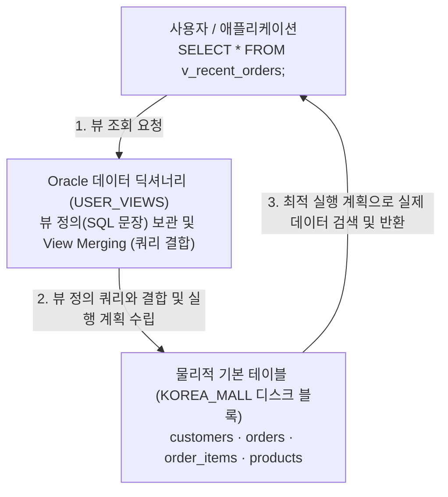
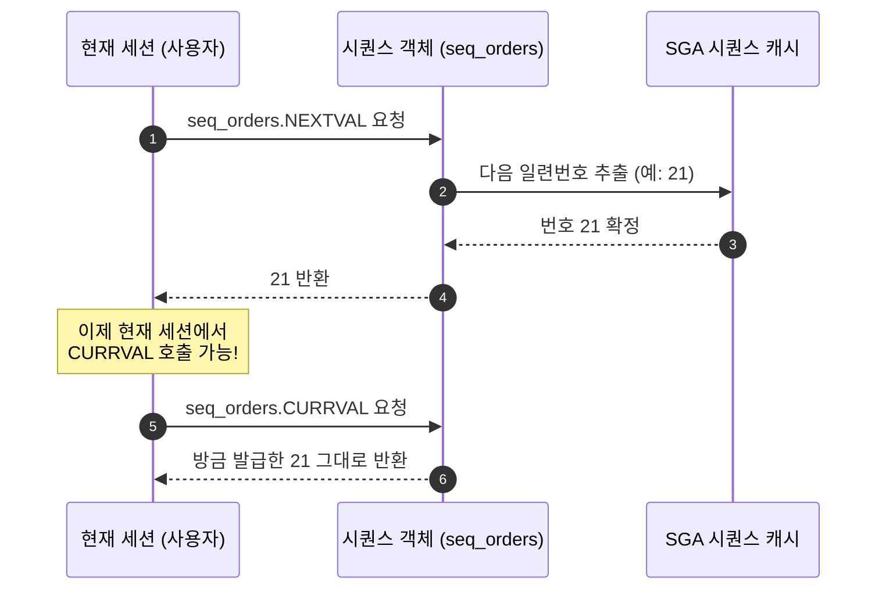
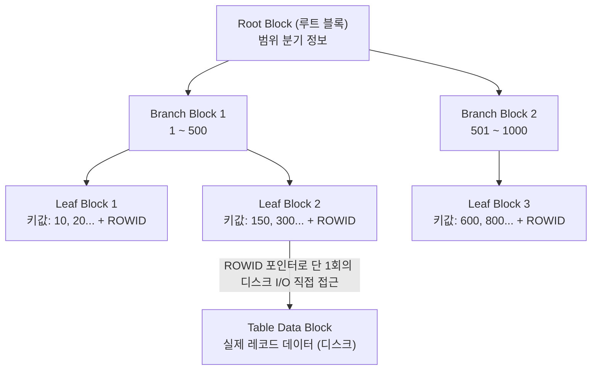
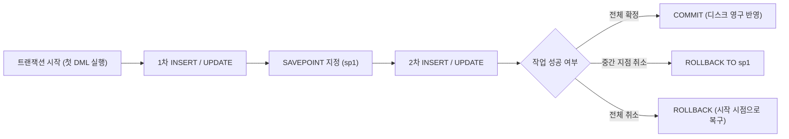

# Oracle SQL 고급 객체 및 트랜잭션 활용 가이드 (VIEW · SEQUENCE · INDEX · TCL)

관계형 데이터베이스(RDBMS)를 실무에서 안정적이고 효율적으로 운영하기 위해서는 단순한 테이블 데이터 조회/조작을 넘어, 데이터베이스 엔진이 제공하는 **고급 데이터베이스 객체**(Database Objects)와 **트랜잭션 무결성 제어**(Transaction Control) 기법을 숙지해야 합니다.

이번 10일차 실습에서는 실무 SQL 개발의 필수 요소인 다음 4가지 핵심 주제를 학습합니다:
1. **뷰**(View): 복잡한 다중 조인 및 서브쿼리를 가상화하여 재사용성을 극대화하고 민감 정보를 보호하는 가상 테이블
2. **시퀀스**(Sequence): 고유한 일련번호(Primary Key 값)를 자동으로 안전하게 발급해 주는 자동 번호 발생기
3. **인덱스**(Index): 대용량 테이블에서 원하는 데이터를 밀리초 단위로 빠르게 찾아주는 B-Tree 색인 구조와 성능 최적화 원리
4. **트랜잭션 제어**(TCL: `COMMIT`, `ROLLBACK`, `SAVEPOINT`): 일련의 데이터 변경 작업을 하나의 논리적 단위로 묶어 무결성을 완벽하게 보장하는 제어 기법

> [!NOTE]
> **📖 SQL 문법 표기 규칙 안내**
> 본 가이드의 문법 설명에 사용되는 기호는 다음과 같습니다:
> - `[ ]` (대괄호): 생략 가능한 **선택 사항**(Optional)을 나타냅니다. *(실제 SQL 작성 시 대괄호 기호는 입력하지 않습니다)*
> - `|` (파이프): 나열된 옵션 중 **하나를 선택**(OR)함을 나타냅니다.

---

## 0. 사전 준비: 실습 사용자 및 세션 확인

모든 SQL 실습은 관리자(`SYSTEM`) 계정이 아닌 **실습용 일반 사용자**(`KOREA_MALL`) 세션의 SQL 편집기에서 진행합니다.

```sql
-- 현재 접속 계정 확인 (결과가 KOREA_MALL 이어야 함)
SELECT USER FROM DUAL;
```

> 🎯 **핵심 배움 포인트** (실습 환경 확인):
> - 데이터베이스 카탈로그 오염을 방지하고 보안 원칙을 준수하기 위해 DDL/DML, 뷰/시퀀스/인덱스 생성 실습은 반드시 일반 계정(`KOREA_MALL`) 세션에서 실행합니다.
> - 일반 사용자(`KOREA_MALL`)에게는 `RESOURCE` 롤을 통해 자신의 스키마 내에 테이블, 뷰, 시퀀스, 인덱스를 자유롭게 생성할 수 있는 권한이 부여되어 있습니다.

---

## 1. 뷰(View): 가상 테이블의 개념과 활용

### 1.1 뷰(View)란 무엇인가?

**뷰**(View)는 하나 이상의 기본 테이블(Base Table)이나 다른 뷰를 기반으로 생성되는 **논리적인 가상 테이블**(Virtual Table)입니다.

- **물리적 디스크 공간을 차지하지 않음**: 일반 테이블과 달리 실제 데이터가 디스크 블록에 별도로 저장되지 않습니다. 데이터 딕셔너리(`USER_VIEWS`)에는 뷰를 정의한 `SELECT` **쿼리문**(텍스트 정의)만 저장됩니다.
- **테이블과 동일한 방식으로 사용**: 사용자는 뷰가 실제 테이블인지 가상 테이블인지 구분할 필요 없이, 일반 테이블과 완전히 동일하게 `SELECT * FROM 뷰이름;` 형태로 조회할 수 있습니다.



### 1.2 뷰를 사용하는 실무적 목적

1. **복잡한 쿼리의 단순화와 재사용성 증대**:
   - 4~5개 테이블의 복잡한 `JOIN`이나 서브쿼리가 포함된 쿼리를 뷰로 한 번 등록해 두면, 다른 개발자들은 단순한 `SELECT * FROM 뷰이름` 호출만으로 언제든지 최신 결과를 재사용할 수 있습니다.
2. **보안성**(Security) 및 데이터 은닉:
   - 주민등록번호, 비밀번호, 카드번호, 상세 연락처 등 민감한 개인정보 컬럼을 제외하거나 마스킹 처리한 컬럼만 모아 뷰로 제공함으로써 비인가 사용자의 원본 테이블 직접 접근을 원천 차단할 수 있습니다.
3. **논리적 데이터 독립성**(Logical Data Independence):
   - 기저 테이블의 컬럼명이 바뀌거나 테이블 구조가 분할·통합되어도, 뷰의 `SELECT` 문에서 별칭(Alias)을 맞춰두면 기존 애플리케이션 코드를 수정하지 않아도 됩니다.

### 1.3 뷰 생성 기본 문법

```sql
CREATE [OR REPLACE] [[NO]FORCE] VIEW 뷰_이름 [(컬럼_별칭1, 컬럼_별칭2, ...)]
AS
SELECT 문장
[WITH CHECK OPTION [CONSTRAINT 제약조건명]]
[WITH READ ONLY [CONSTRAINT 제약조건명]];
```

* `OR REPLACE`: 동일한 이름의 뷰가 이미 존재하면 오류를 내지 않고 덮어써서 새 정의로 갱신합니다.
* `FORCE`: 기본 테이블의 존재 여부와 무관하게 뷰를 강제로 생성합니다. (기본값은 `NOFORCE`)
* `WITH READ ONLY`: 해당 뷰를 통해서는 `INSERT`, `UPDATE`, `DELETE` 등의 데이터 조작(DML)을 원천 차단하고 오직 조회(`SELECT`)만 허용합니다.

---

## # 실습 예제 1-1 : 고객별 최근 주문 내역 뷰 생성하기

`KOREA_MALL` 데이터베이스에서는 고객(`customers`), 주문(`orders`), 주문 상세(`order_items`), 상품(`products`) 테이블을 조인하여, **고객별 가장 최근 주문 내역을 상세 조회하는 뷰**를 정의할 수 있습니다.

### 1.1 실습 쿼리

```sql
-- 고객별 최근 주문 내역을 조회하는 뷰 생성
CREATE OR REPLACE VIEW v_recent_orders AS
SELECT c.customer_id,               -- 고객 ID
       c.name AS customer_name,     -- 고객 이름
       o.order_id,                  -- 주문 ID
       o.order_date,                -- 주문 일자
       p.name AS product_name,      -- 주문 상품명
       oi.quantity,                 -- 수량
       oi.price_each                -- 주문 당시 단가
FROM   customers c
       JOIN orders o
         ON c.customer_id = o.customer_id
       JOIN order_items oi
         ON o.order_id = oi.order_id
       JOIN products p
         ON oi.product_id = p.product_id
WHERE  o.order_date = (
         SELECT MAX(o2.order_date)
         FROM   orders o2
         WHERE  o2.customer_id = c.customer_id
       );
```

### 1.2 생성된 뷰 조회하기

생성된 `v_recent_orders` 뷰는 일반 테이블과 똑같이 간결한 `SELECT` 문으로 조회할 수 있습니다:

```sql
-- 생성된 뷰를 통한 최근 주문 내역 조회
SELECT customer_id, customer_name, order_id, order_date, product_name, quantity, price_each
FROM v_recent_orders
ORDER BY customer_id ASC, order_id ASC;
```

### 1.3 쿼리 실행 결과 예시

| CUSTOMER_ID | CUSTOMER_NAME | ORDER_ID | ORDER_DATE | PRODUCT_NAME | QUANTITY | PRICE_EACH |
| :---: | :---: | :---: | :---: | :--- | :---: | :---: |
| 2 | 박서준 | 20 | 2025-05-08 | 지구 끝의 온실 | 2 | 14,900 |
| 2 | 박서준 | 20 | 2025-05-08 | 지구 끝의 온실 | 3 | 14,900 |
| 2 | 박서준 | 20 | 2025-05-08 | 고급 노트북 | 3 | 16,300 |
| 4 | 정해인 | 13 | 2025-06-27 | 아주 작은 습관의 힘 | 2 | 9,200 |
| 4 | 정해인 | 13 | 2025-06-27 | 북마크 세트 | 2 | 11,800 |
| 5 | 신민아 | 8 | 2025-05-14 | 니코마코스 윤리학 | 3 | 15,700 |
| 6 | 이종석 | 10 | 2025-06-16 | 소크라테스의 변명 | 2 | 12,400 |
| 6 | 이종석 | 10 | 2025-06-16 | 소크라테스의 변명 | 1 | 12,400 |
| 6 | 이종석 | 10 | 2025-06-16 | EQ 감성지능 | 1 | 9,000 |
| 7 | 김소현 | 6 | 2025-06-11 | 소년이 온다 | 2 | 12,000 |
| 7 | 김소현 | 6 | 2025-06-11 | 동물농장 | 1 | 15,900 |
| 8 | 남주혁 | 17 | 2025-06-11 | 위대한 개츠비 | 3 | 10,800 |
| 9 | 김태리 | 11 | 2025-05-23 | 프로이트 심리학 | 3 | 14,200 |
| 10 | 유연석 | 12 | 2025-05-08 | 1984 | 3 | 7,700 |
| 10 | 유연석 | 12 | 2025-05-08 | 책상용 독서대 | 3 | 9,600 |
| 10 | 유연석 | 12 | 2025-05-08 | 책상용 독서대 | 2 | 9,600 |

*(※ 주문 이력이 있는 고객들의 가장 최근 주문에 포함된 품목 총 16건이 정확하게 반환됩니다.)*

> 🎯 **핵심 배움 포인트** (복합 뷰와 상관 서브쿼리의 캡슐화):
> 
> ```mermaid
> sequenceDiagram
>     autonumber
>     participant Dev as 개발자 / 클라이언트
>     participant View as 뷰 (v_recent_orders)
>     participant Engine as Oracle SQL 엔진
>     participant DB as 물리 테이블 (4개)
> 
>     Dev->>View: SELECT * FROM v_recent_orders WHERE customer_id = 4
>     View->>Engine: 저장된 뷰 정의 SQL 전달
>     Engine->>DB: 4개 테이블 조인 + 상관 서브쿼리(MAX 일자) 최적화 실행
>     DB-->>Engine: 정해인 고객의 13번 주문 품목 2건 검색
>     Engine-->>Dev: 간결한 결과 테이블 즉시 반환
> ```
> 
> 1. **쿼리 복잡도의 은닉**(Abstraction):
>    - `customers`, `orders`, `order_items`, `products` 4개 테이블의 조인 조건과 `WHERE o.order_date = (SELECT MAX(...) ...)`라는 상관 서브쿼리를 매번 작성할 필요 없이, `v_recent_orders`라는 단일 뷰 이름으로 완전히 추상화(캡슐화)했습니다.
> 2. **조건절 추가 활용**:
>    - 뷰를 대상으로 `WHERE customer_id = 4`와 같이 조건을 부여하면, 오라클 옵티마이저는 뷰 내부의 메인 쿼리에 해당 조건을 결합(View Merging)하여 필요한 데이터만 효율적으로 탐색합니다.

---

## # 실습 예제 2 : 컬럼리스트를 활용한 뷰 수정하기

`CREATE OR REPLACE VIEW` 구문과 **컬럼 리스트**(Column Aliases)를 활용하면, 기존 뷰를 삭제하지 않고도 컬럼명들을 비즈니스에 친숙한 명칭(한글 별칭 등)으로 일괄 변경하여 뷰를 간편하게 재정의(수정)할 수 있습니다.

### 2.1 실습 쿼리

```sql
-- 고객별 최근 주문 내역 뷰 생성 (컬럼리스트 활용)
CREATE OR REPLACE VIEW v_recent_orders
    (고객번호, 고객명, 주문번호, 주문일, 상품명, 수량, 단가)
AS
SELECT c.customer_id,               -- 고객 ID
       c.name,                      -- 고객 이름
       o.order_id,                  -- 주문 ID
       o.order_date,                -- 주문 일자
       p.name,                      -- 상품명
       oi.quantity,                 -- 수량
       oi.price_each                -- 주문 당시 단가
FROM   customers c
       JOIN orders o
         ON c.customer_id = o.customer_id
       JOIN order_items oi
         ON o.order_id = oi.order_id
       JOIN products p
         ON oi.product_id = p.product_id
WHERE  o.order_date = (
         SELECT MAX(o2.order_date)
         FROM   orders o2
         WHERE  o2.customer_id = c.customer_id
       );

-- 컬럼리스트로 지정된 한글 컬럼명을 사용한 뷰 조회
SELECT 고객명, 상품명, 주문일
FROM   v_recent_orders;
```

### 2.2 쿼리 실행 결과 예시 (`SELECT 고객명, 상품명, 주문일 FROM v_recent_orders;`)

| 고객명 | 상품명 | 주문일 |
| :--- | :--- | :---: |
| 박서준 | 지구 끝의 온실 | 2025-05-08 |
| 박서준 | 지구 끝의 온실 | 2025-05-08 |
| 박서준 | 고급 노트북 | 2025-05-08 |
| 정해인 | 아주 작은 습관의 힘 | 2025-06-27 |
| 정해인 | 북마크 세트 | 2025-06-27 |
| 신민아 | 니코마코스 윤리학 | 2025-05-14 |
| 이종석 | 소크라테스의 변명 | 2025-06-16 |
| 이종석 | 소크라테스의 변명 | 2025-06-16 |
| 이종석 | EQ 감성지능 | 2025-06-16 |
| 김소현 | 소년이 온다 | 2025-06-11 |
| 김소현 | 동물농장 | 2025-06-11 |
| 남주혁 | 위대한 개츠비 | 2025-06-11 |
| 김태리 | 프로이트 심리학 | 2025-05-23 |
| 유연석 | 1984 | 2025-05-08 |
| 유연석 | 책상용 독서대 | 2025-05-08 |
| 유연석 | 책상용 독서대 | 2025-05-08 |

> 🎯 **핵심 배움 포인트** (컬럼 리스트 정의와 `CREATE OR REPLACE VIEW`의 장점):
> 
> ```mermaid
> flowchart LR
>     subgraph ViewDefinition ["뷰 정의 시 컬럼 리스트 매핑"]
>         ColList["(고객번호, 고객명, 주문번호, 주문일, 상품명, 수량, 단가)"]
>     end
>     subgraph SelectClause ["SELECT 절 프로젝션 (7개 컬럼)"]
>         Col1["c.customer_id"] -->|"1:1 매핑"| ColList
>         Col2["c.name"] -->|"1:1 매핑"| ColList
>         Col3["o.order_id"] -->|"1:1 매핑"| ColList
>         Col4["o.order_date"] -->|"1:1 매핑"| ColList
>         Col5["p.name"] -->|"1:1 매핑"| ColList
>         Col6["oi.quantity"] -->|"1:1 매핑"| ColList
>         Col7["oi.price_each"] -->|"1:1 매핑"| ColList
>     end
> ```
> 
> 1. **컬럼 리스트 매핑 규칙**(1:1 개수 일치):
>    - 뷰 이름 바로 뒤 괄호 안에 나열하는 컬럼 리스트의 개수는 하단 `SELECT` 절에서 조회하는 컬럼 개수와 정확하게 일치해야 합니다. 개수가 다르면 `ORA-00947` 또는 `ORA-00913` 오류가 발생합니다.
>    - `SELECT` 절에 개별 `AS 별칭`을 붙이지 않더라도 컬럼 리스트를 통해 한 번에 깔끔한 별칭을 부여할 수 있습니다.
> 2. `CREATE OR REPLACE VIEW`의 **무중단 수정 효과**:
>    - 기존 뷰를 `DROP`하고 다시 생성하면 해당 뷰에 부여되어 있던 사용자 권한(`GRANT`)이나 종속성이 초기화될 수 있습니다.
>    - 반면 `CREATE OR REPLACE VIEW`를 사용하면 기존 권한과 메타데이터 종속성을 유지한 채 뷰의 SQL 정의만 안전하게 갱신(수정)할 수 있습니다.
> 3. **비즈니스 가독성 향상**:
>    - 한글 또는 도메인 용어로 정의된 컬럼 리스트를 사용하면, 데이터 분석가나 현업 담당자가 복잡한 DB 컬럼 규칙을 몰라도 마치 한글 엑셀 시트를 보듯 손쉽게 조회할 수 있습니다.

---

## # 실습 예제 3-1 : 활성 고객만 조회하는 뷰

`WITH CHECK OPTION` 제약조건을 지정하여 뷰를 생성하면, 뷰의 `WHERE` 절 조건에 위배되는 데이터 조작(수정 및 삽입)을 데이터베이스 차원에서 엄격하게 차단할 수 있습니다.

### 3.1.1 실습 쿼리

```sql
-- 활성 고객만 조회 가능한 뷰 생성
CREATE OR REPLACE VIEW v_active_customers
AS
SELECT customer_id, name, email, phone, is_active
FROM   customers
WHERE  is_active = 'Y'
WITH CHECK OPTION;
```

### 3.1.2 뷰 조회

```sql
-- 활성 고객 목록 조회 (is_active = 'Y'인 정상 회원들만 조회됨)
SELECT * FROM v_active_customers;
```

---

## # 실습 예제 3-2 : 뷰의 WITH CHECK OPTION 조건에 위배

`v_active_customers` 뷰를 통해 신규 고객 데이터를 삽입(`INSERT`)할 때, `is_active` 값이 `'Y'`인 정상 데이터와 `'N'`인 조건 위배 데이터의 실행 차이를 확인합니다.

### 3.2.1 실습 쿼리

```sql
-- 뷰를 통한 삽입 (정상 : is_active = 'Y')
INSERT INTO v_active_customers (customer_id, name, email, phone, is_active)
VALUES (101, '홍길동', 'hong@mm.com', '010-9999-9999', 'Y');

-- 기저 테이블(customers)에 실제 데이터가 저장되었는지 확인
SELECT customer_id, name, email, is_active
FROM   customers
WHERE  customer_id = 101;

-- 뷰를 통한 삽입 (오류 : is_active = 'N')
INSERT INTO v_active_customers (customer_id, name, email, phone, is_active)
VALUES (102, '김철수', 'kim@mm.com', '010-8888-8888', 'N');
-- ORA-01402: view WITH CHECK OPTION where-clause violation
```

### 3.2.2 쿼리 실행 결과 및 오류 분석

* **101번 고객**('홍길동', `is_active = 'Y'`) **삽입 및 기저 테이블 반영 확인**:
  ```text
  1 행 이(가) 삽입되었습니다.
  ```
  `is_active = 'Y'` 조건을 충족하므로 뷰를 통해 물리적 저장 공간인 기저 테이블 `customers`에 데이터가 정상적으로 영구 삽입됩니다.

* **102번 고객**('김철수', `is_active = 'N'`) **삽입 결과**(오류):
  ```text
  SQL 오류 [1402] [23000]: ORA-01402: 뷰의 WITH CHECK OPTION의 조건에 위배 됩니다 (view WITH CHECK OPTION where-clause violation)
  ```
  `is_active` 값이 `'N'`이어서 뷰의 `WHERE is_active = 'Y'` 조건을 만족하지 못하므로, 오라클 엔진이 `ORA-01402` 예외를 발생시키며 삽입을 차단합니다.

```sql
-- 실습 데이터 정리 (롤백)
ROLLBACK;
```

> 🎯 **핵심 배움 포인트** (`WITH CHECK OPTION`의 동작 메커니즘과 무결성 보장):
> 
> ```mermaid
> flowchart TD
>     subgraph ClientAction ["클라이언트 DML 요청 (INSERT / UPDATE)"]
>         Insert1["INSERT 고객(101): is_active = 'Y'"]
>         Insert2["INSERT 고객(102): is_active = 'N'"]
>     end
> 
>     subgraph ViewCheck ["WITH CHECK OPTION 검사 엔진"]
>         CondCheck{"데이터가 WHERE 절의<br/>is_active = 'Y' 를 만족하는가?"}
>     end
> 
>     Insert1 --> CondCheck
>     Insert2 --> CondCheck
>     CondCheck -->|"아니오 (조건 탈락)"| Error["ORA-01402 오류 발생<br/>(DML 차단 및 무결성 보호)"]
>     CondCheck -->|"예 (조건 유지)"| Success["기저 테이블(customers)에<br/>정상 삽입 / 반영 (SUCCESS)"]
> ```
> 
> 1. **뷰 조건의 일관성 유지**(데이터 이탈 방지):
>    - `WITH CHECK OPTION`이 없으면 뷰를 통해 `is_active = 'N'`인 데이터를 넣을 수 있지만, 그렇게 삽입된 행은 정작 `v_active_customers` 뷰에서는 조회되지 않는 모순이 발생합니다.
>    - `WITH CHECK OPTION`은 **뷰를 통해 입력·수정되는 모든 데이터가 반드시 해당 뷰의 WHERE 절 조건을 만족해야만 한다**는 엄격한 무결성 규칙을 강제하여 데이터 이탈을 방지합니다.
> 2. **조건 컬럼을 건드리지 않는 수정은 허용**:
>    - `UPDATE v_active_customers SET phone = '010-1234-5678' WHERE customer_id = 1;`처럼 `WHERE` 절 조건(`is_active`)에 영향을 주지 않는 일반 정보 수정은 정상 허용됩니다.
> 3. **뷰의 데이터 조작과 기저 테이블 반영 원리**:
>    - **물리적 저장 위치**: 뷰는 자체 디스크 저장 공간이 없는 가상 테이블이므로, 뷰를 대상으로 수행한 `INSERT`, `UPDATE`, `DELETE` 명령은 오라클 엔진에 의해 실제 데이터를 보관하는 **기저 테이블**(Base Table, 본 예제의 `customers`)에 직접 변환되어 반영됩니다.
>    - **뷰 DML 가능 조건 및 주요 제약사항**: 모든 뷰에서 데이터 추가나 수정이 가능한 것은 아니며, 원본 행과 1:1로 대응되는 **단순 뷰**(Simple View)에서만 제한적으로 허용됩니다.
> 
> | 구분 | DML 불가능한 경우 | 주요 원인 및 제약 이유 |
> | :--- | :--- | :--- |
> | **NOT NULL 제약** | 기저 테이블의 필수 컬럼 누락 | 뷰에 포함되지 않은 원본 컬럼 중 기본값(`DEFAULT`) 없는 `NOT NULL` 컬럼이 있으면 `INSERT` 불가 (`ORA-01400`) |
> | **가공 및 집계** | 집계 함수, 수식, 그룹화 사용 | `SUM`, `AVG`, `GROUP BY`, `DISTINCT` 등이 포함된 뷰는 원본 행과 1:1 매핑되지 않아 DML 불가 |
> | **다중 테이블** | 복합 뷰(다중 테이블 조인) | 여러 테이블을 조인한 복합 뷰는 키-보존 테이블 규칙을 만족하지 못하면 데이터 조작 불가 |
> | **보안 옵션** | `WITH READ ONLY` 지정 | 뷰 생성 시 읽기 전용 옵션을 설정한 경우 모든 DML 원천 차단 (`ORA-42399`) |
> | **조건 무결성** | `WITH CHECK OPTION` 위배 | 뷰의 `WHERE` 조건에 부합하지 않는 데이터 입력 및 수정 차단 (`ORA-01402`) |

---

## # 실습 예제 4-1 : 고객 리뷰 조회 전용 뷰 생성하기

`KOREA_MALL`의 리뷰 테이블(`reviews`)에는 고객이 작성한 상품 리뷰 정보가 저장되어 있습니다. 이 데이터를 조회 전용으로 제공하기 위해 `WITH READ ONLY` 옵션을 포함한 뷰를 생성해 보겠습니다.

### 4.1.1 실습 쿼리

```sql
-- 고객 리뷰 조회 전용 뷰 생성
CREATE OR REPLACE VIEW v_review_summary
AS
SELECT r.review_id,
       c.name          AS customer_name,
       p.name          AS product_name,
       r.rating,
       r.content,
       r.created_at
FROM   reviews r
       JOIN customers c ON r.customer_id = c.customer_id
       JOIN products  p ON r.product_id = p.product_id
WITH READ ONLY;
```

### 4.1.2 뷰 조회

```sql
-- 생성된 읽기 전용 리뷰 뷰 조회
SELECT review_id, customer_name, product_name, rating, content, created_at
FROM   v_review_summary
ORDER BY review_id ASC;
```

### 4.1.3 쿼리 실행 결과 예시 (상위 10건)

| REVIEW_ID | CUSTOMER_NAME | PRODUCT_NAME | RATING | CONTENT | CREATED_AT |
| :---: | :---: | :--- | :---: | :--- | :---: |
| 2 | 남주혁 | 채식주의자 | 5 | 문장이 너무 아름답고 인상 깊었습니다. | 2025-06-01 |
| 3 | 정해인 | 위대한 개츠비 | 3 | 기대한 것보단 평범했어요. | 2025-06-02 |
| 4 | 남주혁 | 책상용 독서대 | 5 | 선물용으로 딱입니다. 받는 분이 정말 좋아하셨어요. | 2025-06-01 |
| 5 | 남주혁 | 나는 내가 죽었다고 생각했습니다 | 4 | 주제는 무거웠지만 쉽게 읽혀서 좋았어요. | 2025-06-02 |
| 6 | 남주혁 | 라인프렌즈 볼펜 | 4 | 귀엽고 실용적이라 만족합니다. | 2025-06-01 |
| 7 | 김소현 | 동물농장 | 4 | 고전이지만 지금 읽어도 흥미롭습니다. | 2025-06-02 |
| 8 | 정해인 | 프로이트 심리학 | 4 | 기초 개념 잡기에 좋은 책입니다. | 2025-06-01 |
| 9 | 정해인 | 소년이 온다 | 3 | 감정선은 좋았는데 결말이 아쉬웠어요. | 2025-06-02 |
| 10 | 신민아 | 니코마코스 윤리학 | 4 | 생각보다 내용이 깊고 재미있었어요. | 2025-06-02 |
| 11 | 이종석 | 소크라테스의 변명 | 4 | 고전이지만 쉽게 읽혀서 좋았습니다. | 2025-06-02 |

*(※ 전체 등록된 20건의 고객 상품 리뷰 데이터가 안전하게 조회됩니다.)*

---

## # 실습 예제 4-2 : WITH READ ONLY 뷰에 UPDATE 시도 시 오류 확인하기

`WITH READ ONLY` 옵션이 설정된 뷰에 대해 데이터 수정(`UPDATE`)을 시도하면 데이터베이스가 작업을 차단하고 오류를 발생시킵니다.

### 4.2.1 실습 쿼리

```sql
-- 뷰를 통한 수정 시도 (오류 발생)
UPDATE v_review_summary
SET    rating = 5
WHERE  review_id = 1;
```

### 4.2.2 쿼리 실행 결과 및 오류 분석

* **실행 결과 에러 메시지**:
  ```text
  SQL 오류 [42399] [99999]: ORA-42399: cannot perform a DML operation on a read-only view
  (ORA-42399: 읽기 전용 뷰에서는 DML 작업을 수행할 수 없습니다)
  ```

> 🎯 **핵심 배움 포인트** (`WITH READ ONLY` 옵션의 역할과 보안적 가치):
> 
> ```mermaid
> flowchart LR
>     UserApp["사용자 / 애플리케이션"]
>     View["v_review_summary<br/>(WITH READ ONLY)"]
>     Table["reviews / customers / products"]
> 
>     UserApp -->|"SELECT (조회 요청)"| View -->|"정상 통과 및 데이터 반환"| Table
>     UserApp -.->|"UPDATE (수정 시도: review_id = 1)"| View
>     View -.->|"차단! ORA-42399 발생"| UserApp
> ```
> 
> 1. **DML의 원천적 봉쇄**:
>    - `WITH READ ONLY` 옵션이 부여된 뷰는 `INSERT`, `UPDATE`, `DELETE` 명령을 데이터베이스 차원에서 완전히 거부합니다.
>    - 데이터 수정이나 변조가 일어나면 안 되는 리포트, 통계, 대시보드 표출용 뷰에 필수적으로 적용하여 데이터 무결성을 확실하게 보장합니다.
> 2. `WITH CHECK OPTION`과의 **차이점 비교**:
> 
> | 구분 | `WITH CHECK OPTION` | `WITH READ ONLY` |
> | :--- | :--- | :--- |
> | **목적** | 뷰 조건(`WHERE`)을 만족하는 DML만 허용 | 모든 DML을 완전히 차단 |
> | **DML 허용 여부** | 조건 부합 시 INSERT/UPDATE/DELETE 가능 | 모든 DML 불가 (SELECT만 가능) |
> | **위배 시 에러** | `ORA-01402: 뷰의 WITH CHECK OPTION 조건에 위배` | `ORA-42399: 읽기 전용 뷰에서는 DML 작업 불가` |

### 1.4 뷰의 삭제 및 데이터 딕셔너리 확인

```sql
-- 내가 생성한 뷰 목록 및 정의 조회
SELECT view_name, text_length, read_only
FROM   user_views;

-- 필요 없어진 뷰 삭제 (원본 테이블의 실제 데이터는 전혀 삭제되지 않음)
DROP VIEW v_review_summary;
```

---

## 2. 시퀀스(Sequence): 자동 일련번호 생성기의 개념과 활용

### 2.1 시퀀스(Sequence)란 무엇인가?

**시퀀스**(Sequence)는 정수형 일련번호를 순차적으로 자동 생성해 주는 오라클 데이터베이스의 독립적인 객체입니다.
주로 기본키(`PRIMARY KEY`) 컬럼에 중복되지 않는 고유한 번호(인조키, Surrogate Key)를 자동으로 채워 넣을 때 사용됩니다.

- **공유 가능**(Shareable): 여러 세션 또는 여러 테이블에서 하나의 시퀀스를 공유하여 번호를 발급받을 수 있습니다.
- **성능 최적화**(Cache): 매번 디스크에 접근하지 않고 메모리(SGA)에 번호 블록을 미리 캐싱하여 매우 빠른 속도로 번호를 발급합니다.
- **롤백 불가능**(Non-Rollback): 트랜잭션이 `ROLLBACK`되더라도 이미 발급된 시퀀스 번호는 되돌아가지 않으며, 결번(Gap)이 생길 수 있습니다.

### 2.2 시퀀스 생성 기본 문법

```sql
CREATE SEQUENCE 시퀀스_이름
    [START WITH 시작값]             -- 생성될 첫 번째 번호 (기본값: 1)
    [INCREMENT BY 증가값]          -- 한 번에 증가할 단위 (기본값: 1)
    [MAXVALUE 최댓값 | NOMAXVALUE]  -- 도달 가능한 최대 숫자
    [MINVALUE 최솟값 | NOMINVALUE]  -- 도달 가능한 최소 숫자
    [CYCLE | NOCYCLE]              -- 최댓값 도달 시 처음부터 반복 여부 (기본값: NOCYCLE)
    [CACHE 캐시수 | NOCACHE];       -- 메모리에 미리 할당할 번호 수 (기본값: CACHE 20)
```

### 2.3 시퀀스 의사 컬럼(Pseudocolumn): `NEXTVAL`과 `CURRVAL`

| 의사 컬럼 | 동작 원리 및 사용 규칙 |
| :--- | :--- |
| `시퀀스명.NEXTVAL` | 다음 번호를 실제로 발행하고 시퀀스 값을 1 증가시킵니다. |
| `시퀀스명.CURRVAL` | **현재 세션**에서 가장 최근에 발급받은 시퀀스 값을 확인합니다. *(주의: 해당 세션에서 `NEXTVAL`을 최소 1회 이상 먼저 호출해야만 사용 가능)* |



---

## # 실습 예제 5-1 : 현재 계정이 소유한 시퀀스 목록 조회하기

시퀀스는 데이터베이스에 객체로 저장되므로, 현재 계정이 보유하고 있는 시퀀스를 조회할 수 있습니다.
Oracle에서는 `USER_SEQUENCES` 데이터 사전을 통해 시퀀스 정보를 확인할 수 있으며, 이 사전에는 시퀀스 이름, 시작값, 증가값, 최대값, 캐시 여부 등의 설정 정보가 포함되어 있습니다.

### 5.1.1 실습 쿼리

```sql
-- 현재 계정이 소유한 시퀀스 목록 조회
SELECT sequence_name, min_value, max_value, increment_by, last_number
FROM   user_sequences;
```

### 5.1.2 쿼리 실행 결과 예시

| SEQUENCE_NAME | MIN_VALUE | MAX_VALUE | INCREMENT_BY | LAST_NUMBER |
| :--- | :---: | :---: | :---: | :---: |
| SEQ_CATEGORIES | 1 | 9999999999999999999999999999 | 1 | 1 |
| SEQ_CUSTOMERS | 1 | 9999999999999999999999999999 | 1 | 1 |
| SEQ_ORDERS | 1 | 9999999999999999999999999999 | 1 | 1 |
| SEQ_ORDER_ITEMS | 1 | 9999999999999999999999999999 | 1 | 1 |
| SEQ_PRODUCTS | 1 | 9999999999999999999999999999 | 1 | 1 |
| SEQ_REVIEWS | 1 | 9999999999999999999999999999 | 1 | 1 |

*(※ KOREA_MALL 스키마 초기화 시 생성된 6대 핵심 테이블용 시퀀스 총 6건이 조회됩니다.)*

> 🎯 **핵심 배움 포인트** (`USER_SEQUENCES` 데이터 사전의 주요 컬럼):
> - `SEQUENCE_NAME`: 시퀀스 객체의 고유 명칭 (대문자로 저장됨)
> - `MIN_VALUE` / `MAX_VALUE`: 시퀀스가 발급할 수 있는 최솟값과 최댓값 (별도 지정 없을 시 오라클 기본 최댓값 부여)
> - `INCREMENT_BY`: 번호가 발급될 때마다 증가하는 단위 (기본값: 1)
> - `LAST_NUMBER`: 현재 시점 기준으로 디스크에 기록된 다음 번호 (다음에 메모리 캐시로 적재될 시작 번호)

---

## # 실습 예제 5-2 : 시퀀스의 상세 조회하기

특정 시퀀스의 세부 설정 옵션(`CYCLE`, `ORDER`, `CACHE` 등)을 집중적으로 확인하기 위해 `WHERE` 조건으로 해당 시퀀스만 상세 조회할 수 있습니다.

### 5.2.1 실습 쿼리

```sql
-- SEQ_CUSTOMERS 시퀀스 상세 조회
SELECT sequence_name,
       min_value,
       max_value,
       increment_by,
       cycle_flag,          -- 순환 여부 (Y/N)
       order_flag,          -- 순서 보장 여부 (분산 환경에서 사용)
       cache_size,          -- 캐시 개수
       last_number          -- 다음에 할당될 번호
FROM   user_sequences
WHERE  sequence_name = 'SEQ_CUSTOMERS';
```

### 5.2.2 쿼리 실행 결과 예시

| SEQUENCE_NAME | MIN_VALUE | MAX_VALUE | INCREMENT_BY | CYCLE_FLAG | ORDER_FLAG | CACHE_SIZE | LAST_NUMBER |
| :--- | :---: | :---: | :---: | :---: | :---: | :---: | :---: |
| SEQ_CUSTOMERS | 1 | 9999999999999999999999999999 | 1 | N | N | 0 | 1 |

> 🎯 **핵심 배움 포인트** (시퀀스 상세 속성의 의미):
> - `CYCLE_FLAG`: 최댓값(`MAX_VALUE`)에 도달했을 때 다시 최솟값부터 순환할지 여부 (`Y` / `N`). 기본키용 시퀀스는 중복 키 방지를 위해 반드시 `N`(`NOCYCLE`)이어야 합니다.
> - `ORDER_FLAG`: 여러 노드로 구성된 분산 환경(Oracle RAC)에서 요청받은 시간 순서대로 번호 발급을 엄격히 보장할지 여부 (`Y` / `N`).
> - `CACHE_SIZE`: 번호 생성 성능을 높이기 위해 메모리(SGA)에 미리 할당해 두는 번호 개수. 쇼핑몰 초기화 시 `NOCACHE`로 생성되었으므로 `0`으로 표시됩니다.
> - `LAST_NUMBER`: 다음에 세션에 할당될 대기 번호.

---

## # 실습 예제 5-3 : 시퀀스를 이용한 데이터 입력하기

`customers` 테이블의 기본키인 `customer_id` 컬럼에 숫자를 수동으로 입력하지 않고, 미리 정의된 시퀀스 객체(`seq_customers`)의 `NEXTVAL`을 호출하여 유일한 고객 번호를 자동으로 발급받아 신규 데이터를 추가합니다.

> [!NOTE] **시퀀스 시작 번호와 기존 데이터 충돌 사전 확인**  
> `customers` 테이블에는 이미 초기 샘플 데이터로 1~10번 고객이 등록되어 있습니다. 따라서 신규 고객은 **11번**부터 부여받아야 합니다.  
> 만약 `seq_customers` 시퀀스가 생성 후 처음 사용되는 상태라면, 아래 사전 조치 쿼리를 먼저 실행하여 시작 번호를 11번으로 맞춰줍니다.

### 5.3.1 실습 쿼리

```sql
-- [사전 조치] 시퀀스 발급 번호를 기존 고객(10명) 이후인 11번으로 맞추기 (최초 1회)
ALTER SEQUENCE seq_customers RESTART START WITH 11;
-- ※ 구버전 호환 또는 DROP & CREATE 방식:
-- DROP SEQUENCE seq_customers;
-- CREATE SEQUENCE seq_customers START WITH 11 INCREMENT BY 1 NOCACHE;

-- 시퀀스를 이용하여 신규 고객 추가
INSERT INTO customers (customer_id, name, email, phone, registered_date, is_active)
VALUES (seq_customers.NEXTVAL, '아이유', 'iu@mm.com', '010-7777-1334', SYSDATE, 'Y');

-- 입력된 신규 고객 데이터 조회 및 발급된 customer_id 확인
SELECT customer_id, name, email, phone, registered_date, is_active
FROM   customers
WHERE  name = '아이유';

-- 실습 데이터 원복 (선택 사항)
ROLLBACK;
```

### 5.3.2 쿼리 실행 결과 예시

| CUSTOMER_ID | NAME | EMAIL | PHONE | REGISTERED_DATE | IS_ACTIVE |
| :---: | :---: | :--- | :--- | :---: | :---: |
| 11 | 아이유 | iu@mm.com | 010-7777-1334 | 2026-11-07 | Y |

*(※ 기존 1~10번 고객에 이어 시퀀스로부터 발급된 11번이 `customer_id`로 자동 부여되어 1행이 성공적으로 삽입됩니다.)*

> [!WARNING] **실행 시 ORA-00001 기본키 제약조건 위반 오류가 발생하는 경우**  
> ```text
> SQL Error [1] [23000]: ORA-00001: 고유한 제약 조건(KOREA_MALL.SYS_C008686)이 테이블 KOREA_MALL.CUSTOMERS 열(CUSTOMER_ID)에서 위반되었습니다.
> ORA-03301: 열 값(CUSTOMER_ID:1)이 있는 행이 존재합니다.
> ```
> * **원인**: `customers` 테이블에 이미 `customer_id = 1`인 고객이 존재하는 상태에서, 시퀀스 객체가 초기값인 1부터 번호를 발급하여 충돌한 것입니다.
> * **해결 방법**(택 1):
>   1. **시퀀스 재시작**(Oracle 12.2 이상):  
>      `ALTER SEQUENCE seq_customers RESTART START WITH 11;`  
>   2. **시퀀스 재생성**(모든 버전 공통 / 가장 확실):  
>      `DROP SEQUENCE seq_customers;` 실행 후 `CREATE SEQUENCE seq_customers START WITH 11 INCREMENT BY 1 NOCACHE;`  
>   3. **대기 번호 소진**:  
>      방금 오류로 1번이 발급되었으므로, 가상 테이블에서 2~10번을 소진시킵니다:  
>      `SELECT seq_customers.NEXTVAL FROM dual CONNECT BY LEVEL <= 9;`

> 🎯 **핵심 배움 포인트** (`NEXTVAL`의 자동 채번과 동시성 제어):
> 
> ```mermaid
> sequenceDiagram
>     autonumber
>     participant Client as 사용자 INSERT 요청
>     participant Seq as seq_customers
>     participant Table as customers 테이블
> 
>     Client->>Seq: seq_customers.NEXTVAL 호출
>     Seq-->>Seq: 내부 번호 카운터 1 증가 (예: 11)
>     Seq-->>Table: 발급 번호 11을 customer_id 컬럼에 바인딩
>     Table-->>Client: 1 행 이(가) 삽입되었습니다.
> ```
> 
> 1. **자동 채번의 안전성**:
>    - 개발자가 `SELECT MAX(customer_id) + 1 FROM customers;`와 같은 방식을 사용하면, 여러 사용자가 동시에 접근할 때 중복 번호가 발생하여 `ORA-00001: 무결성 제약 조건 위배`가 발생할 수 있습니다.
>    - 시퀀스의 `NEXTVAL`은 오라클 엔진이 내부적으로 락 경합 없이 독립적이고 안전하게 유일한 번호를 원자적(Atomic)으로 발행하므로 동시성 환경에서 가장 완벽한 인조 기본키 생성 기법입니다.
> 2. `ROLLBACK` 시 **번호 불연속**(결번) **특성**:
>    - `INSERT` 후 `ROLLBACK`을 실행하더라도, 이미 한 번 증가하여 소비된 `seq_customers.NEXTVAL` 값은 이전 숫자로 되돌아가지 않습니다. 다음 번에 `NEXTVAL`을 호출하면 그 다음 번호가 발급됩니다.

---

## # 실습 예제 5-4 : CURRVAL로 마지막 값 확인하기

현재 세션에서 `NEXTVAL`을 통해 가장 최근에 생성(발급)된 시퀀스의 현재 번호를 확인하기 위해 의사 컬럼인 `CURRVAL`을 조회합니다.

### 5.4.1 실습 쿼리

```sql
-- 마지막으로 생성된 고객 번호 확인
SELECT seq_customers.CURRVAL AS last_customer_id
FROM   dual;
```

### 5.4.2 쿼리 실행 결과 예시

| LAST_CUSTOMER_ID |
| :---: |
| 11 |

*(※ 앞선 실습 예제 5-3에서 발급된 11번이 현재 세션의 마지막 생성 번호로 정확하게 조회됩니다.)*

> 🎯 **핵심 배움 포인트** (`CURRVAL`의 세션 종속성과 주의사항):
> 
> ```mermaid
> sequenceDiagram
>     autonumber
>     participant S1 as 세션 1 (사용자 A)
>     participant Seq as seq_customers
>     participant S2 as 세션 2 (사용자 B)
> 
>     Note over S1,S2: 세션마다 독립적인 CURRVAL 유지
>     S1->>Seq: NEXTVAL 호출 -> 11 발급
>     S1->>Seq: CURRVAL 조회 -> 11 확인
>     S2->>Seq: NEXTVAL 호출 -> 12 발급
>     S1->>Seq: CURRVAL 재조회 -> 여전히 11 반환! (세션 독립성)
>     S2->>Seq: CURRVAL 조회 -> 12 반환
> ```
> 
> 1. `NEXTVAL` **선행 필수 규칙**:
>    - `CURRVAL`은 반드시 현재 접속 세션 내에서 `NEXTVAL`을 **최소 1회 이상 먼저 실행한 이후**에만 호출할 수 있습니다.
>    - 만약 새 세션에 로그인하자마자 `NEXTVAL` 없이 `CURRVAL`을 실행하면 다음과 같은 오류가 발생합니다:
>      ```text
>      ORA-08002: 시퀀스 SEQ_CUSTOMERS.CURRVAL은 이 세션에서는 정의되어 있지 않습니다
>      (sequence SEQ_CUSTOMERS.CURRVAL is not yet defined in this session)
>      ```
> 2. **세션 격리**(Session Isolation):
>    - 다른 사용자가 아무리 많은 `NEXTVAL`을 호출하더라도, 내가 접속한 세션의 `CURRVAL`은 오직 **내가 방금 발급받았던 번호**만 기억하고 있으므로 다른 세션의 작업과 꼬이지 않고 안전하게 자식 테이블 외래키에 연결할 수 있습니다.

---

## # 실습 예제 6-1 : CYCLE 옵션 테스트를 위한 테이블과 시퀀스 생성하기

시퀀스가 지정된 최댓값(`MAXVALUE`)에 도달했을 때 번호 증가를 멈추지 않고 다시 처음(최솟값 `1`)부터 순환하여 번호를 재발급하는 `CYCLE` 옵션의 동작을 테스트하기 위해 실습 테이블과 시퀀스를 생성합니다.

### 6.1.1 실습 쿼리

```sql
-- [1]단계 : 하루 생산 내역을 기록할 테이블 생성
CREATE TABLE product_daily (
    prod_id      NUMBER PRIMARY KEY,         -- 날짜+일련번호 (PK)
    product_name VARCHAR2(100),              -- 상품명
    produced_at  DATE DEFAULT SYSDATE        -- 생산일시
);

-- [2]단계 : 하루 최대 3개 한정 생산 시리얼번호
CREATE SEQUENCE seq_product_serial
    START WITH 1
    INCREMENT BY 1
    MAXVALUE 3
    CYCLE
    NOCACHE;
```

> 🎯 **핵심 배움 포인트** (`CYCLE` 옵션의 동작 특성과 제약사항):
> 
> ```mermaid
> stateDiagram-v2
>     direction LR
>     [*] --> Num1: NEXTVAL 호출
>     Num1: 1번 발급
>     Num1 --> Num2: NEXTVAL 호출
>     Num2: 2번 발급
>     Num2 --> Num3: NEXTVAL 호출
>     Num3: 3번 (MAXVALUE 도달)
>     Num3 --> Num1: CYCLE 순환! 다시 1번 발급
> ```
> 
> 1. `CYCLE` **옵션의 동작 메커니즘**:
>    - 기본값인 `NOCYCLE` 상태에서는 `MAXVALUE`에 도달한 뒤 추가로 `NEXTVAL`을 호출하면 `ORA-08004: 시퀀스가 MAXVALUE를 넘었습니다` 오류가 발생합니다.
>    - 하지만 `CYCLE`을 지정하면 최댓값에 도달한 후 다음 호출 시 최솟값(`MINVALUE`, 기본값 1)으로 자동 리셋되어 순환 발급됩니다.
> 2. `PRIMARY KEY`와의 **충돌 주의**:
>    - 번호가 순환되면 동일한 번호가 재발급되므로 단독 컬럼으로 기본키(PK)를 설정하면 키 중복 오류(`ORA-00001`)가 발생할 수 있습니다. 실무에서는 당일 번호표, 배치 작업 번호, 또는 '날짜+일련번호' 결합 형태로 주로 활용합니다.

---

## # 실습 예제 6-2 : INSERT 하면서 CYCLE 옵션 테스트하기

실습 예제 6-1과 같이 CYCLE 옵션 테스트를 위한 테이블과 시퀀스를 생성합니다.

### 6.2.1 실습 쿼리

```sql
-- 어제 날짜(YYYYMMDD) + 일련번호로 고유한 생산번호 생성 (3회 반복 실행)
INSERT INTO product_daily (prod_id, product_name, produced_at)
VALUES (
    TO_NUMBER(TO_CHAR(SYSDATE-1, 'YYYYMMDD')) * 1000
    + seq_product_serial.NEXTVAL,
    '한정판 다이어리',
    SYSDATE
);

-- 오늘 날짜(YYYYMMDD) + 일련번호로 고유한 생산번호 생성 (3회 반복 실행)
INSERT INTO product_daily (prod_id, product_name, produced_at)
VALUES (
    TO_NUMBER(TO_CHAR(SYSDATE, 'YYYYMMDD')) * 1000
    + seq_product_serial.NEXTVAL,
    '한정판 다이어리',
    SYSDATE
);

-- 입력 결과 전체 조회
SELECT * FROM PRODUCT_DAILY p;
```

### 6.2.2 쿼리 실행 결과 예시

| PROD_ID | PRODUCT_NAME | PRODUCED_AT |
| :---: | :--- | :---: |
| 20261106001 | 한정판 다이어리 | 2026-11-07 19:15:00 |
| 20261106002 | 한정판 다이어리 | 2026-11-07 19:15:00 |
| 20261106003 | 한정판 다이어리 | 2026-11-07 19:15:00 |
| 20261107001 | 한정판 다이어리 | 2026-11-07 19:15:00 |
| 20261107002 | 한정판 다이어리 | 2026-11-07 19:15:00 |
| 20261107003 | 한정판 다이어리 | 2026-11-07 19:15:00 |

*(※ 어제 날짜로 1~3번이 순차 발급된 뒤, 최댓값 3을 초과한 4회차 호출부터는 CYCLE 옵션에 의해 다시 1번으로 자동 순환되어 오늘 날짜로 1~3번이 정상 발급됩니다.)*

> 🎯 **핵심 배움 포인트** ('날짜 + CYCLE 시퀀스' 결합을 통한 PK 무결성 보장):
> 
> ```mermaid
> flowchart TD
>     subgraph Yesterday ["어제 생산분 (SYSDATE-1: 20261106)"]
>         Y1["20261106 * 1000 + 1 = 20261106001"]
>         Y2["20261106 * 1000 + 2 = 20261106002"]
>         Y3["20261106 * 1000 + 3 = 20261106003 (MAX 3 도달)"]
>     end
> 
>     subgraph Today ["오늘 생산분 (SYSDATE: 20261107)"]
>         T1["CYCLE 순환! 20261107 * 1000 + 1 = 20261107001"]
>         T2["20261107 * 1000 + 2 = 20261107002"]
>         T3["20261107 * 1000 + 3 = 20261107003"]
>     end
> 
>     Y3 -->|"CYCLE 옵션으로 1번 자동 리셋"| T1
> ```
> 
> 1. **시퀀스 순환과 고유키 조합 패턴**:
>    - `CYCLE` 시퀀스는 번호가 주기적으로 재사용되므로 단독으로 쓰면 중복이 발생하지만, `YYYYMMDD * 1000`처럼 **날짜 접두어**와 산술적으로 결합하면 매일 번호가 1번부터 시작하더라도 날짜가 달라 전체 테이블에서 `prod_id`의 고유성(PK 무결성)이 완벽하게 유지됩니다.
> 2. **실무 한정 수량 생산/접수 번호표 모델**:
>    - '일일 최대 N건 한정 접수', '은행 대기 번호표(1~99번 순환)' 등 실생활 비즈니스 모델을 구현할 때 매우 유용하게 활용되는 대표적 설계 패턴입니다.

---

## 3. 인덱스(Index): B-Tree 색인 구조와 성능 최적화

### 3.1 인덱스(Index)란 무엇인가?

**인덱스**(Index)는 대용량 테이블에서 원하는 행(Row)을 빠르고 효율적으로 찾기 위해, 특정 컬럼의 값과 그 행이 저장된 물리적 주소(`ROWID`)를 미리 정렬하여 보관하는 **색인 객체**입니다.

- **책의 색인**(Index) **비유**:
  - 인덱스가 없는 테이블 검색 $\to$ 책의 맨 앞장부터 끝장까지 한 장씩 다 넘겨가며 찾는 것 (**전체 테이블 스캔**, Full Table Scan)
  - 인덱스가 있는 테이블 검색 $\to$ 책 맨 뒤의 '찾아보기(색인)'에서 단어를 가나다순으로 찾은 후 해당 페이지로 즉시 이동하는 것 (**인덱스 스캔**, Index Scan)

### 3.2 B-Tree(Balanced Tree) 인덱스의 구조

오라클의 기본 표준 인덱스는 균형 트리인 **B-Tree 인덱스**입니다.



* **Root / Branch Block**: 하위 노드로 빠르게 분기할 수 있는 키값 범위 정보를 담고 있습니다.
* **Leaf Block**: 실제 정렬된 컬럼 값과 해당 행의 물리적 주소인 `ROWID`를 양방향 연결 리스트(Doubly Linked List) 형태로 저장합니다.

### 3.3 인덱스의 명과 암 (Trade-Off)

| 구분 | 장점 (Pros) | 단점 및 주의점 (Cons) |
| :--- | :--- | :--- |
| **SELECT 성능** | `WHERE`, `JOIN`, `ORDER BY`의 검색 속도를 수백~수천 배 향상 | 인덱스가 너무 많으면 옵티마이저가 엉뚱한 인덱스를 선택할 위험 |
| **DML 성능** | 없음 | `INSERT`/`UPDATE`/`DELETE` 시마다 정렬된 인덱스 트리도 매번 재구성해야 하므로 쓰기 성능 저하 |
| **저장 공간** | 없음 | 원본 테이블 크기의 약 10~30%에 해당하는 추가 디스크 공간 차지 |

---

## # 실습 예제 7 : 상품명 검색을 위한 인덱스

`KOREA_MALL`의 상품 테이블(`products`)에서 상품명을 기준으로 검색하는 경우가 많다고 가정해 보겠습니다. 이때 `name` 컬럼에 인덱스를 생성하면 검색 성능을 크게 향상시킬 수 있습니다.

### 7.1.1 실습 쿼리 (인덱스 생성)

```sql
-- 상품명 검색 속도 향상을 위한 인덱스 생성
-- 대상 : products 테이블의 name 컬럼
CREATE INDEX idx_products_name
ON products(name);
```

### 7.1.2 인덱스를 활용한 상품 검색 실습

인덱스 생성 이후 다음과 같은 쿼리를 실행하면, 데이터베이스는 전체 테이블을 탐색(Full Table Scan)하지 않고 `idx_products_name` 인덱스를 활용하여 빠르게 결과를 반환합니다.

```sql
-- 인덱스가 생성된 name 컬럼을 이용한 전방 일치 검색
SELECT * FROM products
WHERE  name LIKE '노르웨이%';
```

#### 쿼리 실행 결과 예시

| PRODUCT_ID | NAME | CATEGORY_ID | PRICE | STOCK_QUANTITY | CREATED_AT |
| :---: | :--- | :---: | :---: | :---: | :---: |
| 4 | 노르웨이의 숲 | 1 | 15,700 | 45 | 2025-06-01 |

> 🎯 **핵심 배움 포인트** (B-Tree 인덱스 스캔과 와일드카드 `LIKE` 검색 원리):
> 
> ```mermaid
> flowchart TD
>     subgraph Search1 ["⭕ 인덱스 활용 가능: LIKE '노르웨이%' (전방 일치)"]
>         Q1["검색어의 첫 글자가 고정됨 ('노')"] --> T1["B-Tree 루트에서 '노' 범위로 즉시 분기 탐색"]
>         T1 --> L1["리프 노드에서 '노르웨이' 시작 구간만 스캔 (Index Range Scan)"]
>     end
> 
>     subgraph Search2 ["❌ 인덱스 활용 불가: LIKE '%노르웨이%' (중간/후방 일치)"]
>         Q2["검색어의 첫 글자를 알 수 없음 ('%')"] --> T2["B-Tree 인덱스의 정렬 색인 이점을 전혀 쓸 수 없음"]
>         T2 --> L2["어쩔 수 없이 전체 테이블을 다 읽음 (Table Access Full)"]
>     end
> ```
> 
> 1. **전방 일치**(Prefix Match)와 `Index Range Scan`:
>    - B-Tree 인덱스는 데이터를 가나다순으로 정렬하여 보관하므로, `LIKE '노르웨이%'`처럼 **첫 글자가 확정된 전방 일치 검색**은 사전에서 '노'로 시작하는 페이지를 바로 펼치듯 인덱스 범위 스캔(`Index Range Scan`)을 최적으로 활용할 수 있습니다.
> 2. **주의: 앞부분 와일드카드**(`%`) **사용 시 인덱스 무력화**:
>    - 반면 `LIKE '%노르웨이'`나 `LIKE '%노르웨이%'`처럼 단어의 맨 앞에 와일드카드(`%`)가 붙으면, 첫 글자를 알 수 없어 B-Tree의 정렬 구조를 전혀 활용하지 못하고 **전체 테이블 스캔**(Full Table Scan)으로 전환되므로 대용량 시스템에서는 성능 저하에 주의해야 합니다.
> 3. **인덱스 삭제**:
>    ```sql
>    -- 필요 없어진 인덱스 삭제
>    DROP INDEX idx_products_name;
>    ```

---

## # 실습 예제 8 : 현재 계정(사용자)이 소유한 인덱스 확인하기

오라클의 `USER_INDEXES` 데이터 사전을 조회하면 현재 접속한 계정(`KOREA_MALL`)이 소유하고 있는 모든 인덱스 목록과 대상 테이블, 고유성(`UNIQUENESS`) 여부를 한눈에 확인할 수 있습니다.

### 8.1.1 실습 쿼리

```sql
-- 현재 계정(사용자)이 소유한 인덱스 확인
SELECT index_name, table_name, uniqueness
FROM   user_indexes;
```

### 8.1.2 쿼리 실행 결과 예시

| INDEX_NAME | TABLE_NAME | UNIQUENESS |
| :--- | :--- | :---: |
| `SYS_C008447` | `CUSTOMERS` | UNIQUE |
| `SYS_C008448` | `CUSTOMERS` | UNIQUE |
| `SYS_C008449` | `CUSTOMERS` | UNIQUE |
| `SYS_C008450` | `CATEGORIES` | UNIQUE |
| `SYS_C008453` | `PRODUCTS` | UNIQUE |
| `IDX_PRODUCTS_NAME` | `PRODUCTS` | NONUNIQUE |
| `SYS_C008457` | `ORDERS` | UNIQUE |
| `SYS_C008460` | `ORDER_ITEMS` | UNIQUE |
| `SYS_C008465` | `REVIEWS` | UNIQUE |

*(※ 실습 예제 7에서 생성한 `IDX_PRODUCTS_NAME`은 중복을 허용하는 `NONUNIQUE`로 표시되며, 테이블 생성 시 `PRIMARY KEY`나 `UNIQUE` 제약조건으로 자동 생성된 인덱스들은 `UNIQUE`로 표시됩니다.)*

> 🎯 **핵심 배움 포인트** (자동 생성 고유 인덱스와 수동 생성 인덱스):
> 
> ```mermaid
> flowchart TD
>     subgraph AutoIndex ["오라클 자동 생성 인덱스 (UNIQUE)"]
>         PK["PRIMARY KEY 제약조건 부여"] --> UIdx1["시스템 고유 인덱스 자동 생성 (UNIQUE)"]
>         UQ["UNIQUE 제약조건 부여"] --> UIdx2["시스템 고유 인덱스 자동 생성 (UNIQUE)"]
>     end
> 
>     subgraph ManualIndex ["개발자 수동 생성 인덱스 (CREATE INDEX)"]
>         Normal["CREATE INDEX 인덱스명 ON 테이블(컬럼)"] --> NUIdx["비고유 인덱스 생성 (NONUNIQUE)"]
>         ExplicitU["CREATE UNIQUE INDEX 인덱스명 ON 테이블(컬럼)"] --> EUIdx["고유 인덱스 생성 (UNIQUE)"]
>     end
> ```
> 
> 1. **제약조건과 인덱스의 관계**:
>    - 개발자가 별도로 `CREATE INDEX`를 실행하지 않았더라도, `CREATE TABLE` 시 `PRIMARY KEY`나 `UNIQUE`를 선언하면 오라클 내부적으로 데이터 중복을 0.001초 만에 검증하기 위해 해당 컬럼에 `UNIQUE` 인덱스를 자동으로 만듭니다.
> 2. `UNIQUENESS`의 **의미**:
>    - `UNIQUE`: 해당 컬럼에 중복된 값이 들어올 수 없음을 보장하는 고유 색인
>    - `NONUNIQUE`: 중복된 값을 허용하며, 일반적인 검색 속도 향상(`WHERE`, `JOIN`)을 위해 생성하는 비고유 색인

---

## # 실습 예제 9 : 인덱스에 포함된 컬럼 확인하기

인덱스가 어떤 컬럼들로 구성되어 있는지, 그리고 컬럼의 배치 순서(`COLUMN_POSITION`)가 어떻게 되는지 확인하기 위해 `USER_IND_COLUMNS` 데이터 사전을 조회합니다.

### 9.1.1 실습 쿼리

```sql
-- 인덱스에 포함된 컬럼 확인
SELECT index_name, column_name, column_position
FROM   user_ind_columns
WHERE  table_name = 'PRODUCTS';
```

### 9.1.2 쿼리 실행 결과 예시

| INDEX_NAME | COLUMN_NAME | COLUMN_POSITION |
| :--- | :--- | :---: |
| `IDX_PRODUCTS_NAME` | `NAME` | 1 |
| `SYS_C008453` *(PK)* | `PRODUCT_ID` | 1 |

> 🎯 **핵심 배움 포인트** (`USER_IND_COLUMNS`와 `COLUMN_POSITION`의 중요성):
> 
> ```mermaid
> flowchart LR
>     Dict["USER_IND_COLUMNS 데이터 사전"]
>     ColName["COLUMN_NAME<br/>(인덱스 대상 컬럼)"]
>     ColPos["COLUMN_POSITION<br/>(인덱스 내 정렬 우선순위 순번)"]
> 
>     Dict --> ColName
>     Dict --> ColPos
> ```
> 
> 1. **단일 컬럼 인덱스 vs 복합 인덱스**(Composite Index):
>    - 단일 컬럼 인덱스는 `COLUMN_POSITION`이 항상 `1`입니다.
>    - 만약 두 개 이상의 컬럼을 묶어서 생성한 복합 인덱스(`CREATE INDEX idx_test ON products(category_id, price);`)라면, `category_id`의 `COLUMN_POSITION`은 `1`, `price`의 `COLUMN_POSITION`은 `2`로 기록됩니다.
> 2. **컬럼 순서**(`COLUMN_POSITION`)가 **성능을 결정하는 이유**:
>    - B-Tree 인덱스는 1번 컬럼 기준으로 먼저 정렬되고, 1번 컬럼 값이 같을 때만 2번 컬럼으로 정렬됩니다.
>    - 따라서 복합 인덱스를 효율적으로 활용하려면 `WHERE` 절 조건에 `COLUMN_POSITION = 1`인 **선두 컬럼이 반드시 포함**되어야 인덱스를 정상적으로 탈 수 있습니다.

---

## # 실습 예제 10 : 인덱스가 없는 컬럼의 검색하기

`category_id` 컬럼처럼 별도의 인덱스가 생성되어 있지 않은 컬럼을 조건절(`WHERE`)에 사용하여 검색할 때 데이터베이스의 처리 동작을 확인합니다.

### 10.1.1 실습 쿼리

```sql
-- category_id 컬럼처럼 인덱스가 없는 컬럼으로 검색할 때
SELECT *
FROM   products
WHERE  category_id = 8;
```

### 10.1.2 쿼리 실행 결과 예시

| PRODUCT_ID | NAME | CATEGORY_ID | PRICE | STOCK_QUANTITY | CREATED_AT |
| :---: | :--- | :---: | :---: | :---: | :---: |
| 3 | 채식주의자 | 8 | 12,900 | 221 | 2025-05-11 |
| 6 | 1984 | 8 | 7,700 | 418 | 2025-04-12 |
| 7 | 몰입 | 8 | 16,500 | 423 | 2025-04-07 |
| 18 | 데미안 | 8 | 13,100 | 346 | 2025-05-17 |
| 19 | 동물농장 | 8 | 15,900 | 259 | 2025-05-13 |
| 23 | 라인프렌즈 볼펜 | 8 | 4,200 | 297 | 2025-05-10 |

*(※ 카테고리 번호가 8번인 상품 총 6건이 정상적으로 조회됩니다.)*

> 🎯 **핵심 배움 포인트** (전체 테이블 스캔, Full Table Scan의 메커니즘):
> 
> ```mermaid
> flowchart LR
>     subgraph FullScan ["인덱스가 없는 컬럼 검색: WHERE category_id = 8"]
>         Direction["테이블의 처음부터 끝 블록까지 순차 탐색 (TABLE ACCESS FULL)"]
>         B1["블록 1 읽기 (대조)"] --> B2["블록 2 읽기 (대조)"] --> B3["블록 3 읽기 (대조)"] --> BN["...끝 블록까지 전수 조사"]
>     end
> ```
> 
> 1. **전체 테이블 스캔**(Full Table Scan)의 **동작 원리**:
>    - `products` 테이블에는 `category_id` 컬럼에 대한 인덱스가 존재하지 않으므로, 데이터베이스 옵티마이저는 테이블의 첫 번째 데이터 블록부터 마지막 블록까지 모든 행을 하나하나 읽어서 `category_id = 8`인지 비교 검증합니다.
> 2. **대용량 테이블에서의 성능 차이**:
>    - 현재 실습 쇼핑몰처럼 25건 내외의 소규모 테이블에서는 전체 테이블 스캔도 수 밀리초 만에 끝나 성능 차이를 체감하기 어렵습니다.
>    - 하지만 데이터 건수가 수백만~수천만 건으로 증가하면 인덱스 스캔(`Index Range Scan`)은 0.01초에 끝나지만, 전체 테이블 스캔은 수 분 이상의 심각한 디스크 I/O 병목을 유발합니다. 따라서 조회가 빈번한 핵심 조건 컬럼에는 반드시 인덱스를 생성해 주어야 합니다.

---

## # 실습 예제 11 : 인덱스를 생성한 컬럼의 검색하기

실습 예제 7에서 `idx_products_name` 인덱스를 생성해 둔 `name` 컬럼을 조건으로 지정하여 데이터를 검색할 때의 인덱스 활용 동작을 확인합니다.

### 11.1.1 실습 쿼리

```sql
-- 인덱스를 사용한 검색
SELECT *
FROM   products
WHERE  name = '노르웨이 연어';
```

### 11.1.2 쿼리 실행 동작 및 분석

* **동작 원리** (`INDEX RANGE SCAN`):
  - 오라클 옵티마이저는 `name` 컬럼에 `idx_products_name` 인덱스가 존재함을 인식하고, 전체 테이블 블록을 읽는 대신 B-Tree 인덱스 트리를 루트부터 탐색합니다.
  - 정렬된 B-Tree 색인에서 `'노르웨이 연어'` 키값을 탐색하여, 일치하는 데이터의 유무와 해당 행의 물리 주소(`ROWID`)를 단 1~2회의 인덱스 블록 I/O만으로 즉시 판별합니다.
* **실습 예제 10과의 비교**:
  - `category_id` (인덱스 없음) $\to$ 전체 테이블 탐색 (`TABLE ACCESS FULL`)
  - `name` (인덱스 있음) $\to$ 인덱스 트리 범위 탐색 (`INDEX RANGE SCAN`)

> 🎯 **핵심 배움 포인트** (Full Table Scan vs Index Scan 비교 요약):
> 
> ```mermaid
> flowchart TD
>     subgraph Case1 ["실습 예제 10: 인덱스 없는 컬럼 (category_id)"]
>         Q1["SELECT * FROM products WHERE category_id = 8"] --> FTS["전체 테이블 스캔 (TABLE ACCESS FULL)<br/>전체 블록을 100% 전수 조사"]
>     end
> 
>     subgraph Case2 ["실습 예제 11: 인덱스 있는 컬럼 (name)"]
>         Q2["SELECT * FROM products WHERE name = '노르웨이 연어'"] --> IS["인덱스 범위 스캔 (INDEX RANGE SCAN)<br/>B-Tree 색인에서 정렬된 키값만 즉시 핀포인트 탐색"]
>     end
> ```
> 
> 1. **Index Range Scan의 압도적인 I/O 절감**:
>    - 인덱스가 생성된 컬럼을 조건으로 조회하면 수백만 건의 대용량 테이블이라도 수 회(약 2~4회)의 블록 탐색만으로 결과를 즉각 반환하므로 시스템 자원을 극적으로 절약할 수 있습니다.
> 2. **실무 튜닝 지침**:
>    - 시스템 전체 성능을 최적화하기 위해서는 빈번하게 `WHERE`, `JOIN`, `ORDER BY` 절에 사용되는 핵심 컬럼을 선별하여 인덱스를 전략적으로 생성해야 합니다.

---

## 4. 동의어(Synonym): 객체 별칭의 개념과 보안

### 4.1 동의어(Synonym)란 무엇인가?

**동의어**(Synonym)는 데이터베이스 내의 특정 객체(테이블, 뷰, 시퀀스 등)에 대해 부여하는 **영구적인 별칭**(Alias)입니다.

- **실제 데이터를 복사하지 않음**: 동의어는 데이터의 복사본이 아니며, 오직 대상 객체를 가리키는 포인터(이름표) 역할만 수행합니다.
- `WHERE` **절 조건 보유 불가**: 뷰(View)와 달리 동의어 자체는 쿼리 조건이나 필터링 로직을 가질 수 없으며, 단순 이름 대체 목적으로만 사용됩니다.

### 4.2 동의어의 실무적 목적

1. **긴 스키마 경로 단순화**:
   - 다른 사용자의 객체에 접근할 때 매번 `SELECT * FROM HR.EMPLOYEES;`처럼 스키마명을 붙이지 않고, `EMP`라는 동의어를 생성하여 `SELECT * FROM EMP;`로 간결하게 호출할 수 있습니다.
2. **객체의 실제 위치 및 소유자 은닉**(보안성):
   - 데이터베이스 내부의 실제 소유자 스키마명과 원본 테이블명을 외부에 숨길 수 있습니다.
3. **위치 투명성**(Location Transparency):
   - 원본 테이블의 이름이나 소유자가 바뀌더라도 동의어 정의만 갱신해 주면 기존 애플리케이션 코드를 전혀 수정하지 않아도 됩니다.

### 4.3 비공개 동의어(Private) vs 공용 동의어(Public)

| 구분 | 비공개 동의어 (Private Synonym) | 공용 동의어 (Public Synonym) |
| :--- | :--- | :--- |
| **생성 문법** | `CREATE SYNONYM 동의어명 FOR 소유자.객체명;` | `CREATE PUBLIC SYNONYM 동의어명 FOR 소유자.객체명;` |
| **사용 범위** | **동의어를 생성한 사용자 계정**만 사용 가능 | 데이터베이스 내의 **모든 사용자**(PUBLIC)가 사용 가능 |
| **필요 권한** | `CREATE SYNONYM` | `CREATE PUBLIC SYNONYM` (DBA 관리자 권한 필요) |
| **보안 고려사항** | 안전 (해당 사용자 세션에만 국한됨) | ⚠️ **보안 리스크 존재**: 모든 사용자에게 객체명이 노출되므로 세심한 접근 권한(`GRANT/REVOKE`) 통제 필수 |

---

## 5. 트랜잭션 제어어(TCL): COMMIT · ROLLBACK · SAVEPOINT

### 4.1 트랜잭션(Transaction)과 ACID 원칙

**트랜잭션**(Transaction)은 데이터베이스에서 하나의 논리적 작업 단위를 이루는 DML(`INSERT`, `UPDATE`, `DELETE`) 문장들의 모음입니다.

* **원자성**(Atomicity): All or Nothing. 모두 성공하여 반영되거나, 하나라도 실패하면 전체가 취소되어야 합니다.
* **일관성**(Consistency): 트랜잭션 실행 전후 데이터베이스의 제약조건과 규칙이 항상 일관되게 유지되어야 합니다.
* **고립성**(Isolation): 여러 트랜잭션이 동시에 실행되더라도 서로 간섭하지 못하고 독립적으로 동작해야 합니다.
* **지속성**(Durability): 성공적으로 완료(`COMMIT`)된 트랜잭션의 결과는 시스템 장애가 발생해도 영구히 보존됩니다.



### 4.2 TCL 명령어 요약

| 명령어 | 기능 및 특징 |
| :--- | :--- |
| `COMMIT` | 변경된 모든 작업을 데이터베이스에 영구 반영하고 트랜잭션을 정상 종료합니다. 다른 세션에서도 변경 내용을 즉시 볼 수 있습니다. |
| `ROLLBACK` | 현재 트랜잭션에서 수행한 모든 변경 작업을 취소하고 트랜잭션 시작 이전 상태로 완전히 되돌립니다. |
| `SAVEPOINT 이름` | 트랜잭션 내부에서 특정 시점을 북마크처럼 저장합니다. |
| `ROLLBACK TO 이름` | 지정한 `SAVEPOINT` 이후에 수행한 작업만 선택적으로 취소합니다. *(트랜잭션 자체는 종료되지 않고 계속 진행됨)* |

---

## # 실습 예제 6 : SAVEPOINT를 활용한 단계적 롤백 실습

신규 고객을 등록하고 주문을 생성하던 도중, 주문 과정에 오류가 발생하여 고객 등록은 유지하되 주문만 선택적으로 취소하는 시나리오를 실습합니다.

### 1.1 실습 쿼리

```sql
-- 1. 신규 고객 등록 (트랜잭션 시작)
INSERT INTO customers (customer_id, name, email, phone, registered_date, is_active)
VALUES (999, '테스트고객', 'test999@korea.com', '010-9999-8888', SYSDATE, 'Y');

-- 2. 저장점(SAVEPOINT) 설정
SAVEPOINT sp_after_customer;

-- 3. 해당 고객의 주문 생성 시도
INSERT INTO orders (order_id, customer_id, order_date, status)
VALUES (999, 999, SYSDATE, '결제대기');

-- 4. 주문 상세 입력 도중 비즈니스 예외 발생을 가정하여 주문 단계만 취소
ROLLBACK TO sp_after_customer;

-- 5. 검증: 고객(999)은 남아있고, 주문(999)은 취소되었는지 확인
SELECT * FROM customers WHERE customer_id = 999;
SELECT * FROM orders WHERE customer_id = 999;

-- 6. 실습 완료 후 전체 롤백하여 원본 상태 보존
ROLLBACK;
```

> 🎯 **핵심 배움 포인트** (DDL 실행 시의 암시적 자동 COMMIT 주의):
> - `CREATE`, `ALTER`, `DROP`, `TRUNCATE` 등의 DDL 문장은 실행되는 즉시 데이터베이스 내부에서 **암시적**(자동) `COMMIT`을 수행합니다.
> - 따라서 이전까지 진행 중이던 DML 작업이 함께 영구 확정되므로, 트랜잭션 진행 도중 실수로 DDL을 실행하지 않도록 각별히 유의해야 합니다.

---

## 6. 핵심 요약 및 객체 관리 치트시트 (Cheat Sheet)

| 객체 / 명령 | 핵심 생성 / 사용 문법 | 실무 주요 권장 사항 |
| :--- | :--- | :--- |
| **VIEW** | `CREATE OR REPLACE VIEW 뷰명 AS SELECT ... [WITH CHECK OPTION | WITH READ ONLY];` | 복잡한 다중 조인 캡슐화, 조건 무결성 보장 시 `WITH CHECK OPTION`, 데이터 수정 차단 시 `WITH READ ONLY` 명시 |
| **SEQUENCE** | `CREATE SEQUENCE 시퀀스명 START WITH 1 INCREMENT BY 1 NOCACHE;` | 인조 기본키(PK) 자동 발급 시 `NEXTVAL`, 자식 참조 시 `CURRVAL` 사용 |
| **INDEX** | `CREATE INDEX 인덱스명 ON 테이블명(컬럼1, 컬럼2);` | `WHERE`/`JOIN` 빈출 컬럼 위주 생성, 컬럼 좌변 가공 절대 금지 |
| **SYNONYM** | `CREATE [PUBLIC] SYNONYM 동의어명 FOR 소유자.객체명;` | 스키마 경로 단축 및 소유자 은닉, PUBLIC 사용 시 철저한 접근 권한 관리 |
| **TCL** | `COMMIT;` / `ROLLBACK;` / `SAVEPOINT 포인트명;` | 데이터 변경 후 반드시 명시적 COMMIT/ROLLBACK 완료, DDL 자동 커밋 주의 |

