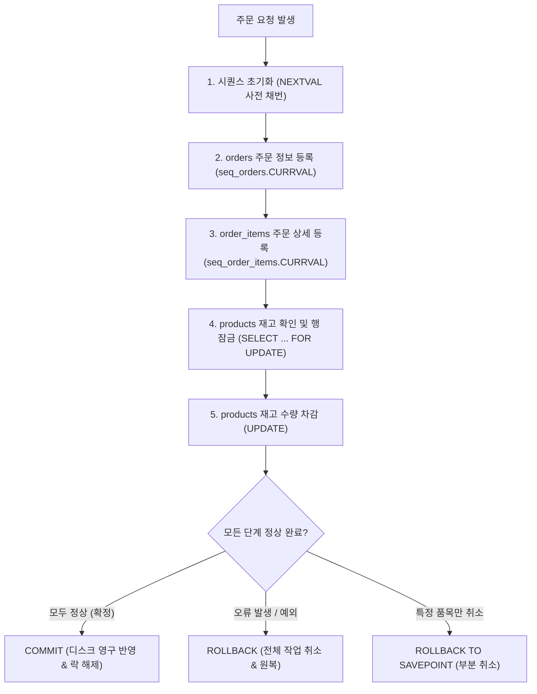

# [실습 예제] KOREA_MALL 주문 처리 트랜잭션 및 재고 차감 실습 (TCL · 시퀀스 연동)

본 실습 문서는 [10_01_advanced_objects_guide.md](./10_01_advanced_objects_guide.md)에서 학습한 **시퀀스**(Sequence)와 **트랜잭션 제어어**(TCL: `COMMIT`, `ROLLBACK`, `SAVEPOINT`)를 결합하여, 실제 전자상거래 시스템 **KOREA_MALL**의 핵심 비즈니스 로직인 **주문 처리 트랜잭션**(재고 차감 및 동시성 제어 포함)을 단계별로 실습하는 심화 실습 가이드입니다.

---

## 📌 실습 개요 및 배경

온라인 쇼핑몰 시스템에서 고객이 상품을 구매할 때 데이터베이스 내부에서는 단순 단일 행 작업이 아니라 여러 테이블에 걸친 일련의 데이터 변경이 순차적으로 발생합니다.

주문이 발생하면 시스템은 다음과 같은 작업들을 순차적으로 수행합니다:
1. `orders` 테이블에 주문 정보 등록
2. `order_items` 테이블에 주문 상품 상세 정보 등록
3. `products` 테이블의 재고 수량(`stock_quantity`) 차감

이 세 작업은 **반드시 하나의 트랜잭션**(All or Nothing)으로 처리되어야 하며, 중간에 하나라도 실패하면 전체 작업이 취소되어야 합니다.

### 📦 KOREA_MALL 주문 처리 4대 핵심 시나리오

본 실습은 실제 쇼핑몰에서 상품을 주문할 때 데이터베이스에서 일어나는 **4가지 대표적인 업무 상황**을 단계별로 직접 구현합니다:

| 실습 구분 | 현실 쇼핑몰 비즈니스 상황 | 핵심 데이터베이스 동작 및 TCL |
| :---: | :--- | :--- |
| **실습 예제 1** | **정상 결제 완료**: 고객이 장바구니 상품을 정상 구매하여 결제가 확정됨 | 주문서 등록 + 재고 차감 후 영구 반영 (`COMMIT`) |
| **실습 예제 2** | **결제 중 오류로 전체 취소**: 2개 상품 중 1개가 시스템 오류로 실패함 | 주문서 전체를 폐기하고 원상 복구 (`ROLLBACK`) |
| **실습 예제 3** | **품절 상품 제외 부분 결제**: 문제 품목만 빼고 정상 품목만 살려서 주문 | 책갈피 지정 후 해당 시점만 부분 취소 (`SAVEPOINT` · `ROLLBACK TO`) |
| **실습 예제 4** | **한정판 상품 동시 주문 줄서기**: 2명의 고객이 마지막 1개 상품을 동시 결제 시도 | 먼저 잡은 쪽에 자물쇠 설정 (`행 락`) 및 뒤이어 온 쪽의 대기 (`Lock Wait`) |



---

## 🛠️ 실습 환경 확인

모든 실습은 관리자(`SYSTEM`) 계정이 아닌 **실습용 일반 사용자**(`KOREA_MALL`) 세션의 SQL 편집기에서 진행합니다.

```sql
-- 1. 현재 접속 계정 확인 (결과: KOREA_MALL)
SELECT USER FROM DUAL;

-- 2. DBeaver 트랜잭션 모드 확인
-- ⚠️ 반드시 '수동 커밋(Manual Commit)' 모드인지 확인하세요.
-- 자동 커밋(Auto-Commit) 모드인 경우 쿼리 실행 즉시 자동 COMMIT되어 ROLLBACK 테스트를 진행할 수 없습니다.
```

---

## 1. 사전 준비: 시퀀스 동기화 및 재설정

실습을 원활하게 진행하기 위해 먼저 기존 테이블의 최대 번호를 확인한 뒤, 그다음 번호부터 시작하는 시퀀스를 다시 생성합니다.

* 기존 `orders` 테이블에서 가장 큰 `order_id` 값을 확인합니다. 그다음 값부터 새로운 주문 번호가 생성되도록 `seq_orders` 시퀀스를 다시 생성합니다.
* 기존 `order_items` 테이블에서 가장 큰 `order_item_id` 값을 확인합니다. 그다음 값부터 새로운 주문 상세 번호가 생성되도록 `seq_order_items` 시퀀스를 다시 생성합니다.

### 1.1 주문 번호 시퀀스(`seq_orders`) 재설정

```sql
-- 1) 현재 orders 테이블의 최대 주문번호 확인
SELECT NVL(MAX(order_id), 0) + 1 AS next_order_id
FROM orders;

-- 위 결과가 예를 들어 21이라면,
-- 아래 CREATE SEQUENCE 문에서 START WITH 21로 지정하면 됩니다.

-- 2) 기존 시퀀스 삭제
DROP SEQUENCE seq_orders;

-- 3) 새 시퀀스 생성 (다음 주문번호부터 시작)
CREATE SEQUENCE seq_orders
  START WITH 21    -- 위에서 조회한 next_order_id 값으로 변경
  INCREMENT BY 1
  NOCACHE;         -- 실습 환경에서는 NOCACHE가 직관적
```

### 1.2 주문 상세 번호 시퀀스(`seq_order_items`) 재설정

```sql
-- 4) 현재 order_items 테이블의 최대 주문상세번호(order_item_id) 확인
SELECT NVL(MAX(order_item_id), 0) + 1 AS next_order_item_id
FROM order_items;

-- 위 결과가 예를 들어 40이라면,
-- 아래 CREATE SEQUENCE 문에서 START WITH 40으로 지정하면 됩니다.

-- 5) 기존 시퀀스 삭제
DROP SEQUENCE seq_order_items;

-- 6) 새 시퀀스 생성 (다음 주문번호부터 시작)
CREATE SEQUENCE seq_order_items
  START WITH 40    -- 위에서 조회한 next_order_item_id 값으로 변경
  INCREMENT BY 1
  NOCACHE;         -- 실습 환경에서는 NOCACHE가 직관적
```

> 🎯 **핵심 배움 포인트** (`START WITH`와 `NOCACHE`):
> - `NVL(MAX(...), 0) + 1`을 통해 기존 데이터의 최대 식별자 값보다 큰 시작값을 설정하여 기본키 충돌(`ORA-00001`)을 방지합니다.
> - 실습 환경에서는 `NOCACHE` 옵션을 적용하여 시퀀스 번호가 건너뜀(Gap) 없이 순차적으로 증가하는 과정을 직관적으로 확인할 수 있습니다.

---

## 2. # 실습 예제 1 : 정상 주문 → COMMIT (재고 차감 포함)

> 📦 **현실 쇼핑몰 시나리오**  
> 고객(남주혁, 8번)이 장바구니에 담긴 책 '지구 끝의 온실'(3번 상품) 2권을 신용카드로 깔끔하게 결제했습니다.  
> 시스템은 **새 주문 번호를 발급받아 주문서를 작성하고, 주문 상세 내역을 등록하며, 창고 재고를 2개 차감**한 뒤 모든 과정이 정상이므로 영구 확정(`COMMIT`) 도장을 찍습니다.

> 💡 **실습 데이터 안내**:
> 본 실습은 `KOREA_MALL` 기본 데이터셋(`customer_id = 8`, `product_id = 3` 존재 가정)을 기준으로 진행합니다. 본인 환경에 맞는 ID로 바꿔 실행해도 됩니다.

### ① 시퀀스 초기화

세션이 새로 열렸거나 데이터베이스에 다시 접속한 경우, 해당 세션에서는 아직 시퀀스의 현재 값이 정의되지 않았을 수 있습니다.

`CURRVAL`은 같은 세션에서 `NEXTVAL`을 한 번 이상 호출한 뒤에만 사용할 수 있습니다. 따라서 먼저 `NEXTVAL`을 호출하여 이번 주문에 사용할 주문 번호와 주문 상세 번호를 생성합니다.

```sql
-- 세션이 새로 열렸거나 재접속한 경우
-- 시퀀스에서 NEXTVAL을 한 번도 호출하지 않았다면
-- CURRVAL은 "정의되지 않음" 상태가 되어 ORA-08002 오류가 발생합니다.
-- 이를 방지하기 위해 NEXTVAL을 먼저 호출합니다.

SELECT seq_orders.NEXTVAL AS new_order_id FROM dual;
SELECT seq_order_items.NEXTVAL AS new_order_item_id FROM dual;
```

### ② 현재 시퀀스 값 확인

아래 두 쿼리를 실행한 뒤, 결과로 나온 값을 메모합니다.  
이 값은 이후 주문 등록과 검증 단계에서 사용됩니다.

```sql
-- [실습 예제 1-1] 아래 2개의 쿼리문을 실행하고, 각 시퀀스의 현재 값을 메모합니다.
SELECT seq_orders.CURRVAL AS new_order_id FROM dual;         -- 예: 21
SELECT seq_order_items.CURRVAL AS new_order_item_id FROM dual; -- 예: 40 (또는 환경에 따라 43 등)
```

### ③ 주문 정보 등록

이제 `orders` 테이블에 주문 정보를 입력합니다. 주문 번호는 앞에서 생성한 `seq_orders.CURRVAL` 값을 사용합니다.  
*(customer_id = 8인 고객이 주문을 완료했다고 가정합니다)*

```sql
-- [실습 예제 1-2] 주문 입력 (orders)
INSERT INTO orders (order_id, customer_id, order_date, status)
VALUES (seq_orders.CURRVAL, 8, SYSDATE, '결제완료');
-- 고객ID=8, 결제완료 가정
```

### ④ 주문 상세 등록

다음으로 `order_items` 테이블에 주문 상품 정보를 입력합니다.  
주문 상세 번호는 `seq_order_items.CURRVAL`을 사용하고, 주문 번호는 앞에서 입력한 주문과 연결하기 위해 `seq_orders.CURRVAL`을 사용합니다.

```sql
-- [실습 예제 1-3] 주문 상세 입력 (order_items)
INSERT INTO order_items (order_item_id, order_id, product_id, quantity, price_each)
VALUES (seq_order_items.CURRVAL, seq_orders.CURRVAL, 3, 2, 12900);
-- 상품ID=3, 수량=2권, 단가=12,900
```

### ⑤ 재고 확인 및 잠금 (동시성 제어)

재고를 차감하기 전에 해당 상품 행을 먼저 조회하고 잠급니다. 이때 `SELECT ... FOR UPDATE` 문을 사용합니다.

```sql
-- [실습 예제 1-4] 재고 잠금 & 현재 재고 확인 (동시성 제어)
SELECT stock_quantity
FROM products
WHERE product_id = 3
FOR UPDATE;
```

> 🎯 **핵심 배움 포인트** (`FOR UPDATE`와 비관적 락):
> - `FOR UPDATE`는 조회한 행에 배타적 락(Lock)을 설정합니다.
> - 따라서 다른 트랜잭션이 동시에 같은 상품의 재고를 차감하려고 변경 쿼리를 실행하더라도 락이 해제될 때까지 대기하게 되어, 재고 초과 판매(오버셀링)와 같은 동시성 충돌을 완벽하게 방지할 수 있습니다.

### ⑥ 재고 차감

주문 수량만큼 상품 재고를 차감합니다.

```sql
-- [실습 예제 1-5] 재고 차감
UPDATE products
SET stock_quantity = stock_quantity - 2
WHERE product_id = 3;
```

### ⑦ 트랜잭션 확정

주문 등록, 주문 상세 등록, 재고 차감이 모두 정상적으로 완료되었다면 `COMMIT`을 실행하여 변경 내용을 확정합니다.

```sql
-- [실습 예제 1-6] 모두 정상 -> 확정
COMMIT;
```

### ⑧ 검증 쿼리

모든 트랜잭션이 정상적으로 데이터베이스에 반영되었는지 확인합니다.  
*(※ 아래 쿼리의 21과 40은 예시 값입니다. 실제로는 [실습 예제 1-1]에서 메모한 new_order_id, new_order_item_id 값으로 변경하여 실행합니다)*

```sql
-- [실습 예제 1-7] 주문 및 상세 데이터 확인 (실습 예제 1-1에서 메모한 값으로 확인)
SELECT * FROM orders       WHERE order_id = 21;
SELECT * FROM order_items  WHERE order_item_id = 40;

-- 재고 확인 (기존 수량에서 2만큼 정확히 감소했는지 확인)
SELECT product_id, stock_quantity
FROM products
WHERE product_id = 3;
```

---

## 3. # 실습 예제 2 : 주문 상세 중 오류 발생 → 전체 ROLLBACK (주문, 주문 상세, 재고 차감 모두 취소)

> 📦 **현실 쇼핑몰 시나리오**  
> 고객(정해인, 4번)이 상품 2개를 동시에 구매하려고 장바구니 결제 버튼을 눌렀습니다.  
> 첫 번째 상품(3번)은 주문서에 정상 등록되었으나, 두 번째 상품을 등록하려니 **전산에 등록되지 않은 가짜 상품 999번이어서 시스템 에러가 발생**했습니다.  
> 첫 번째 상품만 애매하게 결제되면 전산 사고가 나므로, 데이터베이스는 **방금 작성하던 주문서 전체를 폐기하고 모든 작업을 없던 일로 되돌립니다**(`ROLLBACK`).

이번 실습에서는 주문 상세 입력 과정에서 오류가 발생하여 전체 트랜잭션이 취소되는 상황을 확인합니다.

### ① 현재 테이블 최대 번호 확인 및 시퀀스 점검

실습 예제 1이 정상적으로 완료되었다면 `orders` 테이블에는 21번, `order_items` 테이블에는 40번까지 데이터가 저장되어 있습니다.  
새로운 주문을 시작하기 전, 현재 테이블의 최대 번호를 확인하여 다음 발급될 번호를 점검합니다.

```sql
-- [실습 예제 2-1] 현재 테이블의 최대 번호 확인 (다음 주문 번호 확인)
SELECT NVL(MAX(order_id), 0) + 1 AS next_order_id FROM orders;              -- 예상: 22
SELECT NVL(MAX(order_item_id), 0) + 1 AS next_order_item_id FROM order_items; -- 예상: 41

-- ※ 만약 실습 예제 1을 건너뛰었거나 시퀀스 번호가 어긋난 경우, 아래 명령으로 동기화합니다:
-- ALTER SEQUENCE seq_orders RESTART START WITH 22;
-- ALTER SEQUENCE seq_order_items RESTART START WITH 41;
```

### ② 새 주문 시작 (주문 번호 자동 채번)

이제 `orders` 테이블에 새로운 주문 정보를 입력합니다.  
`seq_orders.NEXTVAL`을 호출하여 신규 주문 번호(22번)를 자동으로 발급받으며, DML 문이 실행되는 순간 트랜잭션이 자동 시작됩니다.  
*(customer_id = 4인 고객이 주문을 완료했다고 가정합니다)*

```sql
-- [실습 예제 2-2] 새 주문 시작 (NEXTVAL로 신규 22번 주문번호 발급 및 트랜잭션 시작)
INSERT INTO orders (order_id, customer_id, order_date, status)
VALUES (seq_orders.NEXTVAL, 4, SYSDATE, '결제완료');
```

### ③ 정상 주문 상세 입력

첫 번째 주문 상품은 정상적으로 입력합니다.  
주문 상세 번호는 `seq_order_items.NEXTVAL`(41번)을 새로 채번하고, 주문 번호는 앞서 생성한 주문과 연결하기 위해 `seq_orders.CURRVAL`(22번)을 참조합니다.

```sql
-- [실습 예제 2-3] 첫 번째 주문 상품 상세 등록 (정상 입력)
INSERT INTO order_items (order_item_id, order_id, product_id, quantity, price_each)
VALUES (seq_order_items.NEXTVAL, seq_orders.CURRVAL, 3, 1, 12900);
```

### ④ 오류 발생 주문 상세 입력 및 전체 트랜잭션 취소

이번에는 존재하지 않는 상품 ID(`product_id = 999`)를 사용하여 두 번째 주문 상세 입력을 시도합니다.  
외래키 제약조건 위반 오류가 발생하면 지금까지 수행한 주문 기본 정보 입력과 첫 번째 상세 입력을 모두 취소(`ROLLBACK`)합니다.

```sql
-- [실습 예제 2-4] 두 번째 상품 상세 등록 시도 (FK 제약조건 오류 유발)
INSERT INTO order_items (order_item_id, order_id, product_id, quantity, price_each)
VALUES (seq_order_items.NEXTVAL, seq_orders.CURRVAL, 999, 1, 14000);
-- ORA-02291: integrity constraint (KOREA_MALL.FK_ORDER_ITEMS_PRODUCT) violated - parent key not found

-- ※ 오류가 발생했으므로 트랜잭션 전체 취소(ROLLBACK) 수행
ROLLBACK;   -- 주문 마스터(22번) 및 정상 입력되었던 상세(41번) 모두 취소
```

### ⑤ 롤백 결과 확인

마지막으로 앞에서 입력을 시도했던 22번 주문과 41번 상세 정보가 실제로 롤백(취소)되어 데이터베이스에 전혀 남아있지 않은지 확인합니다.

```sql
-- [실습 예제 2-5] 롤백된 데이터 검증 (모두 0건이 조회되어야 정상)
SELECT * FROM orders WHERE order_id = 22;
SELECT * FROM order_items WHERE order_item_id = 41;
```

> 🎯 **핵심 배움 포인트** (외래키 무결성 오류와 시퀀스 롤백):
> - 부모 테이블(`products`)에 존재하지 않는 `product_id = 999`를 참조하려 할 때 외래키 제약조건(`FK_ORDER_ITEMS_PRODUCT`) 위반(`ORA-02291`)이 발생합니다.
> - `ROLLBACK`을 실행하면 이전에 정상 삽입되었던 `orders` 마스터 레코드(22번)와 첫 번째 `order_items` 행(41번)이 모두 원자적으로 취소되어 데이터 무결성이 지켜집니다.
> - **단, 시퀀스로 이미 발급된 번호는 롤백되지 않습니다.** 트랜잭션 취소 여부와 무관하게 시퀀스는 증가 상태를 유지하므로 번호 결번(Gap)이 발생하는 것은 오라클의 정상 동작입니다.

---

## 4. # 실습 예제 3 : `SAVEPOINT`를 활용한 부분 취소 (선택적 롤백)

> 📦 **현실 쇼핑몰 시나리오**  
> 고객(남주혁, 8번)이 장바구니에서 정상 상품(3번)과 대량 상품(4번, 9,999권)을 묶어 일괄 주문합니다.  
> 대량 상품 처리 중 품절이나 수량 초과가 발생했을 때 전체 주문을 다 취소하지 않고, **"정상 상품 3번까지만 살려서 결제해 주세요!"**라고 처리할 수 있도록 첫 번째 상품 처리 직후에 **임시 책갈피**(`SAVEPOINT`)를 꽂아두고 문제 품목만 쏙 빼서 부분 취소(`ROLLBACK TO`)하는 고급 주문 패턴입니다.

장바구니에서 여러 상품을 일괄 주문할 때, 1번 상품은 정상 처리되었으나 2번 상품 처리 중 품절이나 수량 초과가 발생한 경우 **문제 상품만 선택적으로 취소**하고 정상 상품 주문만 확정하는 고급 트랜잭션 패턴입니다.

### 4.1 세이브포인트 실습 쿼리

```sql
-- 1. 신규 주문 번호 발급
SELECT seq_orders.NEXTVAL AS new_order_id FROM dual;

-- 2. 주문 기본 정보 등록
INSERT INTO orders (order_id, customer_id, order_date, status)
VALUES (seq_orders.CURRVAL, 8, SYSDATE, '결제완료');

-- 3. 첫 번째 상품(3번 상품, 1권) 등록 및 재고 차감
SELECT seq_order_items.NEXTVAL FROM dual;

INSERT INTO order_items (order_item_id, order_id, product_id, quantity, price_each)
VALUES (seq_order_items.CURRVAL, seq_orders.CURRVAL, 3, 1, 12900);

UPDATE products
SET stock_quantity = stock_quantity - 1
WHERE product_id = 3;

-- ====================================================================
-- 4. 저장점(SAVEPOINT) 지정: 3번 상품 처리 완료 시점을 북마크
-- ====================================================================
SAVEPOINT sp_item1;

-- 5. 두 번째 상품(4번 상품, 9999권) 비정상 대량 주문 시도
SELECT seq_order_items.NEXTVAL FROM dual;

INSERT INTO order_items (order_item_id, order_id, product_id, quantity, price_each)
VALUES (seq_order_items.CURRVAL, seq_orders.CURRVAL, 4, 9999, 15700);

-- 재고 부족 오류를 감지했다고 가정한 후, 저장점(sp_item1)으로 부분 취소
ROLLBACK TO sp_item1;

-- 6. 검증: 3번 상품 주문과 주문 마스터는 살아있는지 확인
SELECT * FROM order_items WHERE order_id = seq_orders.CURRVAL;

-- 7. 정상 품목(3번 상품)만 포함하여 최종 영구 반영
COMMIT;
```

---

## 5. # 실습 예제 4 : 동시성 제어 및 락(Lock) 대기 실습 (Session A / Session B)

> 📦 **현실 쇼핑몰 시나리오**  
> 재고가 딱 1개 남은 인기 한정판 상품을 **고객 A(Session A)와 고객 B(Session B)가 0.1초 차이로 거의 동시에 결제**하려고 합니다.  
> 0.1초 먼저 도착한 고객 A가 재고를 깎기 시작하면서 해당 상품에 **자물쇠(행 락)**를 걸어 잠급니다. 뒤이어 도착한 고객 B는 **자물쇠가 풀릴 때까지 화면에 모래시계가 돌며 멈춰 서서 대기**(`Lock Wait`)하게 되며, 고객 A가 결제를 끝마치거나 취소해야만 비로소 작업이 진행됩니다.

병행 제어와 락(Lock)의 개념을 바탕으로, 두 개의 데이터베이스 세션(Session A / Session B)을 동시에 실행하여 실제로 행 락(Row-level Lock)과 락 대기(Lock Wait)가 어떻게 동작하는지 직접 확인해 봅니다.

### 📌 실습을 통해 확인하는 핵심 내용
- 한 트랜잭션이 데이터를 수정하면 해당 행에 **행 락**(Row Lock)이 설정됨
- 다른 트랜잭션이 동일한 데이터를 수정하려 하면 **대기 상태**(Lock Wait)가 발생함
- `COMMIT` 또는 `ROLLBACK`이 수행되면 락이 해제되어 대기 중이던 쿼리가 즉시 진행됨

### 🛠️ 실습 준비: 두 개의 독립 SQL 실행 창 설정

이 실습은 2개의 서로 다른 데이터베이스 세션 창이 필요합니다:
- **실행 창 1** → `Session A`
- **실행 창 2** → `Session B`

두 세션은 동일한 `KOREA_MALL` 데이터베이스에 접속되어 있어야 하지만, 서로 다른 독립 실행 세션이어야 합니다. 또한 락의 동작을 명확히 확인하기 위해 **두 세션 모두 Auto Commit을 OFF**(수동 커밋 모드)로 설정한 상태에서 진행합니다.

> 💡 **DBeaver 팁**(독립 세션 창 열기):
> - DBeaver에서는 상단 메뉴의 <b>[SQL 편집기] → [새 SQL 편집기]</b>를 눌러 창을 2개 엽니다.
> - 두 편집기 창의 트랜잭션 모드가 모두 '**Manual Commit**(수동 커밋)' 상태인지 하단/상단 툴바의 아이콘(주황색 구슬 또는 Auto-commit 해제 버튼)을 통해 확인합니다.

---

### ① Session A : 데이터 수정으로 락 발생

먼저 **Session A** 창에서 다음 SQL 문을 실행합니다.

```sql
UPDATE products
SET stock_quantity = stock_quantity - 1
WHERE product_id = 3;
```

이 SQL 문이 실행되면 데이터베이스 내부에서는 다음과 같은 상태가 됩니다:
- `product_id = 3` 행에 배타적 **행 락**(Row-level Lock)이 설정됩니다.
- 아직 `COMMIT`을 수행하지 않았기 때문에 락이 계속 유지됩니다.
- ⚠️ **주의**: 이 상태에서는 아직 트랜잭션이 종료되지 않았으므로 `COMMIT`을 실행하지 않고 그대로 둡니다.

---

### ② Session B : 동일 데이터 수정 시도

이제 **Session B** 창으로 이동하여, 같은 상품(`product_id = 3`)의 재고를 수정하는 SQL 문을 실행합니다.

```sql
UPDATE products
SET stock_quantity = stock_quantity - 2
WHERE product_id = 3;
```

이 SQL 문을 실행하면 **쿼리가 즉시 끝나지 않고 모래시계/로딩 아이콘과 함께 대기 상태**(Lock Wait)에 들어갑니다.

그 이유는 다음과 같습니다:
- **Session A**가 이미 `product_id = 3` 행에 락을 선점했기 때문입니다.
- **Session B**는 해당 락이 해제될 때까지 Lock Wait 상태로 멈춰 서서 대기합니다.
- 즉, **Session B**는 **Session A**의 트랜잭션이 종료(`COMMIT` 또는 `ROLLBACK`)되기를 기다리는 상태가 됩니다.

---

### ③ Session A : 트랜잭션 종료

이제 다시 **Session A** 창으로 돌아와 다음 명령을 실행합니다.

```sql
COMMIT;
```

`COMMIT`이 수행되면 데이터베이스 엔진에서 다음과 같은 일이 연속으로 일어납니다:
1. **Session A**의 트랜잭션이 정상 종료됩니다.
2. `product_id = 3` 행에 걸려 있던 **행 락이 즉시 해제**됩니다.
3. 락이 풀리는 순간, 대기 중이던 **Session B**의 `UPDATE` 문이 즉시 잠금에서 깨어나 정상 실행 완료(1 row updated)됩니다!

> 즉, **Session B**는 **Session A**가 트랜잭션을 완전히 종료한 뒤에야 비로소 동일한 행을 수정할 수 있습니다.

Session B의 작업도 완료되었으므로, **Session B** 창에서도 트랜잭션을 영구 반영하기 위해 `COMMIT`을 실행합니다.

```sql
-- Session B 창에서 실행하여 트랜잭션 종료
COMMIT;
```

---

### ④ 실습 결과 확인

두 세션의 트랜잭션이 모두 종료된 후, 다음 SQL 문으로 최종 재고 수량을 확인합니다.

```sql
SELECT product_id, stock_quantity
FROM products
WHERE product_id = 3;
```

**조회 결과 분석**:
- Session A에서 1개 차감, Session B에서 2개 차감되어 **총 3개가 정확하게 누적 차감**된 것을 확인할 수 있습니다.
- 이 실습을 통해 한 트랜잭션이 특정 행을 수정하는 동안, 다른 트랜잭션은 같은 행을 동시에 수정할 수 없고 **락이 해제될 때까지 안전하게 대기**한다는 점을 직접 확인할 수 있습니다.

---

## 6. 실습 핵심 요약 및 점검 치트시트

| 단계 | 핵심 명령어 | 주요 역할 및 학습 포인트 |
| :--- | :--- | :--- |
| **시퀀스 동기화** | `NVL(MAX(컬럼), 0) + 1` → `CREATE SEQUENCE ... START WITH` | 기존 데이터와 시퀀스 시작값을 정렬하여 `ORA-00001` PK 충돌 방지 |
| **시퀀스 초기화** | `SELECT 시퀀스.NEXTVAL FROM dual;` | 세션 최초 접속 시 `CURRVAL` 호출 오류(`ORA-08002`) 사전 예방 |
| **부모-자식 연동** | `orders`와 `order_items`에 `seq_orders.CURRVAL` 바인딩 | 단일 세션 내에서 방금 발급된 주문 번호로 부모-자식 간 관계를 원자적으로 연결 |
| **동시성 제어** | `SELECT ... FOR UPDATE;` | 재고 차감 직전 대상 행에 배타적 락을 걸어 다른 세션의 동시 접근 및 오버셀링 차단 |
| **재고 차감** | `UPDATE products SET stock_quantity = stock_quantity - N;` | 실제 구매 수량만큼 실시간 재고 반영 |
| **트랜잭션 확정** | `COMMIT;` | 모든 작업 정상 완료 시 영구 저장 및 획득한 락 자동 해제 |
| **트랜잭션 취소** | `ROLLBACK;` | 예외 발생 시 모든 작업을 취소하고 시작 시점으로 완벽 복구 |
| **부분 롤백** | `SAVEPOINT 명칭;` → `ROLLBACK TO 명칭;` | 문제가 발생한 세부 단계만 선택적으로 되돌리는 실무 기법 |
| **락 대기 및 해제** | `UPDATE 행 락` → `Lock Wait` → `COMMIT` | 동일 행을 수정하려는 후행 세션은 선행 트랜잭션의 락 해제 시점까지 안전하게 대기 |

> [!CAUTION]
> **실무 트랜잭션 주의사항**:
> 1. 트랜잭션 수행 도중 `CREATE`, `ALTER`, `DROP`, `TRUNCATE` 등 **DDL 문장을 실행하면 오라클 엔진이 자동으로 암시적** `COMMIT`을 실행합니다. 트랜잭션 진행 중에는 DDL을 절대 실행하지 마세요.
> 2. `SELECT ... FOR UPDATE` 또는 `UPDATE`에 의해 획득된 행 잠금(Row Lock)은 `COMMIT` 또는 `ROLLBACK`이 호출될 때까지 유지됩니다. 트랜잭션을 끝내지 않고 방치하면 시스템 전체의 병목 현상이 발생하므로 작업을 마친 후 신속하게 확정 또는 취소하세요.
